# 吴恩达《治理AI智能体｜Governing AI Agents》中英字幕 - P5：5.lab-1-building-the-governance-foundation.zh_en - GPT中英字幕课程资源 - BV1GXyhBWE6h

Now it's time to put your governance foundation into action In this lesson。

 you'll work with an HR dataset containing information about employees。

 you'll create views from the tables， create your service principal identity and with those permissions。

 you can access your views and finally create your agent tools and register them in Unity catalog All right。

 let's start coding Before we get started on the lab1 notebook you're gonna to see this welcome to Databricks we are in the Databricks free edition and you can sign up for your own free Databricks account the link for that is in the Read note along with the link to the Github repo you can fork the Github repo and then put that code directly in to your Databricks free account I'm going to copy over my link to the data for this agents governance lab you should see a file data lab1 labb3 agent high and a Readme file Now if I go to Databricks I'm going go to the upper righthand side here I'll see my email that I signed up with so amberag。

1，23 at gmail。com and then I'm going to go into my settings so you are an admin for this account so you will see the workspace admin settings and then you as a user have your user settings as well I'm going to go into the developer tab this is where you can also switch things like dark mode and if I want to link my GitHub I can link accounts so add my Git credential。

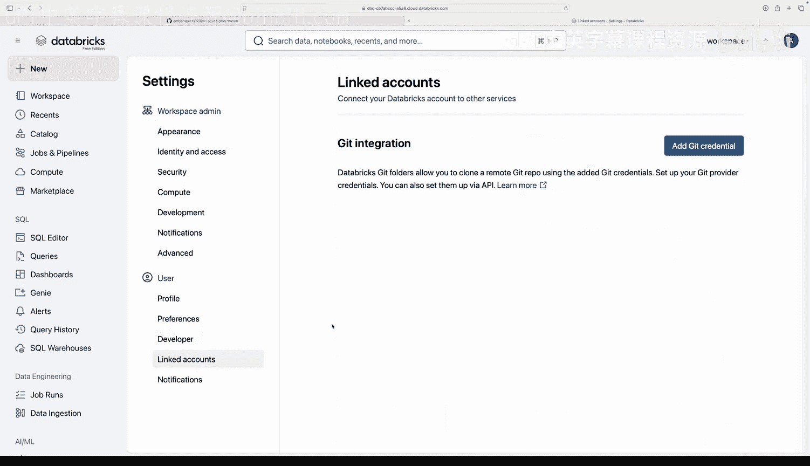

So I have my Github， GiHub name， I can name it， whatever I like。

 I could just say this is Amber agents， link the Github。

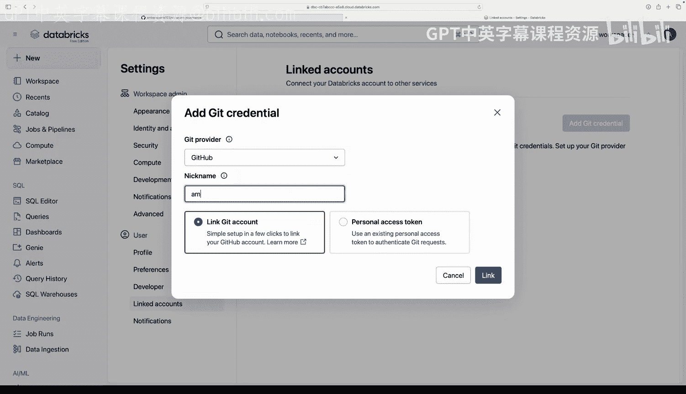

Authorize Databricks。Right now we have successfully linked our GitHub Now if I go into my workspace。

 this is where all your notebook capabilities are。And I can create a Git folder。

 so if you've downloaded the notebooks directly， you can create new notebooks or you can create the same folder。

 but we're just going to have that directly from GitHub。

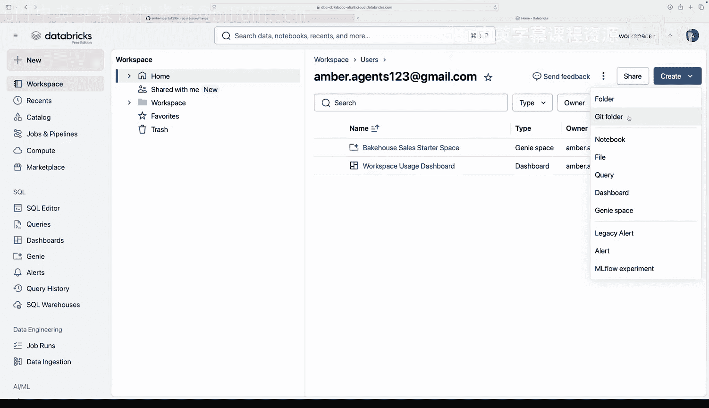

So the link I copied， I'm just going to paste that there and it already pools the get folder information and the provider。

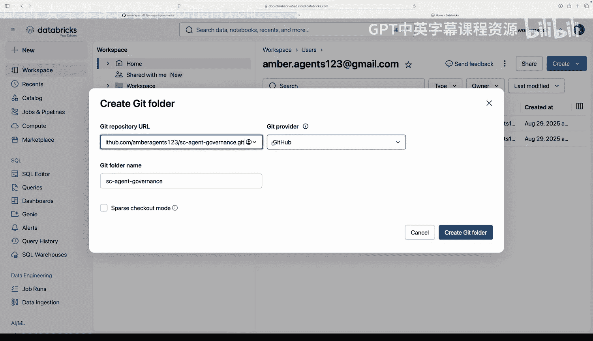

Perfect， so now we see all the data that we just had in our Gitthub repo Now。

 before we get started walking through lab1， which this is our lab 1 governance。

 we're going to create the HR analyst service principle and create the group devs and then add our HR analyst as a member to that。

 So again， I'm going to go back into my admin view， I'm going to look at identity and access。

 which is already the default when I click on my workspace account。

'm going to go to the service principles， add service principle。

 add a new service principle and type HR。

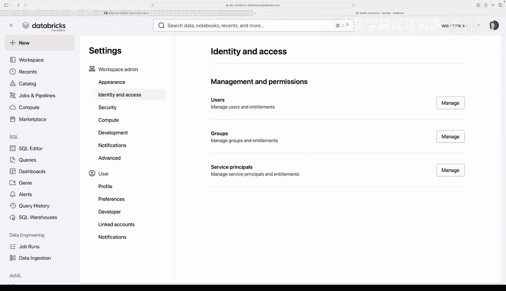

Data analysts add that service principle。

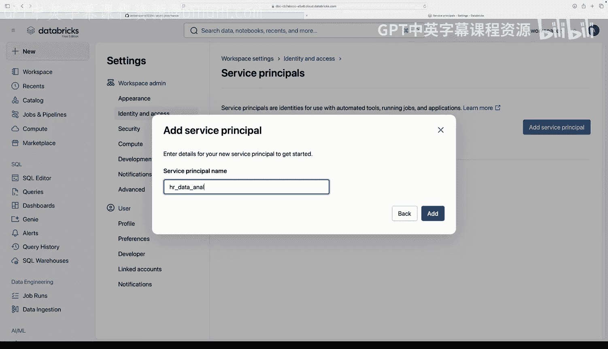

And within the service principle you should see you have entitlement， so Data W SQL access。

 workspace access and you can add in additional permissions here you're seeing a warning about permission control as who can manage or use the service principle service principle manage or does not automatically grant the ability to use the service principle for users or groups that need to use that service principle you want to make sure that they have explicit permissions so we're going to grant access we are going to type in HR data analyst and we are going to give it the ability to manage and use。

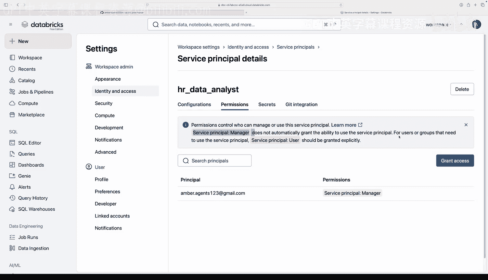

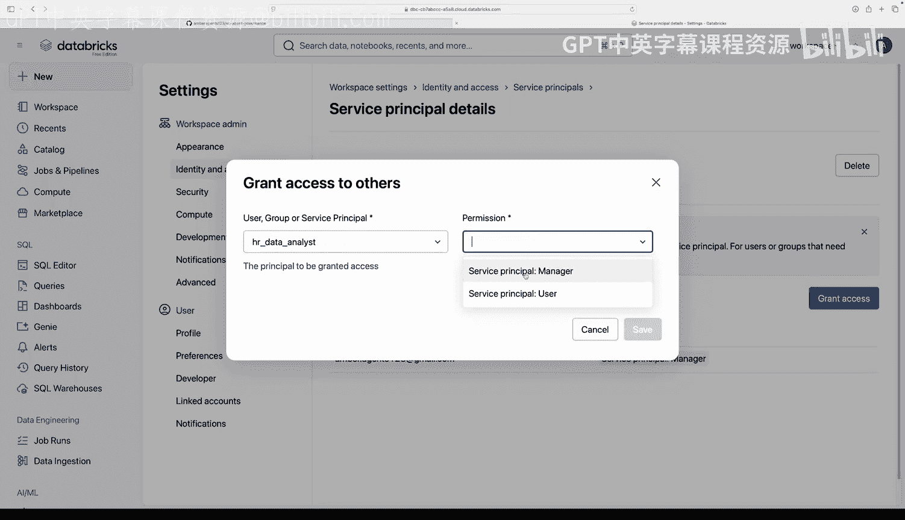

And then you can also， since this is me， I can be able to do whatever I want and use the service principle。

 Im going to add the ability to use as well。

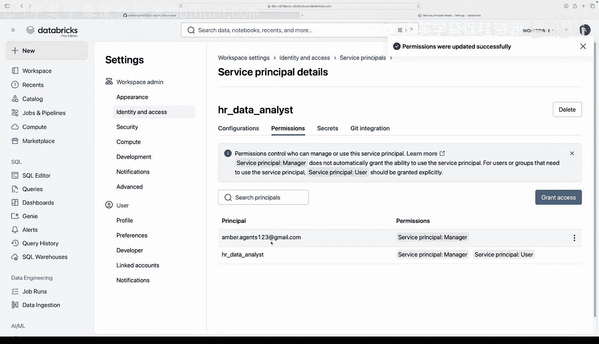

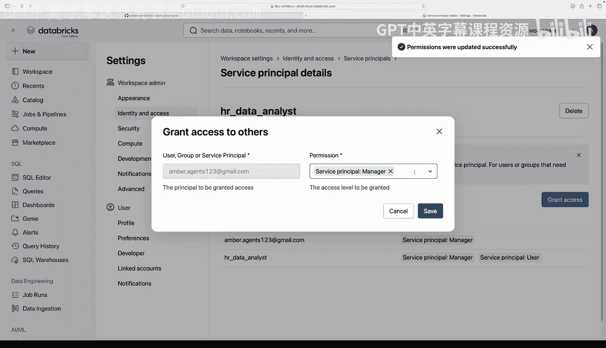

So these are all the permissions set for you to be able to build an agent and eventually deploy it on behalf of a service principal。

All right， back to identity and access。 so now we manage and created the service principle。

 we're going to create the group。 so let's say we had a group for all developers。

 We'll just name that devs。

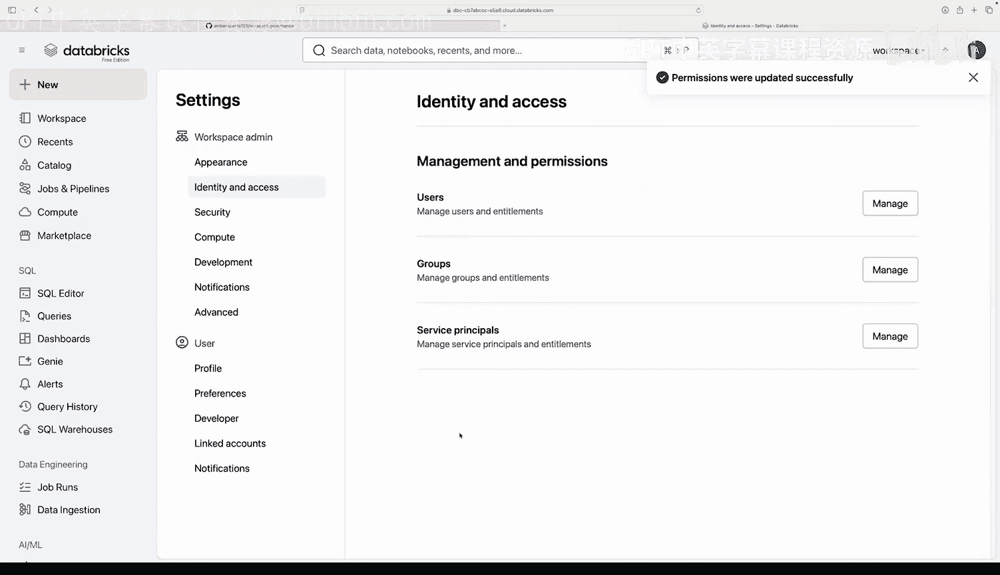

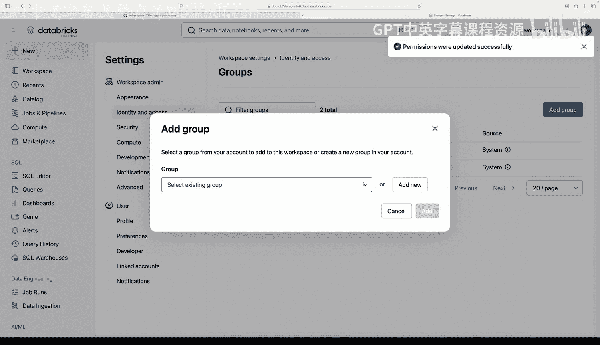

Alright， and you can add as many members as you'd want to devs and they would inherit permissions if you just create a group and you don't give it permissions。

 you don't have a parent group， it will just exist and have no default permissions。

 so I'm going to grant access to the service principle。

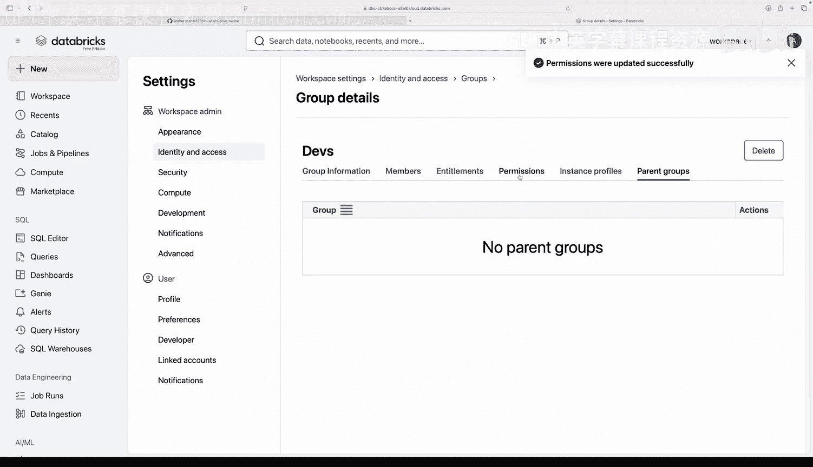

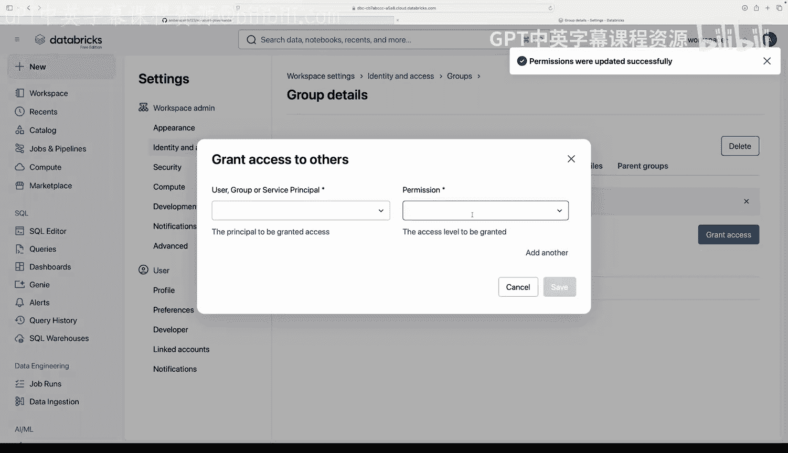

So it is now a part of this group。If I don't want to give it manage access。

 all I have to do is edit and delete those capabilities and it will revoke those permissions。

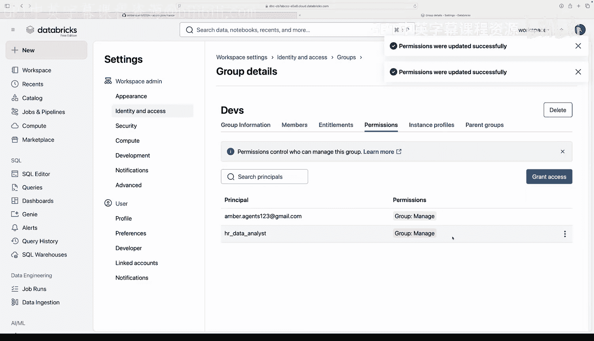

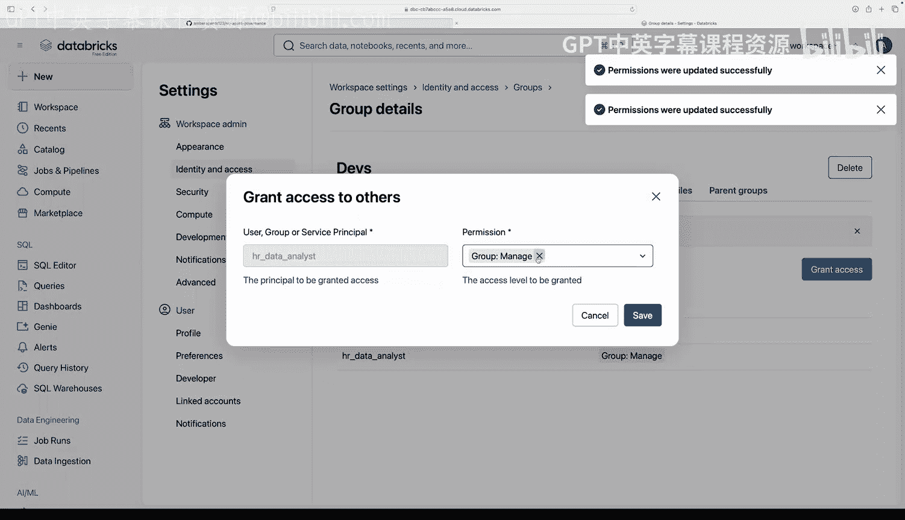

If I just want to give it member access， which all we really need to do to inherit the permissions of a group is give it member access。

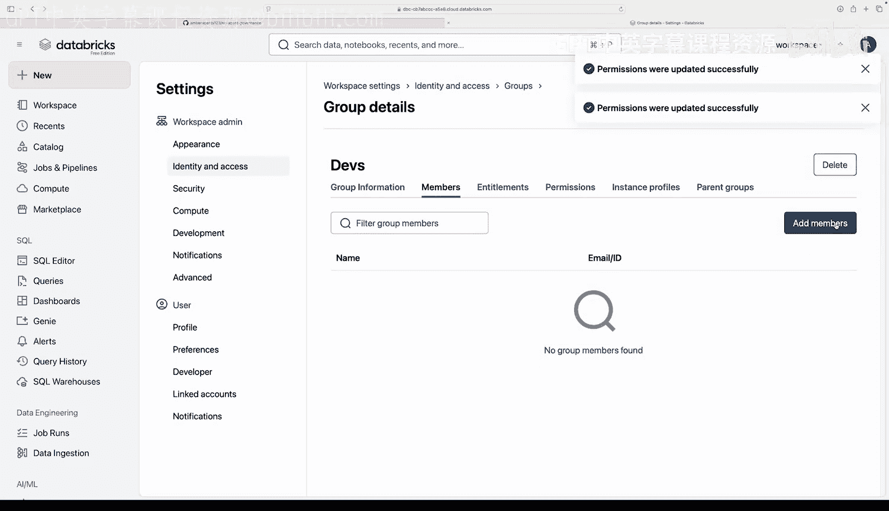

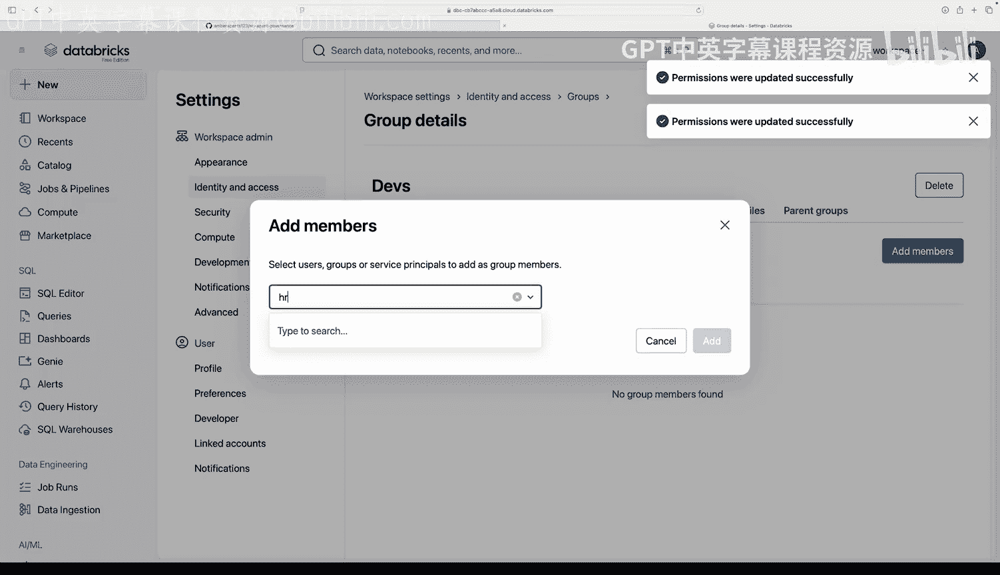

Alright， and so now HR data analyst is added to that group without the ability to change controls within that group perfect。

 and this will start making more sense as well once we implement governance and our notebook so now that we have the group devs which again this is all the developers that are working together to build agents and we don't want to have to add those individually to unity catalog and grant permissions one by one so luckily we're able to grant permissions to the group so everyone within that group including our service principle can inherit those permissions so going back to our workspace。

We see our Age governance folder， click into that folder， click into Lab1。

So starting back at the notebook Lab 1Building the Governance Foundation。

 we've now created the HR data Analys service principle。

 we've created the dev groups and have added HR data analyst just as a member。

 now we have to make sure we're connected to serverless Comp。All right， we're connected。

So the next step is creating the HR tables in Unity catalog and then applying data classifications。

 we're going to create an analyst view， we're going to give permissions to our dev group so they can access that view we're going to create mass and build functions which acts as a tool for our agent so let's break that down step by step so let's start with the initial setup and data verification。

So'm going to run this first cell， so this is going to set up our working environment so we are a company called clientient care and we have an HR Teams database。

 which is our schema HR data， so there's a variety of data stored from our HR team in this database and so our first step is creating a catalog and then we're going to create the schema。

So after we make the data frames for our data。I'm able to run the next file so as long as you have your data in the local directory under data。

 we're able to use all the CSV files， so this is your compensation data employee records HR cases。

 internal procedures we have our performance reviews。

 public policies and then we're going to load each CSV file one at a time so for the table and file name in the CSV files we're going to take each one of these files。

 we're going to read the CSVs and convert it to Sp data frame in this line so we have a pandas data frame here with the file path that is our data。

And then we're going to use Spar to create the data frame Spark just requires this to be the absolute file path and not the local file path so that's why we're using pandas and then we're going to write all those tables into our catalog into HR data and the tables will have these names so let's see if we've successfully created these tables tables successfully created All right。

 the next step is we're going to just review that these tables have actually been created。All right。

 they actually have been created and you're able to just go into your catalog。😊。

And see them directly so we see our catalog client care， we see our HR data。

 and then we see all the files within so this is your file structure。

 but I can also just view in the UI all the tables we've just created。Going back to our lab one。

Into our workspace， into our lab  one governance。All right。

 our next step is we' just want to display the data so we're just getting a good look on what the data is that we see because we know we have things like Social Security number。

 phone numbers， emails， we have employee names， we have salary， start date。

 so we can combine even a few of the tables from employee records and compensation data just to see all the data we've currently logged into unity catalog and the sensitive level of that data。

All right， so we can see our employee ID first name， last name， their department。

 the full Social Security numbers， phone numbers， email， hiring date。

 salaries Now if we're creating an HR data analyst they're going to need key information like base salary bonus stock options but we don't want them to be able to directly identify employees based on those numbers and we definitely don't want them to have full access to their emails。

 phone numbers and social Security numbers next up is applying data classification tags so we're going to define the classification tags for each table and whether or not they contain PII so for example our employee records are confidential and they do contain PII and before getting into more of this I just want to talk about how when we apply tags to our tables it essentially gives a sensitivity levels so table properties are metadata tags that help classify data sensitivity。

Without actually changing the data structure so you can have metadata key value pairs attached these tables they're used by governance tool to understand that data sensitivity but again it won't affect the table structure or the actual data so they can be queried programmatically for compliance and our data classification scheme as you can see we have public。

 restricted confidential I'm saying that public anyone can access internal our employees only confidential is limited access and then restricted is highly sensitive information so by adding classification tags like confidential restricted or public to unity catalog serves as adding essentially metadata because again and databricks tags are metadata that can make your data access more manageable。

 secure and compliant with both internal policies and external regulations so here is the actual step in adding the tags so classification and。

These are our table properties。 So this is in set and Spar SQL。 Add the classification。

 We can see all these were added。And if you want to see the tags themselves， again。

 going into your catalog into your HR data， and for example， we can look at employee records。

Just scroll down and you'll see confidential and contains PII If I go to recent。

 I also can just pull up the lab instead of going to my workspace and then the governance notebook and then the lab all right so just scrolling down here the next thing we have is about agent permissions and agent access requirements so now that we've classified our data。

 let's design the right level of access for HR analytics agent based on purposebut views for example。

 like what would I want my HR admin to see， what would I want a manager to see what would I want a data analyst to see kind of mapping this out as a way to show you know we don't want names or social Security numbers but we do want salary we need to know the department we want to know performance because we can look at analysis related to overall performance and operations。

So your agent should be able to answer questions like what is the salary distribution。

 is there pay equity， what's this correlation without answering what's John Smith's salary who are the highest paid employees Show me Social Security numbers All right。

 so our next step then is creating a classification aware view。

So we're going to create this data analyst view for statistical analysis Now why do we use views for access control Well they're very straightforward So instead of complex masking rules for every possible user these are purpose built views。

 Each view has a clear business purpose and user type they're easy to maintain the views are optimized in SQL。

 so no runtime overhead and they're an added security layer so in Databricks。

 views act as our security layer since we grant permissions directly to our service principles we have our data analyst view for analysis and so key features here we're going to anonymize the employee ID we have the department we're going to take the hiring date and just make it a year like it's easy to connect a specific hiring date to a user if you know when that user started we're going to have the fullbased salary So making sure that's not taken away we're going have our comp。

Year our review quarter and our review year still going have face salary bonus rating， stock options。

 and then we're going to combine the information for employee IDs so we're going to add compensation data and performance reviews together and we're going exclude the legal department we don't need the legal department in our analysis and we're told not to use it for compliance reasons Alright。

 so that view has been created Next， let's confirm the view in our schema so we are just making sure that this view is in client care in our HR data。

 And so we do see that a view is living in that schema。Al right， next up。

 we're going to test the view。 So our analyst view， we're going to check row counts。

 We're going to verify the departments。 All right， we have salaries。

 We have anonymized Is like we wanted。We don't see any legal here。

All right and we don't have any legal in the department All right。

 the next step is configuring group permissions now so we've already created the group devs。

 we've created the service principle and added it to the group devs so that service principle will inherit certain permissions now we just need to make sure that devs has the right permissions to access the data and be able to create agents。

So first verifying that we did create that group and we didn't skip that step。 All right。

 so we see our admins are devs and our users， so we did create that group。 All right。

 next up is granting devs the specific permissions that they need again to view the data and to register models and un catalog with MLflow now if you're granting broad permissions。

 you can just use one query on grant all permissions on client care in HR data but we want to make sure that we're granting minimum permissions and we're just giving specific access to the schema So first we're going to grant our catalog and schema we're going grant access to devs being able to use the catalog and schema these are container permissions so these are prerequisite so they have to be granted and then we have object permissions which are inherited so these once you grant access on。

The schema HR data being able to use any table， any model。

 any function automatically gets inherited If you want more information on that I recommend going back and relisting to listen to alright so just going through these real quick run this so grant use on catalog use on schema the ability to create a table on the schema so if you do have a logged model maybe you want to log all the inferences in a unity catalog table you're going be able to execute so running functions for example。

 when you're using your agent creating a model so we're going to want to create model and create model versions when we register our agent to unity catalog and then grant select on view so that they are able to use that view。

Next up， we're just going to make sure that this works so we're going to check schema level permissions。

 check view level permissions， so we're going to see all the grants on that schema and then we're going to see the table grants as well and so this should just show us for the view who has access to that view Allright schema level permissions devs can use the schema they can create models they can create tables。

 they create versions of the model they can execute and then the data analyst view devs have the ability to select on it Next up we have column masking so you might be wondering why do we need column masking when we've already implemented views well views can be bypassed if users gain direct table access column masking at the table level cannot be bypass because it's enforced by unit catalog on every query regardless of how the data is accessed so by using column masking or row masking nothing can get through。

So we're going to create the masking for Social security numbers。 We're gonna say you know what。

 no one actually needs the full security number unless you're in payroll so we're gonna to just make it a concatenated five digits which are just going be stars so completely anonymized you can't see the first five digits of the social security number and then have the true value as the last four digits but debs don't need to see anything so they're just going to get analytics mask whereas maybe elevated users like managers and admins would be able to see the last four digits All right so we're applying this function to the social Security number column again。

 you can apply these two rows as well。 these masks are functions the same way we're going to create functions that query the data and use them as tools for our agent So we're gonna to alter this table So our client care HR data employee records that has the column Social Security numbers we're going to set that mask now looking at validating the。

Column masking we're going to run the validation of the column masking testing it out so we see we're currently not using that view so it's still the initial employee ID but we see the social Security number has the first for digits mask and even though I'm an admin this is still what I see unless I go and remove the mask So next up we have building the secure tools for agent now you can call them tools you can call them functions you can call them skills essentially you're building a function for the agent to query the data that's the only way the agents going to have access to the data so the functions we make now are going to act as the interface between the agent and are governing data So why do we want to use UC functions for agent tools well they have governed access so the same way everything inherits permissions and access our functions also have permission set they're able to query templates。

 they perform an audit trail so all functions that are logged are logged for compliance。

And they're optimized for performance， so proper indexing and catching you can have a tool that essentially uses a vector database as well and our tool strategy is we're going to create two general purpose functions that we're exclusively with the anonymized data analyst view so when we do deploy the agent when we run it as a service principle it's going to use that view to see the data so it's still going to get anonymized employee IDs it's not going to get any information that's key for social security numbers。

 it's not going to see the legal department so we're going to have all that tied up and when the agent queries。

 anything it's not going to get any sensitive information out so our tool one is performance and retention analytics so here we're going to create or replace the function so you can run this notebook as much as you'd like it will just rewrite what has already been built so this is our function analyze performance we're going to get information about our departments our ratings。

Our employee numbers， so the average 10 year。And we can add in comments these go in directly into the function which the agent uses。

 so HR analytics， this is basic performance metrics by department。

 so we're looking here at average men and max ratings， employee count。

 average tenure by department and again it only works with anonymized data so here is our data analyst view that we're making sure it uses。

Next up we're using our tool number two， which is our department and compensation analytics so this is going to again create a replace the function analyze operations which it's going to take department employee count average salary。

 average bonus average total comp and stock options and the comment here is just that it is department compensation and operations metrics so going to select department count average salary bonuses base salary and again using that data analyst view to make sure it only works with anonymized data Now most data here is going to be available because we want to make sure things like salary bonuses stock we made sure all that was viewable by the data analysis view All right so we've created the data analysis operations function and this will return compensation metrics and headcount by department but no sensitive data will be exposed so let's actually test both。

Of these queries， and now we can see the performance analysis by department。

 so our department our average ratings again， you're not going to see legal。

 you're not going to see any identifiable information。Test 2， compensation， analytics by department。

 Again department， employee count， salary bonuses， and now we've accomplished the governance Foundation。

 So you've done data classification with tagging。 you've built a classification A aware view the data analysis view you' configured group permission so you've set up a group devs with permissions on your views and models。

 you've implemented Social Security masking and then you've built two secure tools for analyzing performance and operations。

 All right， now this concludes the building of the governance Foundation。

 Let's get started on the next lesson。

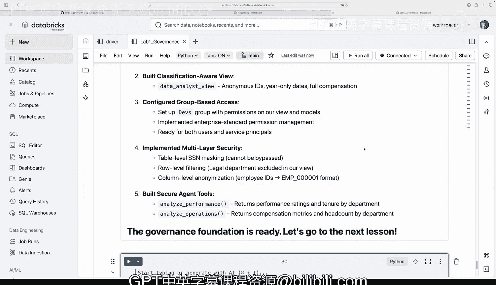