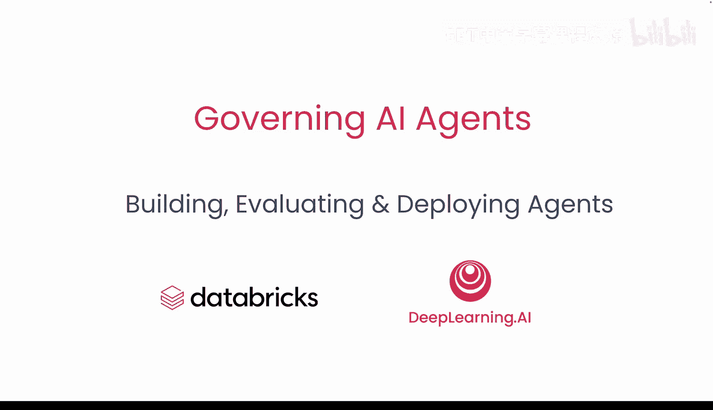
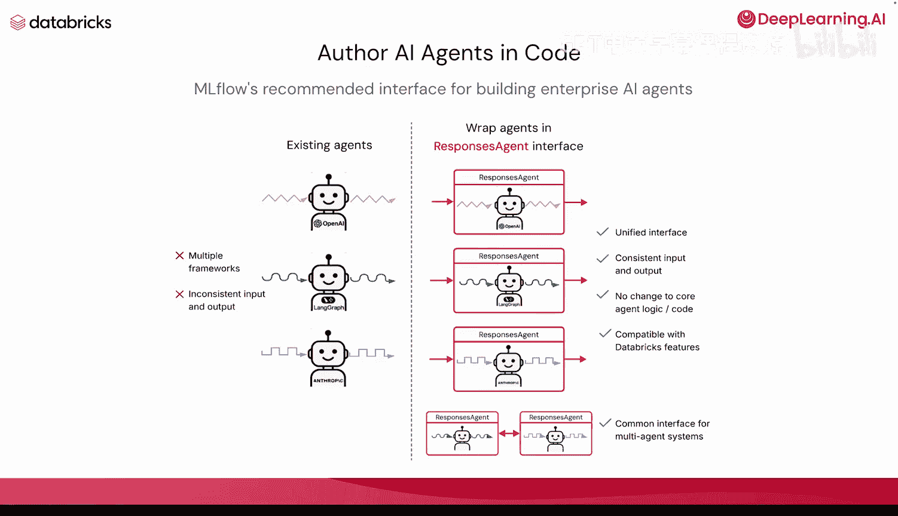
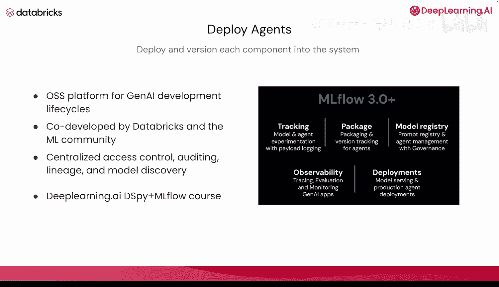
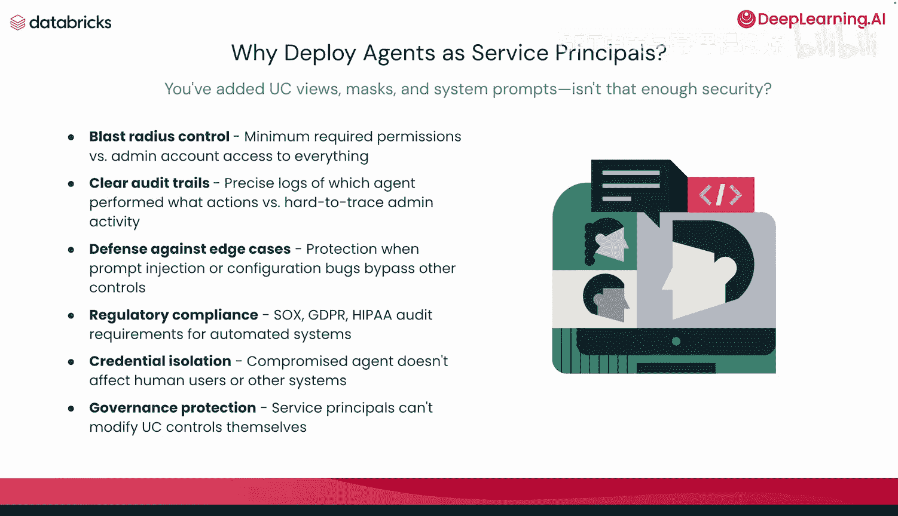
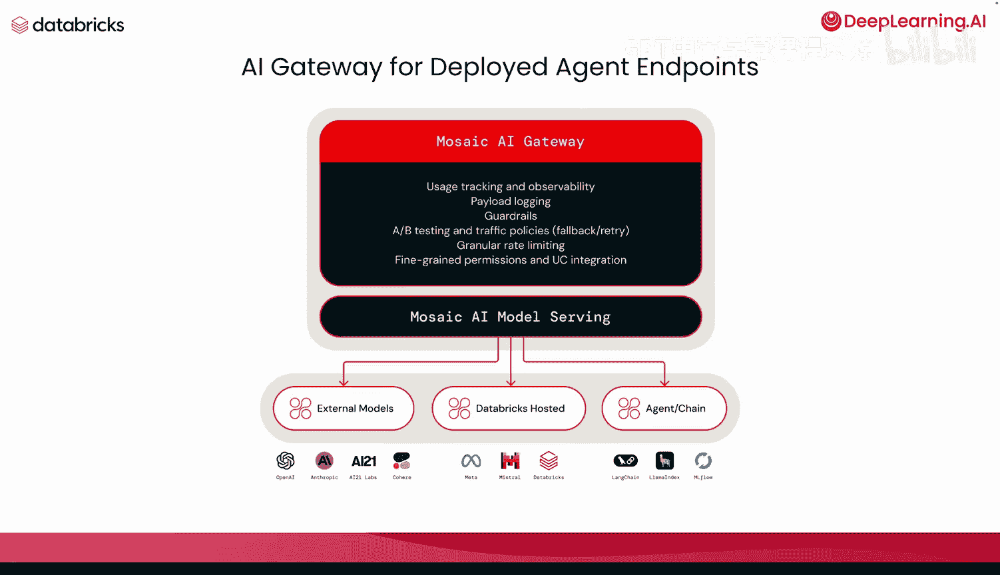
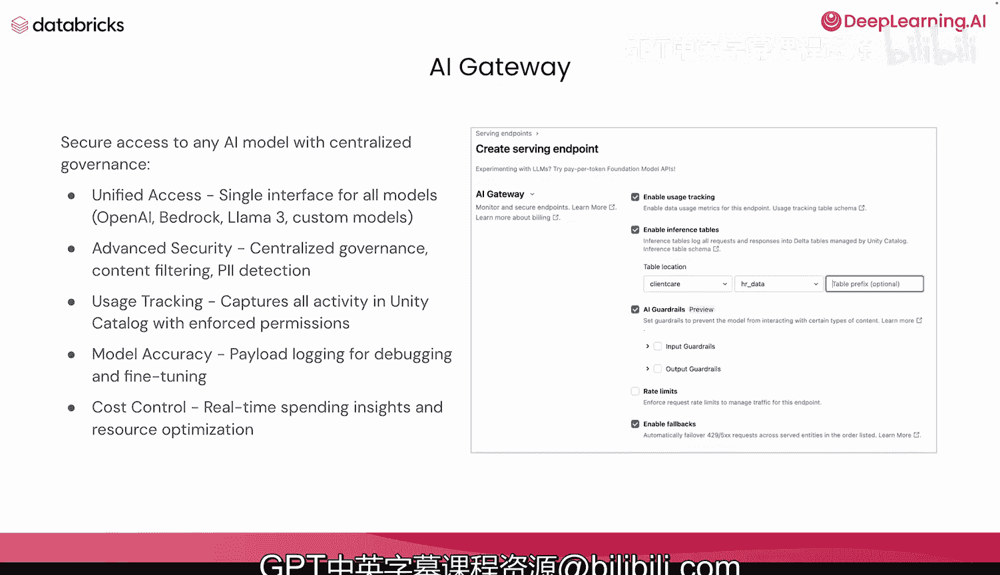

# 吴恩达《治理AI智能体｜Governing AI Agents》中英字幕 - P6：6.building,-evaluating-&-deploying-agents.zh_en - GPT中英字幕课程资源 - BV1GXyhBWE6h

Now that you have your governance foundation in place。

 the next step is to build and evaluate your agent in this lesson。

 you will learn all about the steps you can follow to make your agent production ready using tools like Mlflow and custom evaluation metrics Let's get to it in our first lab。

 we build and prepare the data layer with governance。

 Now we're going to build the agent evaluate them and deploy them in labs 2 and3。

 Just a little refresh for those who are newer to agents。

 The agent uses the LLm as its brain for reasoning through tools。 So for example。

 I can give an agent access to a series of tools and I'm going to give it an LLm and normally assist prompt so that it can make decisions。

 So if I have a customer asking my agent Can you help me return my last order。

 The way a normal customer support agent would work is they would say， okay。

 let me look up your account， let me find that information。 Let me。😊。

up our own return policy， make sure the item you want to return falls within that policy and then go through the process to generate a shipping label the agent should go through that same reasoning step so a reasoning action or react paradigm call the tools necessary and ultimately resolve the issue the tools can be documents。

 they can be vector databases they could be functions， they could be APIs， they could be tables。

 you can give a lot of different tools to your agent and as long as the agent's able to understand the data that it's using either through prompts or explicit actions on behalf of those tools it should be able to then generate proper responses and retrieve data。

For evaluating AI agents， so after your agent is built。

 you're going to want to evaluate the performance of the system before deploying into production So the main way in which we evaluate are using retrieval metrics such as rag metrics so whether or not a response is relevant response metrics so if your agent is hallucinating if it's saying something that is incorrect if it's saying something that is unsafe。

 Also looking at the speed latency and costs so the cost of building an agent in the cost of maintaining an agent you also just need to make sure that it is fast enough that the user is going to be able to get a response in a timely manner。

 The three ways in which we generally run evalals on your agent is through codebased evalals。

 these are your JO and re expressions your LLm as a judge so LLm labeled data via a prompt template or metrics like hallucinations and then human in the loop evalals so this is your golden data this is。

Having a subject matter expert either label data or provides you a set of inputs and outputs that you can use to train or fine tune your agent just going back to ElM as a judge this is become the most popular way to evaluate agents because a lot of agents do not have ground truths to draw on but it's easy to make a secondary agent that can evaluate maybe the tone of the agent or very custom metrics that you want to build when building your agents and making sure they're performant on specific metrics for production remember these evalals once you turn your model into a production deployed system these evalals will turn into monitoring capabilities so you will now have thresholds on those initial evaluations so you could begin monitoring them monitoring for key performance metrics in addition for monitoring things like cost and token count when preparing for production the ways to run your evals on your agent is through a lot。

of tracing capabilities tracing is most commonly used for OTL frameworks or open telemetry format that's kind of the standard when logging these traces MLLflow tracing also use the open telemetry format to log all traces and then every step within a trace which is also called a span so you can see how long each step took。

 see the inputs， outputs， the attributes of the LLM see the intermediate steps。

 see all the documents retrieved if you're using a ragbased agent and really start being able to troubleshoot and resolve problems with your agent in production。

In this course， when you build your agent， we're going to log the agent in MLFlow。

 so logging saves your agent as a version， model artifact， an MLflow's model registry。

 and you can think of this as saving your agent in a format that Databricks can deploy and manage in production so it stores the agent code the dependencies and the full configuration。

 it creates a deployable model version with metadata。

 it enables model serving endpoints and API access， it tracks experiments。

 performance metrics and lineage and allows rollback to previous versions。

When you're authoring AI agents in code， MLflow recommends using the response agent interface for building enterprise agents。

 so no matter what agents you're using， whetherre using an agent from Open AI Lchain Anthropic if you're building an agent in any Python format。

 This wraps the agent in the response agent interface， So you have a unified interface。

 it's consistent input and output， there's no change to core agent logic or code。

 it's compatible with Databricks features and MLflow and it creates a common interface for multiagent systems as well When deploying agents in Databricks。

 we have deploy and versioning for each component in the system。

 We have recently released that Databricks MLflow3。

0 This is an OSS platform for GenAI development cycles。

 we do have a course available with deep learning AI on DSP and MLflow Mflow 3。

0 has tracking capabilities。

model registry， observability， and key components for deploying your models and creating a serving endpoint。

Why do we deploy agents as service principles so you've added UC views， you've added mass。

 you've added system prompts， isn't that enough security so this is all stuff we've done in lab1 when we build our agent we're going to end up deploying it as a service principle at the end of lab3 so why do we do this Well it helps control the blast radius so minimum required permissions versus admin account accessing everything it has clear audit trails so precise logs of which agents performed what actions versus hard to trace admin activity。

 it gives you defense against edge cases， so protection against prompt injection or other nefarious acts it gives you regulatory compliance credential isolation and full governance protection。

You might be wondering what the next step is after you deploy your agent with the credentials of a service principle and have that deployed endpoint Well you can use an AI gateway。

 we have mosaic AI gateway available at Databricks where you can route that endpoint or any external model。

 Databricks hosted model or agent and begin tracking key information with AI gateway。

 you can secure access to any AI model with centralized governance so having unified access so a single interface for all your models whether they're from open AI whether they're an open source model。

 whether they're a custom agent advanced security so this is your centralized governance content filtering PI detection enabling usage tracking so you can capture all activity in unity catalog with enforced permissions and so you can track a single endpoint。

 you can track all your endpoints， you can add cost attributions to make sure that those endpoints aren't being overutilized。

And you can add monitoring as well for model accuracy and payload logging so all your inputs and outputs that you have when working with an LLM or an agent you can log all those responses and start doing evaluations on them and give you spending insights because again。

 we are tracking those serving inputpoints， especially if you have thirdparty LLMs you're working with or proprietaryary LLMs are a bit more costly it's also a great way to optimize your resources by tracking all these capabilities All right。

 now it's time for us to go and build our agent capabilities so ultimately we can deploy that agent with a service principless identity。

😊。

