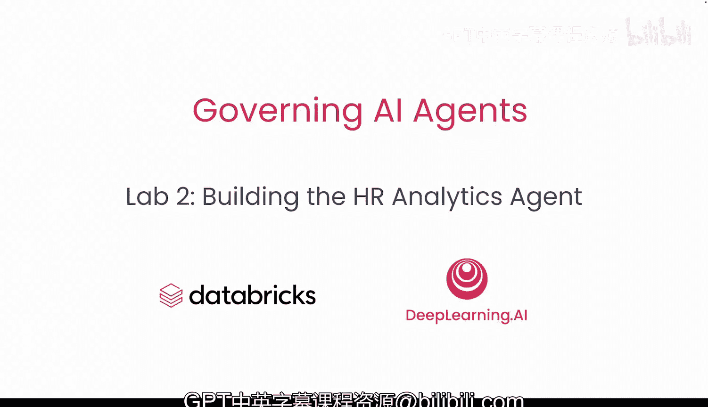
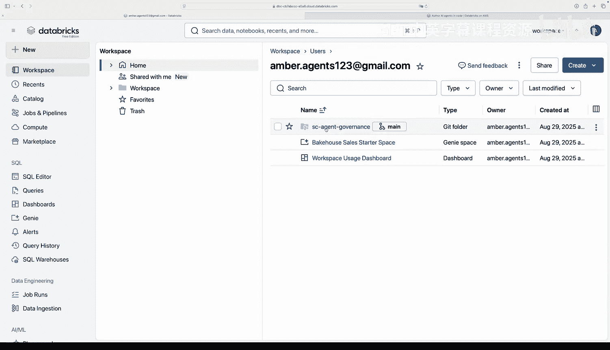
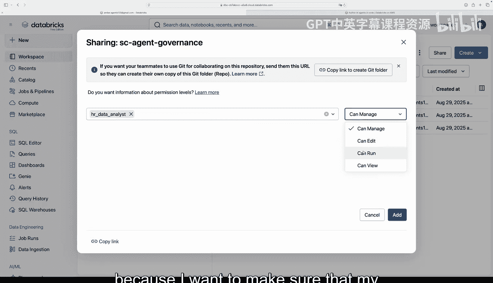
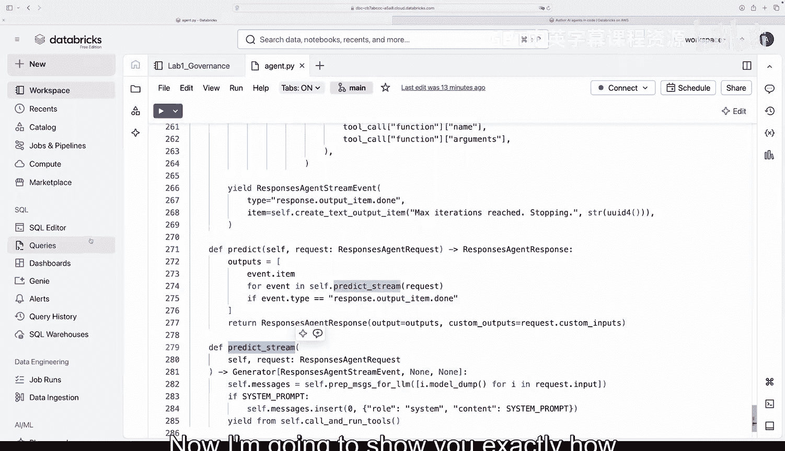
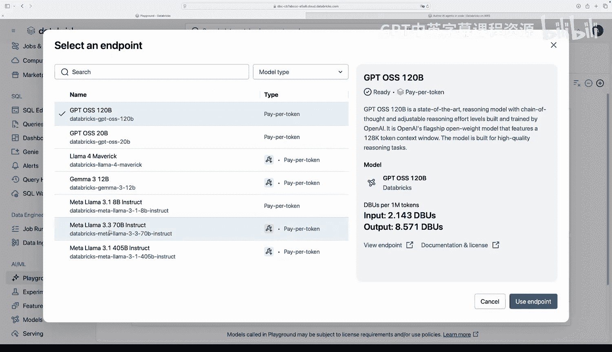
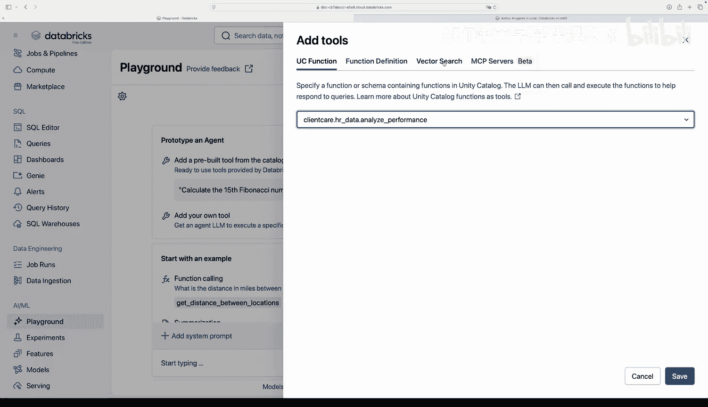
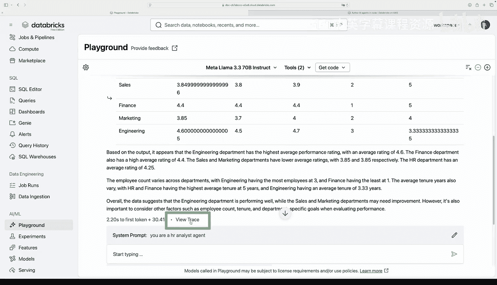
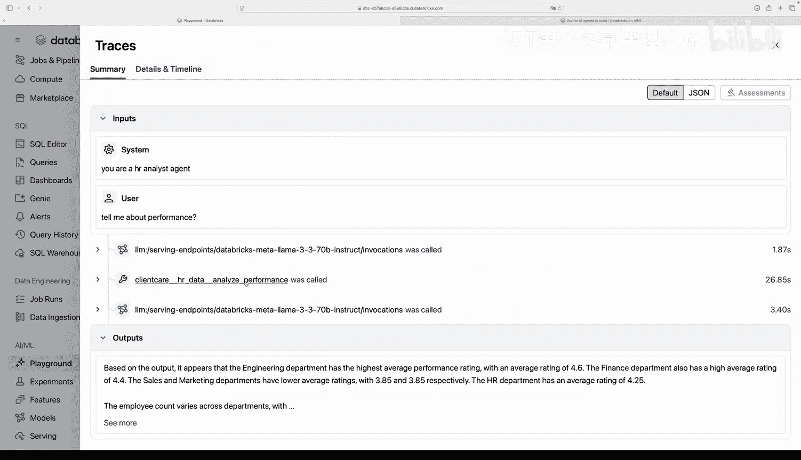
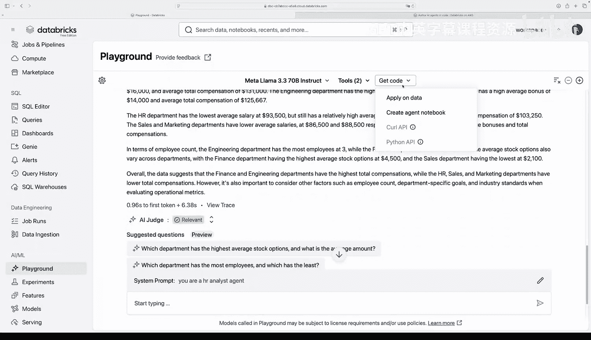
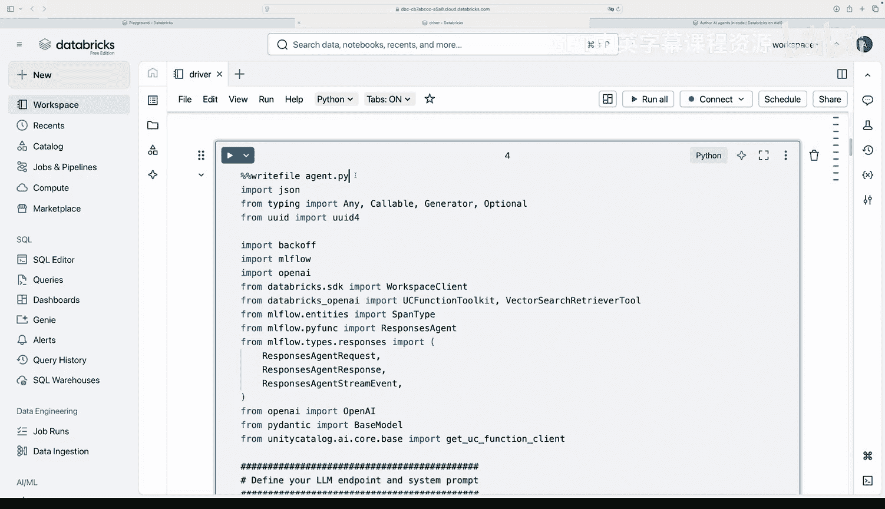

# 吴恩达《治理AI智能体｜Governing AI Agents》中英字幕 - P7：7.lab-2-building-the-hr-analytics-agent.zh_en - GPT中英字幕课程资源 - BV1GXyhBWE6h

You'll now build your tool calling agent using the Open AIS SDK and then wrap it in the MLflow responses agent interface。

 Okay， let's code。

Now that we have finished lab1 and set our initial governance， we're going to go through our lab2。

 our agent Pi and then our lab 3 deployment notebook so we can actually deploy the agent with these service principles conentials so I'm going to go back just one step and I'm going to make sure that my service principles so I'm going to go to my folder that contains all my data。

I'm going to share permissions because I want to make sure that my service principal can actually run。

 I'm just going to make sure that that is added。

Now let's go into our lab2 agent Pi。So this is our orchestration so we talked about using the MLflow responses agent interface。

 so first we need to install key capabilities so we use the Databricks SDK。

 we use Databricks open AI and we pull in our Unity catalog function toolkit if we wanted to use a Reever tool as well so a vector search if we were building a Rag chatbot。

 we have the vector search Retrieval tool as an option。We， of course， need to import Open AI。

And then we need to select our LLM， so if we select a natively available databricks model that has tool calling enabled。

 we can use the Mealma 3。37 newbie Instruct model， we can have our system prompt so you are an HR data scientist and analytics expert you have access to HR analytics tools that provide insights into workforce performance retention and operational metrics。

 so a little bit more about the role， some feedback for when you're answering questions and then the tools you have available so this is your analyze performance and analyze operation tools that we built and registered and un catalog。

 and then you need to define your tools for your agent。

So we're going to scroll down and so you can see the tools that we have already defined and registered in Unity catalog so you can use these user definedfined functions in Unity catalog as agent tools if you wanted to use a vector database you can easily enable that as well And I go all the way to the bottom you can see that your tool calling agent has your LLM endpoint so the endpoint that we've defined so this is our mema 3。

370 B model our tools so the tools that are going to allow the LLM access to data and that's going to bind our tool calling agent Now if you already have an existing agent all you have to do is wrap your existing agent with the Mflow responses agent interface which we've talked about in our last lecture if you're curious on how to wrap your existing agent with the MLflow responses agent interface this is actually wrapped。

I'll show you what that looks like so here we can see the class representing a tool calling agent and we can see here that it implements the responses agent interface so when you have a class that implements the interface responses agent inside your class there should be two methods。

And these are the predict and predict stream methods which wrap the output of the existing agent and if you're more curious on how this works or the step by step process。

 or if you're looking to build a La chain agent and wrap it。

 you can refer to our documentation links。Now I'm going to show you exactly how to produce this agent。

 Pi notebook If I go over to playground， I can choose a model for tool callinging if you see this skill enabled this little emoji of a tool that means it's a tool calling agent that's enabled Now these are just natively available in Databricks you can bring in an external model if you have anything custom you can bring that in as well so if you want to use your own open AI model。

 feel free to do so and then you just need your key in order to use it here I'm going to use my Mealma 3。

370b instruct model。

And then for my tools， I'm going to add the tools that I've created as UC function。

 so I can go to my client care， HR data， analyze operations， save that tool。😊。

I add analyze performance and I can select all my tools that are available in HR data I'm just going to grab the named ones so you can see exactly how our agent is interacting with them we can also add in vector search endpoints or use MCP servers you can add in a system prompt as you saw from our agent do P file we have a very complex system prompt so I'm just going to put in a little bit so you can see where that ends up。

And so I can start asking questions to test this agent before I get that instrumentation code。

 so tell me about performance。Here we can see that using our Mema 3。

370bstruct model so we can see that the LLM pulled up our analyzed performance function。

 pulled up information around performance so the operations we gave it。

 but now it also has a fool explanation involved， we can see the trace capabilities to see if it ended up using more than one tool or the total latency。

I can also ask about operations。So to gain insights into the operational metrics of different departments。

 I'm going to use the function analyze operations， and then it's going to give me this thought process of what this data means what I might find interesting so a full analysis on the data it has access to if I think this looks good I can go and create the agent notebook this will take me to my driver notebook which explains that we are authoring a tool calling MLlflows responses agent that uses the OpenaiI client now just because this notebook and our example use the openaiIS SDDK Our agent framework is compatible with any agent authoring framework so you can use Alma indexex Lcha straight Python in order to build these agents but going down to defining in writing your agentpi file here we can see all the capabilities that we went through on the agentpi we have the LM endpoint we have the system prompt we have the tools that are available。

お？If we wanted to we can add in a vector search database and then of course we have our class tool calling agent and then when we log the model to MLflow。

 we have the MLflow logging of the model and of course we have our LLM endpoint so the LLM that's going to be used for our agent as the brain and then the tools that are going to give that LLM access to our data for our tool calling agent so again this is the exact same information that's available on our agent Pi file。

 so if you use the cell magic at the top。To write this file。

 it will recreate the agent pi so this will create the same agent dopi file if you want to see exactly what this looks like in the L chain implementation you can check out our documentation on databricks for the exact workflow and even how to build out multiagent systems and just so you know this full notebook is the same notebook that we'll be using for our lab3 so the rest of the cells in here on how to log an agent are all available so this is the full orchestration code。

 the only thing different is if you want to add in your own custom evals。

Now let's go into our lab3 to finish building this agent。

 running evaluations and ultimately deploying it。

