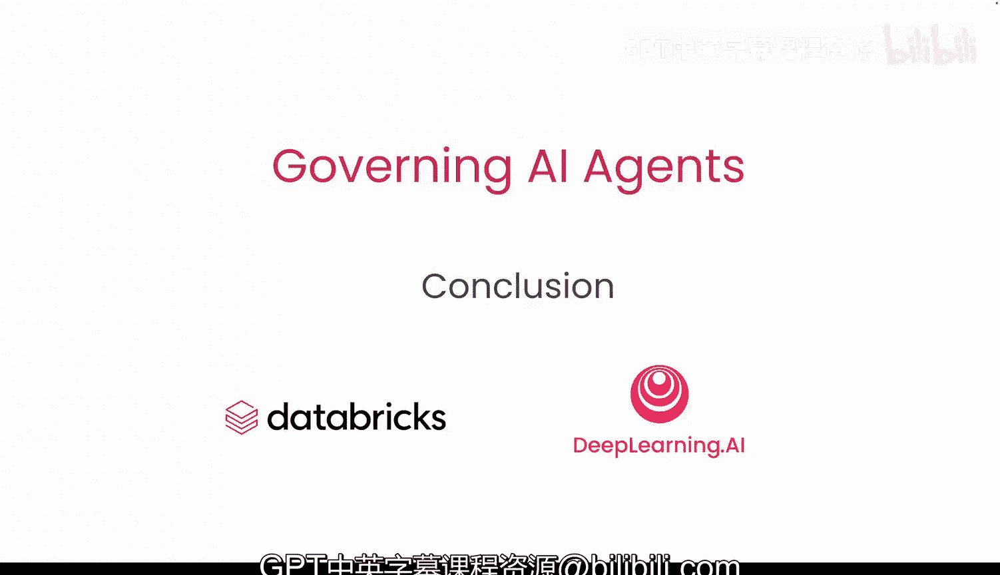
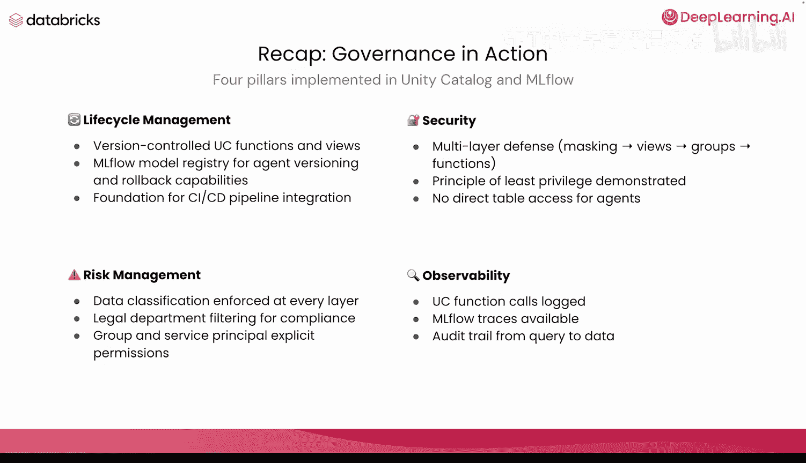
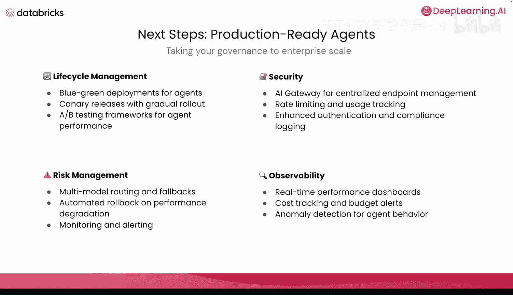
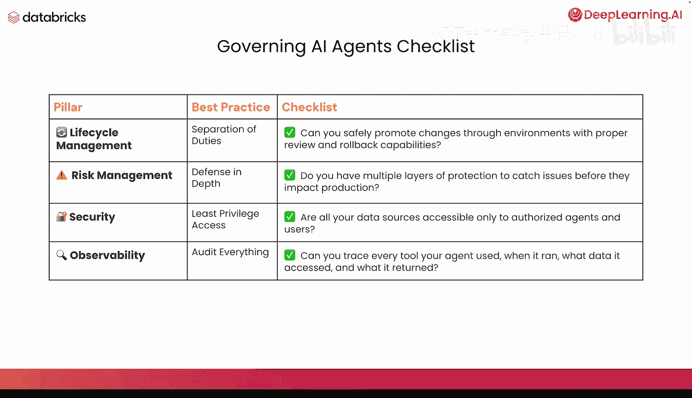

# 吴恩达《治理AI智能体｜Governing AI Agents》中英字幕 - P9：9.conclusion.zh_en - GPT中英字幕课程资源 - BV1GXyhBWE6h

Congratulations on making it this far。 Let's recap what you've learned in this course For governance in action。

 we have our four pillars that we implemented with the use of unity catalog in Mflow。

 Those pillars were lifecycle management， risk management。

 security and observability for our lifecycle management。

 we created version controlled UC functions and views。

 We created Mflow model registry for agent versioning and rollback capabilities。

 This is a foundation for a Cicd pipeline integration and for our risk management。

 We have data classification enforced at every layer。

 We have legal department filtering for compliance。

 and we have group and service principles explicitly defined and the permissions granted for security。

 We have a multilayer defense。 So our maskings， our views。

 our groups and our functions all working together。

 we implement the principle of lease privileged and we have no direct table access for agents。

 We have everything clearly defined and again， we have that principle of。😊。

Privilege so we aren't giving the agent access to anything more than is necessary for its task for HR and analytics Observability。

 so we have UC function calls log， we have MLflow traces available and we have a full audit trail from query to data so now that we have all these capabilities built what are our next steps to really build production level agents so taking your governance to that enterprise scale Well for lifecycle management。

 there is still bluegreen deployment for agents canary releases with gradual rollout AB testing frameworks for agent performance for risk management。

 theres multimod routing and fallbacks， there's automated rollback on performance degradationation there's additional monitoring and alerting for security using something like an AI gateway for centralized endpoint management using rate limiting and usage tracking on all those endpoints and having enhanced authentication and compliance logging and then for observability realtime performance。

ashboards cost tracking and budget alerts as well as anomaly detection for agent behavior。

 This also goes into our monitors on the evaluation metrics that we've used so going through our checklist now for our pillars looking at lifecycle management did we accomplish a separation of duties can you safely promote changes through environments with proper review and rollback capabilities We're checking yes for that risk management。

 did we best applied defense and depth do we have multiple layers of protection to catch issues before they impact production Yes。

 going check that box security， this is our best practice for least privilege access。

 Are all your data sources accessible only to authorize agents and users check yes to this And then lastly observability Can we audit everything Can you trace every tool your agent used when it ran and what data access and what it returned'm going check yes to this as well I want to thank everyone for。

in throughout this course， and I'm excited to see what you build。

