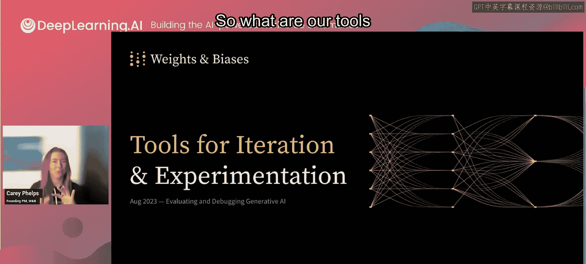
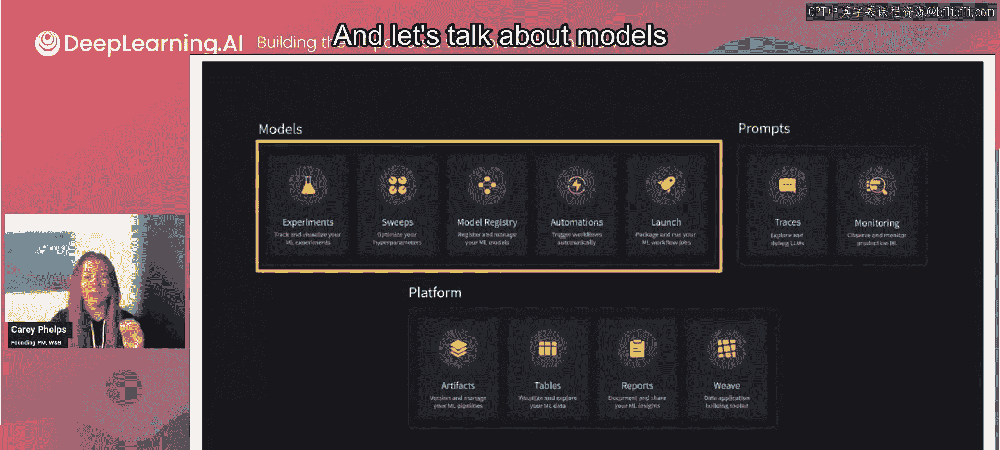
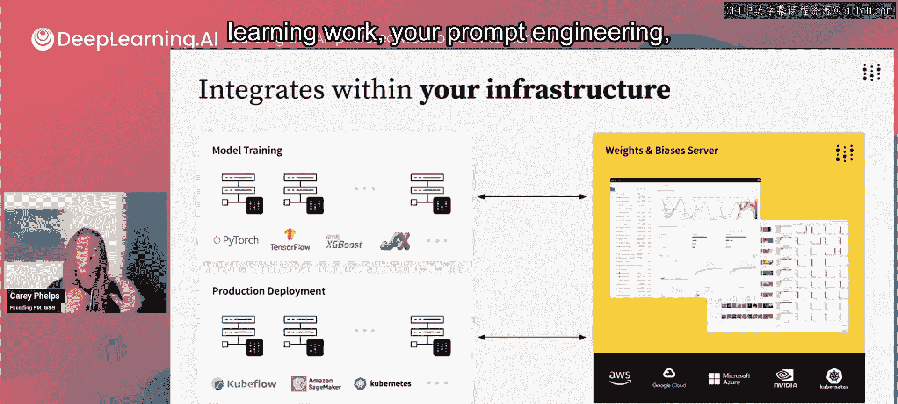
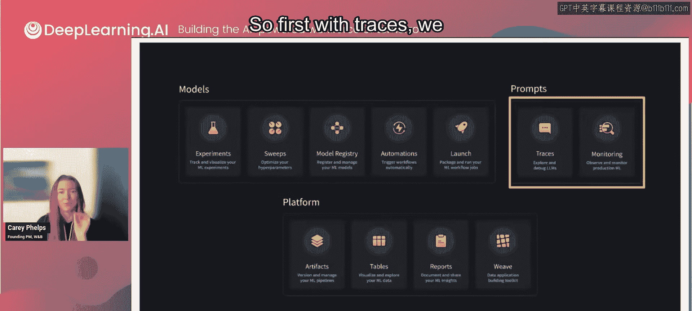
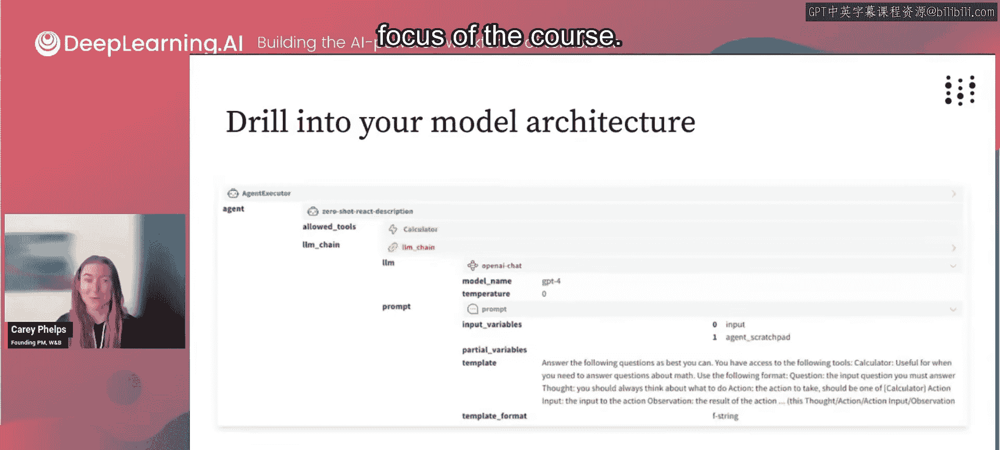
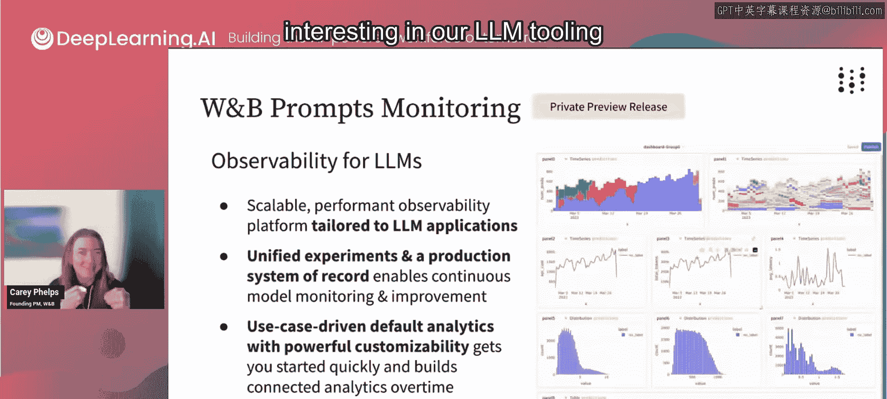
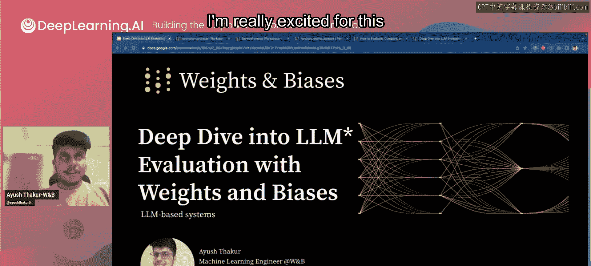
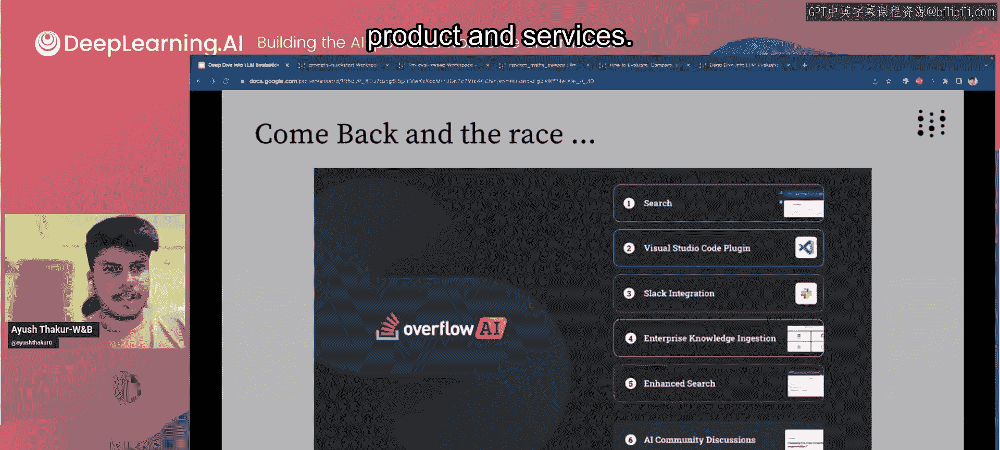
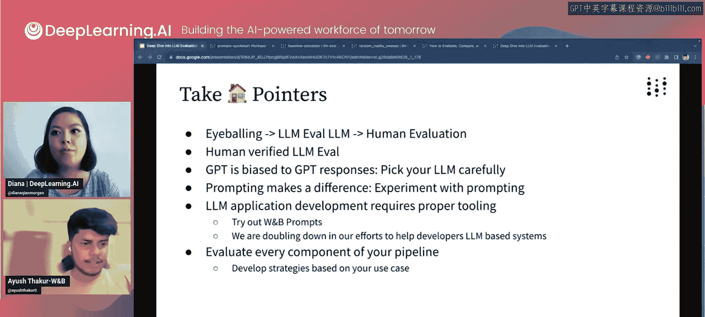

# 吴恩达《深入探讨使用权重和偏差进行 LLM 评估｜Deep Dive into LLM Evaluation with Weights & Biases》中英字 - P1：Deep Dive into LLM Evaluation with Weights & Biases.zh - GPT中英字幕课程资源 - BV191421D7pe

Hi everyone， my name is Diana Chan Morganorgan and welcome to the next deeplearning。

AI event I bring together all things AI community for everyone and today we are very lucky to have a workshop with some special speakers from weights and biases In this workshop we're going to dive into how we can effectively evaluate LLM systems with a particular focus on retrieval augmented generation also known as ragG systems We'll start by discussing the eyeballing technique and why weights and biases prompts stands out as the great first grade tool in this area。

😊，on to supervised evaluation highlighting why it's worth considering and pointing out some limitations to wrap things up we'll also take a look at how LLMs can be used to evaluate themselves from generating their own evaluation data sets to using standard metrics and even evaluating retrieval systems。

😊，Lastly， we'll also touch on how weights and biases sweeps an excellence tool for hyperparameter optimization can be utilized to find the ideal balance to maximize accuracy and minimize costs the session today will end with a Q&A with the presenters so make sure to answer some or ask some questions in the chat we will be presenting a link that you'll be able to vote on all the questions。

😊，This workshop is also based off the foundational Learns of Deep Learns course on evaluating and debugging LLMs built in collaboration with the weights and biases teams。

Everything covered in the workshop is presented as continuednu education from the course。

 and we will be dropping the link in the chat。😊，I want to introduce our first speaker， Carrie Phelps。

 hey Carrie， Carrie is a founding product manager at the Wes and biases team。

 she studied computer science at Stanford and also went on to found Carta healthcareca before joining weights and biases。

😊，Our next speaker。 Oh， sorry， Do you want to say something here Thank you， Diana。

 excited to be here。 Absutely， our next speaker is Ayush。😊。

Ayush is also part of the Wes and Vis team as a machine learning engineer and Google developer expert in machine learning and TensorFlow。

 he is interested in everything computer vision and representation learning and for the past seven months he's been working with all things LLMs and RHF He Ayush。

Hello。😊，Perfect and our last speaker for today is Morgan McGuire。

 Morgan leads the Growth ML team and is an ML engineer at weights and Vices。

 he has a background in NLP and previously worked at Facebook on the safety team where he helped classify and flag potentially high severity content for removal。

We're so excited to have them here today so without further ado let's definitely get started so Carrie take it away A thanks Diana。

 so I'll zoom out for a moment and talk about the larger product vision of weights and biases and where we're coming from and then we'll get into more of the details with Ayus and Morgan。

😊。

So what are our tools for iterating and experimenting on machine learning？

At a high level， we have a platform across models， which is building your own models。

 training from scratch。Prompts， which is iterating on LLMs， looking at the trace viewer。

 which is the focus of the course， as well as monitoring LLMs in production。😊。

And then we have our platform components， so shared tools across the system。😊。

And let's talk about models for a moment， so we started with experiment tracking open AI had this problem where they wanted to see if as they trained models over time they were doing better or worse and it ended up being kind of frustrating to track those metrics in one place so we built an experiment tracking tool then they needed to be able to visualize how different data sets compared and so we got into this data visualization field and then a collaboration tool so being able to share those insights centrally and that's where reports came in。

😊。

And finally， we need the central system of record for different teams across the organization。

 so how can everyone working on a project see the results in one place？😊。

And critically and Morgan has been deeply involved in this work is integrating and making WnB accessible across the different tools available to someone working on a model。

 so you know we started out TensorFlow was the really hot thing back in 2018 and Pytororch was kind of a new kid on the scene and it was clear to us that building integrations with something like Pytororch with Ptororch lightning would make WnB more accessible to say the academic audience training models and so this is a critical area of focus for us is how can WnB play really nicely with the other tools in the ecosystem。

😊，We also integrate with whatever infrastructure folks are using。

 so say you're a student just getting into machine learning and you're training on a GPU under your desk or even your laptop itself。

 we can track there， say you're using the OpenI API for iterating on a prompt。

 we can track the results there， wherever it is that you're doing your machine learning work。

 your' prompt engineering our goal is to make it really simple to capture those results。

So let's talk about prompts which is the focus of our discussion here so first with traces we have a core tool to understand and debug what's happening during the process of taking an input and producing an output and the thing that's interesting here is it's not as straightforward as you might imagine you don't just ask someone a question and directly get an answer there are steps like for example using a tool like a calculator to go calculate an answer and then incorporate that into the result that the LLM produces and so this debugging can be really complicated right especially if you're trying to look at it on you know a terminal output it's hard to purse everything that's going on so this visual trace timeline gives you the way to understand the process what's happening as you're interacting with the LLM。

😊。

And you can also drill into your models architecture so you can see what the steps are that it's doing。

 and then under the hood you can see even more detail the metadata that we're capturing and each of the inputs and outputs that you've fed into the system and received。

😊，So the goal with prompts a high level and this trace tool in particular is making it really easy to iterate on the prompts that you're writing and get a better result from the LLMs that you're working with and so that's really the focus of the course but I also want to talk about another exciting thing that we're developing here and that's monitoring So what happens once you have an LLM that you're monitoring and production well there's a lot of people involved here and the few problems that we see across our different customers we' working with is that it's hard to systematically evaluate what poor performance looks like So say I have a chatbot helping my customers and I've built this LLM to answer their questions it's hard to really evaluate if they give it a thumbs down if that's because the answer was wrong or because they don't like the answer like maybe I can't change my flight so it's hard to systematically evaluate is it doing a good job is it providing the answer that the user wants to hear but it's actually incorrect so。

So this is a real challenge for monitoring elements in production。

We've also got high inference costs so it's an extensive process and it's hard to run traditional patterns like what we've seen in traditional machine learning。

 it's also you know there's this really fresh set of tools that people are using and so it's really hard to to just make one decision like write the prompt once and then leave it and stop iterating it's really important to be able to keep tweaking as you get more information about how users are interacting with your system and it's also really hard to capture and combine data from different points of feedback in your LLM system。

And so we've tried to address each of these key points with our production monitoring tools。

 so being able to explore within the context of the results that you've logged in WNB via evaluation boards。

 being able to monitor in real time and see the cost of the work that you're doing。😊。

Being able to integrate with other tools in the WB ecosystem and beyond and then streaming those results in live so that you can react quickly and what that looks like is something like sort of a datadog dashboard for LLMs in particular and so this observability tool is this new component of our prompts platform that we're really excited to have now in private preview and so this is the next step beyond iterating on your prompts and experimenting with what would work well is monitoring the performance of those models in production。

And we'll get into more of the details of what's interesting in our LLM tooling here with AUH up next。

 so I'm excited to pass it over to AUH。

は。Yeah， thank you Keriey hello I'm myus and I'm a machine learning engineer here at Brison Baes。😊。

I'm really excited for the talk and I think I have。

Good amount of content to cover。So if something is not clear。

 please feel free to drop into comment and I will try to answer that or clarify that as well as。

feelel free to reach out to me after this after this talk and then I can try to answer that question as well having said that all those who are joining from India are very happy independence day to all of you。

And now let's get into the presentation。Okay， so in the past one and a half year。

We have been interact。Let me see if this is working or not， it's like， yeah。啊。Sok。嗯小。

Yeah in the past one and a half year， the way we are interacting with our world is kind of quickly changing right we envision interacting with the software and that's changing the way interact with the tools that changing。

😊，For instance， as developers， we have relied on Sta overflow for over a decade now。

 right it was heavily used for finding code snippets and solutions to bugs。😊。

We either got a working answer because someone already asked for it on Sta Overflow or we post it on the site and wait for a response。

But over the past one in a half year， SO has lost around 35% of this traffic。

And charge GPT is considered to be a huge reason for the downfall of S overflow it was reported in March of 2023 I guess that S overflow alone lost 14% of a traffic and I mean the reason is that a lot of developers have started asking questions directly to charge GPT and there's no significant wait time and you can literally can appear program with charge GPT you can throw in the execution error code。

Back to chargegpT and maybe it can try to resolve the code for you right it's a more natural way of development and so is Githubco pilot right it was launched back in October of 2021 and you see the decline of stackco right after that。

For Github Copit we also have like VS code extensions so the place where you're writing your code exactly the same place you can do code completion and fancy stuff and that's a great way of developing and does the point is that the way we are interacting with our tools and the way we are developing software has changed over the past P and a half right so the question is then what was stack offor response。

Well they release their own generative AI power overflow AI tool with this tool you can ask questions like you can ask questions as well as ask follow up questions in a conversational style like we used to like we are used to do in chargeGPT the answers are summarized with citations and that I mean you can use that to draft your question and latter post on Saoflow as well so just like Copit they also have their own visual Studio plugin so now you can pay program using this tool the point is businesses。

 companies institutions etca they've all started leveraging generative AI capabilities into their own production services。

Awesome， to give a few more example， Khan Academy released their Caninggo tu bot。

 then there's notiontion AI and then Zaper also released on GenI power interfaces。

Great and I mean the number is just increasing there's like 250 plus geneative AI starters that has been mapped as of August if I remember correctly August 8。

 but again in that case this whole field exploding。😊。

Now the reason this is happening is because it has been powered by things like2 GPT4， Palm 2， Falcon。

 Lama2 cloudude models， etc ceter， these are all transformer based architectures which has been scaled to billions of parameters and trained with billions and trillionions of tokens at this point with like really large context lengths as well。

The， the focus of this talk is on large language models。

 but do remember that large image generation models are also playing a role in this landsldes shift that we are seeing。

Right。Personally and also everyone at Wa biases to be very genuinely proud of our contribution to this whole shift because of almost every major lab and companies in this space is kind of using waste biases in some form using waste biases to track experiments。

 the model versioning and whatnot。And we are instrumental。

 to be honest in almost every LLM fine tuning workflow that you can find out there。

 if there's not any， we are working hard to make sure that we can provide their capabilities to those repositories and workflows as well。

So why scaling billion of parameter is a thing well the LLMs are partial because with scale they are literally getting better on task for which they are trained on as well as theyre unlocking new abilities so you train a large language model for say。

Language understanding or summarization， but it turns out that it can do some common sensory thing。

 it can do some arithmetic， can answer some physics based questions。

 which is like literally unlocking new abilities。However。

 under the herd or under the blanket is just nest token prediction。

You provide some prior token or some prior text to those large language models and what they do is if you're like creating a summary or if you are doing translation。

 whatever you are giving some prior text and based on the parentis is generating the next token based on some pro distribution。

Right special focus on the term prior test right now because that has like it has eruped into its own whole field right now and it's like formally called prompts right prompts like involve instructions and。

Context pass to language model to achieve desired tasks。

 say in a text we can specify the instruction， we can pass in the context。

 we can give in some input data even some few short examples right and we can then have an output indicator and just throw in this text to a sequence model or a large in this case a large language model and if willll just generate the next sequence。

Our next token， right based on the prior that we have given。U and yeah， like because of that。

 the whole prompt engineering field has evolved and a lot of prompting techniques has been developed over the past few months。

😊，For example， and to be honest， like all these prompt techniques are somewhat unlocking even newer capabilities of these large angle models that we didn't think was possible。

 for example chain of thought or three of thought， these are like really interesting ways of interacting with LLM or making LLM do things。

😊，And the beauty is that you're just specifying think step by step in your prong and then model starts thinking step by step。

 it's little magical that way， right？So I mean， we talked about language models。

 we talked about prompting， but to be honest。Everything that we are saying right now is kind of possible if we have many flexible frameworks which can encapsulate all these prompting techniques and like to be honest。

A prompting ticket might be released。AWe back and we need to access those techniques right and these frameworks like Lanching and La Min decks have made it really easy。

😊，To do so， they I mean they have access to data connectors of the shelf chains。

 they can do memory management using these frameworks as well。So the point is with these frameworks。

 it has become really easy to build AI power solutions right now。Back in 2019， Gartner research。

 if I remember currently said that only 15% of all the A solutions deployed in 2022 is going to be successful。

I'm not sure about the percentage。But I'm sure that it's really easy now to build such AI power。

Products because you don't have to kind of start from scratch and go through the whole ML lifecycl for your particular use case。

 you can leverage large vision models or large language models for that。So like， yeah。

 you want to build your own QA internal document but。

You might find our Lang in Toronto or alarm index prompt template out there。So hold up， so I mean。

 the point is。We have this powerful tool， let's go ahead and solve every problem under the sky。

 but that's not going to happen。啊。And why is that because elements are a great primitive。

 but is still not sure if it can do everything it can if it can。

Sove all the problems and the biggest challenge is if it can if it can actually。

Properly test the LM based systems that we want to build for our use cases and this brings to the main topic of today evaluation。

And going forward I will just be talking about evaluation yeah if you have any question feel free to drop in and yeah I can take a look at that as well or maybe at the end of the presentation。

😊，Now， before I go。In some depth about how we can evaluate these LLM based systems for those who are new to evaluation。

We first need to understand the difference between the traditional evaluation and LM system based evaluation so in traditional ML。

😊，Yeah and to be honest this ML that I'm talking about is what we used to do few months back now LLM has taken over everything I mean there are still a lot of folks out there doing proper deep learning but yeah by traditional might just mean proper like doing classification like object detection those stuff so in a traditional setting。

We have a training distribution right from which we split two sets。

 the train set and a validation set， then we train our model on the train set and get some metric so in this case accuracy of say say 90% right？

We also evaluate the model on the validation set， we don't use the validation set to train the model。

 we just evaluate the model on that and by doing so we can basically estimate if the model is overfitting or is underfitting right we then evaluate on the test set which hopefully is coming from the production distribution。

This evaluation then gives us a domain shift， so what was the shift in the training and the production distribution？

And then if you' are satisfied with the performance of the model on the testet。

 we deploy it and evaluate on the production data to get a driftft。😊，It's like pretty standard stuff。

But but while we are buildingM based system， we literally don't have access to the training distribution。

 we might know which data set was used to train the model。

 but it's kind of hard we don't exactly know what data was thrown into GPPT4 to train it right so。

Most of the time。And most of the folks will not even care about that and because we are mostly making API calls at this point。

 right？So。And the models that were trained。We're not trained for your particular use case。

 so there's no alignment of those LLMs with your production distribution。

 so these are two big issues that we have in LLM system evaluation today。

Right so before I go ahead I just want to make a quick distinction between building lLms and building lLm powered applications。

 so if you're building lLm so if you plan to build gpt5 or。😊，Lma four or Lama4 Lama  three。

 you can still use traditional evaluations is still a very active area of research wherein we are trying to build better benchmarks。

But if you're building LLM based applications， we have to be thoughtful about it。

 you have to come up with。Like interesting solutions for your particular use case。

 whatever i'm going to talk in the in this presentation it might not even cater to your use case。

 so you have to come up with your solution your own your own ingenuity。

About those evaluation strategies。Right so how about we so how do we think about evaluating an LLM based system so I was inspired by Jo Tobins talk that he gave few weeks back and I created this two by two chart with data with evaluation data on the Y axis and。

Metric on the X axis so the evaluation data will need to be correlated with your use case that makes sense right and the data that you want to evaluate on should also be close to your production distribution。

So。I mean， when you're evaluating your LLM based system， you have that control。

 but you have to be really thoughtful about how you want to create those data sets。Right。

 so one thing and this is maybe the。Like probably， the first thing you might want to try out is pickup or LLM。

That's performing really well on public benchmarks so if an LM is performing good on public benchmark。

 it might perform good on your use case as well。But but there's a caveat。

 if your use cases like medical heavy or it's like legal documents。

 those stuff you might want to be thoughtful about what public benchmark you are using to pick that model right the model might not be might not performing great on that public benchmark but might not have much intuition about legal documents or。

Or like your medical use cases and I mean。To solve that problem we have fine tuning that's like a whole separate thing at this point which I'm not going to touch upon but this is where you should start right so if you pick a model based on the public benchmark then the next I mean this is not the next recommended way but this is like one of the most extreme and the recommended way of evaluating your pipeline wherein you have annotators to build gold standard eval set for each component of the pipeline so your pipeline might have like document passing with different chunk sizes might have arieval etc。

And you need to evaluate every component， so hire annotators to create data set for that， right？

I mean， you can imagine that it's both time consuming and it's also very expensive。

 so if you have like a business or a startup and you have some user base already a dedicated user base who's interacting with your product。

 you can then do some sort of user testing， you can do some sort of AB testing with LLM based logic that's serving your product and a custom I mean。

 crystal based logic that you were using previously。

So you can do those user testing and yeah make incremental changes and see how that's working again it's time taking it might be expensive if like there's some incentive that you need to provide to the users。

😊，So it depends on your use case to be honest， but if you do so is' going to be really correlated with your use case and it's also going to be really it is also going to mimic the production distribution really because literally your users。

Somewhere in the fuzzy area is the law is the idea of like a crazy idea of using large language models to evaluate large language models right it works to be honest。

😊，And quickest and this is the quickest way to evaluate like any incremental changes that you make to your pipeline。

😊，But having said that， you really need to think about it carefully， okay， right？

Maybe I can take a pause and see if there's any questions I can take and then we're going into some really meaty stuff。

嗯。Dana， should I start taking questions or should I carry on with the slide and maybe I can take that at the end？

We can can just continue and take questions at the， but we'll send out that to vote on questions。

Awesome， awesome， great， yeah， let's carry on then。😊，So we talked about。The changing world。

 we talk about this LLM space， we talked about how LLM created this whole field of prompt engineering and why prompting was important。

 we covered traditional evaluation and how the LLM system evaluation is different then the traditional evaluation you also thought about evaluating the system with that two by two axis。

And we thought about few like top level ideas of evaluating。

 but let's talk about evaluating in practice， right？呃。Yeah，So in my opinion， in practice。

 we have three ways of evaluating an LLM system or in my or one can say that this is a more practical workflow for evaluating any LM system。

So number one is eyeballing right we start building LLM base system。

 we usually start our evaluation by eyeballing on few samples or few learning examples。

 so we have my three or four examples， we build the system on like around those three four examples in order to solve those examples。

And while doing so we are literally using our eyes to see if the responses have been generated or the chunks or the documents or chunks thats been retrieved by the retriever。

 they are good or not right and we try different components and we try different form templates。

So the fact that we are trying a lot of pro templates and we might be using frameworks like Lang chain and Lama index。

Of。At this point I will just say that and bias opinion that you should try random D traces is a great tool and carry test upon that as well。

 so if you're using Lanching alignment deck you can literally add in like two or three lines of extra code to your script and you can start tracking the trace timeline the input responses LLL course as a drop。

And actually let me quickly show that like show tracers in action。If you can see the screen。

 this is a trace timeline or a trace table， so I can see the timetamp when this particular input was added and then therefore no response so the trace so the chain basically through avaluator。

In this case， the question is what is the sign of 0。47 rad and we got some output。

 but what's even interesting is that we can look through the sequence of events that happened to come to that。

Decision so there were some tools used as in like a calculator was used let's see this example here which is working so a lot of LLM chains were call calculators were called。

😊，And calls are made to the open chat open A model we can little look at the prompt so what was going in the LLM and the prompt has both the like user prompt the instructions。

 the context we can see the generation that was done we can also look at the parameters like for this particular generation GPT 3。

5 turbo was used and a temperature0 was used so everything has been track。

And literally it was just two lines of code that was added to the to the script so you can start live I mean you can。

Literally debug your pipeline with this because you have access to so much more information that you might miss out if you're just like using the framework as it is。

😊，Okay， so going back to the presentation。The next。Way of evaluating again。

 this is not the next exact step that we should do after eyeballing。

 but we'll just want to I just want to cover this before I jump into LLM evaluating LLM right so。

This is a recommended way because this is going to give you the most trustworthy。

Evaluation of your pipeline， but it's expensive and slow， as I mentioned earlier。Yeah。

 but here's a very simple example that I tried， so the idea was that I will build an LLM based。😊。

Calculator so the calc so you give an expression to the calculator and the calculator is going to use the board mass rule。

😊，It's also called Pendma's rule and it will generate the answer for their mathematical expression。

For your problem you might have a problem statement where then you are generating code so you can throw the genetic code to a computer to execute or compile the code right so that's also form of a super supervision that you can provide to the generation that you' are doing and you can use that to evaluate so again like if you might have you might be genetic structure structured。

SQL， you can run those SQL and see if it's giving good correct results or not。

Sup provisionvision can be。Achievd in clever ways in some scenarios。

 you don't necessarily need to hire annotators， but yeah。Now， if you have such an example。

 what I did was I。Just let's to simulate hiring an annotator and building the data set。

 I came up with the expressions myself and then computed the values for all the expressions and then asked GPT4。

😊，With the given prompt template， so the prompt template was the following neuro mathematicalthematic expression。

 find the answer using bo master and provided the question and the formatmatic instructions。

Right so the model was evaluated or 16 samples that I generated the evaluation result along with prompt users and the cost were all locked to 1DB tables。

 as you can see in the screen。😊，And with van D tables。

I was able to find out all the examples for which the model was failing。

 so in this case the example 19th， the true value should be 35 but the model GP4 is giving a 25%。

What to my surprise the model gave only 59% accuracy， it's a GPT4 model。

 which was not able to do basic Bo mass arithmetic but like doing the evaluation on those 106 examples costed just $1。

 so it's very cheap which is a point I mentioned earlier as well。😊，Also。

 the evaluation course is going to be really negligible compared to the data sation course。

 even if I created those 106 expressions and evaluated them。

 it took me maybe 30 minute to an hour to build that right while the evaluation took just a few seconds。

Wit， just want to take a quick detour to emphasize the importance of tracking with one they Bay because when I was preparing this slide deck。

 I was not able to recall which model was used for that particular evaluation job。

 which gave that 59% accuracy in the previous slide。😊，So if I switch to the tab。

 this is basically the workspace where I log everything。

 so there are like 134 experiments that I did and this was calculator I guess so I can search that particular run go to that front page。

😊，And go to the overview page and in the configuration because I log the con parameters I saw I can see that yeah GPPT4 was used and again I didn't recall while I was building a slide so I actually did this step to find also I demo Wey tracer。

Previously， so let's go to a generation here so for this。Example5 plus8 into 2 power three。

It gave some answer so let's see which model was used so if I go to the LLM here I can see that yeah SGP4 that was used under the H so again I was not logging this information but this information was yeah。

😊，Ted automatically by using those two lines of code。Greatait， let's come back to the presentation。

Great， so at this point for the。Supervised。Setting that I'm talking about we have both the data set and we have the metric so we can optimize the prompt parameter prompt parameters to find the best set of prompt parameters like which LLL model is going to be best what the temperature of theLL model the prompt etc right so in traditional deep learning we used to do hyperparameter optimization magic with a tool like1D sweeps。

I you have tried that。Well， we can do the same three for prompt parameter optimization。

 just set up a gaml file throwing define your parameter space as in the prompt template。

 the temperature or the L model and then yeah once you have that run the job for say 50 or 100 experiments and once you have that。

But you are going to get。呃。Paular coordinate plot like this and let me actually run through actually show this slide here to all of you if you can see the screen so this is so there were like 50 experiments that I did different pro templates different models so the text Aviny003 GP4 turbo and。

😊，If I want to。Pick the system like this QA， I mean， the calculator system。To give the best accuracy。

😡，I will have to use the GPPT4 model。With this prompt template three。

 so I can look at the configureg here and。This is going to cost me what some $2 so if I'm evaluating $106 samples is costing me $2 like negligible but still it's costing more the point is if you want to optimize for the cost and the accuracy there's always going to be a tradeoff right so if you're okay for your system maybe you're okay with an accuracycing the range of 60 plus you can literally get away with like a dollar right so。

Again， you're using GPT4， but you're only spending dollar with a maybe not so heavy prompting technique and you're okay with this accuracy。

If you run a prompt parameter optimization sweep like this， you can do this multi objective。啊。

Comparison and like find out the trade off and pick a pick a model that or a system that works best so in this case。

 if I want to pick this yeah I will look at the configuration for needs sleep maintain experiment and just pick that and use that for my and like deploy that maybe if I want to deploy that。

So that's optimization。对， not one I mean。So that was everything about supervision we talked about eyeballing and how it was important and how it like how it is important and we talked about supervision now the fun part is how are we going to use LLMs to evaluate LLMs given is the fastest way to evaluate your pipeline in。

Right so just to make things a bit more complicated let's take an example of a retrieval augmented generation or a RA pipeline so for those of you who is not familiar with this is basically a way to bring your own private data。

😊，2 an LM， so you take the your like document chunket。

Embbedd it and create the vector store when you are querying you can then embed the query。

 retrieve their most relevant chunks from the vector store and pass the query as well as those retrieve chunks to LLM to synthesize the response right so there are so many elements that's going on and probably in your use case it might be even more complicated than this right you might have multiple retrieves and you might be routing the query from multi to multiple retrieves you might have the concept of agents as well。

So。Now， if we imagine evaluating a RA pipeline for a question answering board over a document。

We can maybe evaluate three important bits here， so number one is going to be how factually correct response is the two is。

How good the retrieve chunks are so if the chance that has been that's been retrieved by the retriever is not good。

 we are not providing good context to the LLM so response is not going to be good so we need to evaluate that as well。

And when you are actually taking the document and chunking chunking。And into smaller text。

 you also need to evaluate which chunk size is going to work well for you， right。

But before that we we need to think about the evaluation data again you can hire annotators and build the evaluation data great。

 but again that's going to take time so we can leverage large language model here to generate the data for us in this particular example I use GPT 3。

5 tobo。To generate the question answer pairs how did I do that Well if you're using blank chain you can literally generate with three lines of code using this QA generation chain but under the hood this change is nothing this chain is just calling LLM with this particular problem so in this problem it has some instructions like you are a smart assistant to come up with meaningful meaningful QA pairs and the pair should be the。

Point and the answer as detailed as possible right so the prompt takes in the chunk of text that you provide from which you want to retrieve that question and answer period and yeah the LLM will do that for you great。

Now， let's think about the metrics。😡，So you have the question or the query you pass it to the board。

 you get our answer and you also have a ground throat answer which was generated using a retro generated using an LLM itself right so we can either use LLM as a metric itself so you ask an LLM provide both the ground throat answer and the predictor answer and ask if it's correct or not or you can grade in the scale of one to 5 or1 to 10 or you can throw in a standard metric like F score blue etc so the standard benchmark that we use we can also throw it here because we have access to both the ground throat。

Answer and the geneative answer I mean one can say how can you be sure that the ground tro or the LLm generated groundro answer is accurate I mean now that's where the it iterative cycle comes in you need to get in the wes maybe look through some examples have some more interesting way of generating the answer questions there but this is me just giving an idea。

So if I。So why envelopepe can be used as a metric？So it has good understanding of semantic of the test that's something we all can agree on right so we can leverage it to compare the ground truth with the earth with the genetic response and it's like and in many cases it's going to be better than the traceal metrics like F1 or blue right？

And this is like a one degree table that I where in I logged both the question answer and the prediction and the evaluation。

 but if you look at one highlighted。Box here， you can see that for that given particular question about what is the broader for broad families of selfupvised learning。

 the model response was kind of fuzzy while the ground to answer was really solid and was coming from the bullet points that was in the PDF the archive PDF file and does。

The GPT4 said that no， this is not the correct answer， so you can do this for an evaluation。Right。

 so if we are using line chain， we can again do this in freeance of code。

 you have something called QA Eval chain。So with the QA E chain you can just pass in the pair the prediction of everything and if you'll just give you a response correct or incorrect。

 you can also change the prompt template to give it like a grade one to five or one to10。Awesome。

 again， under the hot is just a simple prom and you can modify the prom as per your use case。Awesome。

 let's talk about some standard metrics。😡，Since we have the groundro prediction we can use something like a squad metric which computes the exact match and en score for those who are not familiar exact matches if the tokens of the modest prediction exactly matches that of the true answer while en metric is basically precision and recall of the system so precision in this case would be ratio of。

The tokens that's been shared between the ground truck and the prediction divided by the total number of tokens in the prediction and likewise recall is shared tokens by number of tokens in the ground tro again fancy metric you can use the metric as per your use case。

And again， if you're using something like oneDB tables logging to it you can actually see for all all the data points。

 the individual metric as well and not just a main metric。

 by the way I also for this particular use case I use hugging as evaluate because it has a lot of traditional metrics which we can literally load with just two a threeance of code grid。

😊，啊。Again， I will not go into。😡，The hyper parametermeter optimization job that I did for this。

 but the reason I'm throwing it here is to share a very important insight that I found from this experiment。

Basically if the evaluation dataset set was created with GPPT3。5 Trbo model the GPT 3。

5 Trbo model give better responses as per this evaluation metric right so you can see that for GPPT3。

5 the mean E score is 51 while for GPP4 which is a superior model on public benchmarks is giving a score of 47 mean E score of 47。

And also， I will come on this point later on because this was something which was also proved in the G Eval paper by the authors of the paper。

But yeah， let's moving forward。So far we were able to evaluate the responses。

 evaluate the responses using the LLM as a metric or using some standard metric now how about evaluating thes？

So we can then like we can deceive the chunks that we' used to。

Create the QA pairs and while we are retrieving we can basically do some sort of reranking wherein you take the chunk you rank it with the retrieve chunks and see what's the rank you are getting in this case say if the three retrieve chunks are cat catty cats and the source chunk or the tru chunk or cats the rank is one by third and you can create like do this reciprocal ranking and then yeah get a beaman rankings and the objective would be to improve the mean reciprocal ranking and again you can use a prompt template like this when yeah please tell if this given piece of。

Information is relevant and yet you can provide some facial examples and then you can use LLM to evaluate a retrieval as well。

对。😡，So that was some ideas on how you can evaluate a retrieve。How about evaluating the chunk size？

And this is an idea that was proposed by Jerry who is founder of Lamandex in a tweet。

 so the idea is that you build separate retrieves for each chunkangsi so you can have Chang sizeise 128 and you can build a retriever for that for a chunkangsise 512 you build on a retriever and during query time you route。

All the you wrote the same queries to all the retrieverss parallelary so you don't take like the extra overhead time and then you。

Pull all the retrieved chunks from all the retrievers。

 pass it to a reraer and allow the reraer to rank all the chunks。

So once you have all the chunks rank， you can then compute the mean receiptpror ranking which I showed previously and since every node that you are ranking is subset of that is of retriever you can basically say that great for retrieve one with a chunk size of 128 I am getting a better mean receiptpro ranking so let's use the chunk size 128 and that way you might be able to evaluate your chunk size or if not evaluate you can use a better chunk size that's improving the performance of your model。

Great yeah， I guess just have two or three more slides and then I will be done。

I thought about LLM as a metric， so LLM can be used as a metric for evaluating chunks。

 evaluating retrievers， responses whatnot， but we need good metrics as well。😊。

So one such method is this semantic answering answer similarity score or SAS。

 so if you look at the table here。呃。This was evaluated on squad benchmark so a lot of metrics were used to evaluate the squad benchmark and also humans were used to humans were also hired to evaluate the benchmark so theres a two。

Numbers r and tau so these values are basically pircson and kind they are basically correlations and the correlation was done between the gold standard true answer just in the benchmark with the answer that was generated。

By ays and you can see that metrics like blue and e score or Roug。

 they are not even close to the correlation that the human annotator is getting on that benchmark。So。

 I mean， a SAS base model is able to get such a system。

 such like a better or a closer correlation compared to a human annotator。

Thus we need to have metrics that are more close to human annotators and in some cases you might be able to find metrics that even surpass human annotators。

And this task is very simple， it's just a cross encoder model you pass into sentences with a separation token and you get a score from a classification head。

 so if the score is 0。9， the both sentences are very similar and this is 0。

1 they are not that similar and you can get an idea of how good the generation is based on that。

Yeah finally we'll touch upon this GW paper， so the idea here is that you specify some task introduction so introduce the task to in a prompt or as a text。

 then you also define the evaluation criteria。How you want to evaluate。

 do you want to grade in a scale of one to five？Specify that and you pass provide both things to an LLM and ask an LLM to come up with chain of thoughts basically asking LLM how if given this task and given this criteria what are the steps that I should take to evaluate so it's like auto chain of thoughts right and you take all of these things along with the input context and the target generation give it to an LLM and generator score for you。

And Hora you have a better the metric here again you can read the paper it's really good and they also have an open sourceository which you can try。

 but I really want to stress upon few of the points that the authors of the paper。

came up with the number one point is that they said GPT4 is a very strong evaluator so we can use it。

 but if you use some chain of chain of thoughts and some fancy output tricks。

 we can literally use this as a good evaluator if we are asking an LLM。

To evaluate or grade in a scale of one to five make sure that or rather like sometimes the LLM will have a dominant generation so in a scale of one to five it will dominantly generate three in a scale of one to1 it will dominantly generate seven which is not good so maybe you can ask the LLM to generate text sub correct or incorrect。

Like that。Also， if you're asking LLMs to generate decimal value， so 2。31。

7 like this LLMs have the tendency to like generate integer which is again it just kills the granularity of your evaluation so you want decimal values but so you have to be thoughtful of these things and when it evaluate and you just cannot blindly throw in and LLM you need to do this analysis as well and finally。

The point that they concluded was that GPPT based evaluator has a bias towards GPPT output and this is exactly the same thing that I showed previously from my hyperparmeter pro parametermeter optimization job that I showed when the GPPT 3。

5 Trbo was performing better under the question generated by GPT3。

5 so again you need to be thoughtful of what model you are using to build a pipeline and what model you are using to evaluator pipeline。

Oh。Right， again， I mean， I think I am yeah， I mean， it's almost time。If anything was not clear。

 feel free to reach out to me， but these are the main takeaway points that you should consider。

And finally， it there was a lot that I kind of tried to cover。

 but I highly recommend trying out this evaluating and debuging Gen AI course launched on deep learning AI in partnership with WDB Carrry was an amazing instructor who walked us through that course。

And yeah， again， feel free to reach out to me on any platform that you feel like to ask more questions。

Having said that， I am mostly done， yeah， we can then I guess we can take questions。Amazing。

 thank you so much Aish I'm also going to bring back up Morgan so we can answer some questions from the audience。

 I hope this is very helpful for a lot of people watching we only have time to go through a few questions we will drop the resources in the chat and the slides and we'll also drop the survey as well so that we can improve the event experience and all the education we want to bring to everyone。

😊，But to start off with for our first question， why don't we start with how do you come up with good data sets to assess the LLM performance？

😊，呃， yeah。I mean the answer to be honest depends again if you're building an LLM based system。

 the good dataset set is something that you need to come up yourself or you have to be clever about that if you're building an LLM or a low language model there are a really good benchmarks out there that you can try hell is a good one if I recall correctly there are a few more as well big bench is a good one so you can use those to。

Yeah， assess your11 performance， but for your own。Application。

 you need to be thoughtful about how you are building those data sets。Absolutely perfect。

 let's move on to。Do you know any domain specific LLMs such as legal。

 wondering what are the best practices to train these types of LMMs。

 build one from scratch or adapt existing LLMs？麻紧你话我停得。我哋嘅。Sure， yeah。

I haven't heard any domain specific legal ones recently not in this like current crop of。😊，Yeah。

 like multibillion parameter there's been like other NLP models before like on the smaller scale that have been fine tuned on particular legal data sets。

 I'd say if you go to the Ho F hub and maybe just like search legal or law or lawyer。

 you might find something。In terms of like best practices， definitely adopt an existing one。

 you know， you want to rely on like the like incredible amount of like。😊。

Capability in like a Lama2 model So you'd yeah， just fine tune that， you know。

 if there's a particular set of like law in your like country or jurisdiction or type of law。

 you know， just try get gather all that data， you know， par clean it and then fine tune an existing。

 yeah， powerful foundation model。Awesome。Perfect， why don't we dive into what are the drawbacks to allowing the LLM to evaluate completions？

The drawbacks can be multifold。Again， as I said that say if you are building an LM system and using cloud model or a cohere model and you are trying a GPPT4 to evaluate that might be GPPT4 will not do a good job at evaluating those systems so you might have to try out a bigger cloud model for the also。

Many times， for example， like I showed in a slide that as you scale LLMs unlock abilities。

 but that doesn't mean LLMs will unlock abilities to perform really well on legal use cases or a medical use case。

 maybe you need to find tune LLM for your use case and then try to use that as an evaluator so。

And there are drawbacks， you need to be thought about it， to be honest。Marvin。

 do you want to add anything to that？No yeah， it's it's still early days the jury is cutting out on how effective they can make they can with a bit of work they can be directionally correct。

 so it mightn't like get every you know one matching a human annotation。

 but you can maybe broadly know if you know your generations are going in the right direction。Yeah。

 personally， I tried cohere and saw GPPT for evaluating it well and vice versa， so yeah。

 we need to be like thoughtful about it。Absolutely perfect well I think this ends our time for our workshop and event today thank you everyone for attending and thank you the Waits and biases team not only for working with us on our course that you're able to take but also for this amazing workshop today I'm sure we'll do many more in the future we have dropped a link in for the survey in the chat so if you could please fill that out definitely helps us decide what will our next topic be for the next event and thank you Aysh Morgan and Carrie for coming out today we'll see you guys next time。

😊，Thanks everyone， thanks everyone， thank you。