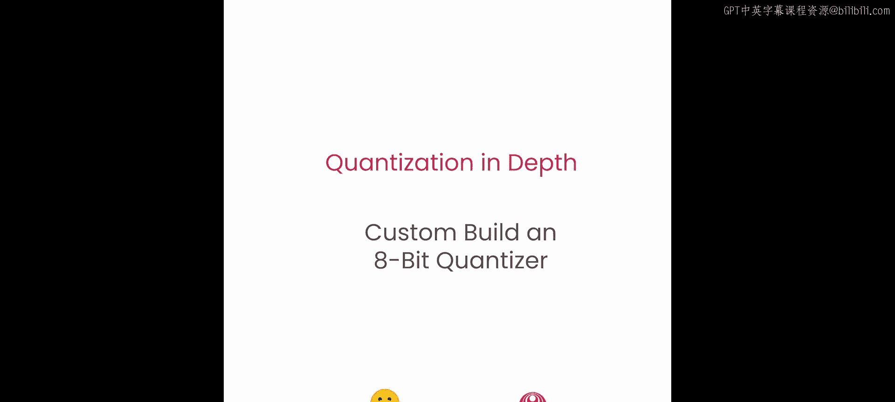
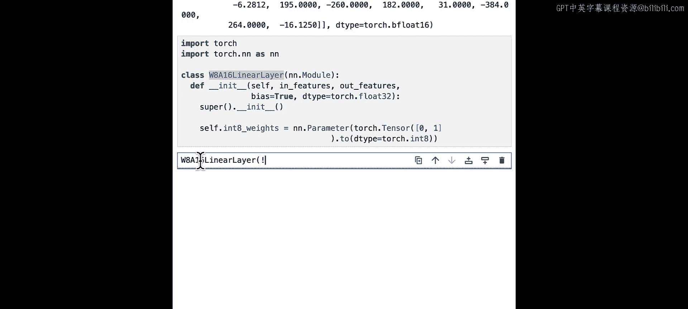
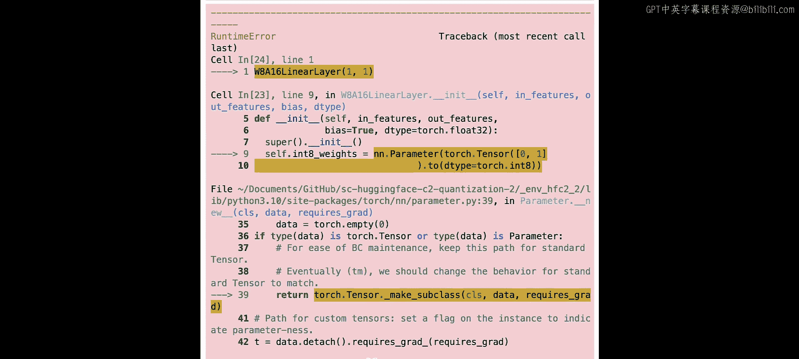
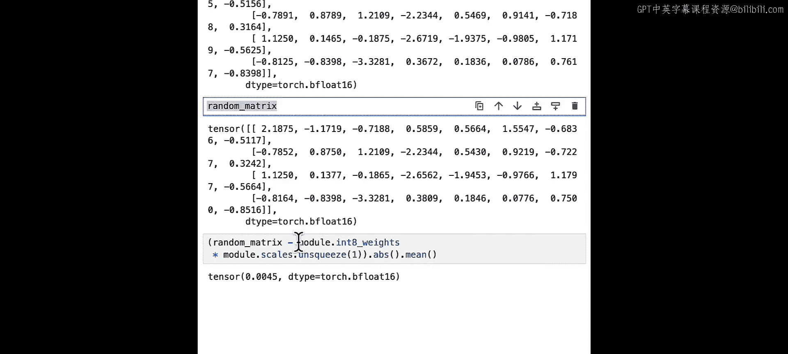

# 吴恩达《深入模型量化｜Quantization in Depth》中英字幕 - P10：10.Custom Build an 8-Bit Quantizer.zh_en - GPT中英字幕课程资源 - BV1kw4m1X7Bi

In this lesson you will leverage the tools that you have just built in order to create your own quantizer to quantize any model in8B precision This quantizer is Moity agnostic。

 meaning you can apply it on vision， audio， text and even multimodel models let's get started and quantize some models。

In this lesson we will learn together about how to make our own quantizer to quantize any model in a bit precision using the per channel linear quantization scheme that you have seen in the lesson previously so for that we'll break down our project into multiple substep so well first deep dive into creating a W8 A16 linear layer class and W8 stands for 8 bit weights and a16 simply stands for 16 bits activations we'll use this class to store 8 bit weights and scales as you have seen previously on the previous lesson and then we will see how we can replace all instances of torch n end of linear layers with that new class and then we will build a quantizer to quantize a model end to end and we will test our quantizer on many scenarios and we will study the impact of the8 bit quantation on different models。

So let's start with the first subt that we have defined before。

 So building the W8 A16 linear layer class。 So for this task。

 we'll also break it down into different multiple subts。 first of all， you will build。

A four method called W8A16 forward that we take as inputs。It bes。16 bit inputs。

Scals and optional bias Once you have built this method。

 the idea is to call that method inside the linear layers forward pass。And pass。

The8 bit weights of the linear layer input， the scales that are stored inside the layer and the optional bias as well。

So let's get started so what the W8A16 for method will do under the hood is to first cast the 8 bit weights into the same data type as the input so for example in the case the input is in float 16 or Bf 16 cast the weights into that precision while keeping the weights into the same range as before so between minus 128 and 1207 well just cast the data type of those weights in health precision so that it will match the data type of the input。

Then we'll perform the linear operation， so classic matrix multiplication between the input and the cast weights。

 we will multiply these results together with the scales of the model and optionally add the bias once this is done。

So let's get started so let's first import those modules that we will use for implementing our method and I'm also defining here some random inputs or random88 matrix random hidden states。

 random scales and random bias so typically the workflow would be something as follows so we first cast the weights into the same data type as the hidden states。

 then on top of that。You will perform the matrix multiplication by calling F dot linearar from Pytorch。

All right。And then we'll multiply that with the input scales。

And optionally add a bias term at the end of the operation。

Perfect a note is also for the weight matrix， so it has the shape。

Output dimension input dimension when you perform the matrix multiplication between the in8 matrix and the input hidden states。

 you will have a vector of batch size output dimension of 132 so it's important that the scales has the same shape as the output shape of your weight matrix and same command for the bias so that you can broadcast the operation between。

The output from here and the scales and。The whole output here and the bias perfect。

 so let's wrap everything in a single method。Perfect。

And let's also quickly try it out with and without bias great so it seems to work fine。

 so I guess we can move forward with the next building block that will leverage the method we have just created to continue building our linear layer class we'll start implementing the init method of that class so recall for this linear layer we need to store the intnate weights。

 the scales。And the bias， let's first start by implementing the skeleton of the init method。

 so it has to kind of match the signature of the init method of a torchlinear layer so。

It has to contain input features， output features in order to correctly initialize the input matrix。

 the weight matrix bias， whether the linear layer has a biaser or not and data type which should correspond to the data type of the bias because our weight matrix will have a torch not innate as data type so here we're going to define our innate weights together with the scales that are going to be stored in the linear layer。

 so if you have done any bytorrch before this lab you might be directly trying your hands on doing something like this to create your innate weights assign a new attribute innate weights being a parameter。

And then maybe do something like this So the issue with this with this approach is that when you create an n dot parameter Pytorch expects that parameter where it's able to compute gradient on it The issue is that with Pyttorch you can't explicitly compute gradients。

On in8 tensors yet， so you should get an error if you try just to initialize a dam layer with this approach。

 so if you try that out， you get an error saying only tensors of floating point and complex detail type can require gradients。

So the right approach to store in8 weights is instead of。

Saving attributes as being an end parameter is to call this method called register buffer that way instead of storing a parameter we just store a buffer。

 meaning we don't need to compute gradient on that tensor and you can initialize it with whatever detail that you want so if you try that out and initialize the deminator it just works。

So let's continue designing our linear layer， so we have our innate weights。

And then we'll do the same thing for scales。As well by initializing with the correct shape and we're also going to call register buffer on scales because again here we're just expecting to do simple inference。

 we're not interested in doing training so just calling registered buffer is sufficient and then we're going to store an optional bias so if bias is set to true we're registering a new buffer called bias。

 otherwise we'll set it to none。So let's quickly try that out and create a dummi instance of a linear layer and see if our attributes have been correctly saved。

Perfect so yeah， so all the expected attributes have the expected shape， so output shape。

 input shape， output output shape or the scales， I guess we can move forward with the next with the next task which is building the four path of that class。

So we're going to copy。What we did here and we're going to call the method that we have globally defined in the first subtask and we're just simply going to call it on self dot intake weights。

 cell do scales and cell do bias and this method will do everything under the hood for us and we'll take care of casting the weights into the correct D type and multiplying everything with the scales and optionally add the whole results with bias all right so let's create a new module some du hidden states with the shape patch size sequence length hidden shape we should match the input hidden state shape that we have past here。

Perfect， so we still have bud size sequence length and here instead of input shape we have output shape。

Let's also check data type。So the D type is correct。

 flow32 because we have initialized a random tensor and by default pytorrch initialize everything in torch do flow 32。

 Great now that we have a fourpath that is working。

 a linear layer class that has all the needed attributes we need to build quantized method in order to perform the linear quantitation algorithm that you have seen in the previous lesson so that the weights gets correctly quantized because right now everything is random so if you replace all the layers with this linear layer it get gibbbriish output most likely so just to give you more idea once we have defined that quantized method the workflow would be the following so youll have your base model that is let's say half precision so either FP16 or Bf16 will loop over all the linear layer classes replace them with our new linear class and then call quantize by passing the old weights in order to。

Quantize the old weights into int8， so let's redefine our class again and here start thinking about the quantize method。

 So as I said， the quantized method will take the original weights as input。

 It will quantize the weights in in8 precision。Get the scales of the quantization and then manually assign in8 weights and scales to the computed quantized weight and scales so let's do that step by step so first of all I would recommend to appcast the weights in FP32 for stability so we'll get the weights in FP32 first and then we will use we'll use this simple formula that you have seen in the previous lesson so we'll first get the absolute values of the weights get the maximum on the last dimension and divide it by yeah 127 in order to get the scales so we're going to assign that to scales variable and make sure that scales has the same data type as the input weights。

By calling2 weights the D type and to get the intake weights we just apply the formula that you have seen on the previous lesson on linear quantation。

So this is the per channel linear quantation。As you're getting the maximum on each element of the last dimension。

So yeah， basically this is how you get the intake weights， again， it's based on the previous lesson。

And we're just simply assigning。Cote intake weights and scales。With distancers。

Perfect and the forecast pass will stay the same。Perfect。Okay， so let let's try that out。

 so let's first initialize the D module maybe print the intake weights before quantizing and we'll compare the results after quant as well I might just take a smaller。

やep。All right， let's also pass some Dmi random。Original weights。

 so this random matrix will act as the original weights that you're going to use to quantize your module。

 so let's call modulate quantas perfect。So as you can see。

 the weight ssor are completely different because we quantized the module with the correct weights。

And also。The in weights are now between minus 128 and 127。

 so those values did not existed before because the module has been inized randomly and since here we're performing Abmax quantization we always have these values in the quantized in weights yeah we can also inspect the scales of our quantized module。

Which looked like this， I wanted to quickly inspect also the shape of scales。

So you have a tensor of size 4， which is the expected output shape。So we're going to do the same for。

Int 8 weight， so 48， so if we directly multiply the two tensors。

 it won't work so you have to add a new dimension here in scales。All right。

 so let's compare that against our original weights。 Yeah， so as you can see。

If you quickly look into it， the weights look pretty close。

 we can have also a better idea by computing the quant error that can be done through this formula so we just。

Subtracting both tensors， so the deco quantized weight， the original weight， absolute value。

 so this is the average quantization error for each element between the original weight and the deco quantized weight perfect。

