# 吴恩达《深入模型量化｜Quantization in Depth》中英字幕 - P11：11.Replace PyTorch layers with Quantized Layers.zh_en - GPT中英字幕课程资源 - BV1kw4m1X7Bi

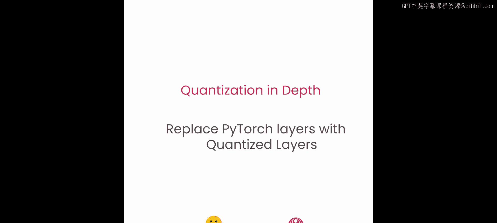

We have now all our building blocks to build our quantizer so the quantizer is going to be a quantization pipeline that will iterate over all linear modules of your original model and replace them with our new W8 a16 linear layer module and call quants on using the original weight yeah so let's do that step by step so let's first build a method called replace linear with target that is going to loop over the model identify the modules that are an instance of torch at an end of linear and replace it with the new module yeah so this is going to be the signature of our method so it's going to take module or also model but since the method is going to be recursive I decided to call it module so that yeah it's clear that you can pass a model but you can also pass a module target class is yeah the target class。

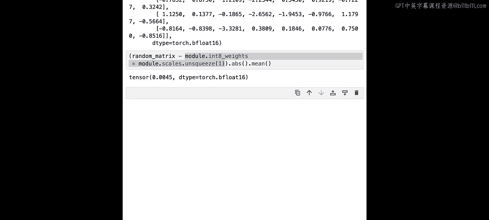

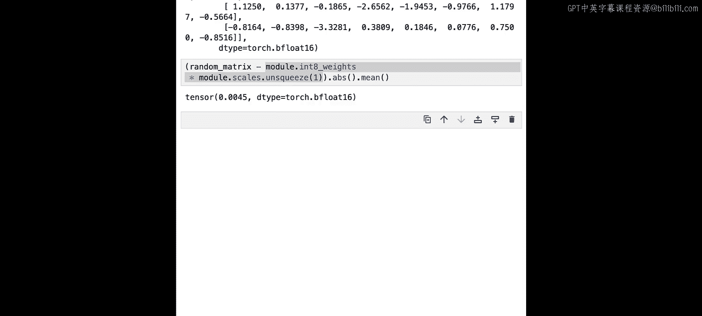

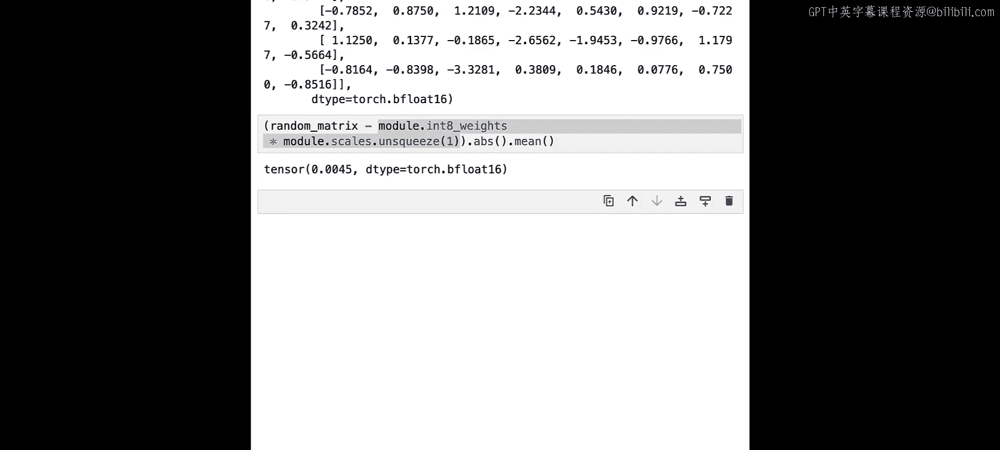

Of the new class that you're going to set in replacement to the linear layer and module name to exclude is the name of the modules that we're going to exclude in this replacement logic so we're going to see later for language models that usually it's better to keep the last module unantized for better results so this is going to be useful for you know these specific use cases so we're going to simply loop over the modules named children and if the submodule is an instance of an end linear and you don't have any name that matches the names that are inside module name to exclude。

Then we're going to move forward with the module replacement。

So we're going to get the bias of the sub module here because we're going to use it to create our new target class。

 and then we can create our new module。Which is going to be target class of。So in featuress。

 out features should be the same as the linear layers， the original layers one bias。

 we're just simply going to check if old bias is not none and we're going to use the same data type as the sub moduleule's weight。

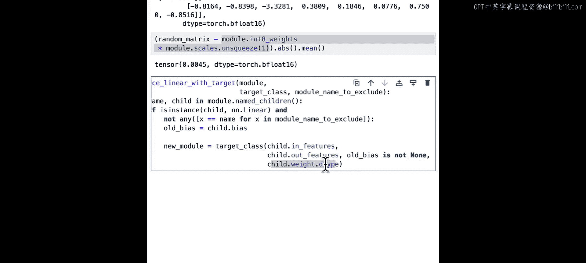

And we're going to call set attributes。To the parent module。

 we're going to replace the current attribute of the module by calling set attribute module name because name gives you the name of the current attribute we're going to modify and then new module。

 so this is simply going to replace the parent module's attribute that has the name name with the new module。

And if the old module has a bias， we're going to explicitly set the bias of the new module to old bias and yeah and as I said previously we're going to call that method recursively so if we're not in this case we're going to call that method again but this time on the child module using the same arguments okay sos let's try this method out so we're going to create a dummy model for testing purpose yeah with two linear layers one language model head which is usually the last module in a transformer model since the method modifies the model in place we're going to create new two model so one where we're going to test out the module name to exclude feature and the other one which is just going to replace all linear layer instances with the new one so let's try out the first case so we we just have to call replacing target model one our target class so this time we don't want to replace。

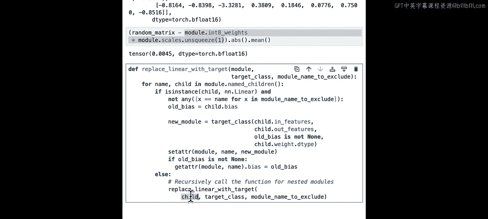

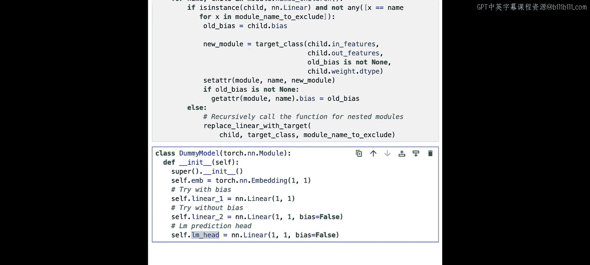

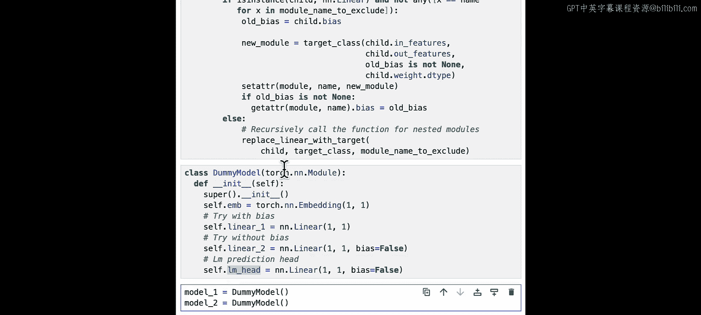

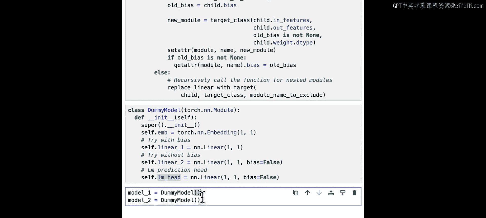

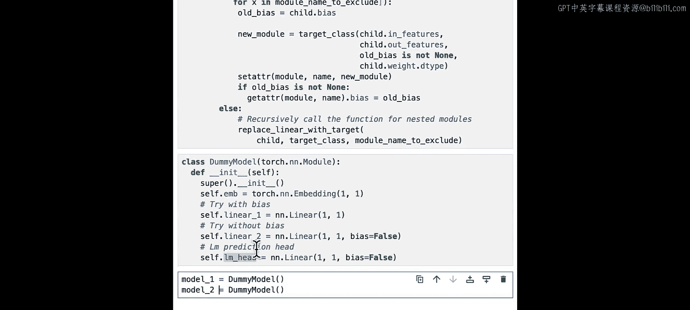

The LM head with the new class。

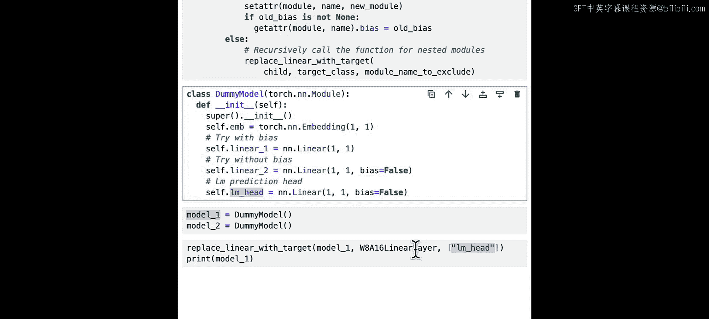

So perfect it worked and we were able to replace all linear layers with new ones except for the LM head and let's see what happens if we pass an empty list。

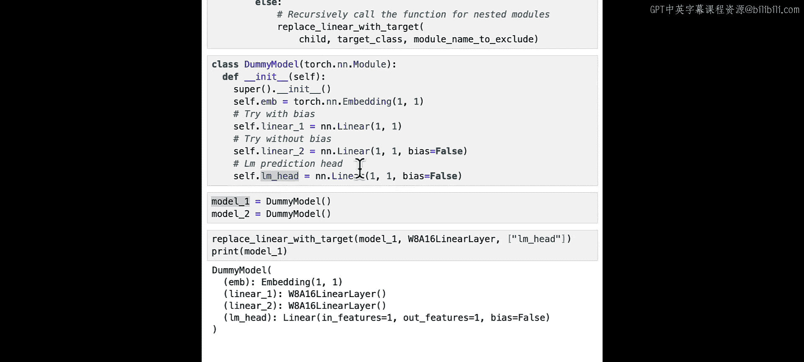

Yeah， so as expected。For the second case we replaced all instances of linear layers within with the target class Yeah so now let's just tweak a bit this method in addition to replacing all linear layers with target class。

 we're also going to quantize the new module once we have replaced the old module with the new one so。

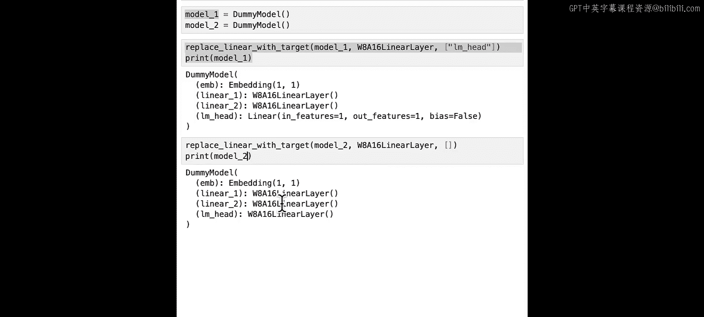

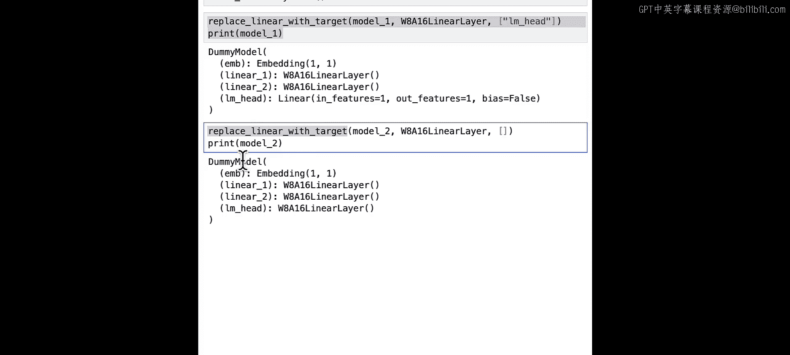

I'm just going to copy this method and slightly replace it。

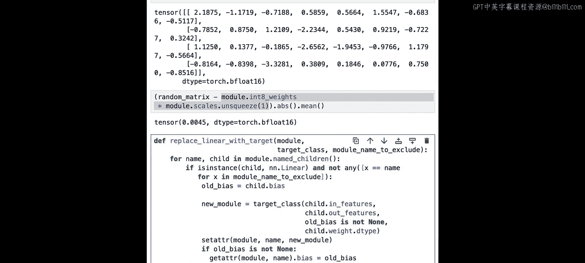

In order to quantize the new module as well， so here we can also retrieve the old weight。

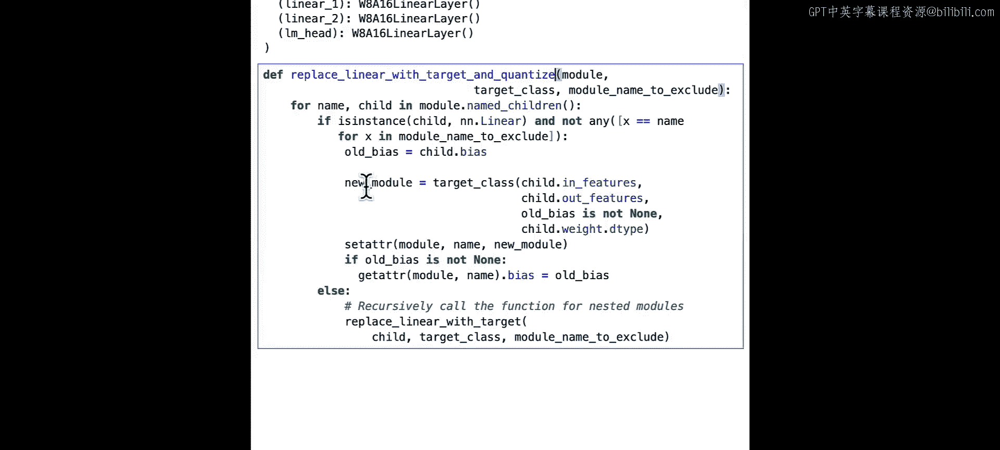

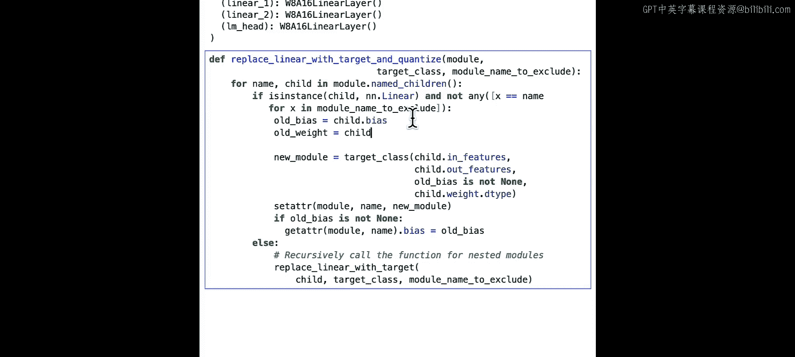

Perfect， so I think the quantization should happen here once we have replaced the module with the new module。

 we can get that module again with get attributebute module name and at this point this should return the new module and call quants and pass the old weight。

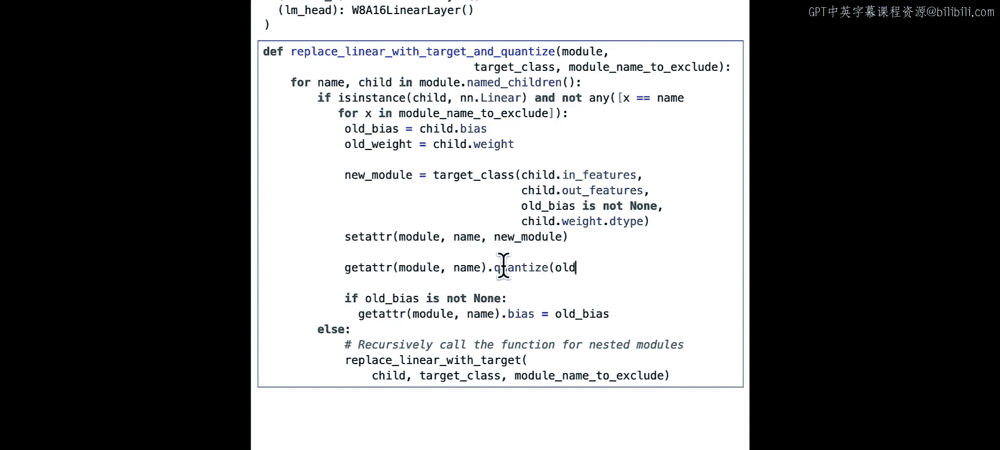

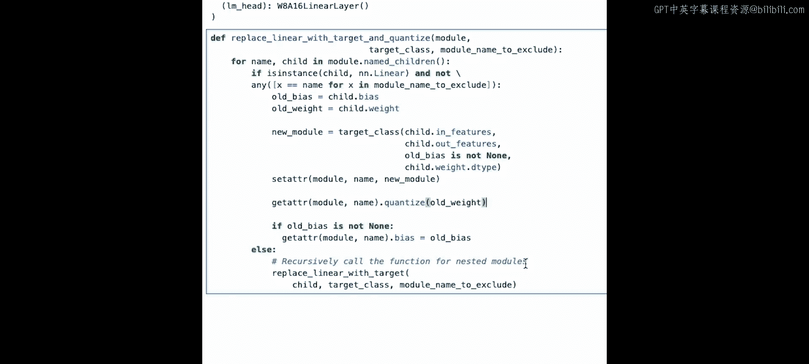

Let's also update the recursive function call。So let's try out again just to see if it works using a new dummy model。

Perfect， so yeah， it seems that it worked。

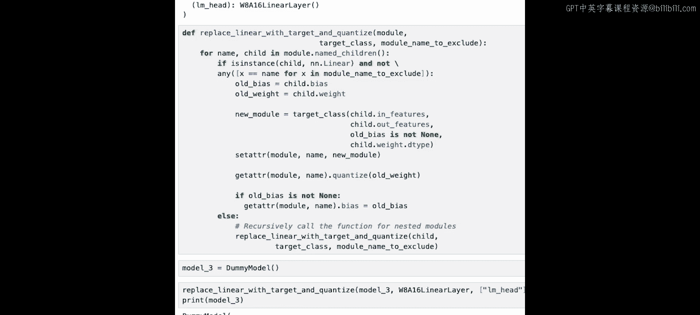

Great。😊。