# 吴恩达《深入模型量化｜Quantization in Depth》中英字幕 - P12：12.Quantize any Open Source PyTorch Model.zh_en - GPT中英字幕课程资源 - BV1kw4m1X7Bi

The thing is that right now we tried everything on a dummy model。

 I we want to test out also on real use cases， yeah meaning useful models。

 so let's test out our implementation and our quantizer right away on models that you can find on hack fish transformers。

So let's get started。So for this demo， we're going to use this model called Salesforce CodeG 350 m mono。

So this is a language model that has been fine tune on code and it has only 350 million parameters。

 let's use transformers to load the model together with the tokenizer and get some generation。

And let's use the tech generation pipeline in order to get some tech generation。

 so we're going to load pipeline text generation and pass the model and the tokenizer。

And then since it's a model that has been function on code。

 let's try to battle test the model by giving it some code completion task。And try to see if we can。

Generate some consistent text in order to print hello word in Python。So the fellow word。

Print had a word which seems to be correct and then the model has also suggested to call the method right after and then well it ended up with some comments in perhaps Korean but that's fine Yeah overall the model seems good and also bear in mind that the model is a small model it's 350 million parameters you might get more impressive results with larger models but anyway yeah。

Let's just out of curiosity print the model before quantization， so we're going to shrink the model。

 quantize it in8 bit and try to get some generations on the quantize model so yeah this is how the model looks like you have a lot of linear layers because it's a transformer based architecture so most of the most of the weights come from some linear layers on the model and let's call。

Our。Quantitization API replace linear with target and quantize model target class and as I said we're not going to quantize the language model head because since the model is an autoregressive model it uses the output from the previous iteration to get the output of the next iteration if you quantize the language model head a lot of errors might be accumulating over the generation steps and you will most likely end up having some gibbish after some tokens and notice this method modifies the model in place so we're just going to inspect pipe dot model。

And check if the model has been correctly quantized。

 so yeah we can confirm the model has been quantized by checking that the linear layers has been replaced with the W8A16 linear layers。

 we can also confirm that the language model had is still a torch and linear which is expected and intended。

So let's do some generation and see the results perfect so it's able to generate a correct method of printing hello word in Python its also tried to call hello word in the main python file but somehow the model has commented the call to that method but I guess that's fine for generative models since the model generates output from past input so it's an autoregressive model all the running errors can sum up once you start generating a lot of tokens NtL maybe all of these errors gets super large so that it affects the models performance this specifically affects larger models so maybe greater than 6 billion parameters and the whole noper degradation quantization for LLMs is a whole exciting topic and it has been also addressed by many recent papers such as LLM do in8 smoothqu GPTQ Qlora AWQ and so on and probably many many more directly。

Forgo to mention。 and we're also going to briefly explain a little bit the insights behind these papers in the next lesson。

 Alright， we can also try out to quantize models from other modalities。

 I wanted to show you how to call the quantizer on an object detection model。

 So the workflow is going to be typically the same。

 We're going to call the API that we have designed on a model that we will load from transformers。

 So we will use this class。 So D ETR for object detection。

 So D ETR is an architecture that has been designed by Facebook AI that is used for object detection。

 So you can inspect the。The model card on the hub in order to get the code snippets on how to run the model so this is the way to load the processor and the model from Hiingfaceace hubub and we're going to call our quantizer on the model itself okay so before quantizing the model we can get the memory footprint of the model before quantizing it。

So we just have to call model that get memory footprint and the size of the model should be something around 170 mebytes perfect yeah。

 I want to quickly test the model before quantizing it and visualize some results。

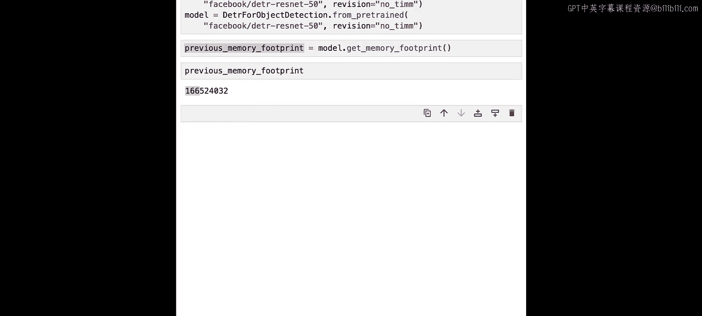

So we recently went to dinner altogether and we took a nice picture。

 so we're going to use this picture and try to detect as as many objects as possible using the model。

 perfect yeah， so if you check out the model card of the model you can get an idea of what is the code snippet to use in order to run the model so we're just going to use that and call plot results。

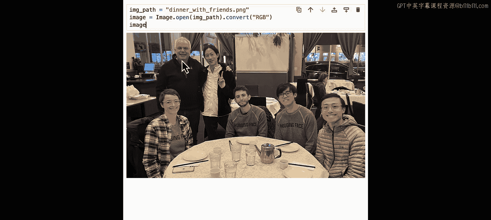

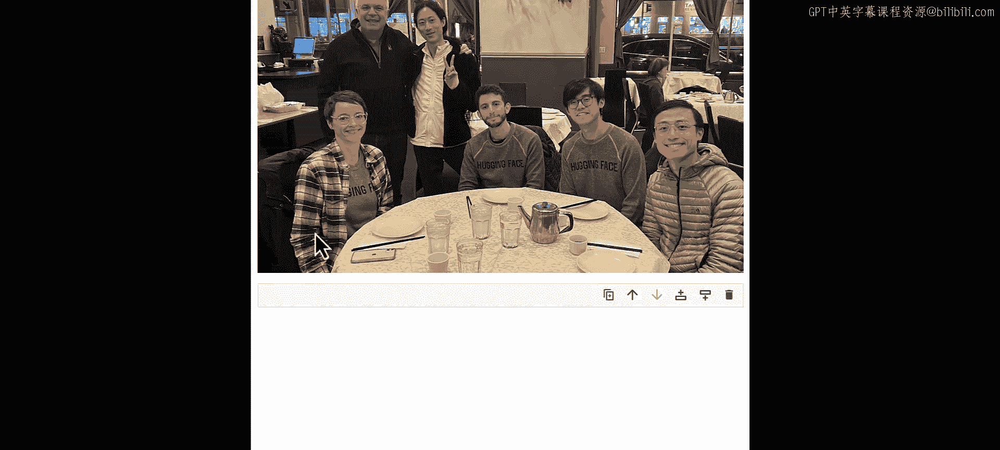

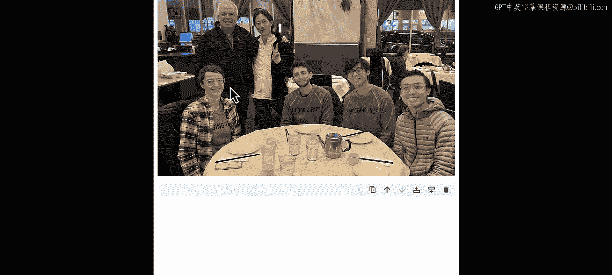

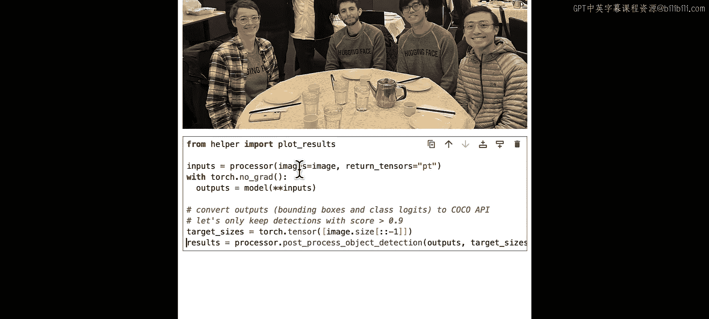

And the results。So very cool， it was able to detect all the people here。

So with the correct class person it was also able to detect the table here on the left， the phone。

 the cups， the knife and also the card that is on the background and even this laptop there is a bit far in the image that's really cool yeah so let's try to quantize the model and visualize the results of the quantas model so before doing that let's quickly inspect the model so。

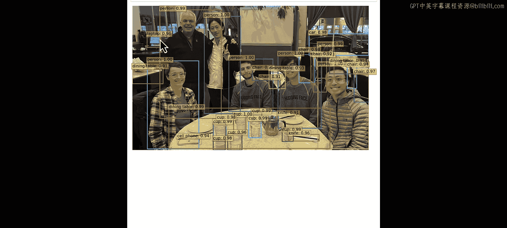

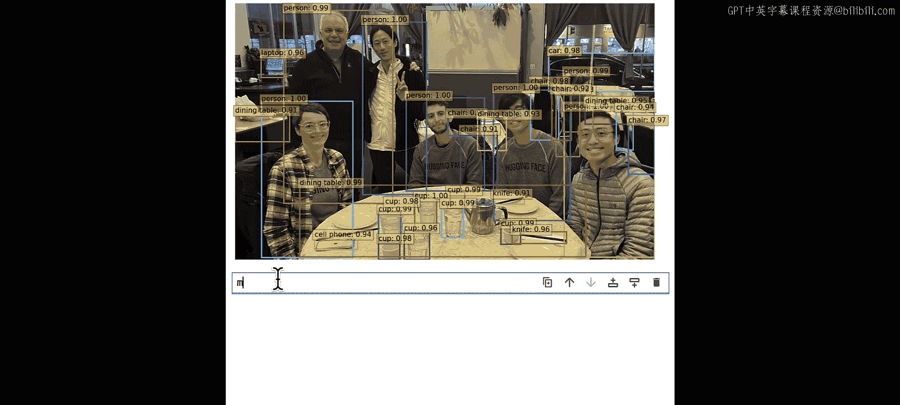

The impact of the quantization is going to be a little bit lower than a language model because as you can see here。

 so there are many convolutional based layers， so these layers are not going to be quantized。

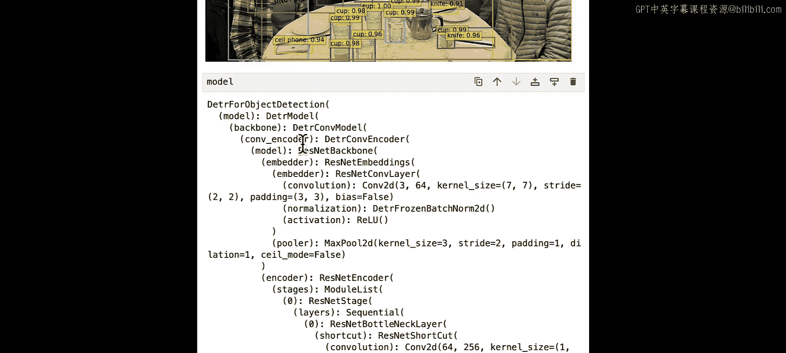

But if you go down。The layers that are going to be quantized are going to be the linear layers that are here in the encoder and the decoder。

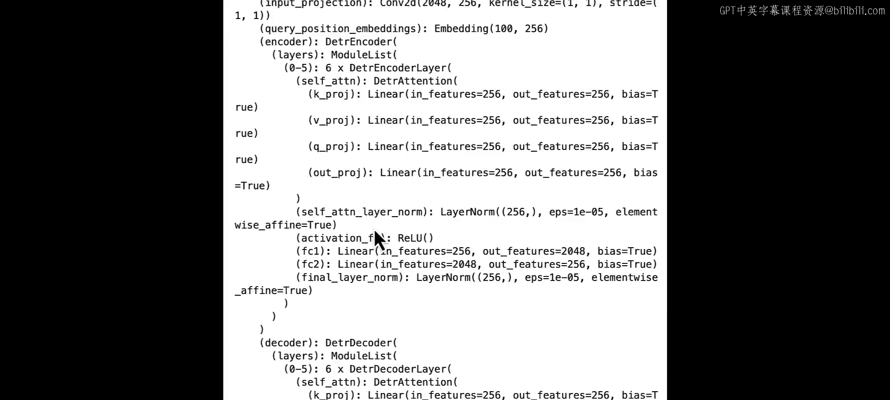

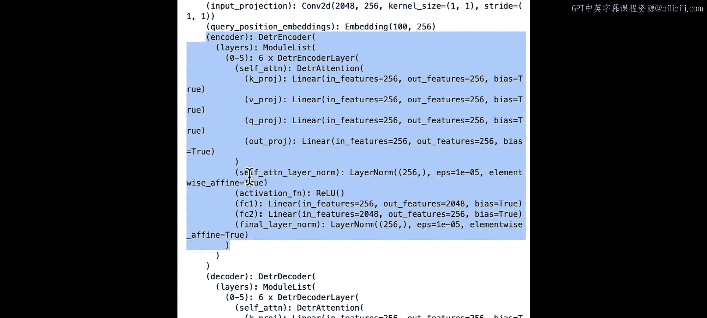

Here and yeah so we're still going to keep that practice of trying to not quantize the last layer。

 so the bounding box predictor we're going to keep it in its original precision。

 so we're going to call replace lion layer model target class 012。

So that we don't quantize these layers and the class labels classifier as well and everything is is specified here。

 perfect， let's inspect the model again。 So yeah， as expected。

 the convolution layers are still the same and the encoder and decor layers seem to be。

Correctly quantized in int8 perfect。 And of course。

 we kept the last modules in their original precision。

 Let's visualize the results with the quantized model。

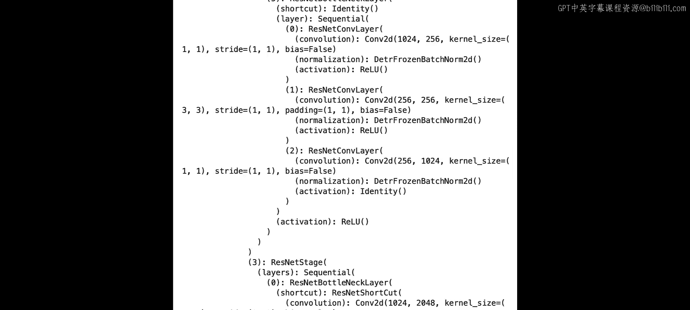

Perfect yeah so yeah I think we got pretty much the same results I think we're able to detect the same instances yeah even the computer that you can see on the background。

 the chairs and the car as well let's also try to have a good idea of how much memory did we manage to save so。

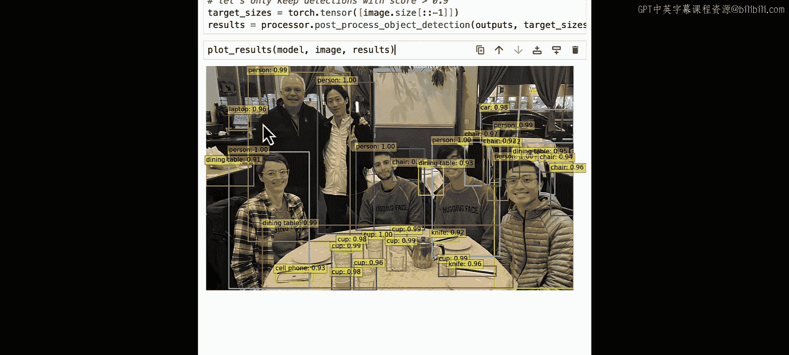

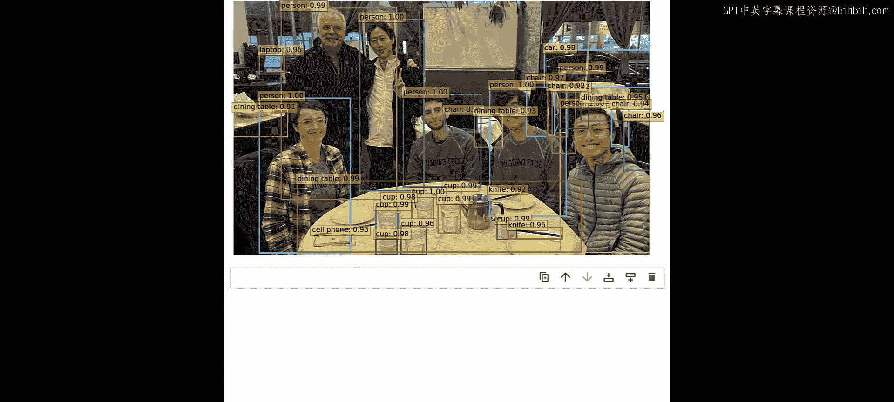

This is the new memory footprint。 So yeah we were able to save around 50 mebytes So before we were around 160170。

 So yeah it's a reduction of maybe around 2530% So that's not bad and we managed to keep most of the capabilities of the model So yeah now I invite you to post the video and you can also try out this approach on other models other modalities you can also try to maybe break the quantizer and see what went wrong。

 maybe I don't know try to also quantize the last module to see how does it affect the model's performance and yeah you can also try that out on as many modalities as you want you can try it on a vision model you can also try it on an audio model on a multimodel model So yeah feel free to post the video try out the API we designed together on other models and also bear in mind that the API modifies the model in place So once you have loaded the model and called。

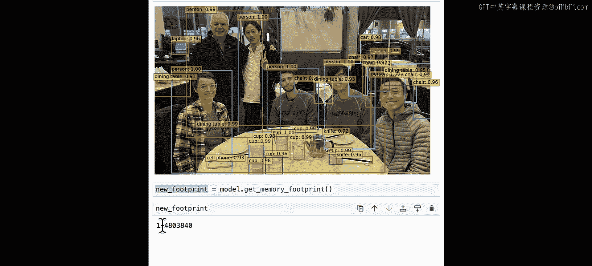

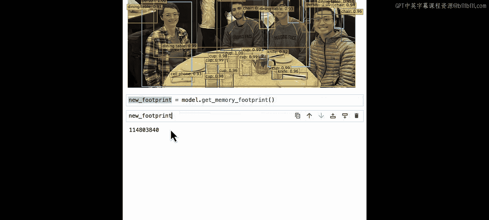

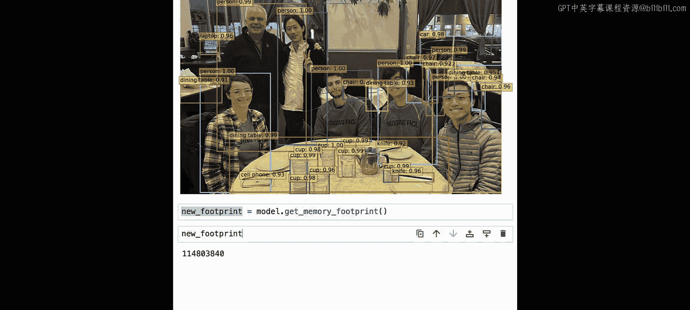

The quantizer on the model， you need to reload the model if you want to compare it with its original version。

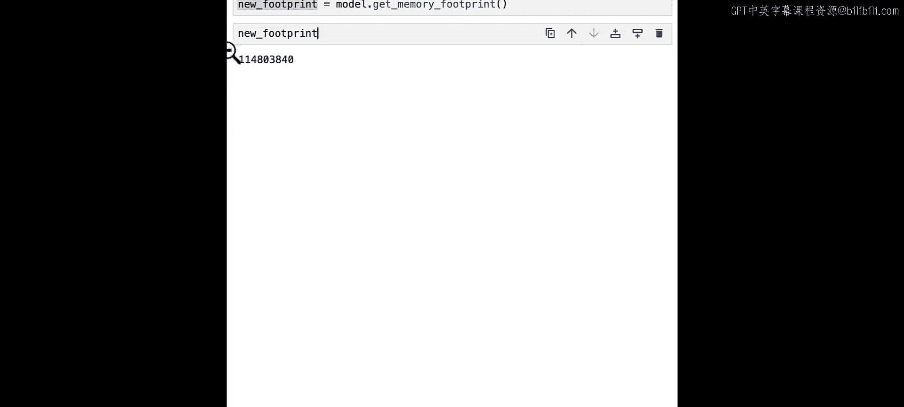