# 吴恩达《深入模型量化｜Quantization in Depth》中英字幕 - P13：13.Load your Quantized Weights from Hugging Face Hub.zh_en - GPT中英字幕课程资源 - BV1kw4m1X7Bi

Before wrapping up the lesson， I wanted to maybe quickly show you a follow up approach of the quantization API。

So note in the current design we need to first load the model in its original precision in order to quantize it So ideally this is not really optimal because you need to allocate enough RAM in order to load your model in the default day type and then quantize the model in practice you can maybe quantize the model using a large instance so if let's say you have a bigger machine then you can quantize the model using your machine and then push the quantize weight somewhere on the cloud。

 for example on Hegingface hub and then directly load the model in8 bit precision or even lower precision on your machine So let's try to build something that covers this approach So let's imagine we're now in the in the big instance where you have enough RAM where you can quantize the model so you can let's say load a language model for example。

 OPT125 m so we're just going to load a small model for just demonstration purpose and let's say we're quantizing the model so we're calling our。

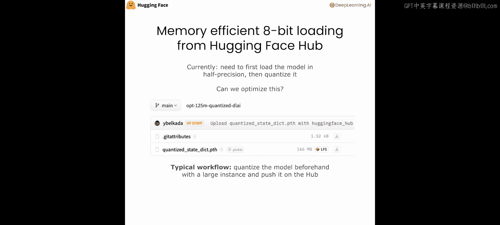

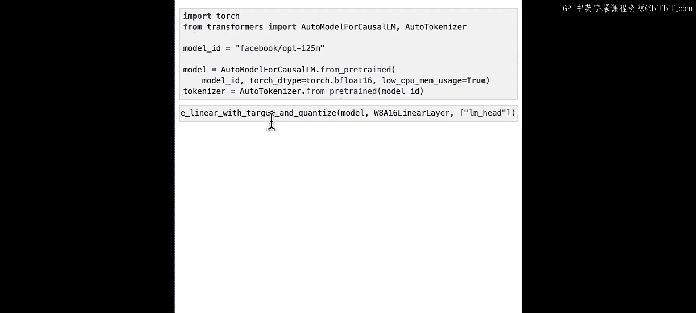

Quantizer here。Let's make sure the model is quantized。

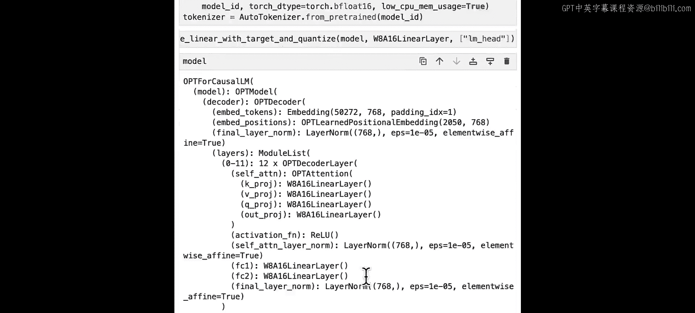

So that's the case you can retrieve the quant statedict by calling model that stayeddict in order to get your model's weights and then you can save it somewhere so yeah let's say we saved it locally here and then you can use some utility methods from the Hagingface hub library in order to push these quantized weights on the hub so I'm just going to show you how the API would look like so you just have to import HF and create repo from Haging F hub you can put your huggingface user name here and then you can define your the ID of the Repo where you want to push the quantized weight so it's going to be under your user name name of the repo so here I decided to call it OPT125 m quantized deep learning AI here we call API HF to initialize the huggingface hub API optionally you can create the Repo you can also do it manually through the Hagingface website and then you just have to call API upload file。

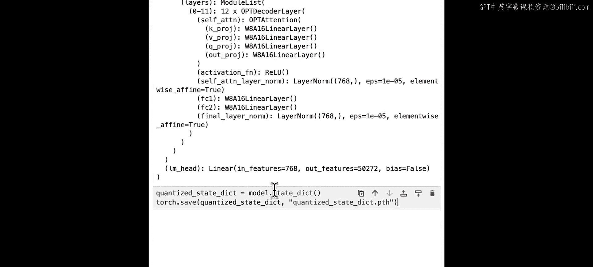

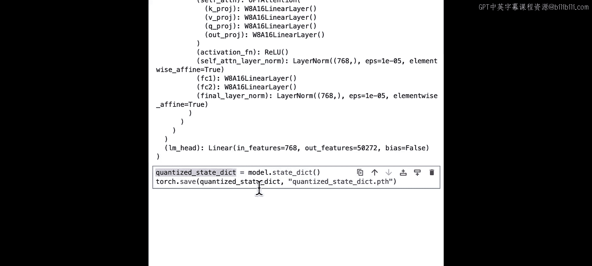

The path in your local computer of the object that you want to push and then the target path in the rippo。

 name of the Ripo if you call that you can successfully push your quantized weight on Higingface hubub so yeah so you can imagine that in your large instance where you have GPU or CPU Ram。

 you quantize your models as such and then you push them on Higingface hubub and then now in my local machine all I have to do is to load these smaller state diict because it contains the quantized weight and we're going to leverage a feature from Pythtorch called the meta device。

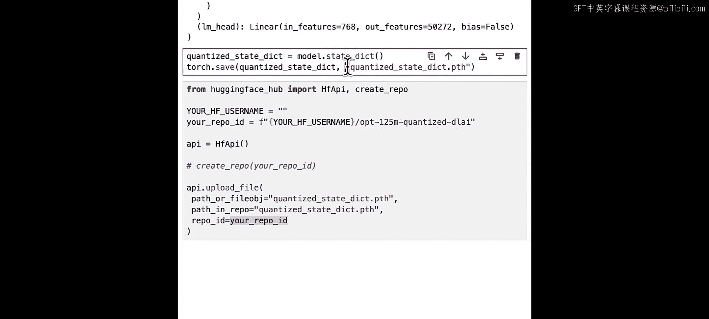

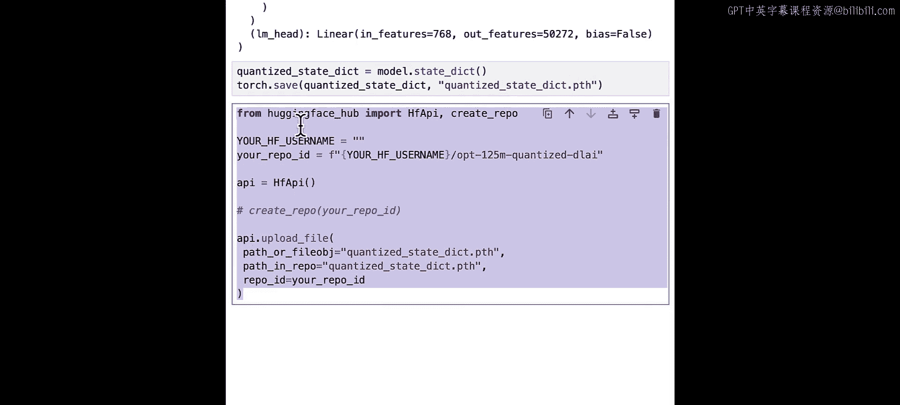

So the idea here is to first load the skeleton of the model in order to get the exact architecture of the model。

 the correct modules and so on， and then once we have loaded that skeleton。

 we just need to replace all instances of linear layers with our quantized layers without quantizing the model because we don't have access to the weights since all the weights are in the meta device meaning they're not getting initialized and then once you have replaced all linear layers。

 you just have to call model that load state dict by passing the quant state dict since the state dict will automatically assign the correct weights on each module so that way you save your CPM because you don't have to load your original model first you directly load the quantized version of the model by loading the state dict and also you're leveraging the meta device from Pythtorch where you just have to load the skeleton of the model instead of loading the whole model itself so in terms of code it would look。

Something like this， so you need to first load the config of the model to get the details about the architecture of the model。

 and then you just have to initialize your model and under the context manager towards the device meta。

To load the model on the meta device， so let's try that out to see what happens exactly。

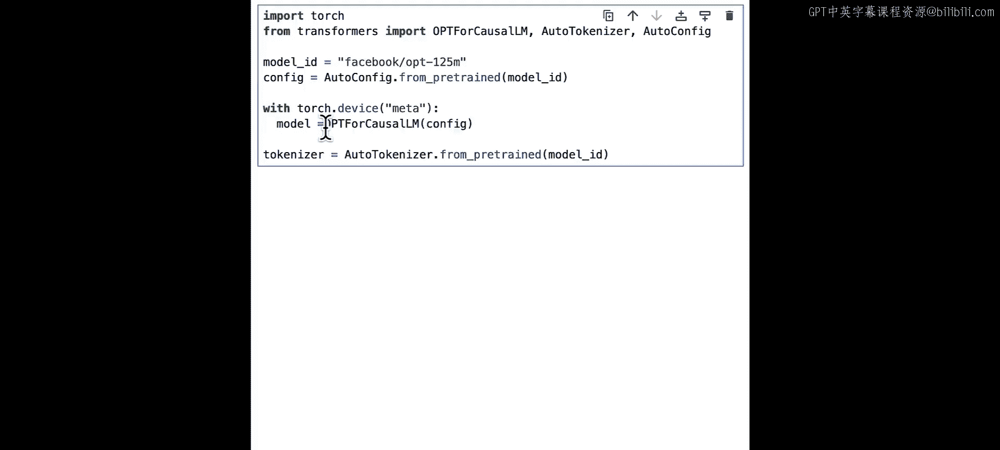

So if you try to print the parameters of the model， you'd get something like this。

 so you have all your parameters， but the tensors are not initialized at all。

 so you have a bunch of metatensors that don't take any RAM so you can have as many metatensors as you want。

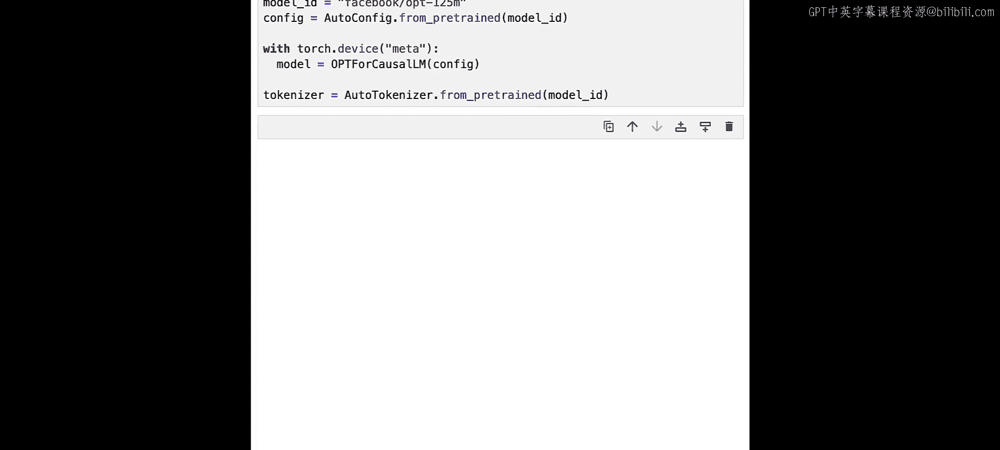

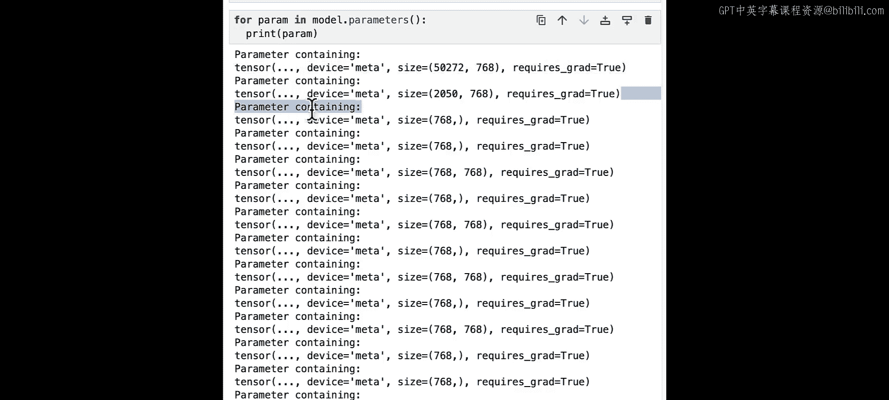

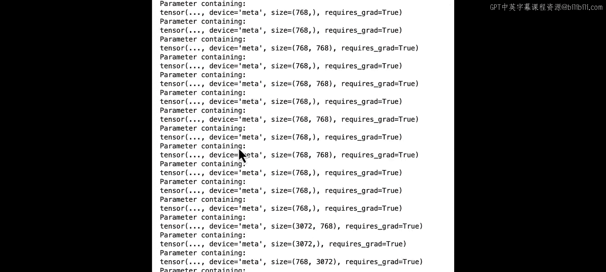

But。You have all your information about。The model architecture。

 so the model skeleton is already there if you have some linear layers。

 you have everything except the weights。 So instead of calling replace linear with target and quantas we're just going to replace the linear layers with the quantized layers。

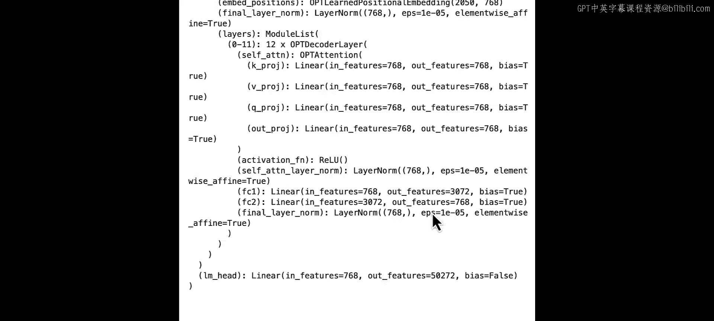

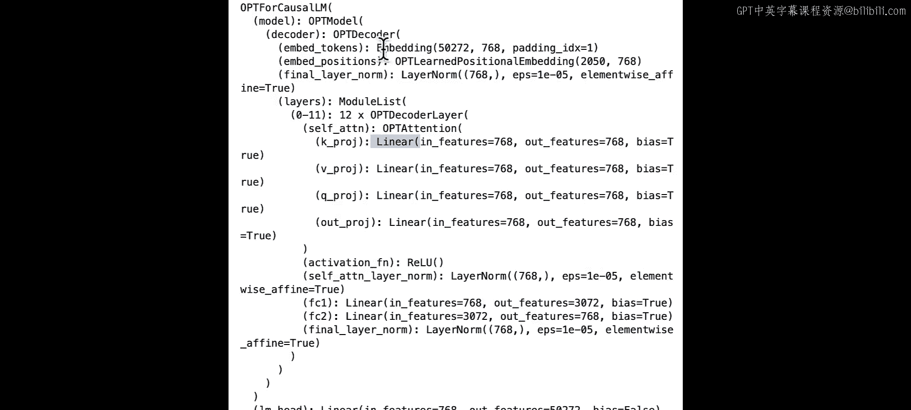

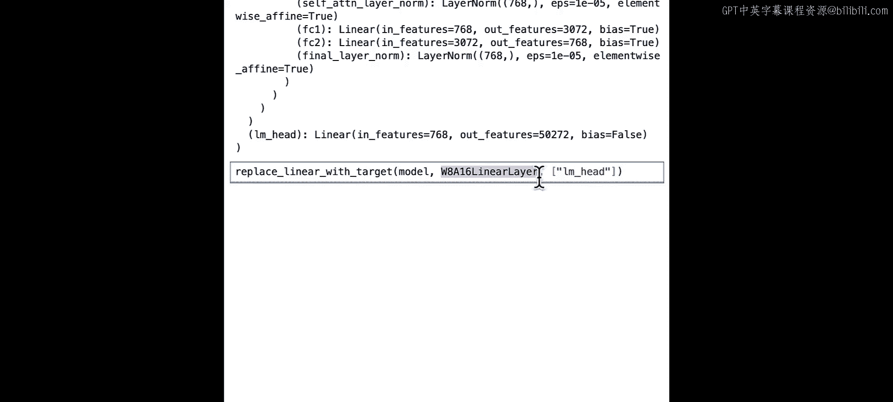

Perfect， and if we print the model。Perfect so now the next step of the workload is to load the quant state d so for that we're also going to leverage some methods from Hugingface hubub library called HFHub download with that method you can load any file from the hub using this API and H of hubub download will return you the path on your cache to the loaded object so here I've already pushed for you the quant weight on the hub and I'm specifying the path on the hub of the file that I want to get and as you can see here the file has only 166 megabytes so the model is a 125 million parameters model so if we store the row state d in half precision of the model you would need 125 million times2 because in half precision each parameter takes two bytes so it would end up having 250 megabytes here the state d is only 166 million parameters because most of the weights。

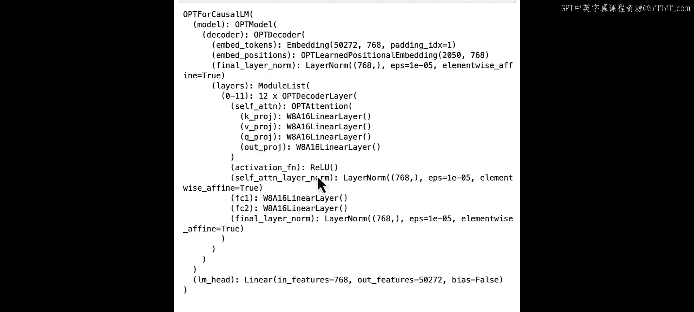

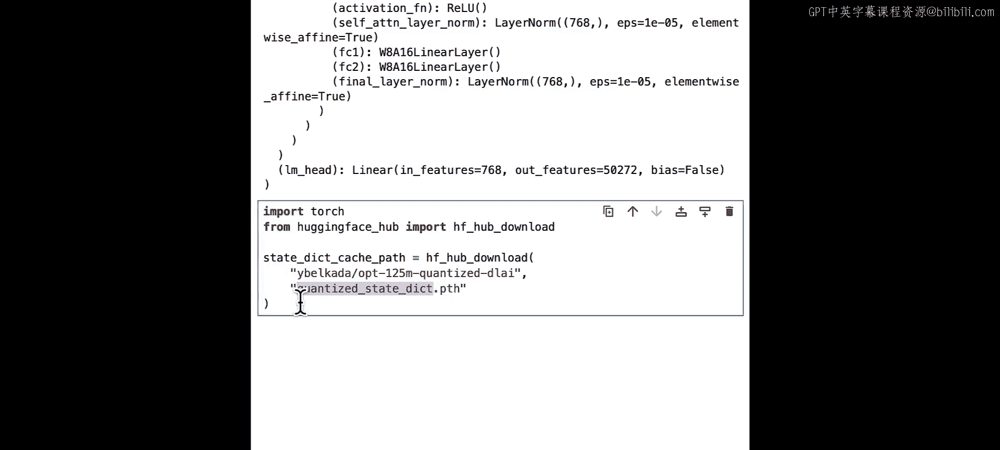

Are in 8 B precision， so 1 by， 1 by per parameter， 125 MBby and then you have approximately 30 gig between probably the language model had。

 but also the scales that are stored in float 16 and then we load the state dict because yeah this returns you the path to the cache so we load the state dict as follows and then since the model is loaded on the meta device we need to call load state dit but with strict equal true and assign equal true。

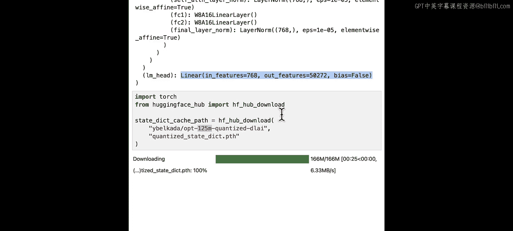

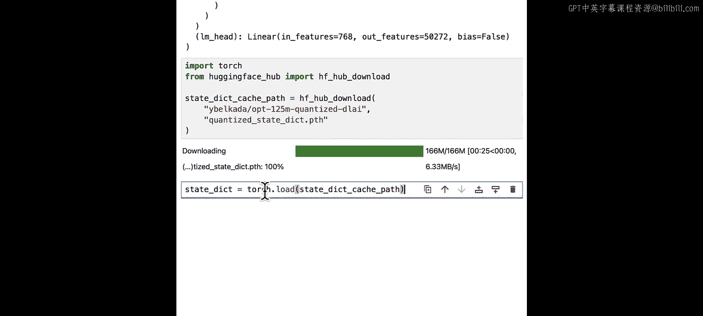

Perfect， all keys match successfully， so now our model has been loaded， it's ready to be used。

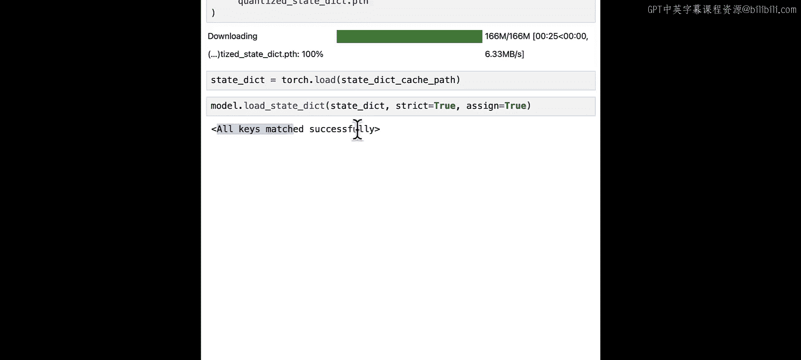

Perfect。Hello today I'm a student of the University of the Philippines。

 I'm a student of Philippines and so on， the model bear in mind that the model is a small model。

 so it's probably more or less expected that you have some repetition if you don't provide a lot of context。

Let me try maybe another prompt。Hello to them， giving a course about the history of the world and the history of the。

Yeah so the model is still repetating a bit itself but maybe with some sampling methods and by trying out a larger model maybe you would be able to get better results that's it for today's lesson。

 yeah so in the next lesson we're going to see some challenges in the lesson I mentioned the outlier features for example。

 for large language models when you quantize them some other challenges such as storing low bit weights for example two or four bits you're going to try your hands on packing the weights in order to store two or four bit weights and we're also going to cover the most recent state of the art approaches in order to address the outlier feature challenges when it comes to quantizing large language models。

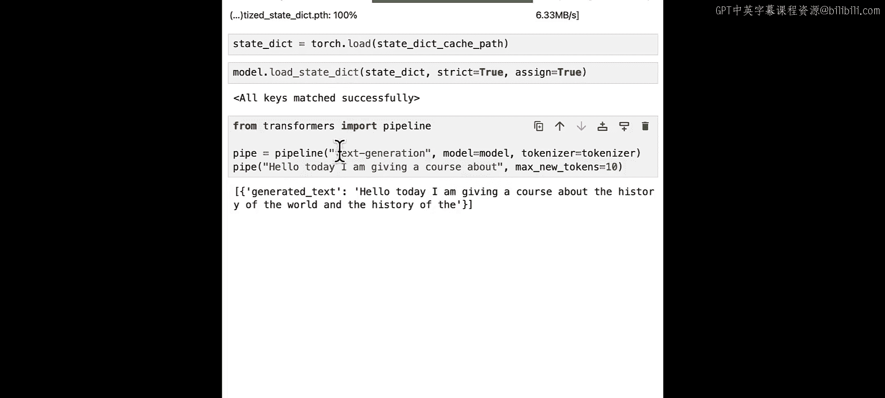

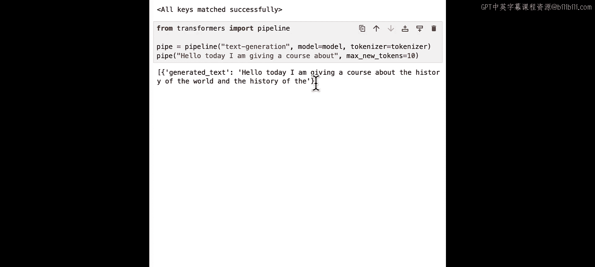

So yeah， see you on the next lesson。