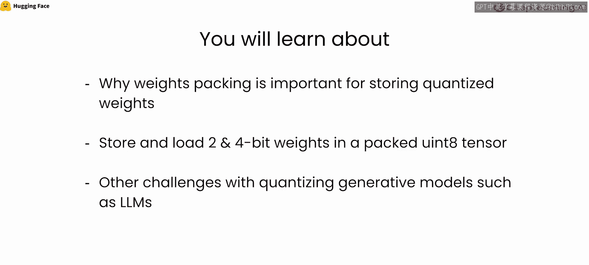
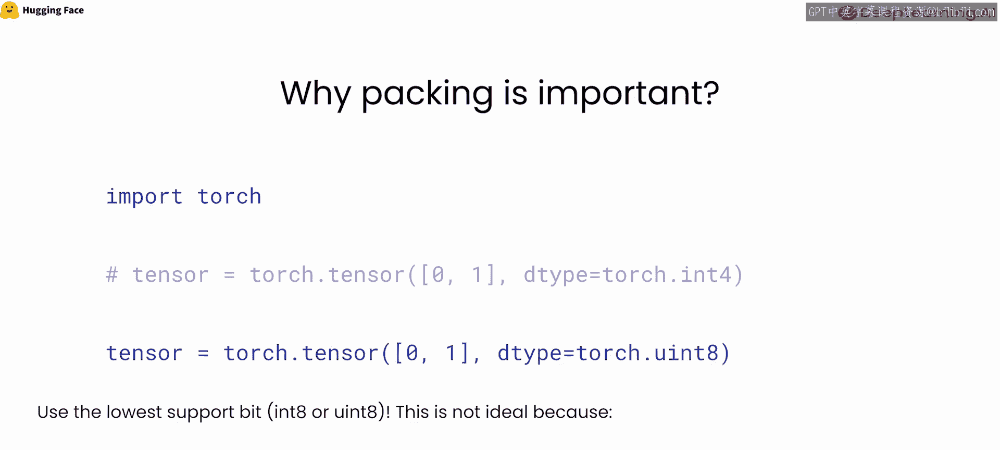
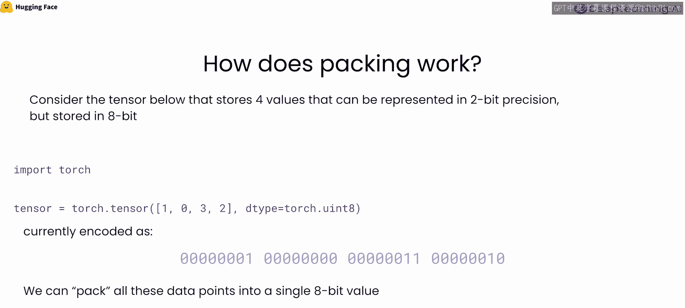
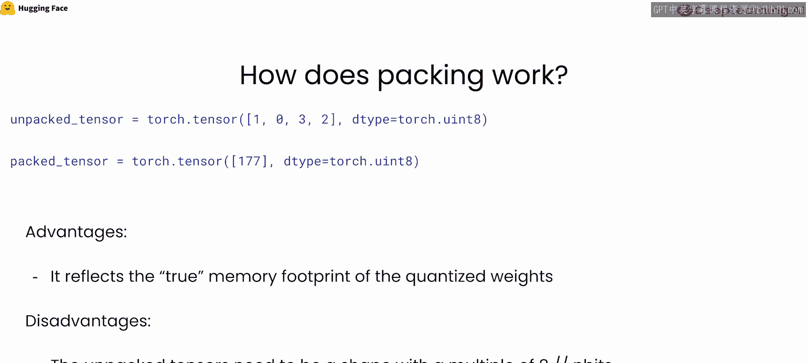

# 吴恩达《深入模型量化｜Quantization in Depth》中英字幕 - P14：14.weights packing.zh_en - GPT中英字幕课程资源 - BV1kw4m1X7Bi

In this lesson， you'll get a sense of some common challenges when it comes to applying low bits。

 quantization， such as two or four bits by diving it weight backing。In addition。

 you'll wrap up the course by some insights into the state of the art con methods。

Let's pack some weights。

In this lesson we are going to discuss about the common challenges that you can face when you want to try out low bit quantization such as two or four bit and we're going to implement from scratch weight packing so specifically in this lesson you will learn why weight packing is important for storing quantized weights we will also store and load two and4 bit weights in a packedact and signed int8 tensor and we will also see together other challenges with quantizing generative model such as LLMs and quickly review some state of the art LLM quantization methods so let's get started so before starting the lab I wanted to give some small context on why packing is important and why do we need packing when storing quantized weights So assume you have quantize you want to quantize your model in4 bit precision and you want to store the weights in a torch tensor So ideally you want to call something like this so you want to create a tensor with some values and then probably pass Dtype equal torch int for or you can also do it after。

Ca the tensor in in4。 But the problem is that the time， at the time we speak。

 there is no native support for4 bit weights in pytorch。

 So we need to find a way to store those4 bit weights in an efficient manner。 So right now。

 the only possible solution is instead of saving the tensor in 4 bit。

 We have to save it in 8 bit as currently it's the data type with the smallest precision that is available in pytorch。

 So in practice， we need to save the tensor in 8 B。 But this is not really ideal because。

The tensor will occupy 8 B per data point， despite in practice it will only need four bits because you have encoded your parameters in4 bit precision。

 so it will definitely add considerable overhead for large models therefore if we go for the negative approach meaning if we store the four bit weights in an 8 bit tensor there will be no point quantizing the model in  two or4 bit because all the parameters will be stored in 8 bit precision so for that we need to pack the4 bit weights into 8 bit tensor so how those packing works in detail so consider the tensor below that stores four values that can be represented in 2 bit precision so recall in two bit precision you can encode four values so in case of base2 we can encode0。

12，3 so we can code that most four values2 to the power of two and those values will be01。

2 and3 so imagine we have a parameter。

A model which we have encoded in2 bit precision。And these are the parameters of the model so right now in Pythtorch we can store the model weights in 2 bits so we have to store them in 8 bit precision so we'll have to end up with such a tensor that will take four times8 bit in terms of memory memory footprint so currently this weight tensor is encoded as so one in 8 bit0 in8 bit3 in8 bit and two in8 bit so as I said this is not really optimal because you need to allocate4 times8 bit in terms of memory in order to store weights that can be encoded only in2 bit so what can we do to ignore these bits that we don't need。

That's exactly what packing does and addresses this challenge by packing only the relevant bits altogether in a single8 bit tensor。

 so if let's say we're going to pack these four weights in a single 8 bit tensor so we're going to start with the right one and we're going to insert it in our new 8 bit parameter so 10 we're going to put 10 on the first bits in the first bits of our new 8 bit parameter and then one1。

0001。And if we store that in8 bit， we'll end up having a new tensor with only a single value instead of four values。

 but this time this tensor encodes all the parameters that are stored in2 bit so this value in U in8 will end up being 177 so the advantage of packing is that it reflects the true or real memory footprint of the quantized weights so again if we go for the na approach we need to allocate four times8 bit precision。

 whereas for the packed case we only need to store a single parameter in8 bit precision that will store all the2 bit parameters that we have of course this has to come with a price。

 whenever we want to perform inference we need to unpack the weight to come back to this state because most of the operations are not supported in native2 bit or4 bit in pytorrch and also the unpack tensors need to have a shape。

With a multiple of n divided by the number of bits so if we have five parameters well need to allocate an extra8 bit parameter here that will only encode a single2 bit value so ideally we need to have eight divided by n bits so in case of two four we need to have multiple of four parameters in the single tensor Yeah so let's see how does it looks like in terms of implementation and we're going to move on to the lab。

