# 吴恩达《深入模型量化｜Quantization in Depth》中英字幕 - P15：15.Packing 2-bit Weights.zh_en - GPT中英字幕课程资源 - BV1kw4m1X7Bi

Okay so we're going to do that in pure Pytorrch let's first import torch and then define the signature of the method pack weights that is going to take the unsigned in8 tensor and the number of bits so the reason why we're using unsigned int instead of in8 is that for int8 tensor the first bit is used to determine the sign of the tensor so just for simplicity we're going to use unsigned int so that we don't have to deal with the sine bit。

So for simplicity。It's better to have the shape of the input tensor being a multiple of 4。

80 divided divided by number of bits。 So we're just going to add a small condition here。

 checking that if the tensor does not have the right shape。

 then we're going to raise a small error saying that。

The input shape needs to be a multiple of the expected number and printed to the users。

 So now let's get the number of values， expected values of the packed tensor。

 So if we come back to our example。 So this of course depends on the number of bits that you use to encode your values。

 So in case of two bits we have four values。 So the number of expected packed values is simply going to be the shape of your input tensor multiply by the number of bits。

 So here we have two bits per value， and then we have four values。 So8 bit。

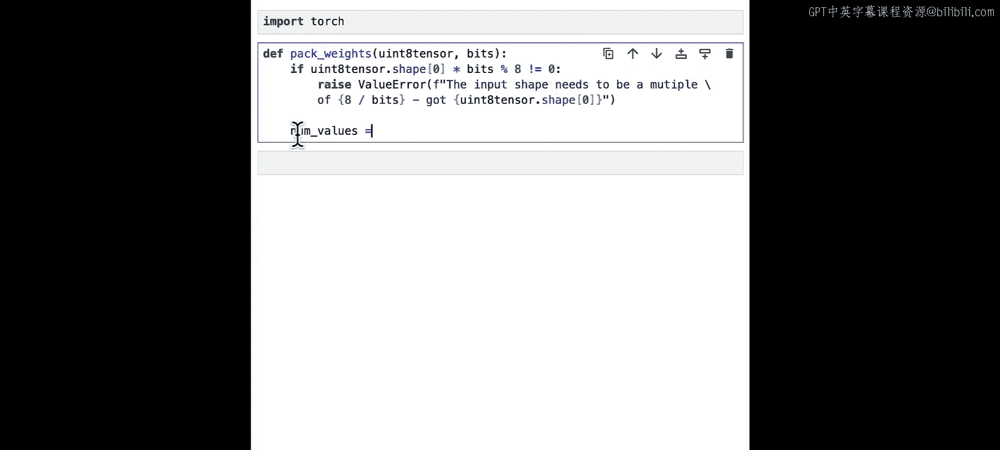

Divided by8。Because our packed tensor。

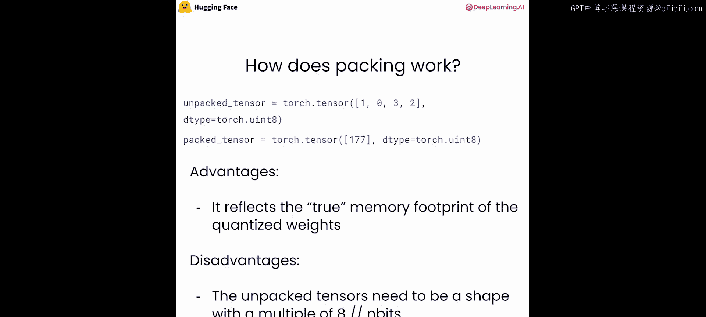

Is going to be in 8 bit。 So number of expected value simply going to be number of input low bit values that you're going to retrieve with dot shape of0 times number of bits。

 if either you are in two or four bits。Everything divided by8。

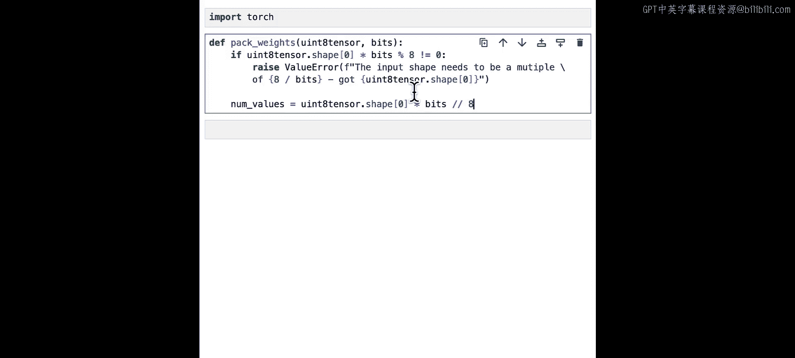

Perfect， so let's come back again to the example that we had before。 So in case of two bits。

Each packed weight will contain four values in2 bit。

 will processing four parameters per packed parameter。

 So this is going to be our number of processing steps so we。

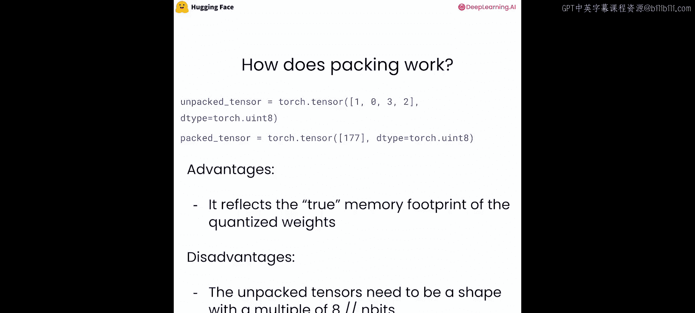

Calling this value nu steps， there is simply going to be the number of bits of the packed tensor divided by number of bits。

 Again， in our example， this should be。4， because we're processing4，2 bit values per packed tensor。

 and we're going to。Declare this index because we're going to have a full loop。

 and then we initialize our packed tensor， which we should contain。Nam values。

 and which should be in a day type of unsigned in8。 perfect， let's first loop。On each backed value。

 and then for each back value。We pack numb steps。Low bit values。

 so we need to loop again here using a new variable and then we're going to use unpacked index in order to keep track of which values are we trying to pack in our algorithm so。

In the first iteration， again， if we consider the tensor that we had in our example。

 so I'm going to write it here。So 1，0，3，2。hich should be inbit。And then we have our word。

So this is U int8 tensor， so it's encoded in in8， and we only want to extract those bits。

 and then we have our plane packed tensor， which should only contain。1 value in U in 8。 Alright。

 for each nu steps here。 So for each。No step。So each two bits。

 we're going to retrieve the corresponding value。 So here， for example， it should be one。

And then we're going to perform B2 shifting on the left。For this tensor， but encode it in 8 bit。

 So let me try to break it down below。 So here。This value。So it's encoded in U in8。

 so it should give us this value。All right。And then the idea is that we're going to take this value shifted on the left by bit times j。

 so here since we are on the first iteration， it's going to be0。

 so nothing is going to be applied here so no shifting on the left。

So this value should stay like this。All right， and then we're going to perform bitwise。Or operation。

On。The current packed tensor， so let me explain you that so in the first it。

 this is how the packed tensor would look like。

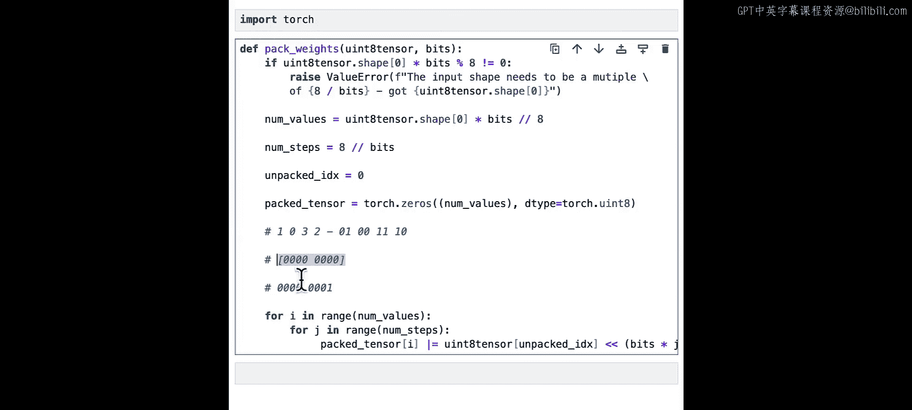

And this is how the right side of the equation would look like here。And again。

 we want to pack this here， then this here， this here and this here。

 so we're going to perform a bitwise or operation so that0 and0 or1 would give us1，0 or 0。

0 and so on。

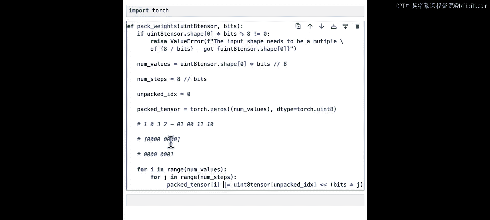

So here after the first iteration， the packed tensor would exactly look like this okay and then on the second iteration。

 then we're going to increment our unpacked index here。

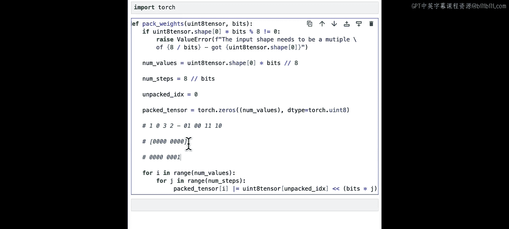

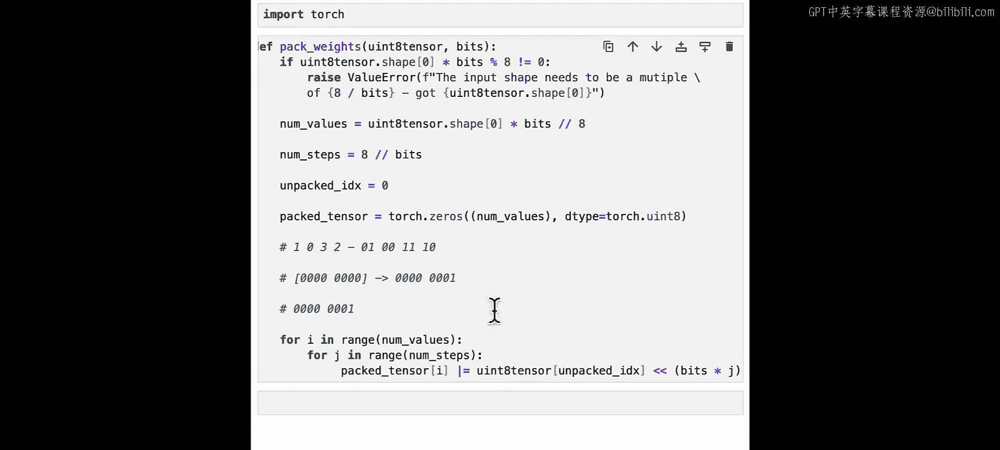

Allright， and then on the second iteration， we're going to take。This tensor， but encoded in U and 8。

So now the packed tensor would look like this because of the bitwise or operation。

 and this time the shifting coefficient is going to be 2。

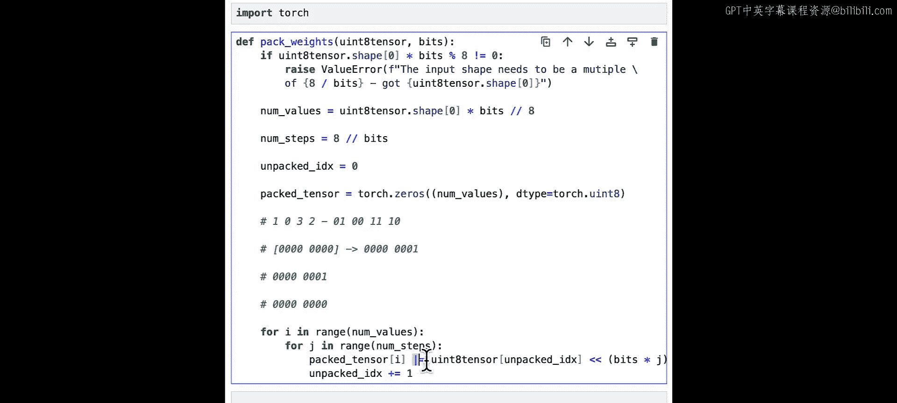

So you're going to take thistenser， it's 000， shift it on the left by two。

So again it's going to be 0000 and then you're going to perform bitwise or operation between the shifted tensor and the pack tensor and it's still going to be 1000000。

 but that's fine because we packed the first tensor here in2 bit。

 we packed the second tensor here in 2 bit。And then we're ready to move on to the next one and then on the next iteration。

😊，We're going to have thistensor okay， so me go ahead and into 8。

 we're going to shift it on the left this time by so J is going to be equal to 2， so2 times 24。

So we're going to shift that by four bit and it's going to look like this。

 and then you're going to perform bitwise or operation and the new pack tensor would look like。です。

Perfect， and then on the last iteration， you'll do the same thing， but this time shifting by6。😊。

On the left， so 10 would be here and then beatwise or at the very end you would end up like this。

 so the final packed tensor would look theoreticalically like this。

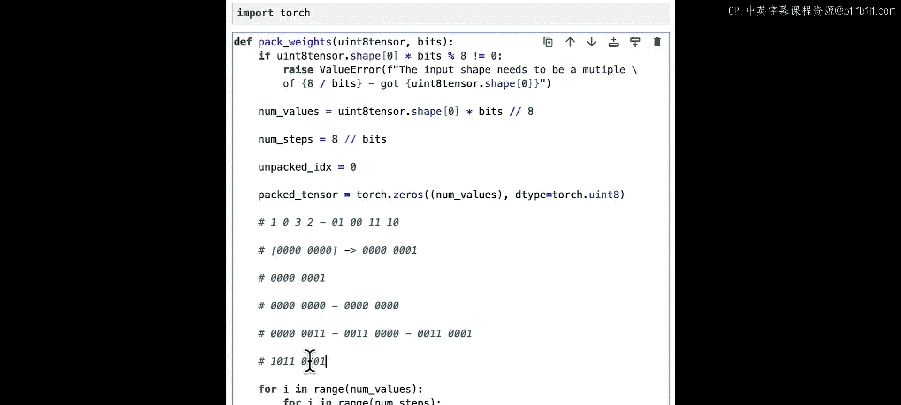

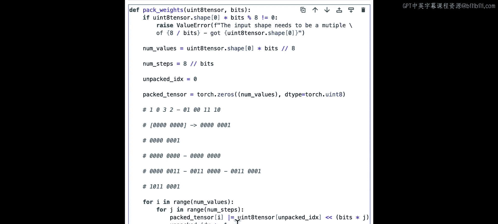

Perfect yeah let's try out quickly our method and test it and we're going to test it on our toy example。

 let's say our impact tensor is encoded as follows 1032。

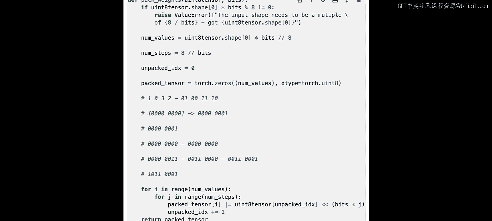

Again， everything encoded in two bit and yeah let's back the weight to see if it works perfect。

 so 177 should be encoded exactly like this in U in 8 you can try that out。

 verify the result but yeah that should be the correct result perfect so yeah。

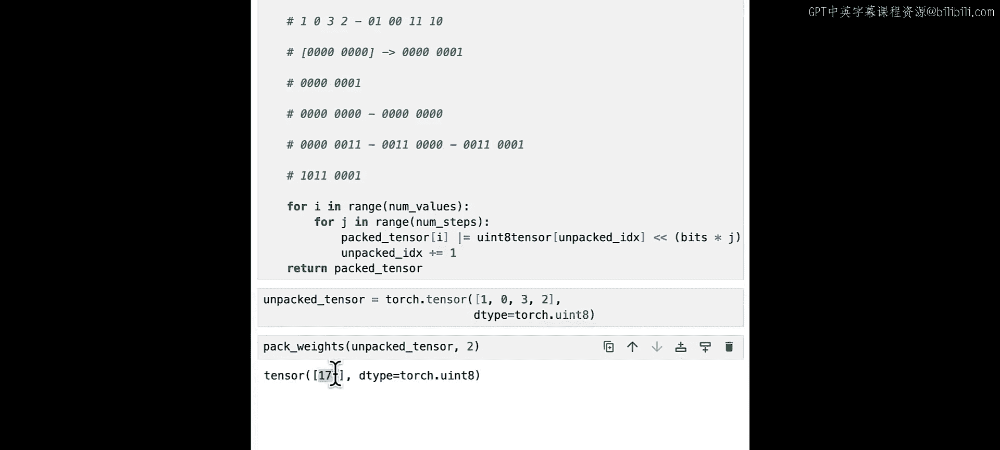

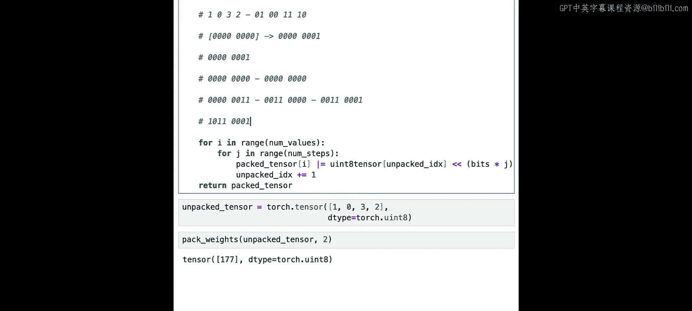

You can yeah post the video， maybe try to understand this whole logic。

 try also maybe to enhance it a bit， optimize it， you can also try out with four bits and yeah maybe you can also try out different combinations。

 for example you can also battle tests。

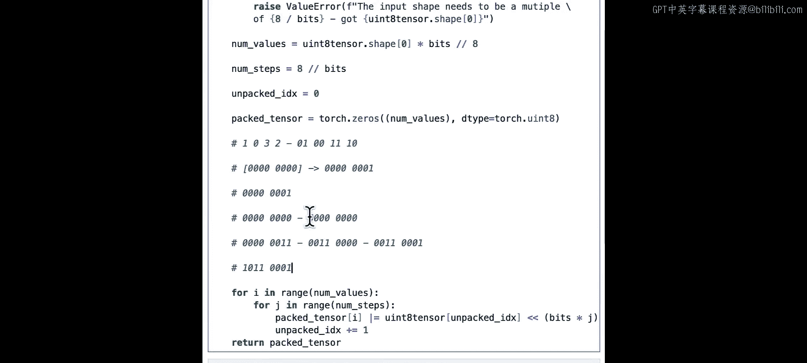

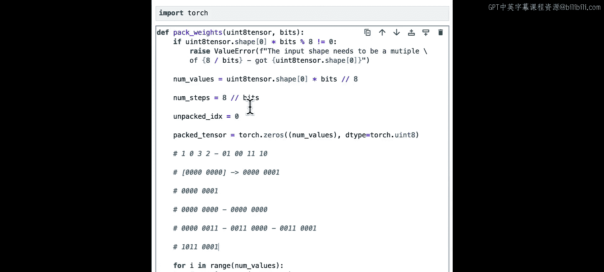

The method a bit， if we add these values， so three and 2 bit should be 11， so we should have 11，1，1。

1 here everywhere。And the second tensor should be 255。

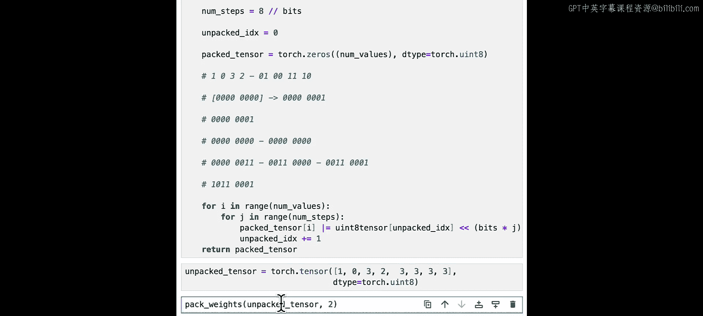

Which is the case。