# 吴恩达《深入模型量化｜Quantization in Depth》中英字幕 - P16：16.Unpacking 2-Bit Weights.zh_en - GPT中英字幕课程资源 - BV1kw4m1X7Bi

The unpacking algorithm is simply the other way around。 So if you pack the tensor。

As follows you would like to unpack them to extract the real values of the two bit weights and most importantly you want to unpack these tensors so that you can also perform some operations on top of these sensorsors Yeah so if you have for example packed the tensor then you would unpack it like this or0100000011 and then 10 so let's also try to do it step by step so unpack weights the signature would be the same as well you take an packed U in8 tensor number of bits so to get the expected number of values you can just use this formula yeah it's simply the number of packed tensors。

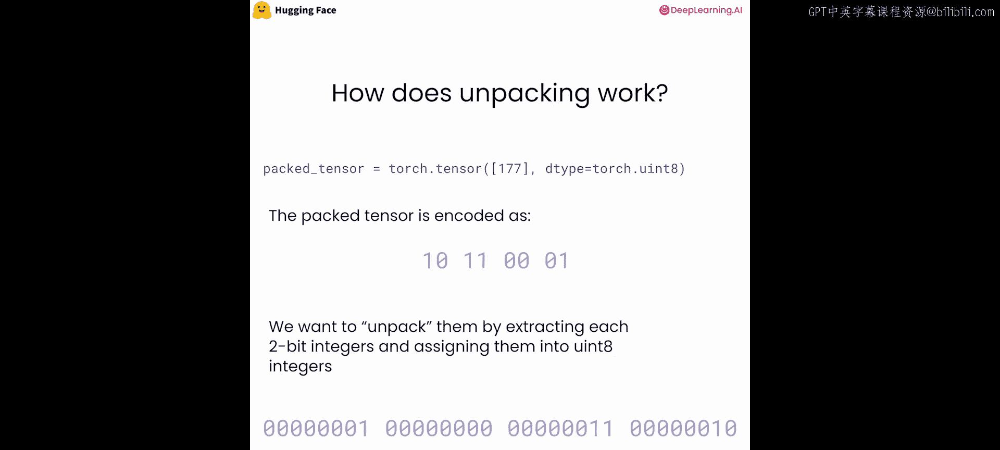

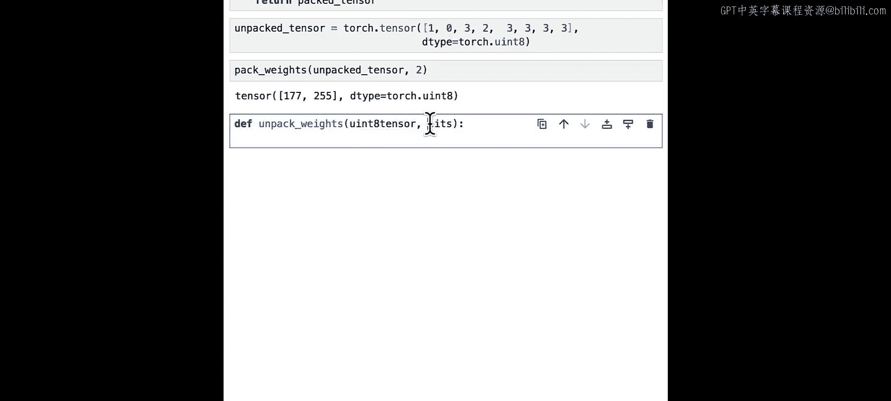

Multipliied by 8。

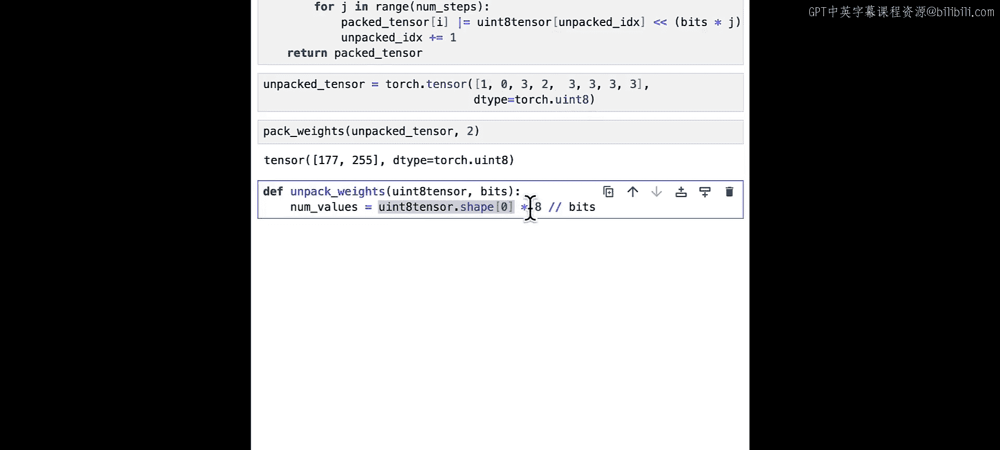

Divided by the number of bits， nu steps is also going to be the same for each packed tensor we're expecting to extract。

8 divided by number of bits。Tenssors， let's initialize our unpack tensor。 So yeah。

 by just initializing some torch of zeros and values。You need8， and let's keep track。

Of the index of the impact tensor。 So yeah， we're going to go for a simple and naive approach。 Yeah。

 we're just going to loop over the packed weights one by one and。Extract。For each back tensor。

Number of steps。 So here for two bits，4。 So again， if we consider this example。

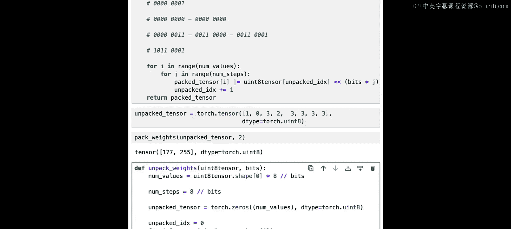

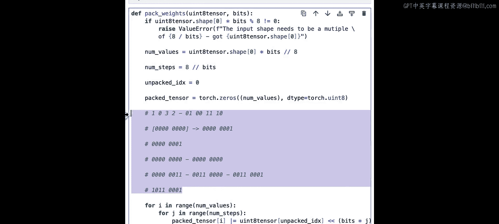

Okay， so this is our packed weight。 We want to extract step by step， this valingbit and this one。

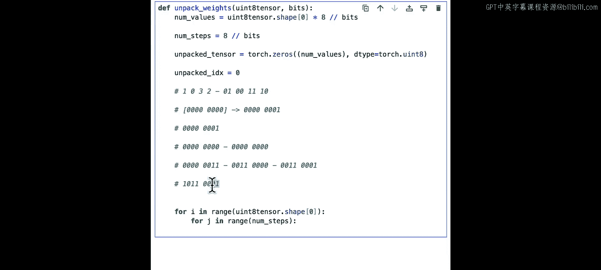

And so on。 So let's consider the first iteration。So for the first packed weight。

 so this is in our simple case， this is one value right。

 so in the first iteration you inate tensor of I is this value。

So if we want to extract only these first two bits。In an iterative manner。

 we're going to shift it by bits times J， so J starts from 0。And then it goes until3。

 So for the first iterationration， this is going to be 0， we're going to do nothing。

But it's fine because we just want to take the first two bits。

 We're going to use the same bitwise or operation on the impact tensor。 So let's also write down。😊。

Here。The status of the impact tensor， so we have nu values here。Is。

4So we have four values in four bit。For the first index。

 we're going to make a bitwise or operation between these full zeros and this tensor shifted by zero。

 so basically just this tensor。And in the first iteration。

 it's going to be an exact replication of the packed tensor。

So you may be wondering what do we do to remove all these bits that are before 01。

 but don't worry you're going to see that in a few moments。

 So this is on the first iteration of course don't forget to increment andpack index。

And let's try to see what happens on the next iteration。 So on the next iteration。

 we want to consider these two bits and put them here， right？So now unpacked index is going to be1。

 J is going to be1。And U in tensor is still going to be0 because we only have a single packed tensor。

 so this time instead of shifting by0， we're shifting by2 bits bits times J because j is equal to1。

 so in the second iteration so this is first iteration。Second iteration in the second iteration。

 we're going to shift that by two bits on the right。So， the shifted。Tenssor would look like this。

So if you shift something on the right。The shifted values will be equal to0。

And then you're going to perform a bitwise or， so since this is full zeros。

The unpacked tensor would look like this。And then third duration， So j is going to be equal to 2。

 so we're going to shift this by4 right so it it will look like this。And we're going to do again。

 bit twice or between this value and our shifted value。Perfect and then last iteration， al right。

 we're almost there there is just one thing， so you may be wondering we're not having exactly the same results as our targeted tensor。

 which again would look like this right？But now we have these bits that we want to remove from our unpack tensors。

 so to do that we're just going to perform a simple trick。

 so basically the idea is that we're just going to create a mask and use that mask to perform a bitwise operation that will always give us here zero。

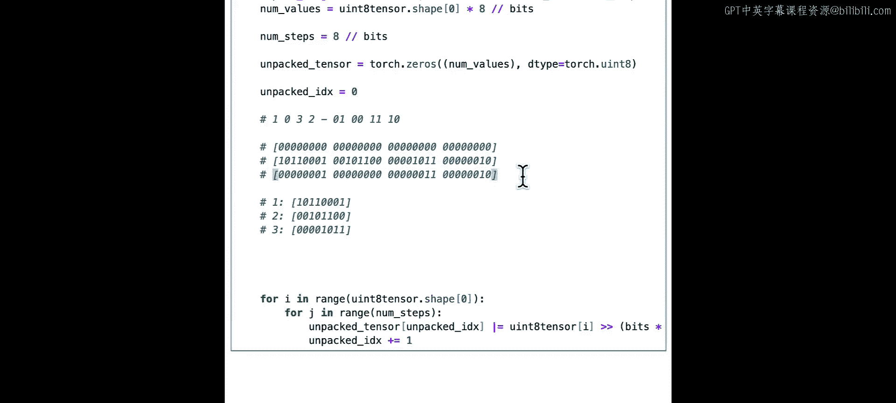

And always make sure that these values stay the same。 So if we consider this mask。

 and let's say this value， if we perform a bit wise end operation。Between these two values。So。

 one and 0。0，0，0，0， and so on， 0 everywhere。Except for the last two bits。Or you have00 and1，0，1，1，1。

So all the bits before these two bits that we want to keep were correctly masked out as0 and the two bits here are preserved。

 so that's exactly what we want to achieve。 you can try that out on the other values that just to double check but this mask should be sufficient to remove all the bits before。

These all of these two bits that we are interested in keeping and there is a general rule where you can compute the value of this mask。

 so this mask is simply three。So three， in case of two bits。

 is just two to the power of two number of bits， minus1。

 which corresponds to the maximum value you can reach within this number of bits。

So if you encode it in binary in two bits， you can't go above three because you can only encode 0，1。

2， and 3。And this formula， of course， is accessible。

 so you can also try it with 48 and you get the same logic。

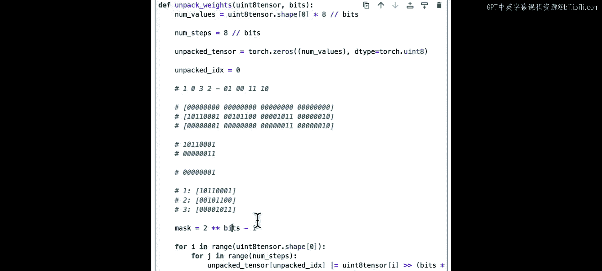

So we can perform the masking operation at the end of everything。

 so we're just going to perform an end operation。

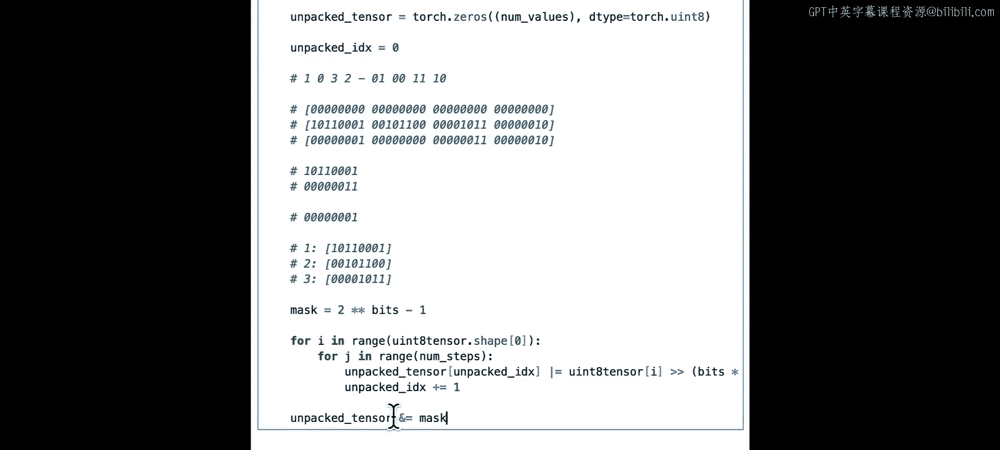

To mask out。Those values as explained。

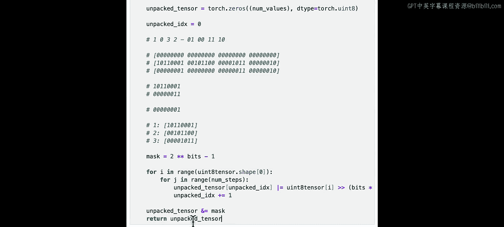

So， let's try that out on。

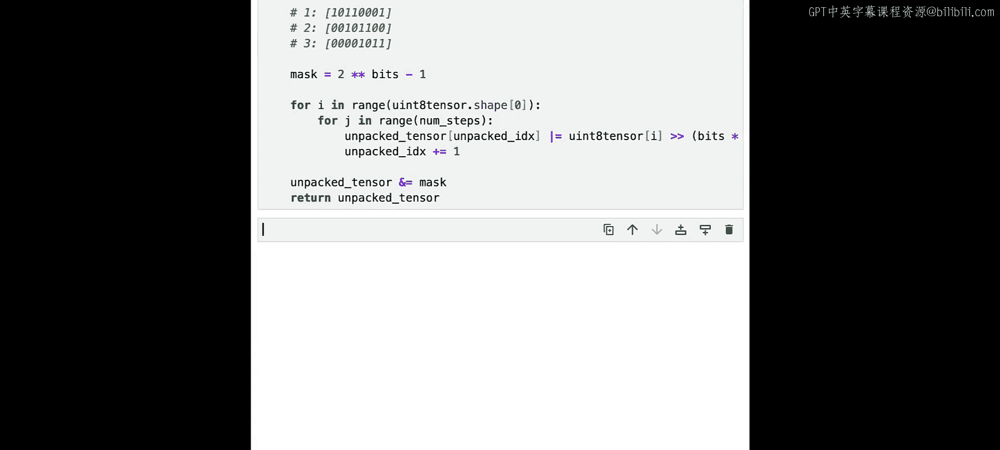

Let's say this tensor。So this is the packed version of the tensor， if we unpack it。

 we should retrieve exactly this tensor。

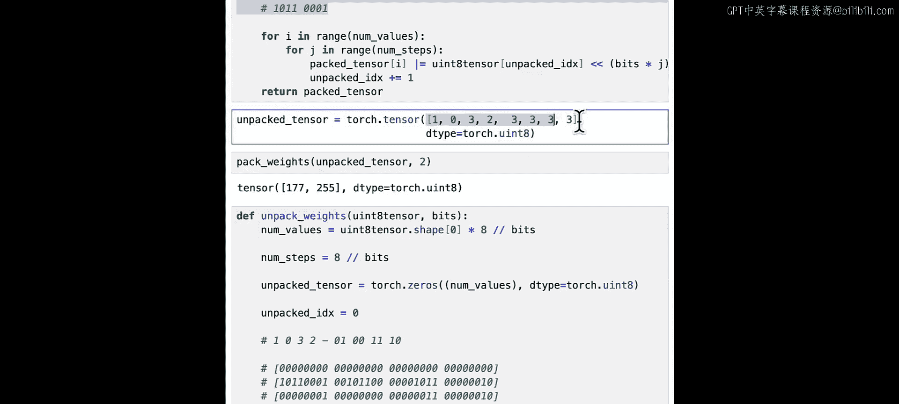

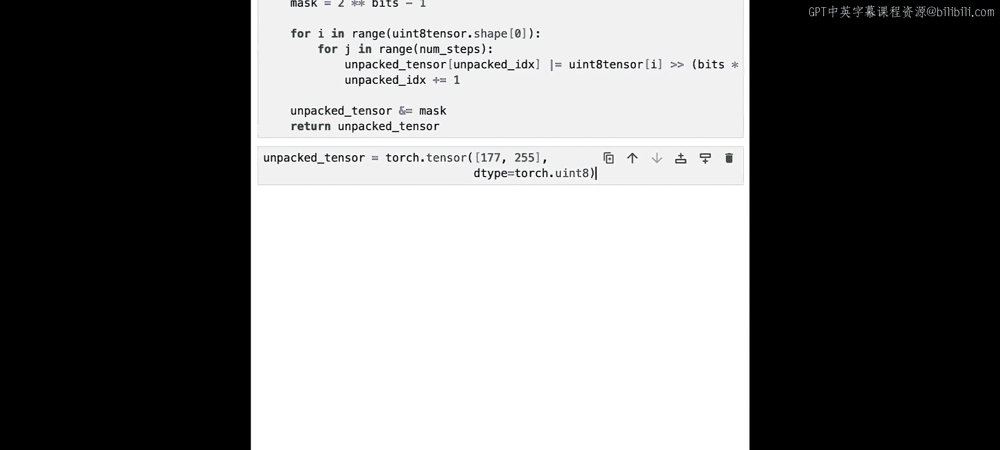

Perfect， it should be the same， yeah。

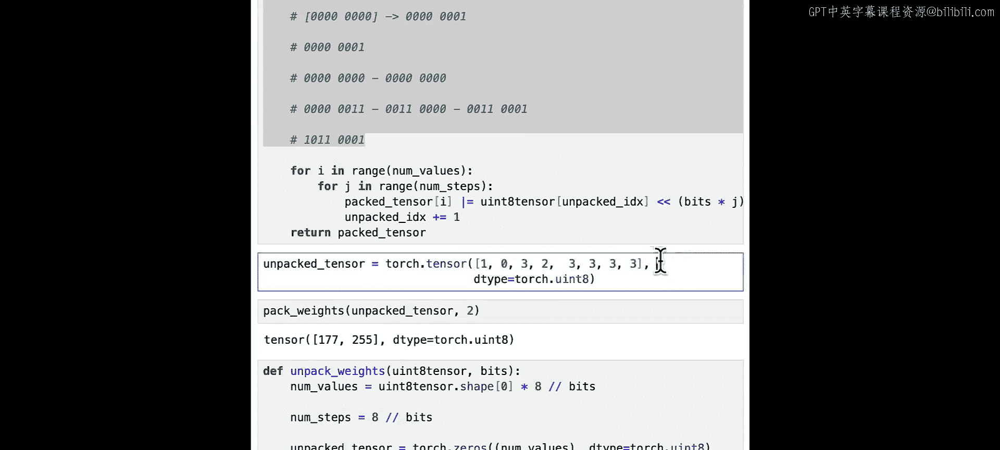

So yeah， if you compare both tensors， they're exactly the same。1，0，3，2， and 3，3，3，3。

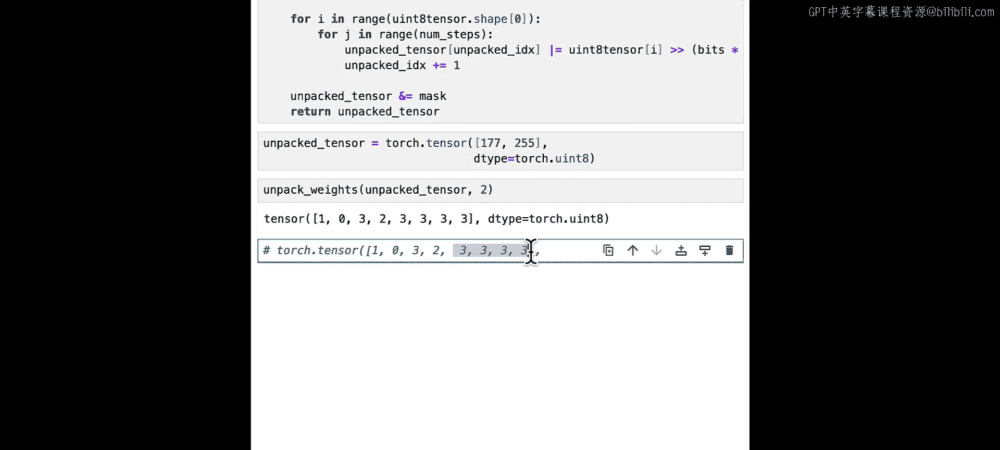

Perfect so yeah we just did it now for two bits， we also applied a very naive approach where we you know did two four loops。

 we also didn't consider the case where the tensor is has multiple shapes here we just considered a simple vector but yeah feel free to enhance this algorithm。

 make it faster， try out to also。

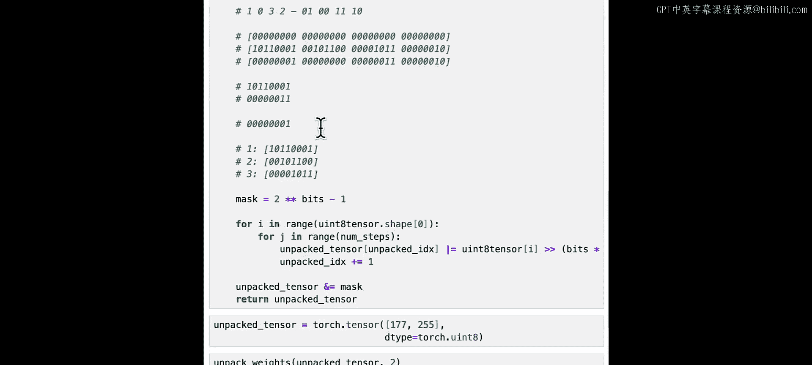

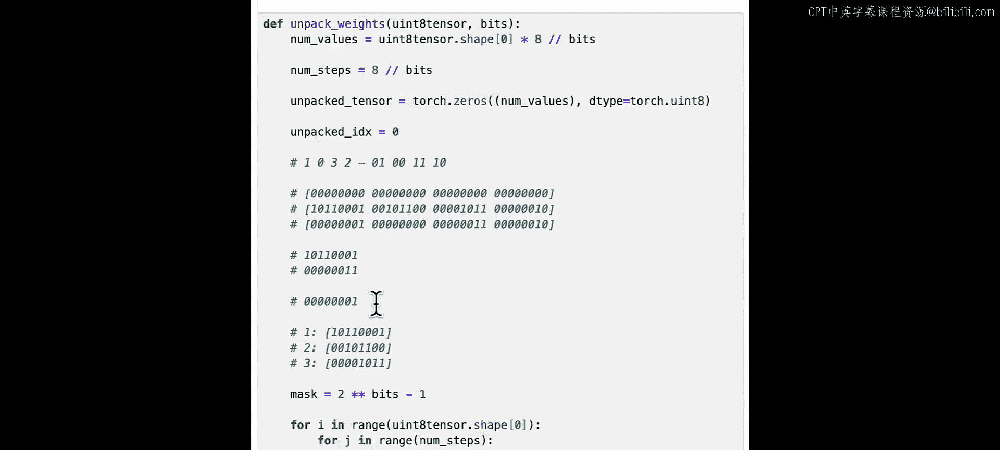

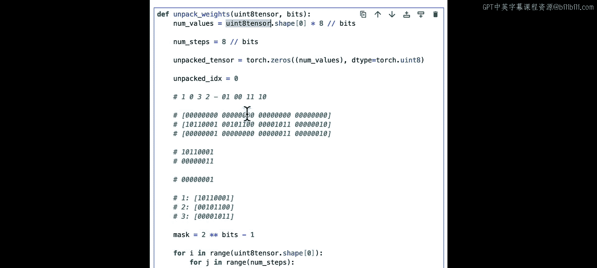

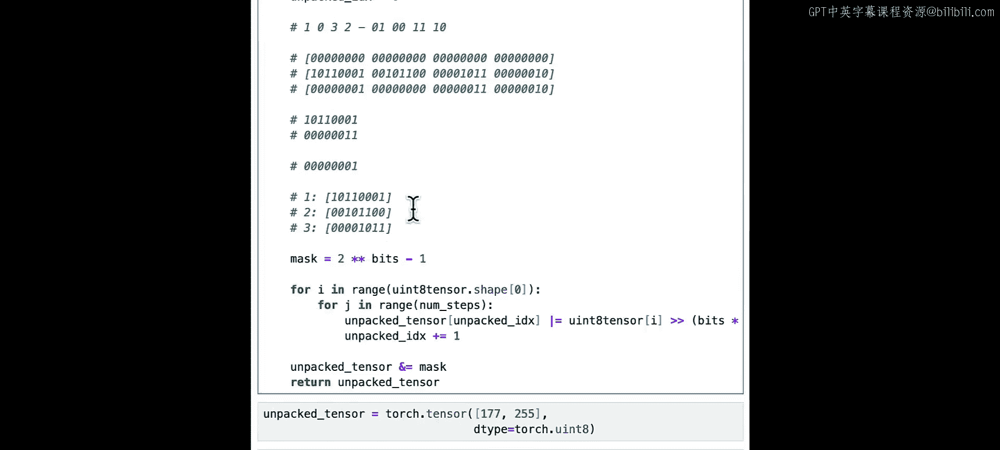

Extend this algorithm so that it works on different shapes， arbitrary shapes as well。

 so yeah feel free to battle test everything， make sure that you have understood all the internals that I have explained here to wrap up the lesson we're just going to see other challenges when you quantize large models such as large language models。

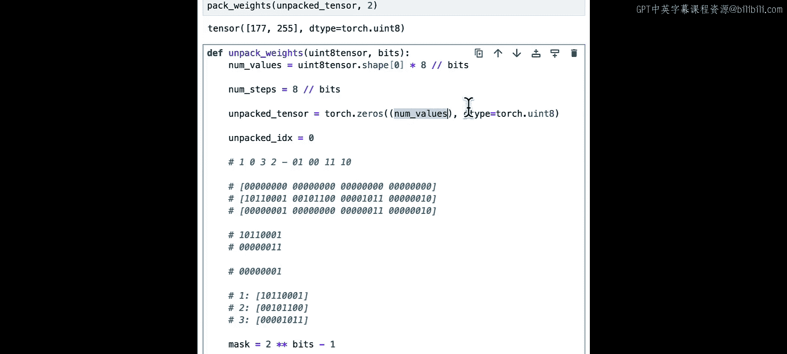

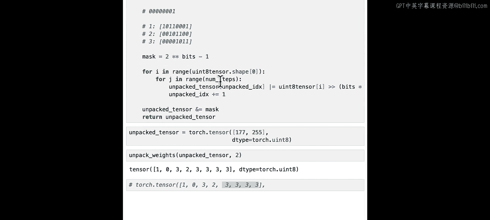

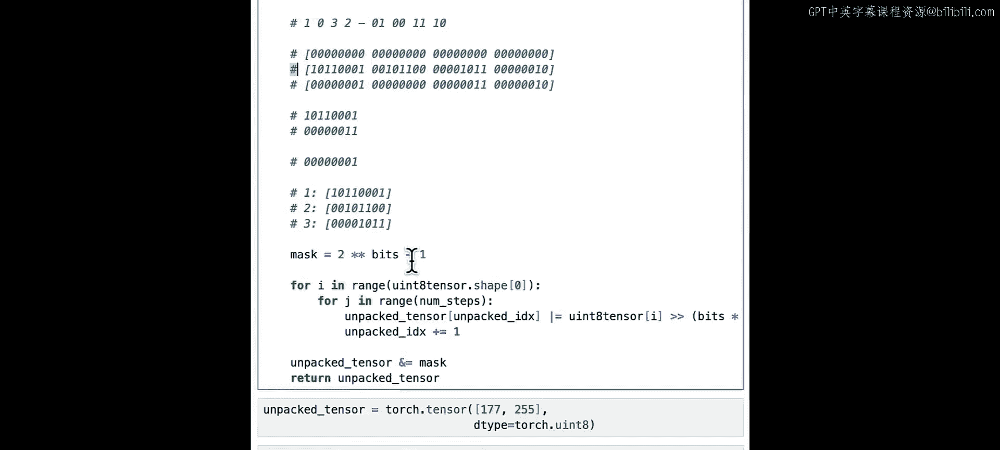

And yeah， we're going to wrap up the whole course with these explanations。

 so yeah let's move on to the slides。

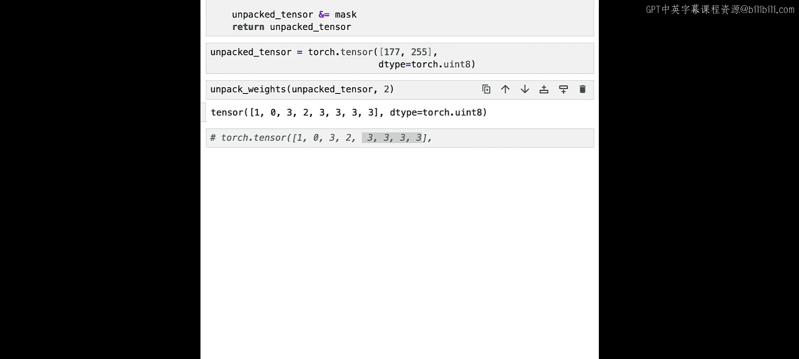