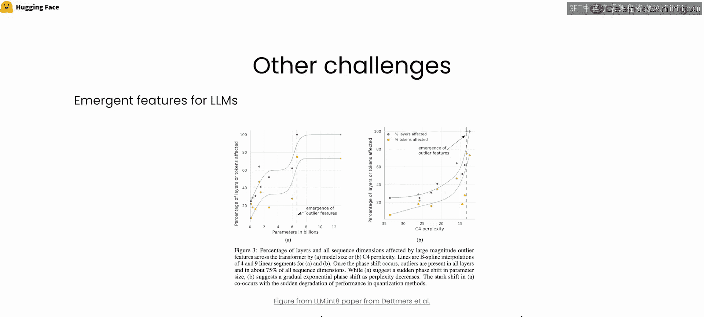
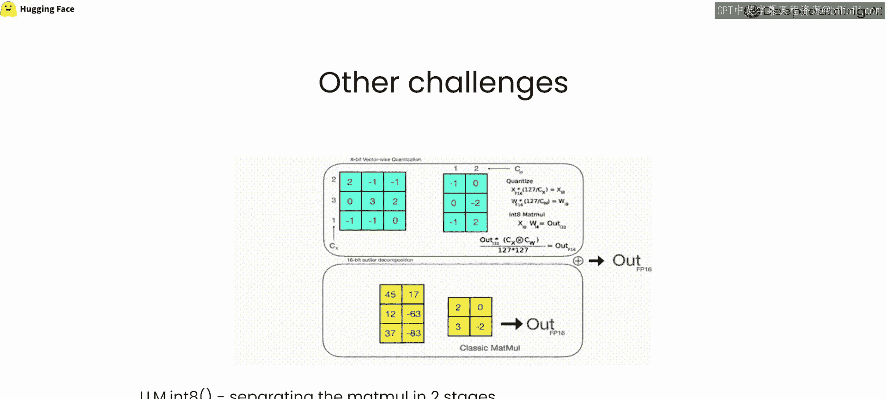
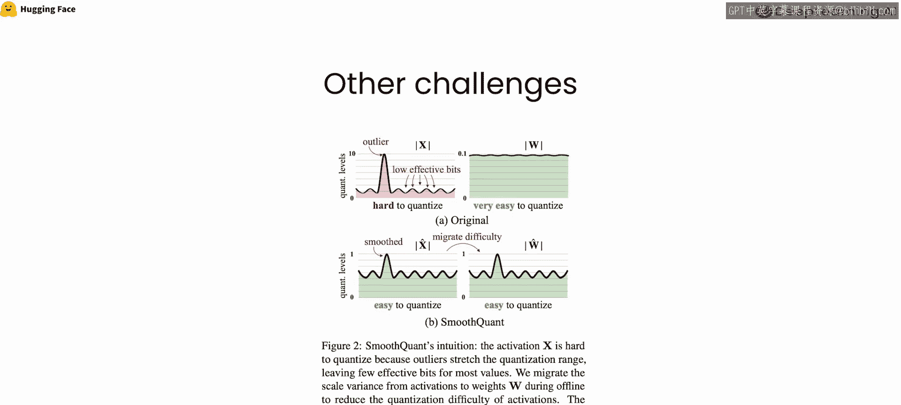
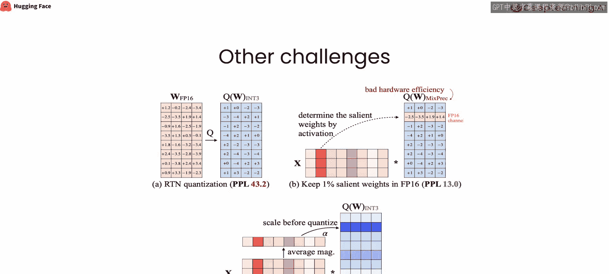
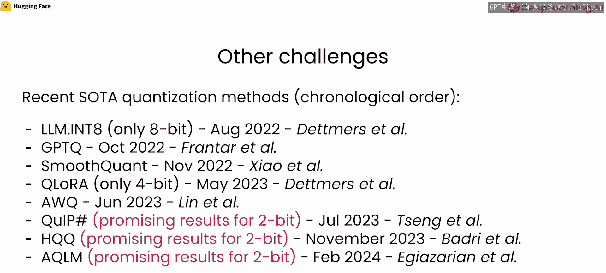
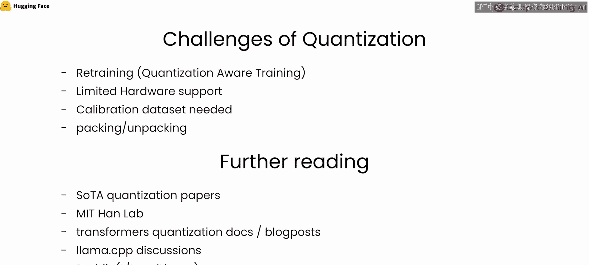

# 吴恩达《深入模型量化｜Quantization in Depth》中英字幕 - P17：17.beyond linear quantization.zh_en - GPT中英字幕课程资源 - BV1kw4m1X7Bi

We're going to wrap up the whole course with these explanations If you have followed the previous lab I've quickly mentioned the notion of emergent features for large language models and this is part of like one of the biggest challenges when it comes to quantizing large language models once in the open source community we had more and more large language models such as OPT the opened pre-trained transformers from Facebook in 2022 researchers started to directly dive into the capabilities of the model and they discovered some so-called emergent features at scale what do we mean exactly by emergent features simply some characteristics or features that appear at scale so when the model is large so it turned out that for some models at scale。

The features predicted by the model。Meaning the magnitude of the hidden states started to get large thus making the classic quantization schemes quite obsolete which led to classic linear quantization algorithms just failing on those models many papers today since opensourcing these large language models decided to tackle this specific challenge on how to deal with outlier features for large language models again outlier features simply means hidden states with large magnitude so there are some interesting papers such as LM。

 in8 smooth quant AWQ and I wanted to give a brief explanation of each paper to just give you some insights of what could be the potential solutions to address this specific issue。

So LLM。8 proposes to decompose the underlying matrix multiplplication of the linear layers in two stages。

So if you consider the input hidden states that you can see in the big matrix here。

 it is possible to decompose the mat。In two parts， so the outlier part。

 all the hidden states that are greater than a certain threshold。And the known outside part。

The idea is very simple， so you decompose the input into。

Perform the non outlier part matrix multiplicationification in in8， so you quantize。

 you do the math in8 bit， and then you dequantize using the scales。

So that you get the final results in the input data and the second part you do it classically with the original day type of the hidden states。

 so usually in health precision， and then you combine both results。

 so this way it has been proven that you can retain the full performance of the model without any performance degradation。

Another very interesting approach is called smooth quant S quant specifically applies to A8 W8 schemes。

 meaning we also want to quantize the activations so meaning both the activation and the weights are in8 bit precision so the paper also tackles this issue of outlier features in large language models and they propose to mitigate that by smoothening both the activation and the weights given a factor that you determine based on the input activation to migrate the quantization difficulty in both during the quantization of the activations but also quantization of the weights。

 so that way you transfer the quantization difficulty all over to the weight。

eququally to the weight and to the weight and the activation and that way you can also retain the full capabilities of the model a more recent paper called AWQ also treats the outlier feature in a special way。

 so the paper which came out also from the same lab as the smooth quant paper proposes to first iterate over a data set that we were going to call a calibration data set to get detailed idea of which channel。

In the input weights could be responsible of generating outlier features called salient weights。

 and the idea is to use that information。To scale the model weights。

Before quantization and also use that scale during inference to rescale the input as well So these are just a few of them。

 there are numerous other papers that specifically addresses this issue for an effective and efficient large language model quantization so here is a non-exhausive list of those quantization techniques but perhaps you can find much more at the time we speak so yeah if you are curious about this I invite you to read these papers in detail and just dive into them and try to understand these papers。

 These are one of the challenges when it comes to quantizing large language models because the models are quite large you can get some surprising behavior there are also other challenges so it seems the quantization our training field seems to be a little bit maybe underexplored today so training models in low bit could be also an interesting topic to dive into there is also this challenge on limited hardware support so right now for this course。

focused on W8 A16 scheme， meaning the weights are in8 bit but the activations are in 16 bit but for a more efficient quantization scheme you may be also interested in other scheme such as W88 as well but not all hardwares do support8 bit operations there is also this challenge around calibration data set so for some quantization methods you need to have a calibration data set to perform some sort of model preprocessing to make the quantization model better and also in terms of distribution packing and packing so yeah if you're really interested about this topic I invite you to do some further reading through for example the state of the yard quantization papers there is also a lab called MIT hand labb which made some of these state of the yard quantization papers so they have also good resources on which you can learn more。

About this topic you can also check out the hugging phase transformers quantization documentation and blog post you can also have a look at the Lama。

 c plus plus repository discussions where you can find really some insightful experiments and talk you can also check out Reddit so there is a subdit called local Lama where they share a lot of cool insights about quantization and you can also learn more about the new method that come up and so on and then of course probably missing many more resources but yeah these are the ones that I know so that's it for this lesson so I hope you learned a lot through this course and that you can use the things that we have showed to you for your work or for your projects and that all of this could give you some ideas of cool things that you can do around you so yeah we're going to move on to the next video yeah we will say thank you for going through this course and suggest you potential next steps。

See you there。