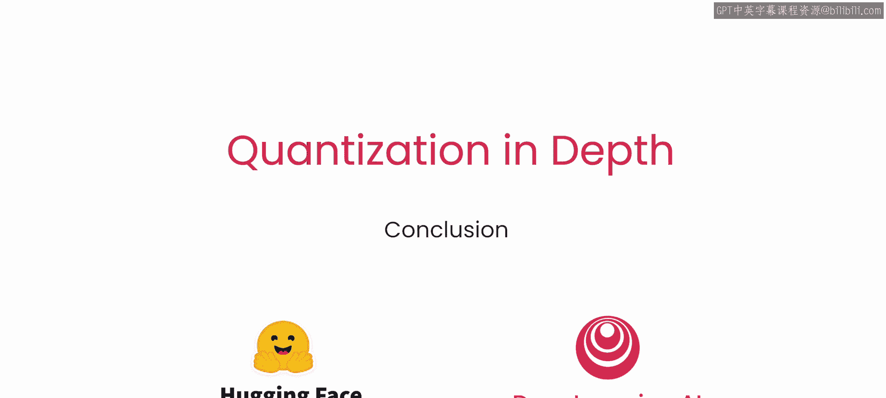

# 吴恩达《深入模型量化｜Quantization in Depth》中英字幕 - P18：18.conclusion.zh_en - GPT中英字幕课程资源 - BV1kw4m1X7Bi

Congratulations on making it to the end of this short course in the short course you tried your hands at different variants of linear quantization methods and implemented them from scratch using Pytorch you also build a quantizer to quantize any model in EB precision Finally you learn about some important challenges when it comes to quantization such as weight packing and you implemented the packing and unpacking algorithm by hand We encourage you to explore other quantization methods available on hugging fast transformers and we hope this course will give you all the tools you need to get started with quantizing any model。

And if you find this course helpful， maybe you can even share it with your friends。

