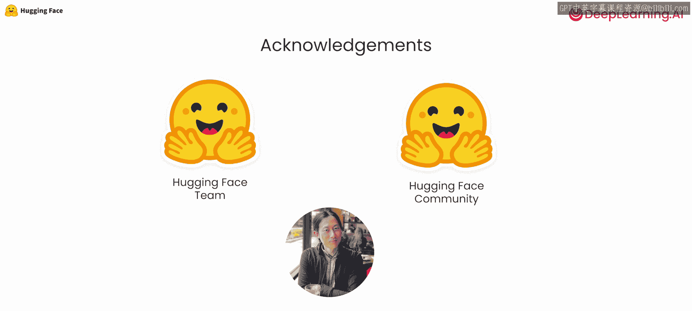

# 吴恩达《深入模型量化｜Quantization in Depth》中英字幕 - P1：1.introduction.zh_en - GPT中英字幕课程资源 - BV1kw4m1X7Bi

Welcome to this short course， quantization in De， builtt in partnership with hugging F。

In this course， you deep dive into the core technical building blocks of quantization。

 which is a key part of the AI software stack for compressing large language models and other models。

 you implement from scratch the most common variances of linear quantization called asymmetric and symmetric modes。

 which relate to whether your compression algorithm maps zero in the original representation to zero in the compress representation。

 or is allowed to shift the location of that zero。You also implement different forms of quantization such as per tensor。

 per channel and per group quantization using Pythtorch in which you can decide how big a chunk of your model you want to quantize at one time。

You end up building a quantizer to quantize any model in8 bit precision using per channel linear quantization If some of the terms I use don't make sense yet。

 don't worry about it。 These are key technical concepts in quantization that you learn about in this course and in addition to understanding all these quantization options you also hone your intuition about when to apply which technique I'm delighted to introduce our instructors for this course。

 Eunice Dgoda， a machine learning engineer at Huging phase has been involved in the open source team where he works at the intersection of many open source tools developed by Huging phase such as transformers。

 Pft and Tro。And also， Mark Sun who is also a machine learning engineer at Huging phasease。

 Mark is part of the open source team where he contributes to libraries such as transformers or accelerate。

Marco unitss are also deeply involved in quantization in order to make large models accessible to the community。

Thanks Andrew， we are excited to work with you and your team on this in this course you will directly try your hand on implementing from scratch different variants of linear quantization。

 symmetric and asymmetric model you will also implement different quantization cannularities such as pertensor per channel and per good quantization in pure ptor Each one of these algorithm having the own advantages and drawbacks After that you'll build your own quantizer in order to quantize any model in8 bit precision using the per channel quantization scheme that you have seen right before you will see that you'll be able to apply this method to any model regardless of its modality meaning you can apply to a text vision。

 audio or even a multimodel model once you are happy with the quantizer you will try your hands on addressing common challenges in quantization at the time we speak the most common way of storing low bit precision weights such as4 bit or2bit seem to be weights backing with。

packing you can pack altogether two or4 bit tensors in a larger8 bit tensor without allocating any extra memory we will see together why this is important and you will implement from scratch。

 packing and unpacking algorithms。 Finally， we will learn together about other challenges when it comes to quantizing large models such as LLm。

 we will review together current state of the art approaches in order to perform no performance degradation quantization on LLms and go through how to do that within the hugging face ecosystem。

 Quaantization is a really important part of practical use of large models today So having in-depth knowledge of it will help you the build deploy and use models more effectively many people have worked to create this course I'd like to thank on the huggingface side the entire huggingface team for the review of this course content as well as the huggingface community for the contributions to open source models and quantization methods from deep learning AI Eddie Shu had also contributed to this。

Quantization is a fairly technical topic。After this course I hope you deeply understand it so you be able say to others I now get it I'm not worried about model compression In other words。

 you be say I'm not sweating the small stuff。Let's go on to the next video and get started。

