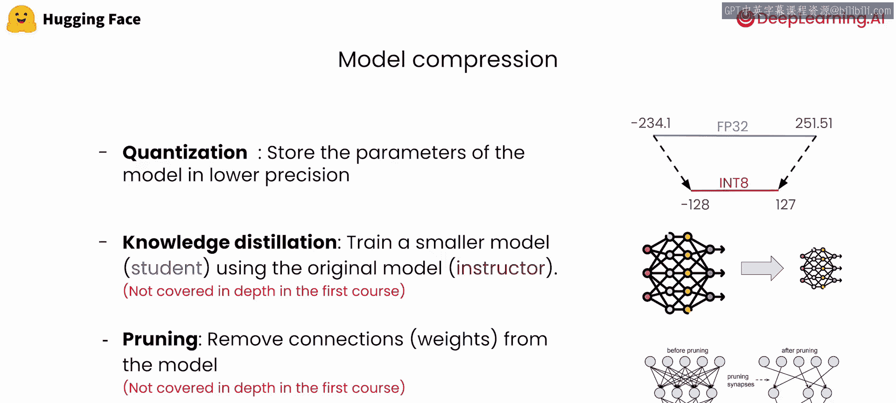
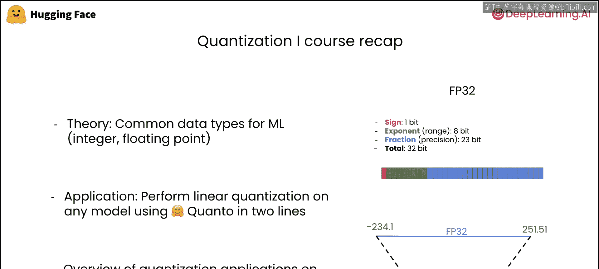
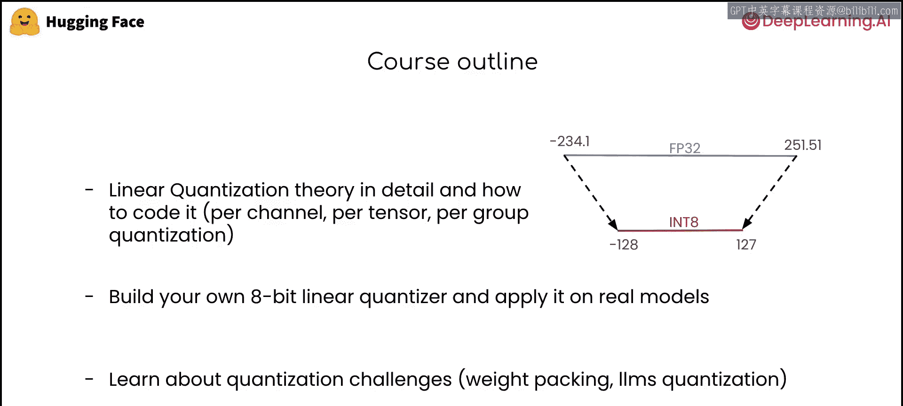

# 吴恩达《深入模型量化｜Quantization in Depth》中英字幕 - P2：2.overview.zh_en - GPT中英字幕课程资源 - BV1kw4m1X7Bi

Quanization methods are used to make models smaller。

 which makes them more accessible to the AI community。

In this lesson youll get an overview of what quantization is and how it works。 Let's get started。

 We have seen previously that quantization is an exciting topic as it enables us to shrink models for better accessibility to the community In this lesson we will learn how to implement some quantation primitives from scratch and we will also implement our own model quantizer and cover some challenges that anyone can face when it comes to lower bit quantization such as weight packing。

Let's get started so let's first have a quick glance on what we have learned so far from the first course so in the introduction of the first course we listed all available techniques that one could use in order to compress a model in general So first of all quantization aims at representing parameters of the model in a lower precision with knowledge distillation you can train a student model using the bigger teacher model outputs and finally with pruning you can simply remove some connections inside the model meaning removing weights to make the model more sparse we also covered common data types in machine learning such as int8 or float we also performed linear quantation using hugging faces quant library with few lines of code and finally we wrapped out the course with an overview of how quantation can be leveraged in different use cases such as large language models fine tuning so let's see together what you are going to cover exactly in this course so first。

First we are going to deep dive together into the internals of linear quantization and implement some of their variants from scratch。

 such as per channel， pertensor， or per group quantization。

We will study what are the advantages and drawbacks for each of these methods and we will see their impact on some random tensors and next。

 we will try to build our own quantizer to quantize any model in 8 bit precision using one of the quantation schemes presented before note the quantation scheme is agnostic to modalities meaning you can apply to any model as long as your model contains linear layers。

 technically， you will be able to use your quantizer to quantize a vision， text。

 audio or even a multimodel model。 And finally， we will wrap up the course by learning more about some challenges that you can face when it comes to extreme quantation such as weight packing。

 which is a common challenge these days。 As of the time we speak Pytorch does not have a native support for two bit or4 bit precision weights。

 One way to address this issue is to pack these low precision weights into a higher precision tensor。

 for example， in8 and we will deep dive into that and implement。

ing and unpacking algorithms together and we will end the course by covering what are the other common challenges when it comes to quantizing large models such as LLMs and review together some state of the art LLM conci methods together。

 Yeah， so let's directly get started and shrink some models。

