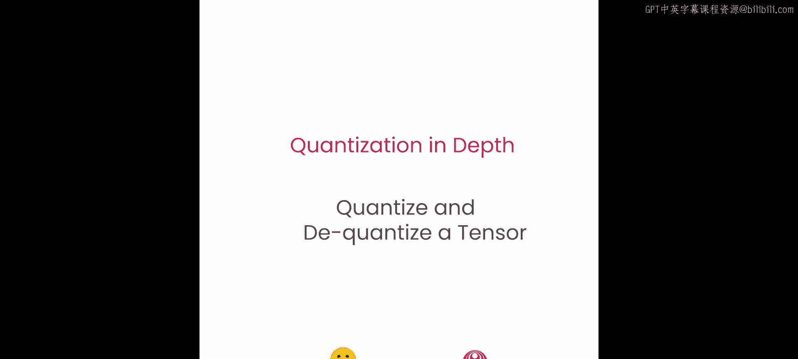
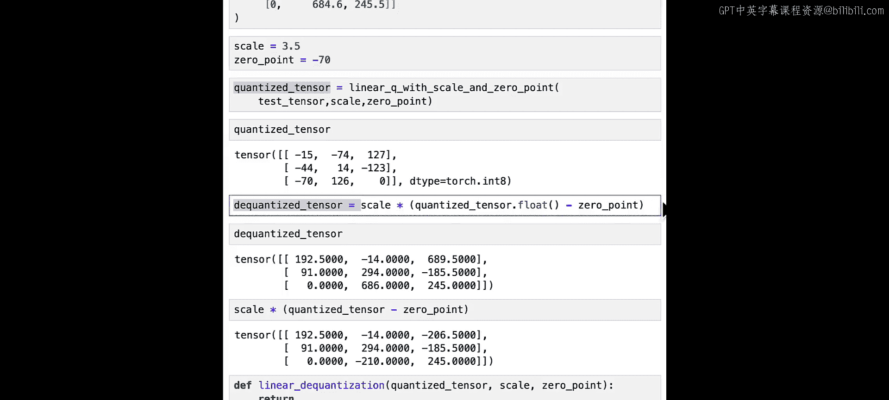
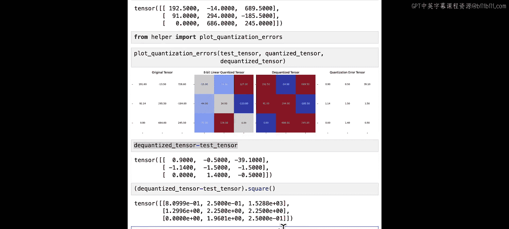
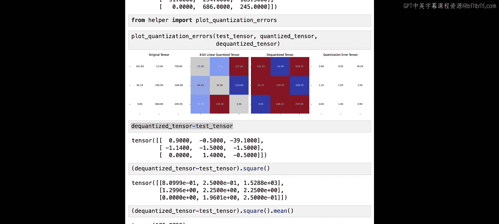
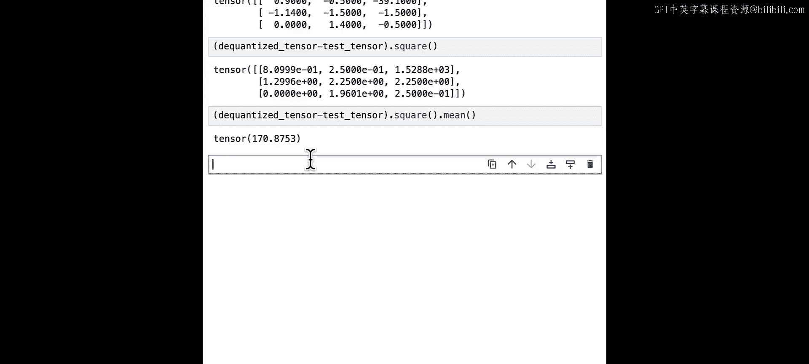

# 吴恩达《深入模型量化｜Quantization in Depth》中英字幕 - P3：3.Quantize and De-quantize a Tensor.zh_en - GPT中英字幕课程资源 - BV1kw4m1X7Bi

In this lesson， you will dive deep into the theory of linear quantization。

 you will implement from scratch the asymmetric variant of linear quantization。

 you will also learn about the scaling factor and the zero point Let's get started。

Quantization refers to the process of mapping a large set to a smaller set of values。

 There are many quantization techniques。 In this course， we will focus only on linear quantization。

 Let's have a look at an example on your left。 you can see the original tensor in floating point32。

 and we have the quant tensor on the right the quant tensor is quantized in torch do in8 and we use linear quantization to get this tensor。

 We will see in this lesson how we get this quant tensor but also how do we get back to the original tensor。

 Let's have a quick recap on what we can quantize in a neural network in a neural network。

 you can quantize the weights that is to say the neural network parameters。

 but you can also quantize the activations。The activations are values that propagates through the layers of the neural network and if you quantize a neural network after it has been trained。

 you are doing something called pasttrain quantization。

 There are multiple advantages of quantization。 Of course， you get a smaller model。

 but you can also get speed gains from the memory bandwidth and faster reparation。

 such as the matrix to matrix multiplication and the matrix to vector multiplication。

 We will see why it is the case in the next lesson when we talked about how to perform inference with a quantize model。

 there are many challenges to quantization。 we will deep dive into this challenges in the last lesson of the short course。

 but now I'm going to give you a quick preview of these challenges。

 Now let's jump on the theory of linear quantization。

 linear quantization uses a linear mapping to map the higher precision range， for example， floating。

3。To a lower precision range， for example， in8， there are two parameters in linear quantization。

 We have the scale S and the 0。 z。 The scale is stored in the same data type as the original tensor and Z is stored in the same data type as the quantized tensor we will see y in the next few slides。

 Now let's check a quick example。 let's say the scale is equal to 2 and the0 point is equal to 0。

 if we have a quantized value of 10 the de quantantized value will be equal to 2 times Q minus 0 which will be equal to 2 times 10 which will be equal to 20 if we look at the example we presented in the first few slides we would have something like this。

So， here we have。The original tensor， we have the quant tensor here and the zero point is equals to minus77。

 and the scale is equal to 3。58。We will see how we get the zero point and the scale in the next few slides。

 But first， we have the original tensor， and we need to quantize this tensor。 How do we get Q。

 If you remember， well， the relationship is R equals to S times  Q minus Z。

 So how do we get Q to get the quant tensor， we just need to isolate Q。

 and we get the following formula。 So in order to get the quant tensor， as I said before。

 you need to isolate Q。 So first， we have R which is equal to S times Q minus Z。

 we need to pass S to the left side by dividing it by S。

Then we put the zero point on the other side by adding a Z on this side and on this side。

So we get the following results。 as you know， the quant sensor is on the specific D type。

 which can be 8 bit integers。So we need to round that number。

 and the last step will be to cast this value to the correct the type， such as in the8。

Let's code that in this classroom， the libraries have already been installed for you。

 but if you are running this on your own machine， all you need to do is to type the following command in order to install torch。

Pep install torch。Since in this classroom， the libraries have already been installed。

 I won't be running this comment， so I will just comment it out。Now。

 all we do need to do is to import torch。Now， let's code the function that will give us the quant ssor。

 knowing the scale and the zero point。So we define a function called linear。Q for quantization with。

Skill and。0 point。This function will take multiple arguments， so we have the tensor。

We have this scale。We have the zero point。And。We also need to define the D type。

 which will be equal by default to torch dot in the8。

So the first step is to get the scaled and shifted tensor， as you can see in the formula right here。

 So this R divided by S plus z。So we are going to first calculate that。

So this specific tensor will be equal to tensor。Divided by scale。Plus，0 points。

We need to run the tensor， as you can see in the formula。

So we will just create the variable roundney tensor。Which will be equal to torch do round。

The round method will enable the torch dot round methods。Will round the tensor that we pass。

And the last step is to make sure that our roundtensor is between the minimum quant value and the maximum quant value。

 and then we can finally cast it to the specified D type。 Let's do that。

 So first we need to get the minimum quantized value and the maximum quant value。So。

So to get the minimum quant value， we will use the torch I info methods。

We will pass the de type that we define。In the attribute of the function and to get the minimum。

 we just need to pass min。 We do the same thing for the maximum value。

Now we can define the quant tensor， which will be equals to round the tensor。Dot clamp， Qmin Q max。

And we can cast this tensor to the quant data type we want。Such as in the8。

And the last step is to return the font sensorsor。Now that we have coded our function。

 let's test our implementation。 So we'll define a test tensor。

 We will define the same tensor that you saw in the example on the slides。

And we will assign random values for scale and0 point since we don't know how to get them yet。

So I'll just put scale equals to 3。5 and the 0。2 minus70。Then。Let's get our quant sten。

By calling the linear Q with scale and0 point function that we just coded。And we need to pass。

The test tensor。The scale that and the zero point we defined earlier。

And now let's check the quantized sensors。As you can see。

 we managed to quantize the tensor and we can see that the d type of the tensor is indeed torch do inte8。

 so now that we have our quantized tensor let's de quantantize it to see how precise the quantization is so the deco quantetization formula is the one we saw in the slides we have or equals to S times  Q minus z and we will use just that。

 So to get the deco quantantized tensor we will just to scale times quantized tensor dot float because we need to cast it to aload。

 otherwise we will get weird behaviors with underflows and overflows since we are doing a subtraction between two in8 integers。

Let's check the results。So we get these following values。

 but let's check what happens if we don't cast quant s to float。

What we will get is the following results。Which is not the same。

As you can see here we have 686 and now we have- 210。

 now let's put it into a function called linear quantization。

So for the linear de quantization function， we need to put as arguments， the quant s。

 the scale and the zero point。嗯。Then we just need to return what we called itbo。

As you can see on the right you have the quantization error tensor we have for some entries pretty small values。

 which shows that the quantization work pretty well。

 but as you can see here we have also pretty big values to get the quantization error tensor。

 we just subtract the original tensor and the decoquantetized tensor and we take the absolute value of the entire matrix。

And at the end， as you can see， we end up with a quantization error of around 170。

 the error is quite high because in this example we assign a random value to scale and0 point。

 Let's cover in the next section how to find out those optimal values。

