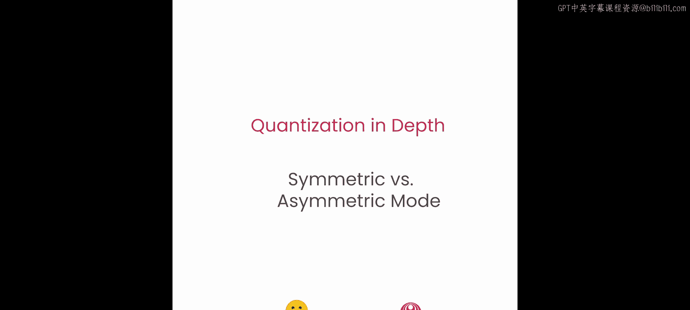
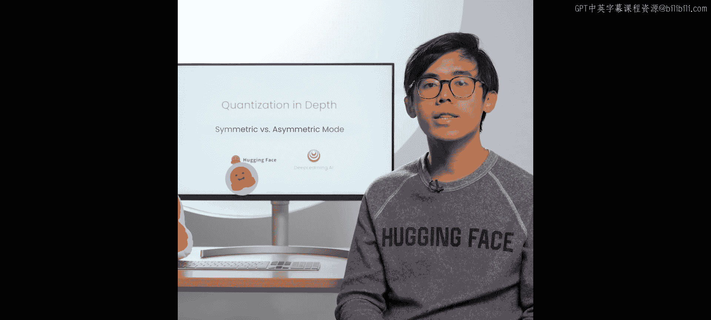
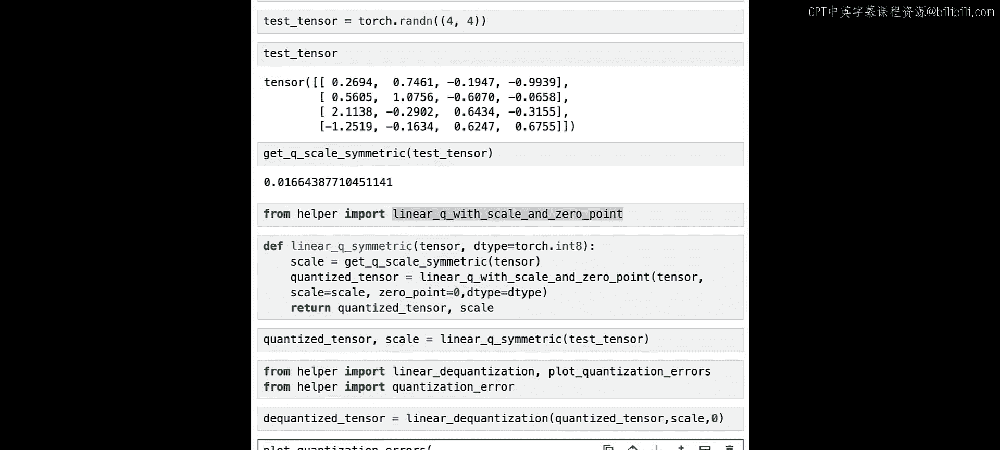
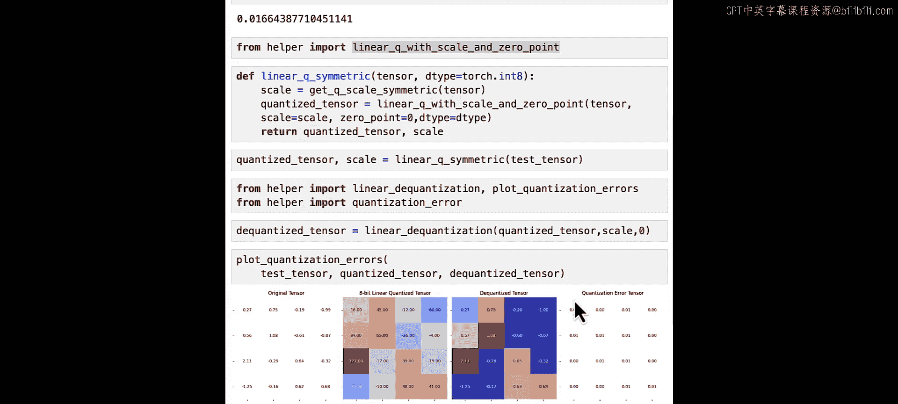
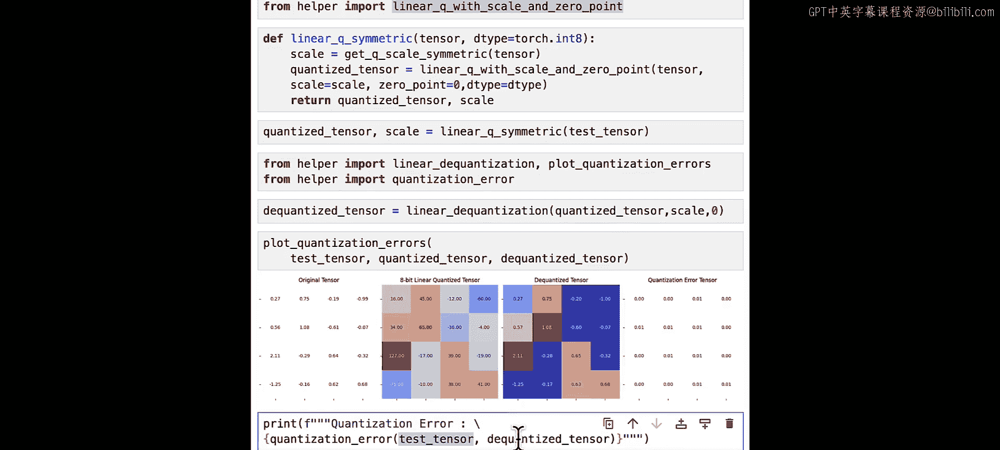
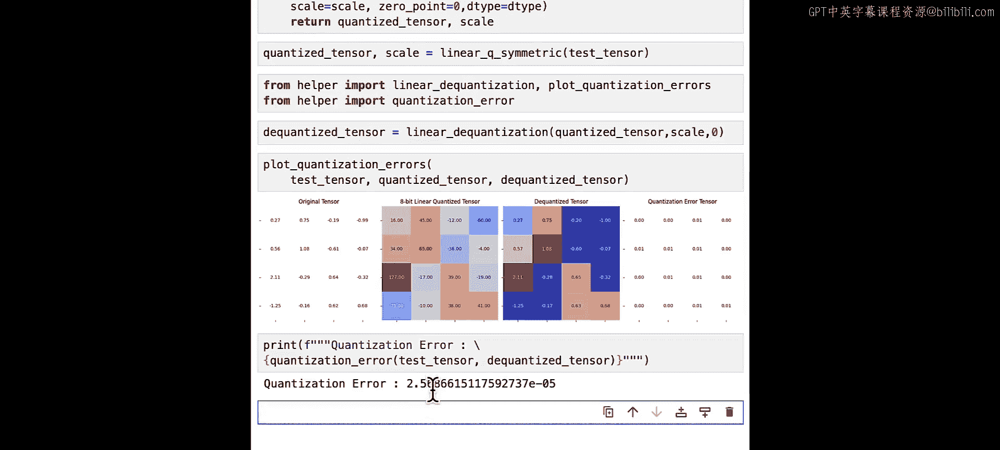
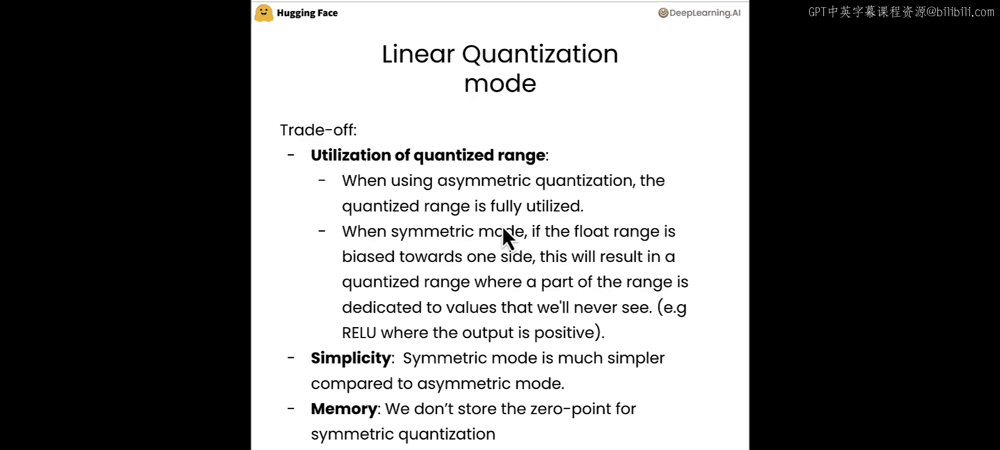

# 吴恩达《深入模型量化｜Quantization in Depth》中英字幕 - P5：5.Symmetric vs. Asymmetric Mode.zh_en - GPT中英字幕课程资源 - BV1kw4m1X7Bi

In this lesson you will learn about the symmetric mode of linear quantization。

 you will also implement quantization at different cannularities such as per tensor。

 per channel and per group quantization Finally you will check how to perform inference on the quantized linear layer let's take a look。

There are two modes in linear quantization。 The first one is the asymmetric mode。

 This is when you map the ormin or max to Q in Q max， and we just did that in the previous lesson。

 The second one is the symmetric mode。 This is when we map negative orax orax to negative Q max Q max and or max can be defined as the maximum of the absolute value of the tensor in the symmetric mode we don't need to store the zero point sin。

 it is equal to0。 This happens because the floating point range and the quant range of symmetric with respect to0。

 Hence we can simplify the equation in the previous lesson to get the following equation。

 The quant tensor is simply the original tensor divided by the scale that we run and cast to the data type of the quantized tensor and the scale S is simply or max divided by Q max。

 Now let's code。The scale in this classroom， the libraries have already been installed for you。

 but if you are running this on your own machine， you can download the torch library by simply typing peep install torch。

Since the libraries have already been installed， I won't be running this command and I'll just comment it out Now let's import torch。

Now let's call the function in order to get the scale for the linear quantization with symmetric mode。

 we will call it get Q。Scall symmetric。And this function will take the tensor。

We will also define the G type。And the default value will be torch do in8。

And as we saw in the slides， we need to get Rmax and Q max and for RMax。

 we can define it as the maximum value of the absolute value of the tensor。

 so to get the absolute value of the tensor， we just need to call the apps method and then to get the maximum value we just need to use the max method and to finish we also need to use the item method to get just the value another tensor to get Qax。

 we will use the torch。 iinfo method。We need to pass the D type and to get the maximum value。

We just need to put thatt max and we will return。The scale， which is equal to R max divided by Q max。

Now let's do a quick test， let's define a test answer to be equal to a random4 by four matrix。

 We can print the test answer。And。We can call。Dis function。To our test sensoror， to see the results。

And this is the scale we get Now that we got the scale。

 we can get the quant sor based on the following equation， we will call it linear Qsymmetric。

And it will take as argument， the tensor and the D type。

We will set the default detail to be equal to torch dot in date。So first we need to get the scale。

 so we'll use the GAQ scale symmetric function that we just coded and we just need to pass the tensor。

Then to get the quantum sensor， what we will do is to import a function that we coded in the last lab。

All the function we coded in the last lab or in the helper do Pi file， so from the helper file。

 we will get the linear queue with scale and zero point function。And。To get now the quant sensor。

 we just need to call this function。By specifying the tensor。

And we need to specify the scale that we got just above。

We need also to set the zero point to be equal to 0， since。For symmetry quantization。

 the zero point is equal to0。And specify the last argument， which is the D type。To finish。

We just need to return the quant sensor and the scale。

Now let's get the quant sensor and the scale using the function that we just coded。

On our test sensorsor。Just like the last lab， we will also get the decoquantized sensorsor and have a summary of the quantization process using the plot quantization error function。

 let's import them。Now， let's get the de quantized sensor。

 We will use the linear deco quantization function， and we just need to pass the quantized sensors。

The scale and the zero point， which is equal to0。Now we have everything。

To have the summary using the plot quantization L， we just pass the test sensorsor。

 the quant sensorsor and the the quantize sensorsor。

And this is the result we get and as you can see the original tensor is pretty much the same as the deco quantantized tensor and the quantization error tensor is pretty low and we can also print the quantization error that we define in the last lab bypassing the test tensor and the decoquantized tensor into the quantization error function and as you can see the is quite low the tradeoff between these two modes are first the utilizationization of the quantization range when you're using the assymmetric quantization。

 the quantization range is fully used but when you're using the symmetric mode。

 if the floating point range is biased toward one side for example。

 you can think about the layers where the output is positive this will result in the quantization range where a part of the range is dedicated to values that we will never see the second tradeoff is the simplicity symmetric mode is much simpler。

compared to asymmetric mode and the last one is the memory for symmetry quantization。

 we don't need to store the zero point In practice。

 we use symmetric quantization when we are trying to quantize to8 bits。

 but when we quantize to low bits such as two， three or four bits。

 we often use asymmetric quantization。

