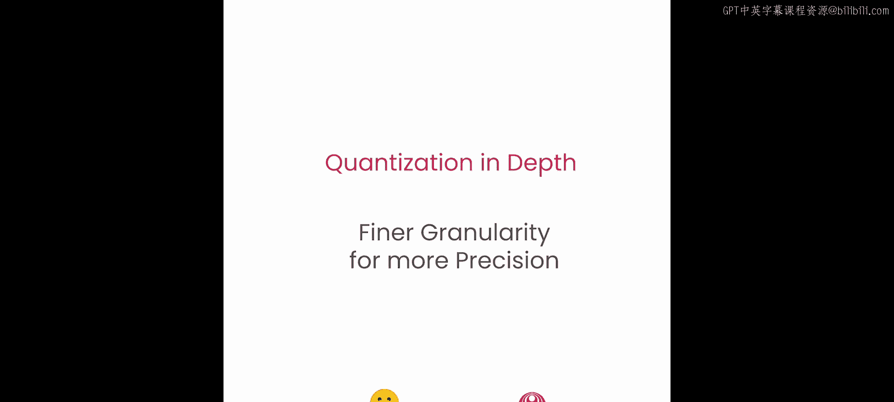
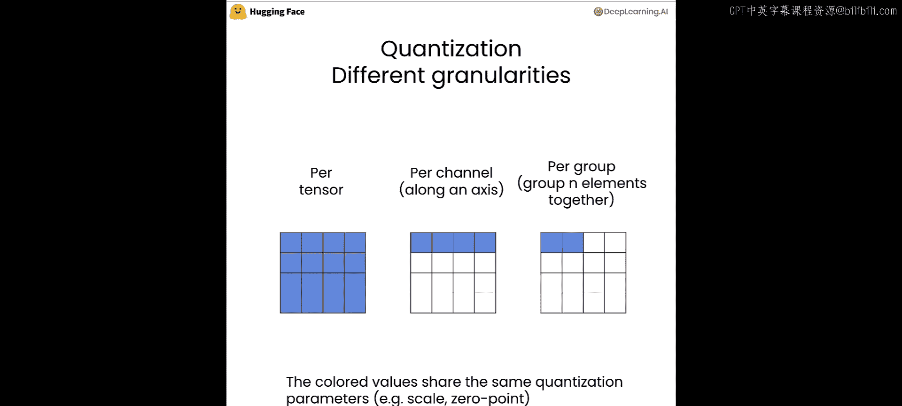
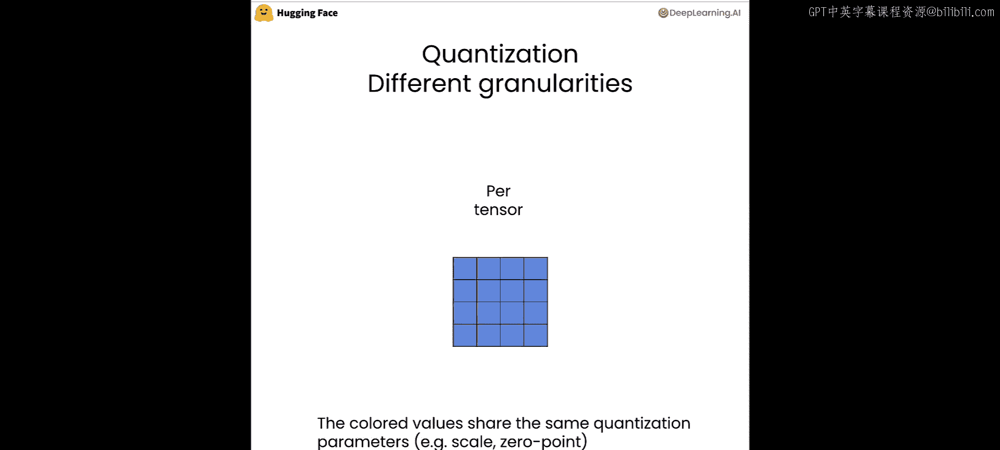
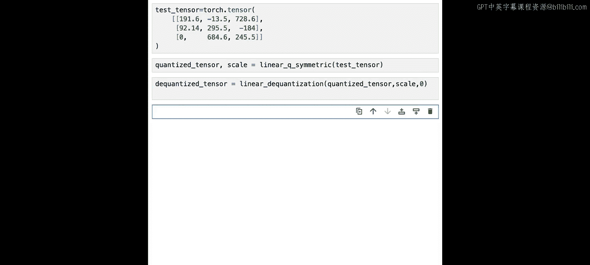
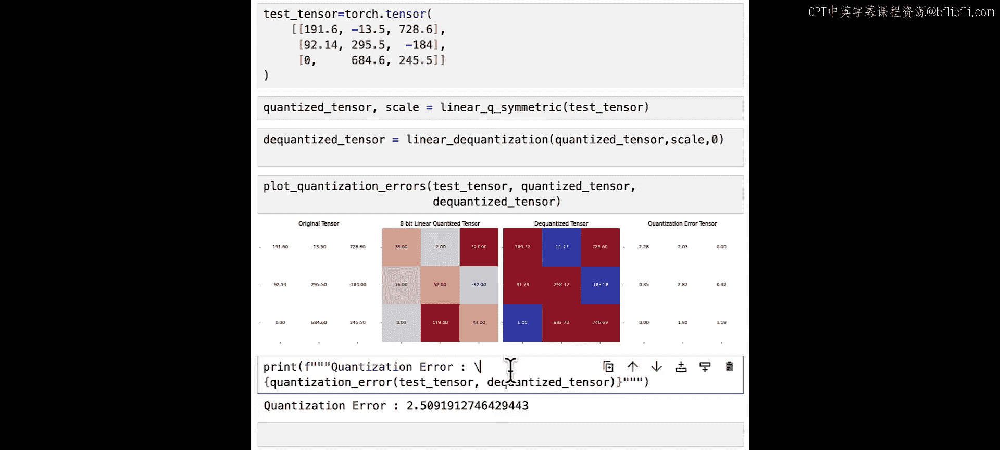

# 吴恩达《深入模型量化｜Quantization in Depth》中英字幕 - P6：6.Finer Granularity for more Precision.zh_en - GPT中英字幕课程资源 - BV1kw4m1X7Bi

The more granular the quantization is， the more accurate， it will be。

 however know that it requires more memory since we need to store more quantization parameters。

 There are different granularity when it comes to quantization we have the pertensor quantization but as you can see we don't have to use the same scale and zero point for a whole tensor。

 we can for instance， calculate a scale and a zero point for each axis。

 This is called per channel quantization。 we could also choose a group of n elements to get the scale and zero point and quantize each group with its own scale and zero point for the pertens quantization。

 this is what we did in the previous labs。 let's refresh on mind with a simple example let's use the test tensor we had in the previous lab and now this time let's perform the symmetry quantization to this tensor so we will use the linear Q symmetry function。

That we just coded。So we will get the quant stensor。The scale。无。😔，Dis function， linear Qsymmetric。

 And we just need to pass the test sensor。Then。To have the summary， you also need to dequitize it。

We will use the linear equalization function wed in the last lab。

And we need to pass the quant sensor。The scale。And the zero point， but as you remember。

 the zero point is equal to0 for symmetry quantization。 Now we have everything to plot the summary。

And here we have。As you can see the quantization worked pretty well， the values are pretty close。

 and we get the quantization error tensor， which looks pretty good。

Let's have a look at the quantization error and we get 2。

5 and if you remember the previous lab when we used a symmetry quantization。

 we had a quantization error around 1。5。

