# 吴恩达《深入模型量化｜Quantization in Depth》中英字幕 - P7：7.Per Channel Quantization.zh_en - GPT中英字幕课程资源 - BV1kw4m1X7Bi

Now let's move on to the Per quantization。 We need to store the scales and the zero point for each row if we decide to quantize along the rows and we need to store them along each column if we decide to quantize along the columns the memory needed to store all these linear parameters is pretty small。

 we usually use personal quantization when quantizing models in8 bit you will see that in the next lesson with un Now let's code the Per quantization and don't worry about this slide well do it in the notebook。

 So let's code the Per quantization to simplify the work will just restrict ourselvess to the symmetric mode of the linear quantization So the function will be called linear  Qsymmetric per channel。

 So we expect this function to take as arguments， the tensor。

 the dimension so whether we want to quantize along the rows or the columns if we are talking about the 2D matrix and we set the default value to be equal。

Torch dot in 8。And at the end， we expect to get the quant sensorsor and the scale。

 We don't need the zero points since we are trying to do it with the symmetric mode。

 So let's define a test sensorsor so that we can walk through the code。

We will use the test tensor that we defined previously。

 The first step is to know how big the scale tensor will be since we are doing per channel。

 we will be having more than one scales and we need to create a tensor to store these values So the shape of the tensor scale will be equal to that。

电池。The sheep。And with a specific dimension， we need to set the dimension to vehicless to zero if we want to quantize along the rows。

 otherwise we need to set it to one if we want to quantize along the columns。

So let's check the output dimension。As you can see we get three and indeed we need three scales value。

 one for these numbers， this one and the last one is this one now we can create the scale tensor using torch dot zeros。

 this will create a tensor with the shape output dimension and each element will be equal to zero。

Let's have a look。And indeed， we get that。Now， what we need to do is to iterate through each one of these worlds。

And calculate the scale for each one of them。To do that we will loop over the output dimension now we need to get a third row。

 for example， the first row， the second row or the third row to do that we will use the select method。

And we need to set two arguments， first， the dimension and second the index。And now， just to be sure。

 let's check at what the subtensor looks like， we should have a tensor for each row。And indeed。

 we were able to extract each row in a tensor。Now that we manage to get the subtensor。

 all we need to do is to apply the getQ scale symmetric function to that subtensor in order to get the scale related to that rule and store it inside the scale tensor。

So we need to set in the index position of the tensor scale。

 the scale for that particular subtensor to do that we will use the getQ scale symmetric function and we just pass the subtensors。

 let's check now what scales look like。We indeed manage to store the scales related to each row inside this tensor now that we have stored all our scales。

 we need to do a little bit of processing in order to reshape the scale so that when we divide the original tensor by the tensor scale each column is divided by the correct scale to do that we define the shape that the scale tensor should have。

Let's have a look at this scale shape。

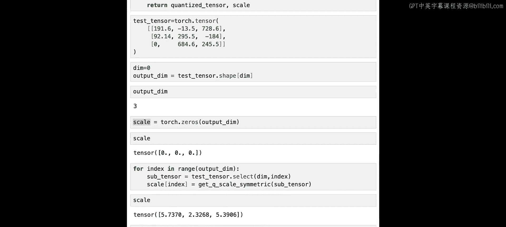

It's full of one。Then we need to set scale shape at index G to be a equal to minus1。

 which will give us that and the last thing we need to do is to reshape the scale using the view method using the scale shape that we just。

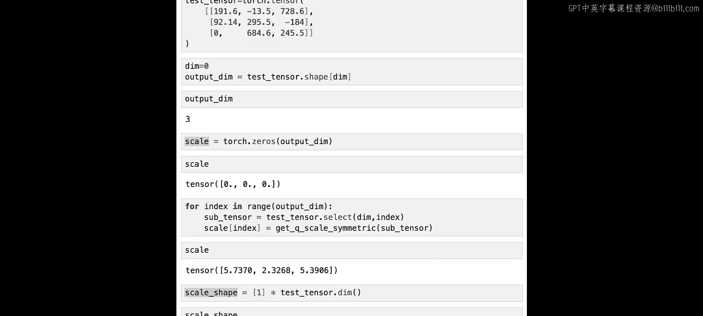

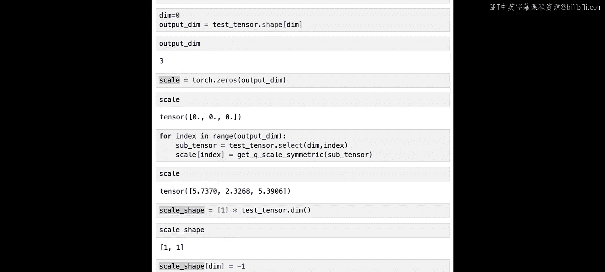

And we get the following scale and this is the scale we need in order to be able to divide the original tensor by the tensor scale so that each work is divided by each value of the scale I know this is a bit complex since it involves how to divide tensor by tensors in pythtor。

 let's have a look at an example in order to understand how view works and how to divide tensor by tensor in such way that you divide each rows or each columns。

 let's say we have the following matrix。

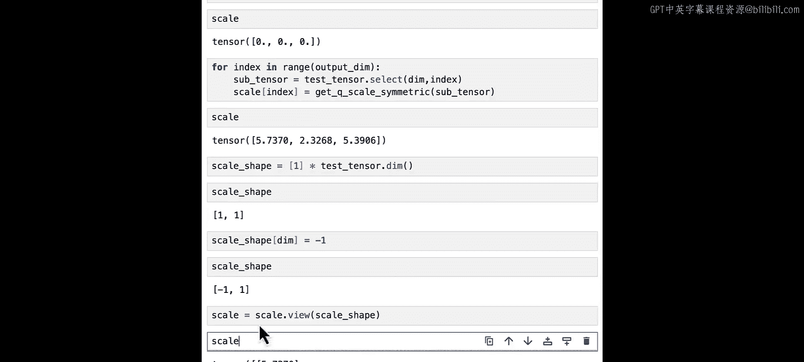

And we have the following scale， just like in the previous example。The shape of this scale is3。

 We can reshape that tensor in such way that the first dimension is of size 1 and the second dimension can contain the rest to do that。

 we can use the view function。 The shape of the of the scale is 3。

We can reshape that tensor using the view function。For example。

 we can reshape it so that the first dimension is one and the second dimension is3。And as expected。

 we get a tensor of size1 by3。 an alternative way to do that is just to replace the3 by minus1。

 What this does is that you will be able to find the right shape where you put the minus1。

 you can also reshape S so that the first dimension will end up with being3 and the last dimension to be1。

By doing that now let's try to divide the matrix M along the row。

 so the scale we need in order to divide each row is this one。

 as you can see the scale shape is the following we have three as the first dimension and one as the second dimension and let's perform the division。

And as you can see， we managed to divide along the rows。

 you can see that this row was untouched since it was divided by one， the second one was divided by5。

And the last one， the third one was divided by 10 if we use the following scale instead。

With the following shape。One by three。And we divide the metrics by this specific scale。

 we see that in this case， we divided each column by the scales。 So here， as you can see。

 this column is untouched。 we have 1，4 and 7。 The second column was divided by 5。

 and the last column was divided by 10。 Now， let's go back quantizing or tensor。

 If you remember well， the scale that we got at the end was the following。 And if we check。

The shape of this scale。This is the right shape for the scale in order to quantize each row。 Now。

 all we need to do is to quantize the tensor by。Using the linear QE scale and zero point。

Function that we call it in the previous lab and we just need to pass the test answer， the scale。

 and the zero point which should be equal to zero since we are doing symmetry quantization。

And as you can see， we end up with the following quant stens。

 Now let's put everything we did in a function called linear Q symmetric per channel。系。

As you can see here， we get the output dimension。We create the scale tensor with the output dimension shape。

 we iterate through the output dimension， and for each index。

 we get the subtensor and we store the scale in the index position， then we reshape the scale。Here。

 lastly， we get the quant sten using the linear cube with scale and zero point function。

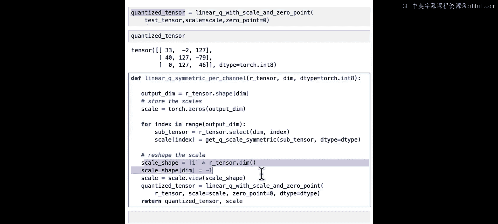

And that's it， we get the quant sensor and the scale。Now that we have our function。

 let's check if we were indeed able to quantize along a specific dimension。

 so I will read paste the test sensorsor that we defined earlier and this time we will quantize along the first dimension and the second dimension so well have the quantize tensor0 and the scale zero we get that by using the linear Qsymmetric personal function。

And we need to pass the testtens。And we need to precise that the dimension that we're quantizing is zero。

 let's do the same for the other dimension。So we'll call it quant tensor 1 and scale and call 1 to get the summary。

 we need also to de quantantize each tensor， so let's first do the case where the dimension is equal to0。

 we have de quantized tensor and the score0。Which is equals to linear equal quantization。

 and we need to precise。The quant sten underscores 0。

Its scale and zero since the zero point is equal to0。

 Now we have everything to get the summary using the plot quantization of function。

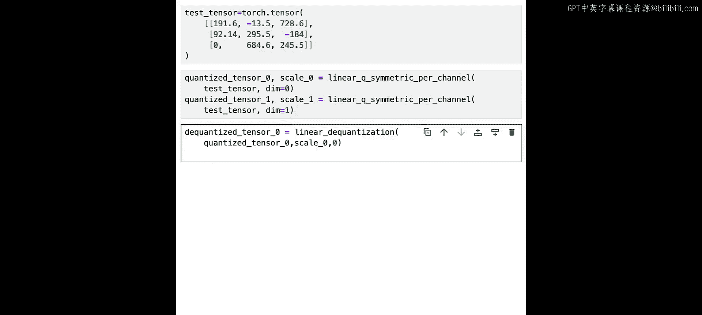

And that's it。 As you can see， we indeed quantize along the rows。

 You can see that we have the maximum quantized value here， 127 here， here and here。

 and the quantization was pretty good， as you can see。

 the original tensor is pretty close to the de quantantized tensor。

 and that the quantization L tensor is not so bad。 Let's have a better metric by computing the quantization error。

And we get a quantization error of 1。8， if we remember well when we did the pertensilsymmetric linear quantization。

 we had the quantization error around 2。5 Now let's check what happens if we quantize along the columns we'll do the same thing as we did as above but with the quant ssor under score 1 so as you can see here we define the deco quantantized ssor underscore score 1 by using the linear deco quantization and we pass the quant ss underscore score 1 and scale1 and then we plot the quantization error this will give us the following summary and as you can see here we manage indeed to quantize along the columns this time the quantization error is even lower you see that we get a lower quantization error in both cases compare to pertensil quantization this is because outlier values will only impact the channel it was in。

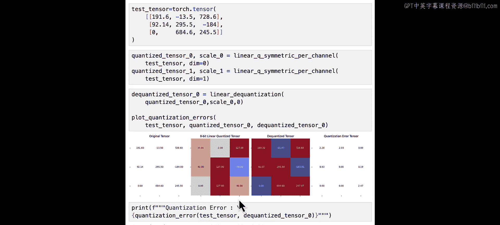

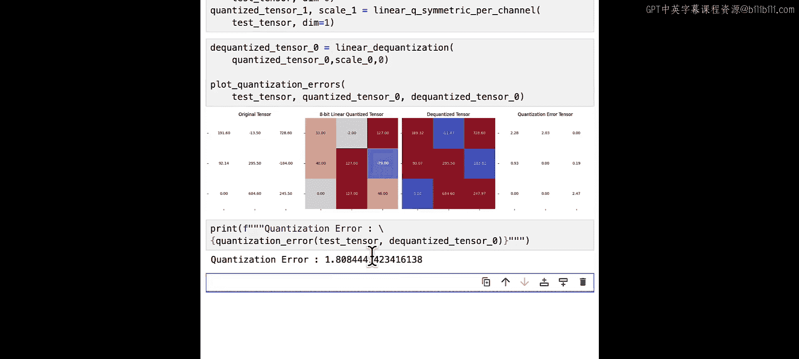

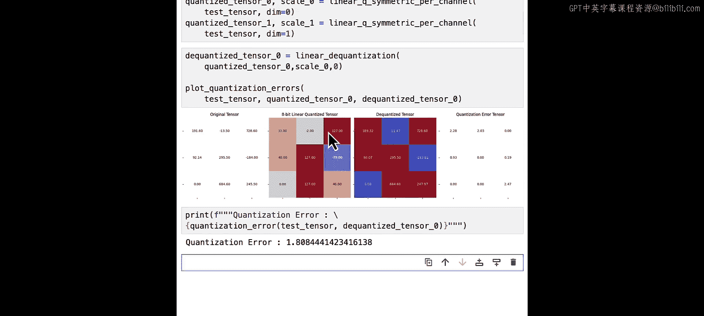

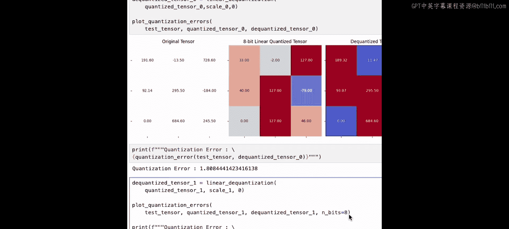

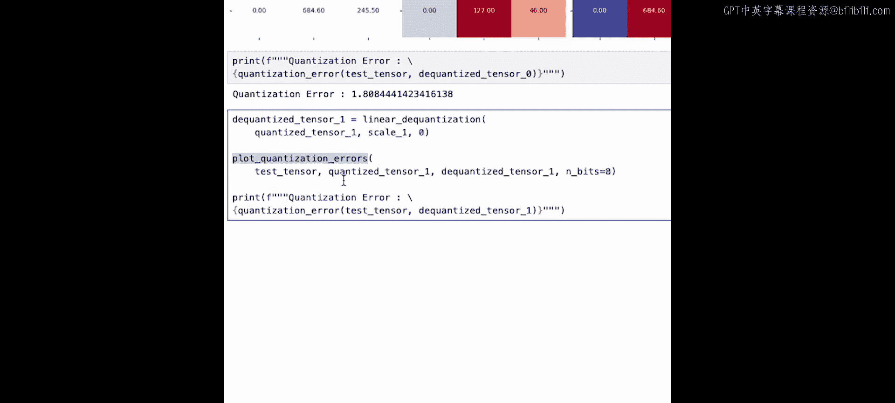

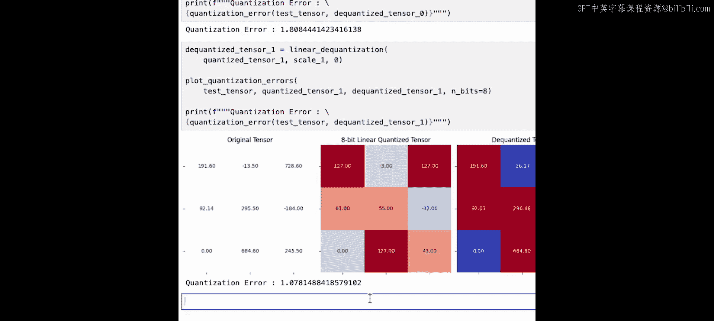

Instead of the entire tensor。