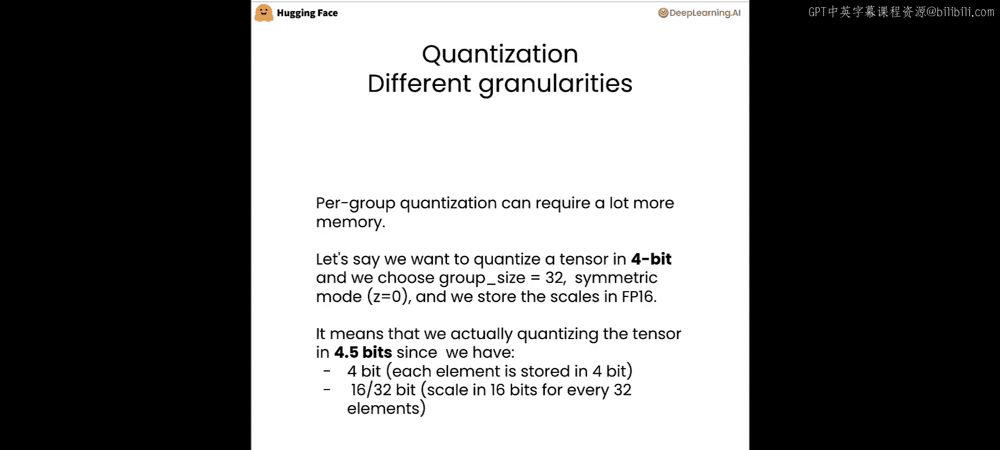
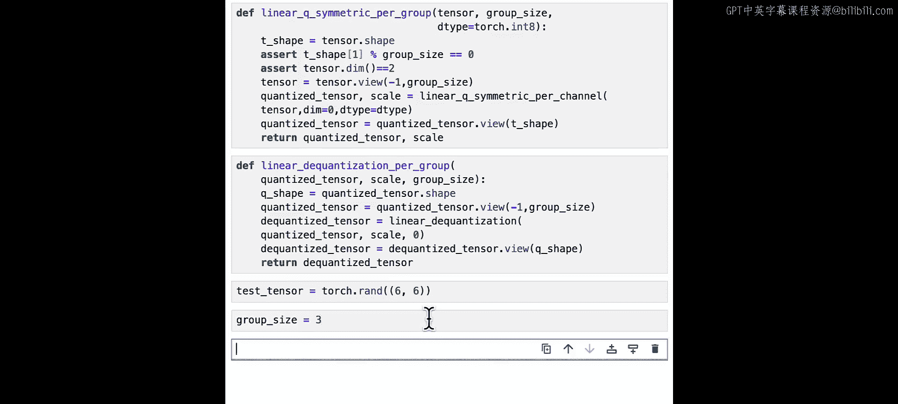
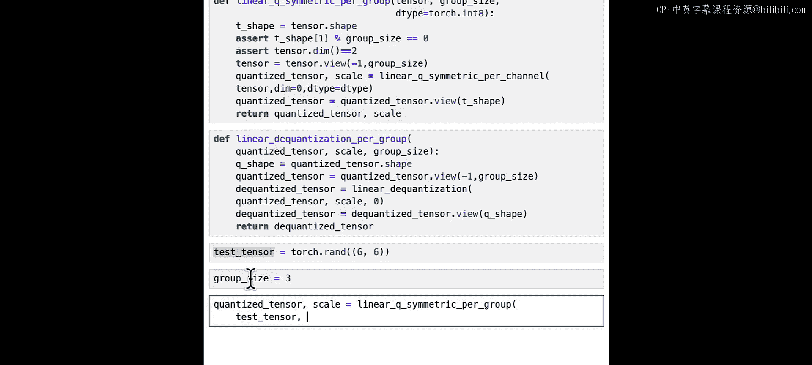
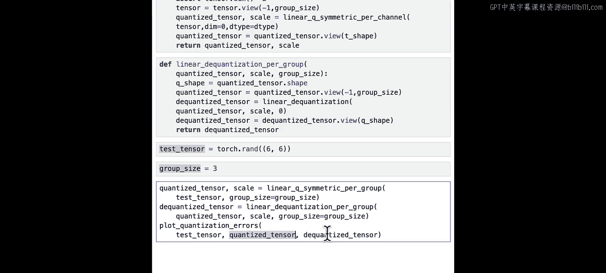
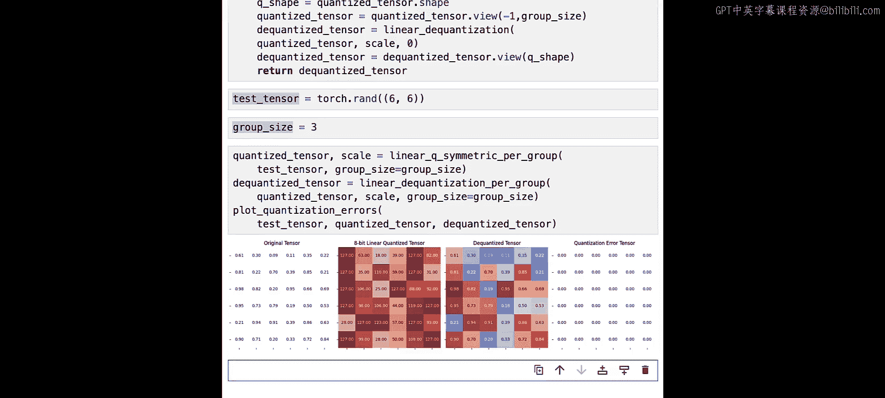
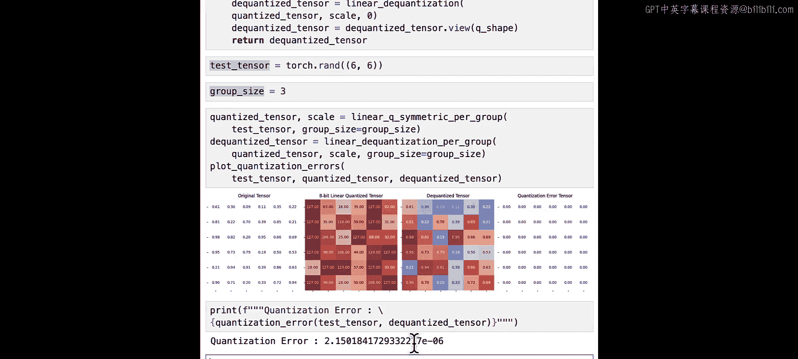
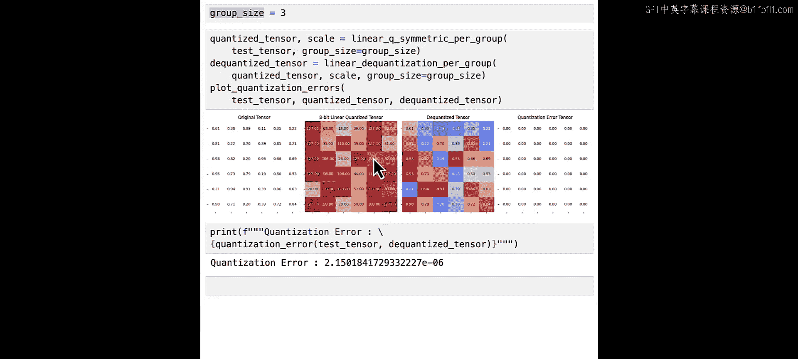
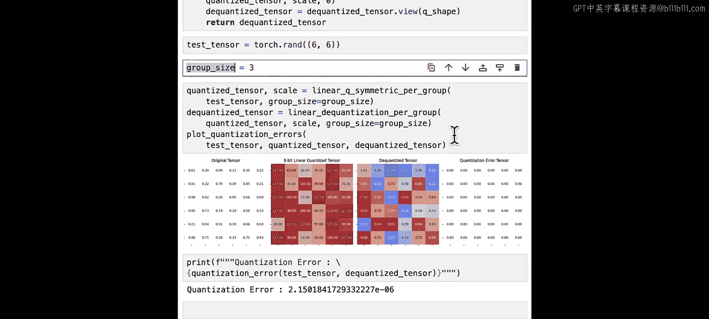

# 吴恩达《深入模型量化｜Quantization in Depth》中英字幕 - P8：8.Per Group Quantization.zh_en - GPT中英字幕课程资源 - BV1kw4m1X7Bi

Now， let's go even smaller and do per group quantization in per group quantization。

 we perform quantization on groups of n elements， common values for Nr  32。

64 or 128 per group quantization can require a lot of memory。

 Let's say we want to quantize a tensor in 4 bit and we choose a group size equal to 32。

 we use symmetrysymmetric mode that means that the 0 point is equal to 0。

 and we store the scales in  floating。16。 It means that we are actually quantizing the tensor in 4。

5 bits since we have 4 bit Since each element is stored using 4 bit and。

We have 16 divided by 32 bit since we need to store a scale in 16 bits for every 32 elements。

 for each element， you store it in4 bit， but you also have quantization parameters and you need to store once a scale in 16 bits。

 So 16 bits every 32 elements。 Now let's jump to the code So simplicity。

 we will restrict ourselves to the case where the tensor is of dimension to and we will be using the symmetric mode you don't need to pay attention to this code since we will be coding in the notebook。

 Now let's code it。 So we define the following function linearar  Qsymmetric per group。

This will take as argument the tensor。The group size and the D type。

We set the default value torch do in8。First， we need to get the shape of the tensor。

Then another restriction of our this function is that we will be performing program quantization on the rows。

 this is why we also need to make sure that each row is divisible by group size to confirm that we will just use assertion so that the shape of the tensor along the rows is indeed divisible by group size then as I said we will be restrictingulcers to tensors of dimension2。

Now， all we need to do is to reshape the tensor so that we end up with rows of group size elements。

To do that， we will use the few function that we learn above。嗯。

So as you can see what we do here is to make sure that each row contains group size element and we put the minus one here so that it infers automatically the right dimension to have in the first dimension and now if you look at the tensor we have the setup for performing per quantization we resized distensor so that we have rows of group size so that we can use the function that we coded previously that is to say the linear Qsymmetric per channel quantization so we have quant tensor。

And scale， which is equal to linear Q symmetry per channel function。And we need to put the tensor。

 the right dimension， so along the rows and the D type。After a quantizing the tensor。

 we still need to reshape it to each original shape。

 so we will use the shape that we store before here， the T shape。To reshape the tensor。

 we use the view and we just pass this shape， then we can return the quant tensor and the scale。

Now that we have coded the per group quantization， now let's code the linear deco quantization for the per group quantization in order to verify our results。

So， we need to define。This function in that function， we need the quant stencil。The scale。

But we also need the group size。Then， we need to get。

The shape of the quant stens that will be useful。Then we need to reshape the quant sensor so that we have rows that contains only cube size elements。

To do that。We put in the view methods minus one for the first value and group size for the second one。

Then。We can reuse the linear deco quantitization methods we coded before to decoquantetize the tensor。

 we need to pass the quantized tensor， the scale and the zero point。

 but since we are doing symmetric quantitization。The zero point is equal to0。

 then all we need to do is to reshape the de quantized tensor with the shape of the original tensor and the shape is stored in Q shape。

Then we return the de quant stensor。Now， let's test our implementation。

We will test a random tensor of size 6 by 6。And。Let's set group size to be equal to 3。

So。We will get the quant sten， and the scale。Using the linear cu symmetrymetry per group function。

 and we need to pass the testtensor as well as the group size， then to verify our results。

 we also need to dequantetize the tensor。

Using the linear deco quantization program function where we need to pass the quant sten。The scale。

Under the group size。 Finally， to have the summary of the quantization process。

 we just need to pass inside the plot quantization error， the following arguments。 So test tensor。

 quant tensor and deco quantized tensor。 And as you can see， if you look at the quant tensor。

 you will see that every three elements in each row， you will have the maximum value 127。

 it shows that we indeed manage to quantize each three elements in this matrix along the rows。

 So three elements here， three elements here and so on。 and you have the deco quantized tensor。

 as you can see on the right and you can see also that the quantization error tensor is very。

 very low。 and that the deco quantized tensor is。

Practically the same as the original tensor。Let's also print the deco quantitization error using the deco quantization error function。

 and we just need to pass the test sensor and the deco quantitized sensor。

And indeed， we have a very， very low quantization error。

 Now is a good time to post the video and try a couple of things。

 you can try to change the test sensors， or you can also change the group size and to see what is the effect of the group size on the quantization process。

