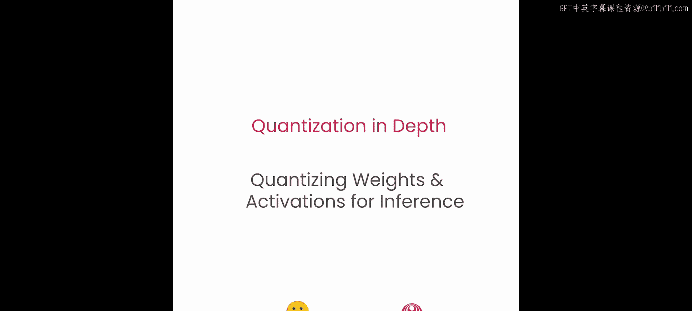
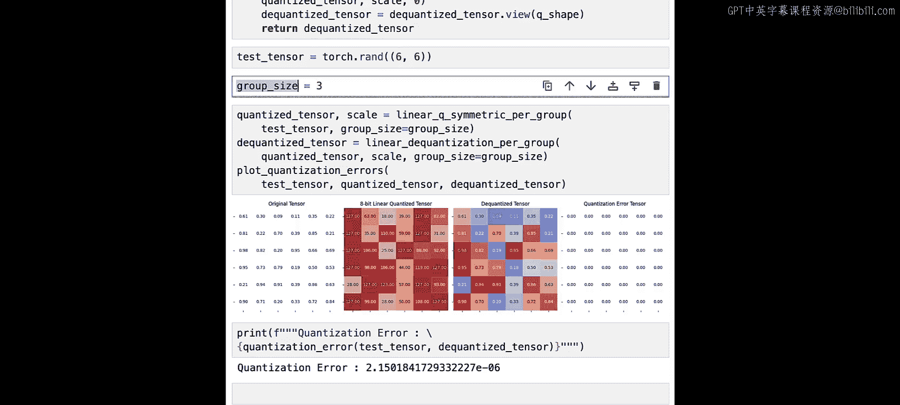
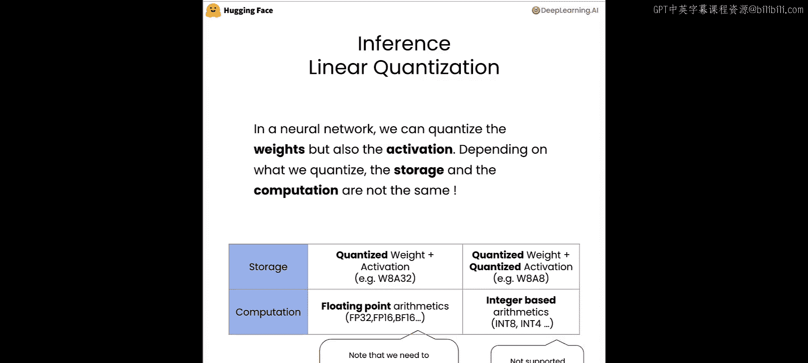
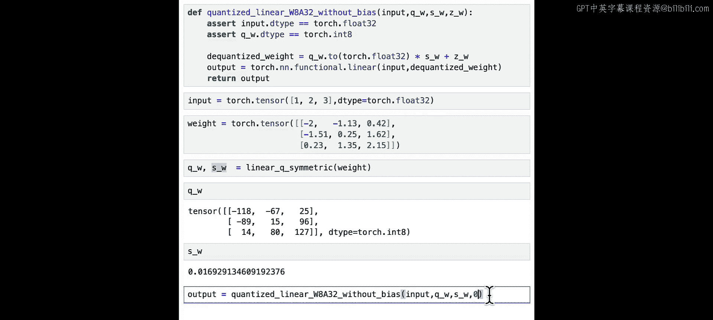
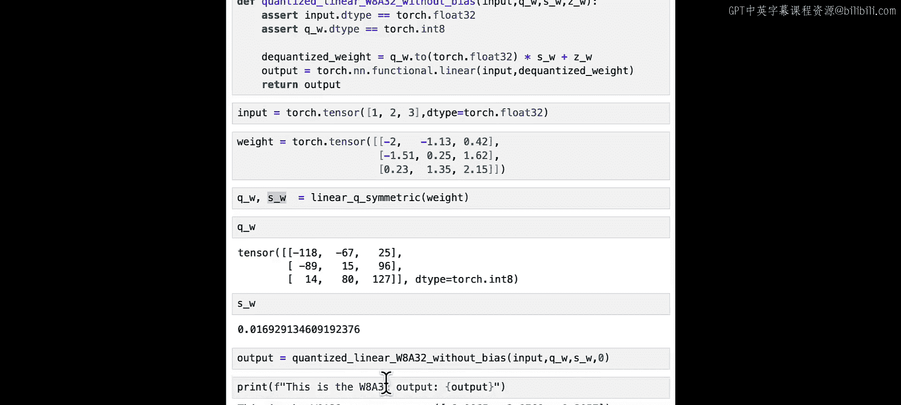
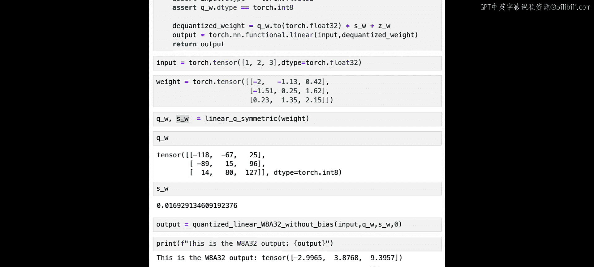
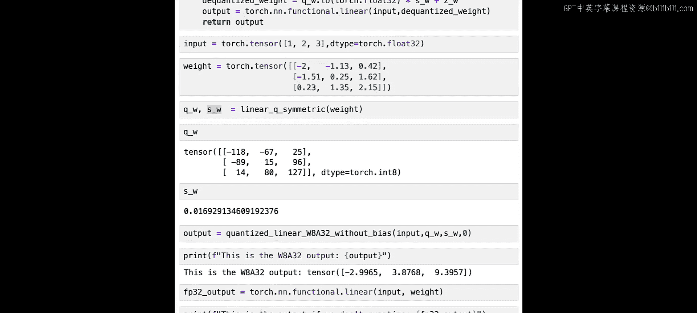
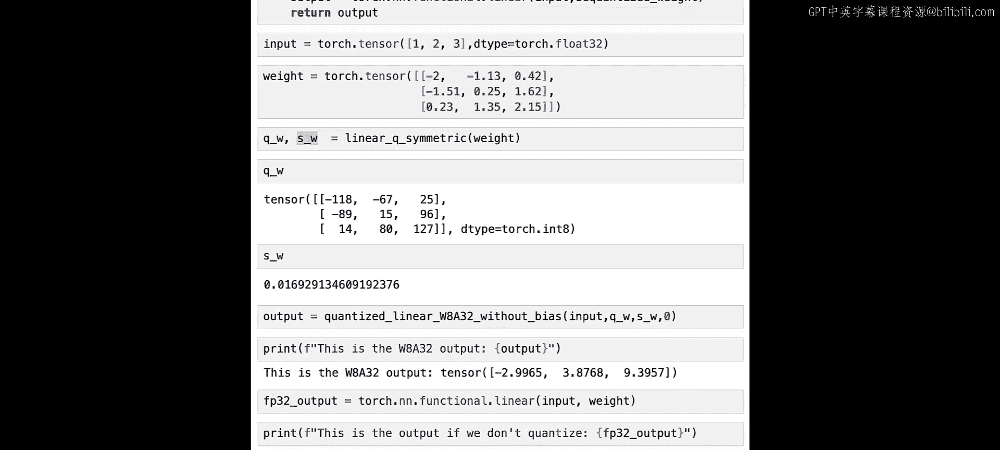

# 吴恩达《深入模型量化｜Quantization in Depth》中英字幕 - P9：9.Quantizing Weights & Activations for Inference.zh_en - GPT中英字幕课程资源 - BV1kw4m1X7Bi

Now let's move on to how to perform inference with linear quantization as we saw in the previous lesson in a neural network。

 you can quantize the weights， but you can also quantize the activation depending on what de quantantize the storage and the computation are not the same So if you only quantize the weights。

 the computation will be using floating point arithmetics。

 so floating point 32 floating point 16 or B flow 16 if you also quantize the activation。

 you will be using integer-based arithmetics for the first case where you only quantize the weights note that you need to dequetize the weights to perform the floating point computation if you quantize also the activation you will be using integerbased arithmetics but this is not supported by all hardware Now let's have a look at what happens when you quantize the weights in 8 bit and the activation remains in 32 bits also called。

W8， a 32。 Now， let's see how to code a linear layers when the input is quantized for simplicity。

 the linear layer will be without bias。So the function name。Is quantized linear。Without bias yes。

 the input will be quantized in that layer， we will have the input。

 This function takes several arguments， So the first one is the input to the linear layer。

 Then we have the quantized weight。The scale and the zero point， as we said。

 the activation is in float 32， so the input D type should be equal to torch dot float 32。

 Also the quantized weight should be in torch dot in8。

 Now all we need to do is to first de quantantize the weights。

 So de quantized weights equals to Q and the score W。Well cast these waste to torch dot float 32。

We will multiply it by the scale。And we will add the zero point。

Then all we need is to call the linear layer。With the input。And the de quantized weights。

And we return the output。 Let's try this function on a simple example。

 So the input will be the following， and we will have this as the weight of the linear layer。

 Let's quantize these weights using the symmetric linear quantization。

 So we call linear Q symmetric and we just put the weights。This should give us the quant weights。

 as well as the scale。 Then all we need to do。Is to call the quantas linear without bias as function。

 and we put the input。And the quantized weight， the scale and the zero point， which is equal to0。

 Let's check。

The output， and we can also check what the flowing point32 output gives us。

So we just call the linear layer with the input and with the original weights。

And as you can see this is the floating。32 output and these two values are quite similar。 that's it。

 Thank you very much in the next lesson units we' will show you how you can build your own 8 bit quantizer with everything we learn here and apply it to real models。

