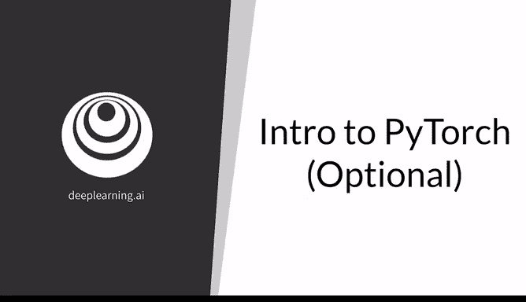
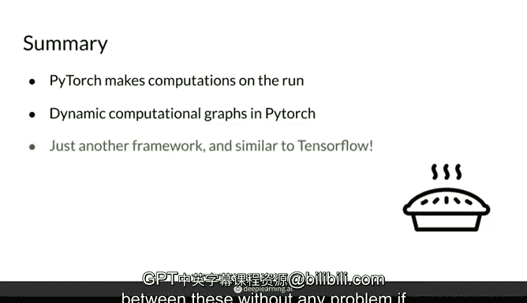

# 吴恩达《生成对抗网络（Generative Adversarial Networks，GAN）》中英字幕 - P10：10_01_13_可选：PyTorch入门.zh_en - GPT中英字幕课程资源 - BV1JC4y1T7vZ

Some of the notebooks in this specialization use Pytororch。

 a super popular deep learning framework developed by Facebook and that I really love。

 but if you haven't used it for， do not worry， you'll see that it's really similar to other frameworks like TensorFlow and in every notebook assignment there will be hints to help guide you along in using this Pytorch framework。

In this video， I'll first compare PyTtororch with Tensorflowlow。

 then you'll see how to define models and how to train them using PyTwch functions。

So Pytor and Tensorflow are arguably the most popular deep learning frameworks right now。

 And if you took the deep learning specialization， you're probably familiar with Tensorflow。

 But here's a secret。 I like Pytorch more。 The main difference between them is the way they typically make computations In Pytorch。

 you compute things on the go。 and this is sometimes called imperative programming。 In Tensorflow。

 you first define how to compute things。 and then you make the calculations afterwards。

 which is called a symbolic approach。 So this just means that in Pytorch。

 you have some values for variables A and B like a is1 B is2。 and when you sum them up。

 you get3 as a result。Well in TesorFlow， you don't have initial values for AMB。

 but you can store the sum of them in another variable C， so it's a bit abstract here。

 but then you compile C and to get a value for that computation。

 you have to assign values what AMB are。So this gives pi towards the ability to have dynamic computational graphs。

 and this just means that your known networks could change their structure at every run pretty easily。

However， because the computational graphs in Tensorflow are static。

 the models tend to take less time to run。 So because you are describing this C equals a plus B or your entire neural network like that。

 these computational graphs are considered static。And recently with TensorFlow 2。0。

 there's something called eager execution， and this is very。

 very similar to Pytorch with having dynamic computational graphs。

 but all in all the dynamic computational graphs still feel much more natural in PyTtorch。

But on the whole， these currently are very， very similar frameworks and you'll see that transitioning from one to another has never been easier。

 especially from the Tensorflow to pi to direction。So focusing on Ptorrch。

 let's start with how to define a model using Pytorrch。 First。

 you have to import Ptorrch with the line import torch。And this is just the Pytorch library。

 and then it's also useful to also import the NN module， which stands for neuralural network。

 and this includes custom layers for deep learning models so it's very， very useful。

It's common to define models in PyTtors using subclasses of the class NN dot module。

And here the class logistic regression will help us create a logistic regression model The initialization method for this class takes the parameters that you want for your models。

 this is typical to objectoriented Python and in this case the variable in here determines the number of input variables for this logistic regression model then you define the architecture of the model as an attribute within the constructor in it and for a logistic regression you can use a linear layer and a sigmoid activation within what's called a sequential module。

And so the sequential module is just layering on sequential layers。

 so first give me a linear layer and then give me a sigmoid activation function。

And here in the linear layer， you can see that I passed this variable in from here。

 so this is the size of that input going in， and then the output is one。

 I just want one prediction from all these inputs。And so this one here could just be a class of cat or not cat。

 which goes through the sigmoid activation that produces values between zero and 1。And then finally。

 after this in here， you define the forward method of your model class and the forward method just means what your model does on the forward pass given inputs to produce in output。

 It's not the backward pass with back propagation， The forward pass is what happens when you put in the inputs。

 How does it produce the outputs。And so in this case。

 the sequential model you define here self dot logistic regression。

 you just return given the inputs X， so given the input's X。

 you put it through this sequential set of layers。Alright。

 so this is a very simple general outline of how to define a model in Pytorch。

 but you could achieve the same results with a different code structure as well。

Now to train a model in this framework， you have to initialize an instance of the class that you define for your model。

 so here the logistic regression class， this model from the last slide has 16 input variables。

Then you determine a cost function for your model， I'll call this the criterion。

 so it's a criterion that your model is learning from。

And this is a typical name that's given to the cost function in Pytorrch。

 and here I'm going to initialize the BC loss for the cost function。

 which is available through this NN library， the Torch neural Network library。

After that you have to choose the optimizer you want to use。

 for example sastic gradient descent pass in your model's parameters。

 so these are the theta that you've seen previously and that will be weights that are going to be updated during training。

 and then you have to specify different hyperparameters for this optimizer， for example。

 the learning rate here。Finally， you can train your model for a number of different epochs。

 so let's start the training loop with N epochs， where within this training loop。

 you pass the input into your model， you get a prediction from your model。

 then you compare your prediction to the ground truth output using this criterion using your cost function。

 and this gets your loss for this particular step。And then take a step towards your optimum using the optimizer that you defined。

You don't need to worry about the exact syntax here。

 but basically what's happening is that this optimizer we are zeroing out the gradients from before to make sure that it's all clean and good。

 and this is the important step for back propagation。

 this prepares the back propagation step and this last optimizer do step here means using stochastic gradient descent on the model parameters with this small learning rate to step in that general direction and update those parameters。

So to sum up Pytororch makes computations on the run。

 so it allows you to experiment with models I can change in every single run， however。

 as you've seen in this video， Pytororch is just another deep learning framework that's actually very similar to TensorFlow。

You'll be able to change back and forth between these frameworks without any problem if you're already familiar with one of them。

