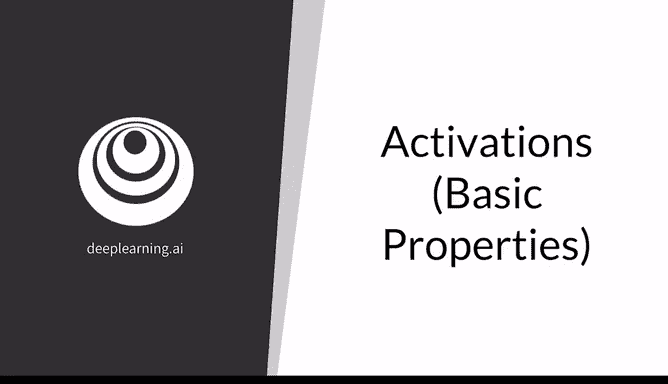
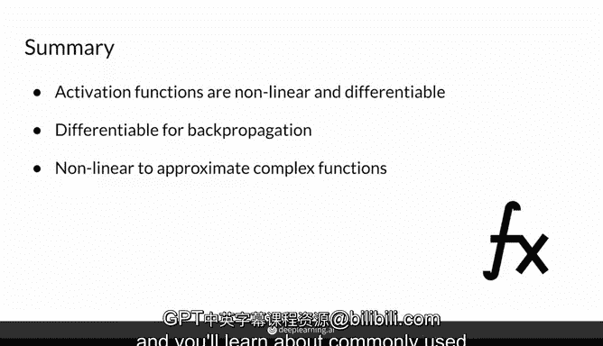

# 吴恩达《生成对抗网络（Generative Adversarial Networks，GAN）》中英字幕 - P12：12_02_02_激活函数的基本性质.zh_en - GPT中英字幕课程资源 - BV1JC4y1T7vZ

Activations are functions that take any real number as input。

 also known as its domain and outputs a number in a certain range using a non nonlinear differentiable function。

 You typically use them for classification between certain layers in deep neural networks and more specifically in GANS。

In this video， I'll go over what activations are， and the reason why they are both nonlinear and need to be differentiable。

 which just means you can take the derivative of them， meaning they have a gradient。

So take this neural network with two hidden layers and multiple inputs， for example。

 x0 maybe fur color。X1 is the size of the animal。And all sorts of other features。

 And say this neural network predicts whether these features comprise a cat。

 So this will output a probability between 0 and 1 at the end here。

 So what about all these nodes in between all these nodes together compose the entire neural network architecture。

 and I'll start by demonstrating what occurs at each of these individual nodes。

 So a note here takes in information from the previous layer and predicts two things。

 which I'm going to split with this dotted line。So first it computes Z where I represents which node it is。

 so here it's01， it's the first node， so I equals 1 and L represents the layer and here is the zero with layer and here it's in the first layer。

 so again L is 1。And Z here is equal to a sum of various weights on the outputs from the previous layer。

 So you see a here， but this a is the other side of these nodes from the previous layer coming in and L -1 just means it's the previous layer。

 so that's the zero with layer here。And it looks at all of those different values where i equals zero all the way up to I equals n down here。

And so Z is looking at the previous layer and weighting them。

 so Z is the outputs of the previous layer weighted by these values W。

And this is typically called a linear layer， and it both includes scaling values of weights。

 as well as a bias term， which will shift those values。 So it's like saying plus B out here。

 but typically you can tuut that into the matrix W。And then on the other side is A。

And a is the output of an activation function that I'll call G here that takes in as input this z value。

And I'll go over quickly what differentiable and non nonlinear mean here。

 because this is what this activation function needs to be。

So you need your activation function G to be differentiable and nonlinear。

 and it needs to be differentiable because you use back propagation for training your neural network and updating its parameters so it needs to be able to differentiate and provide gradients to the previous layer。

It also needs to be nonlinear so the features you compute within the neural networks can be complex。

 so if you didn't use non nonlinear activations， a neural network like this one with multiple hidden layers and neurons could actually be collapsed into a simple linear regression with these raw inputs as X here and these two layers could actually just become a single layer and there's no nonlinearity because linear layers you can just stack on to each other。

And linear regression is just one linear layer with a biased term tucked into the weight matrix again。

So in summary， you need nonlinear differentialiable activations to take advantage of deep learning models and to have the layers stack onto each other to construct a complex neural network to model complex nonlinear functions。

And so the nonlinearity specifically ensures your linear layers don't reduce to a single linear layer in linear regression。

 and so your network can learn more complex functions and the differentiability aspect ensures your network can learn through back propagation by computing the derivative。

You could use any custom function as an activation for your deep learning models as long as you make sure that it's non nonlinear and Frenchable。

Researchers often experiment with what works best， and you'll learn about commonly used activation functions in the next lecture。

