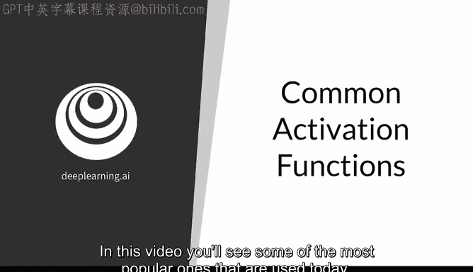
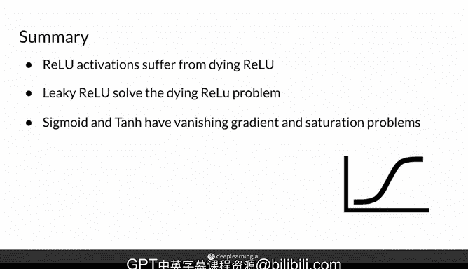

# 吴恩达《生成对抗网络（Generative Adversarial Networks，GAN）》中英字幕 - P13：13_02_03_常见激活函数.zh_en - GPT中英字幕课程资源 - BV1JC4y1T7vZ

You've seen that activation functions are important for deep learning models。

 There are multiple functions that are used as activation functions。 In this video。

 you'll see some of the most popular ones that are used today。😊。

This video will focus on four commonly used activation functions that you'll also be using in your GANS。

The first one is Relu， the second one is a variant called leaky Relu。

 and the last two are sigmoid and TNH。There are actually an infinite number of possible activation functions。

 but not all of them are ideal， and one of the most popular effective activation functions is known as the rectified linear unit or Raylu for short。

AndWhat raylu does is it takes the max between z and 0。

 So meaning if its input is z from this current layer L， this activation G， where Raylu is G here。

 will take the maximum between the value 0 and Z。 And really。

 what that means is that it squashes out all the negatives。 So graphically。

 I can illustrate the function to look like a straight line with the slope equal to 1 for the positive values。

So any value coming into z such as the value 2， if it goes in to G。

 it'll still be the value 2 Now if a negative number in Z is passed into G， then graphically。

 whenever that value z is negative， it'll then output zero。Essentially。

 no negative values are allowed， so it looks similar to a hockey stick which makes it nonlinear and linear would mean a single straight line and you might notice that raylu is strictly speaking。

 not differentiable at z equals0， but by convention and implementation。

 the derivative of raylu at z equals0 is often set to  zero here。Allright。

 the flat part of the raylu activation function when Z is negative always has a derivative equal to zero and this can be problematic because the learning process depends on the derivative to provide important information on how to update the weights and with a zero derivative some nodes get stuck on the same value in their weights stop learning so that part of the network with stop learning and in fact the previous components of the network will all be affected as well and this problem is known as the dying Raylu problem because it's the end of learning and that's why a variation of Raylu exists and it's called the leaky raylu。

AndWhat the leaky relu does is that it maintains the same form of Relu。

 and it maintains the same form as Relu for the case when Z is positive。

 which means that it keeps the same positive value again as whatever the input is。

But it adds a little leak or a slope in the line when Z is less than 0 when z is negative down here。

 and it's still non nonlinear with a bend in the slope as equals 0。

 but now it has this non-zero derivative when z is negative。

 so this slope is intended to be less than 1， so it doesn't have to form a line with this positive side that would be unfortunate amy linear。

And note that the derivative at z equals0 is still set to zero。

And broadly the slope is treated as a hyperparmeter and that's a here， but it's typically set to 0。1。

 meaning the leak is quite small relative to the positive slope still。

 and this solves the dying raylu problem by and large。

 and in practice most people still use raylu though， but leaky raylu is catching up in popularity。

So now I'll show you two other common activation functions that look fairly similar to one another。

 so first it's the sigmoid activation， which has a smooth as shape and outputs values between0 and1。

😊，So when Z is greater than or equal to 0， the sigmoid activation outputs a value between 0。5 and 1。

 and when Z is less than 0， the sigmoid outputs a value between 0 and 0。5。

 and because it outputs a value between 0 and 1， the sigmoid activation function is often used in binary classification models in the last layer to indicate a probability between 0 and 1。

 for example， predicting that there's a cat in a picture with a probability of 0。95。

Now the syigmoid activation function isn't used very often in hidden layers because the derivative of the function approaches zero at the tails of this function。

 and this produces what you'd call vanishing gradient problems or saturated outputs here at the tails of the function。

 and you can imagine that this function continues to go in both directions because it can take any real value as input。

It is asymptotically approaching1 here at the top and asymptotically approaching0 at the bottom。

 and this produces what you call vanish ingredient gradient problems because you have these saturated outputs here at the tails and the values will always be close to 1 or close to zero when you get too far away from the input Z being  zero。

Another function with a similar shape to the syigmoid is the hyperbolic tangent or T H for short。

 In contrast with the sigmoid， however， it outputs values between negative1 and 1。

 So when z is positive， it outputs a value between 0 and 1， and when z is negative。

 it outputs a negative value between negative 1 and 0。

And one key difference from the sigmoid is that tanNH keeps the sign of the input Z。

 so negatives are still negative， and that can be useful in some applications。

 and because the shape is similar to the sigmoid， however。

 the same saturation and vanishing gradient issue does occur and again the tails do extend on both sides。

 approaching one at the top and negative one at the bottom， both are used in neural networks。

 in fact， all of these activation functions are used in neural networks。

 and especially in GNs which you'll be implementing shortly。There are more activations out there。

 and new ones are in the process of development by researchers all the time。 so if you're interested。

 you could come up with your own activation function。

 just make sure it's nonlinear and differentiable。So to sum up。

 many different functions are currently used as activation functions， and I show you the raylude。

 the leaky raylude， sigmoid and TNH， and most of them come with their own problems。

 the raylude with the dying Raylu problem， and sigmoid and TNH with the vanish ingredient and saturation problems。

You'll see and use all of these activations presented here on the models that you'll implement throughout the specialization。

