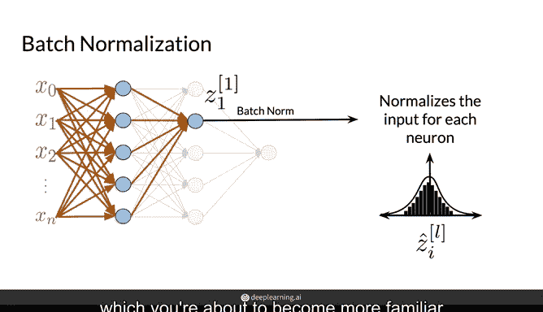
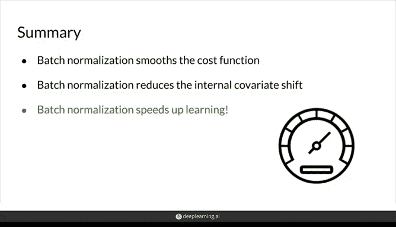

# 吴恩达《生成对抗网络（Generative Adversarial Networks，GAN）》中英字幕 - P14：14_02_04_批归一化解释.zh_en - GPT中英字幕课程资源 - BV1JC4y1T7vZ

GANs take a lot of time to train， especially if you want to build them for really cool applications like the one discussed in this course。

Gans are often quite fragile when they learn to because they aren't as straightforward as a classifier。

 and sometimes the skills of the generator and the discriminator aren't as aligned as they could be。

For these reasons， every trick that speeds up and stabilizes training is crucial for these models and batch normalization has proven very effective to that end。

So to get started， I'll remind you of the effects that normalization has on training。

 I'll show you what internal covariate shift means and why it happens。

 and at the end you'll get to connect it all to batch normalization and develop some intuition on why it speeds up and stabilizes training in neural networks。

So suppose you had a super simple neural network with two input variables， x1 for size and x2。

 save for fur color。And a single activation that outputs whether this example based on these features is a cat or not a cat。

And let's say the distribution of X1 here the size over your data is normally distributed like this around a midsize example。

 for example， with very few extremely small or extremely large examples。

While the distribution of fur color x2 skews a little bit towards higher values over here with a much higher mean and lower standard deviation。

 and so let's say this higher value here represents darker fur colors。And of course。

 notice that comparing the same value on fur color and size is a little bit like comparing apples oranges because dark fur color and large size don't really have a meaningful correlation。

However， the result of having these different distributions like this impacts the way your neural network learns。

 For example， if it's trying to get to this local minimum here and it has these very different distributions across inputs。

 This cost function will be elongated so that changes to the weights relating to each of the inputs will have kind of a different effect of varying impact on this cost function。

 And this makes training fairly difficult， makes it slower and highly dependent on how your weights are initialized。

Additionally， if new training or test data has， let's say really light for a color。

 so the data distribution kind of shifts or changes in some way。

 then the form of the cost function could change too。

 so showing that it's a little bit more round here now and the location of the mini could also move even if the ground truth of what determines whether something's a cat or not stays exactly the same that is the labels on your images of whether something is a cat or not has not changed。

And this is known as Covariate shift。And this happens pretty often between training and test sets where precautions haven't been taken on how the data distribution is shifted。

But what if the input variables X1 and x2 are normalized and normalized。

 meaning the distribution of the new input variables。

 X1 prime and x2 prime will be much more similar with， say。

 means equal to 0 and a standard deviation equal to 1。

 Then the cost function will also look smoother and more balanced across these two dimensions。

 and as a result， training would actually be much easier and potentially much faster。Additionally。

 no matter how much the distribution of the raw input variables change， for example。

 from training to test。The mean and standard deviation of the normalized variables will be normalized at the same place。

 so around a mean of zero and a standard deviation of1。And for the training data。

 this is done using the batch statistics， so as you train each batch。

 you take the mean and standard deviation and you shift it to be around zero and center deviation of one。

And for the test data， what you do is you can actually look at the statistics that were gathered over time as you went through the training set and use those to center the test data to be closer to the training data。

In using normalization， the effect of this covariate shift will be reduced significantly。

And so those are the principal effects of normalization of input variables。

 smoothing that cost function out and reducing the covariate shift。However。

 covariate shift shouldn't be a problem if you just make sure that the distribution of your data set is similar to the task you're modeling。

 so the task set is similar to your training set in terms of how it's distributed。That being said。

 neural networks like the one I am showing you here are actually susceptible to something called internal Covariate shift。

 which just means it covariate shift in the internal hidden layers here。

So take the activation output of this first hidden layer of the neural network and look at this node right here。

When training the model， all the weights that affect the activation's value are updated。

 and consequently， the distribution of values contained in that activation changes and are influenced over this course of training。

 This makes the training process difficult due to the shifts similar to the changes you saw in the input variable distribution shifts like fur color。

 only on the internal notes that have a little bit more of an abstract meaning than fur color and size。

Now batch normalization seeks to remedy the situation and normalizes all these internal nodes based on statistics calculated for each input batch。

 and this is in order to reduce the internal covariate shift。

 and this has the added benefit of smoothing that cost function out and making the neural network easier to train and speeding up that whole training process。

So the word batch and batch normalization indicates a use of batch statistics。

 which you're about to become more familiar with as you continue this week's videos。

So in summary， batchsh normalization smooths the cost function and reduces the effect of internal covariate shift It's used to speed up and stabilize training and comes in handy when building grade Gs。

One caveat to note is that while batch normm is extremely effective for ourgans and neural networks more broadly。

 the theory behind internal covariate shift is not actually conclusive。

 we're still finding evidence for other reasons batch normm might be useful in our models。

