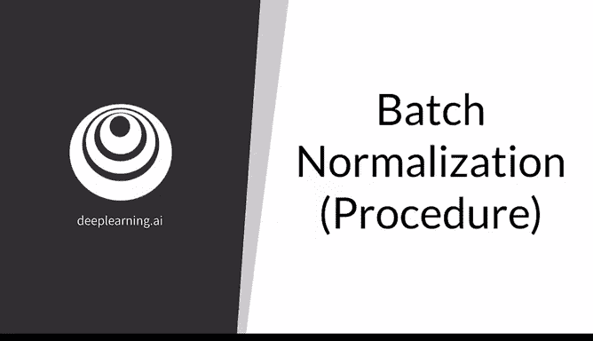
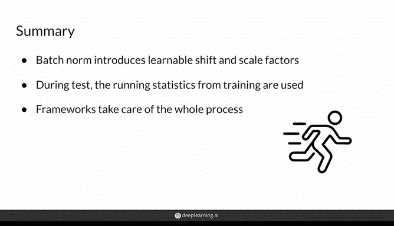

# 吴恩达《生成对抗网络（Generative Adversarial Networks，GAN）》中英字幕 - P15：15_02_05_批归一化流程.zh_en - GPT中英字幕课程资源 - BV1JC4y1T7vZ

Btch normalization might sound daunting， but it's a pretty straightforward procedure that you could implement from scratch。

However， frameworks like Pytorch actually do it for you， so in this video I'll show you how it works。

You'll get familiar with the operations of batch normalization in this video and how they differ during training versus testing batch normalization creates these happy normalized distribution of values like you see here。

So take this neural network with two hidden layers， multiple inputs， and a single output。

I'll focus on this internal hidden layer to explain how batch normalization works。

 so from the inputs Z here is coming from all the previous nodes。

Batch normalization considers every example Z I in the batch。 for example。

 you could have a batch size of 32 so you would have 32 Z's here and again， as a reminder。

 I here represents this is the Ith node in this layer and L represents this is the E layer。

For example， here is layer 0， layer 1， or here is node0， node i1。

And so batch normalization takes the size of the batch， for example， 32， and it has 32 Z's here。

And from those 32 Z's， it wants to normalize it so that it has a mean of zero and a standard deviation of1。

And so what you do is you get the mean of the batch here mu。

 and that's just the mean across all these 32 values。

 and then you also get the variance of the batch sigma squared。Which is again。

 the value from these 32 values。And to normalize these z values to a mean of zero in a standard deviation of 1。

 you subtract the mean and you divide by the standard deviation。

 or here is' the square root of the variance， and you add an epsilon here just to make sure the denominator isn't zero。

And at the end， you obtain these normalized Z values， which I'll call Z hat。All right。

 so after you get the normalized value Z hat， you have learned parameters in the batch normalization layer and what that means is that you'll have a value called beta。

 which will be the shift factor in gamma， which will be the scale factor and these parameters are learned during training to ensure that the distribution to which you're transforming Z is the optimal one for your task so after you completely normalized things to Z hat。

 you then rescale them based on these learned values gamma and beta。

And so this is the primary difference between normalization of inputs and batch normalization。

 because here youre not forcing your distribution to have zero mean and standard deviation of one every single time。

 it's after normalizing things， then you can go on and rescale things to the necessary task so it's key here is that batch normalization gives you control over what that distribution will look like moving forward in the neural network。

And this final value after the shifting and scaling will be called Y。

 and this y is what then goes into this activation function。

So now that was during training and during testing you want to prevent different batches from getting different means and standard deviations because that could mean the same example。

 but in a different batch would yield different results because it was normalized differently due to the specific batch mean or specific batch standard deviation。

 so instead you want to have stable predictions during test time。And during testing。

 what you use is the running mean and standard deviation that was computed over the entire training set。

 and these values are now fixed after training so they don't move。

But after that you just follow a very similar process。

 so here is the expected value of those z values， so that's the running the and here's the variance of those z values。

 where when you take the square root here， it will get you the standard deviation。

 you still have that epsilon here to prevent that denominator from going to zero。And after that。

 you just followed the same process as you did in training and you feed these normalized values into the learn parameters and then the activation function。

But don't worry too much about the details of this process， as I told you before。

 frameworks like TensorFlow and PyTtorrts keep track of these statistics for you。

 and all you have to do is create a layer called batch Norm。

 and then when your model is put into the test mode。

 the running statistics will be computed over the whole dataset for you or saved for you so that's really really nice。

You might have also heard of test mode being called test time， inference time， evaluation or E mode。

 these are roughly equivalent and you can think of them as not training time。So in summary。

 batch normalization differs from standard normalization because during training。

 you use the statistics from each batch， not the whole dataset set。

 and this reduces computation time and makes training faster without waiting for the whole dataset to be gone through before you can use batch normalization。

Secondly， by introducing learnable shift in scale parameters。

 you don't force the target distribution to have a zero mean in a standard deviation of1。Finally。

 at test time， the running statistics from training are applied to the entire data set。

 which keeps predictions stable because the training values are independent and fixed。

One important note is that deep learning frameworks have this entire process implemented for you for training and testing。

 so all you need to do is know when to use it in your GANs or some other spectacular model you want to train。

You'll also get to learn about more advanced normalization techniques in the upcoming weeks。

 so stay tuned on that。

