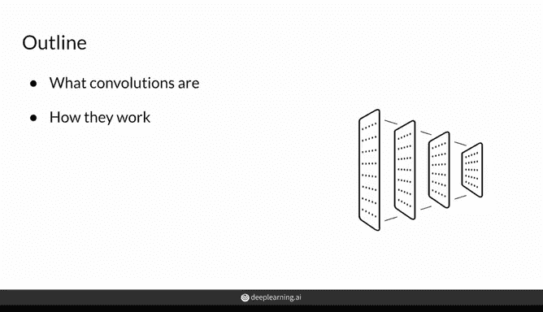
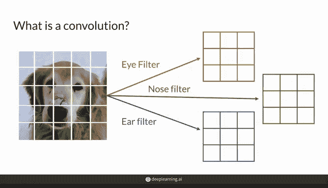
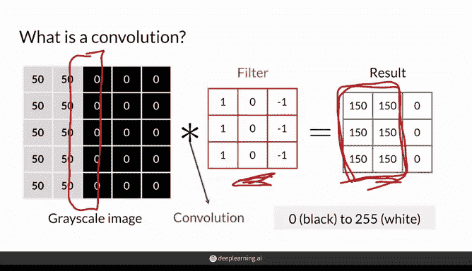
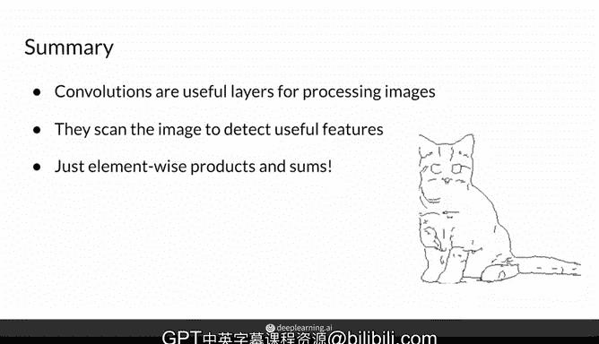

# 吴恩达《生成对抗网络（Generative Adversarial Networks，GAN）》中英字幕 - P16：16_02_06_卷积回顾.zh_en - GPT中英字幕课程资源 - BV1JC4y1T7vZ

Convolutions are an essential part of image processing。

 which is why they're an especially important part to many GN architectures。

So to get started， I'll go over what convolutions are and how they work using a really simple example。

Coabution allows you to detect key features in different areas of an image like the picture of this cute jog using filters。

 and these filters scan across the image to find various features。 For example。

 an eye filter will tell you which parts of the image contains eyes。

 a nose filter will tell you which parts contain noses and an ear filter will tell you which parts contain ears。

And each of these filters is just a matrix of real values and these exact values are learned during training。

 and these values are used to compute a convolution on the input image。

 so in reality they're much more abstract than eye or nose filters。

 but they do pick up on fairly high level features such as eyes and noses。

So the convolution operation is very straightforward。

 take a look at this 5 by5 grayscale image where each square here is a pixel with a value between0 and 255。

 where0 represents entirely black pixels and 255 represents entirely white pixels。

 and so gray values are in between such as the 50 you see here。And so as an example。

 let's say you have a learned three by three filter with ones in the first column。

 zeros in the second column， and negative one in the last third column。

In the convolution operation using this filter on the grayscale image。

 I'll represent with an asterisk in between them， so this means that you want to apply this filter across this grayscale image。

 and so what that would look like here is you start in the top left corner and you multiply all the elements from the filter on top of those pixels。

 and so you multiply that 50 with the 1， that 50 with the0 and so on and so forth matching that filter。

And then you take the sum of all of these products and you put them into a resulting matrix。

 so you put that in the first cell here。And after that。

 you move your filter one position to the right to get the element wise product。

 sum the results again and store that value in your matrix and so on and so forth。

 you go down a slot。 Now that you've reached the end， you go down now。

 you start from the left and youd keep applying the filter until you cover your entire image with your filter and then you get this three by three result at the end。

And what's interesting is that your filter is actually a vertical line detector。

 so there's a vertical line here in your image and your filter see some really high values here and it's trying to say。

 hey， I really see this vertical edge here。And these filters could be of many different values and composing multiple layers of these filters will get those more abstract higher level concepts such as a nose or an eye。

And so that's all there is to computing a convolution。

 but there are some tweaks you can make to this simple operation that will be helpful for you moving forward and I'll be talking about those next。

So to sum up， convolutions are really important operations used for image processing。

 and they recognize patterns by scanning each section of your image and detecting features。

At the end of the day， a convolution is just a series of sums of those element wise products across your entire image。

