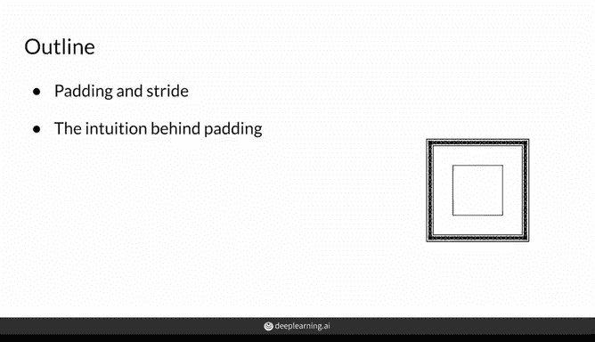
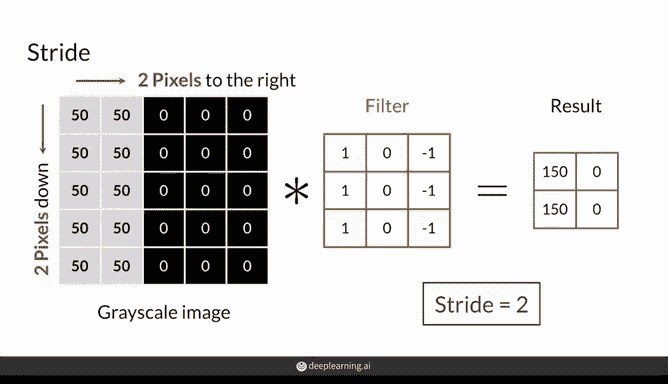
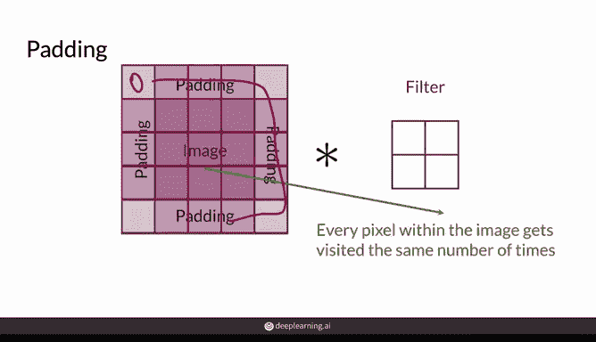
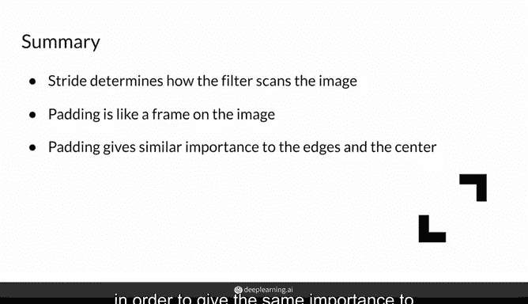

# 吴恩达《生成对抗网络（Generative Adversarial Networks，GAN）》中英字幕 - P17：17_02_07_填充与步长.zh_en - GPT中英字幕课程资源 - BV1JC4y1T7vZ

Convolutions are simple operations used to detect features in different areas of an image Before this video I demonstrated how to apply that simple convolution to an image up next I'll show you some ways to tweak those convolution operations。

I'll review what padding and stride are and share with you some intuition behind the use of padding for convolutions。

So take this grayscale image from the previous example when you apply that 3 by3 convolutional filter to it。

 you start by computing the elementwise product of the filter with the first three by3 section of the image at the top left corner。

 and then you moved one pixel to the right into the same set of computations and after that moved the filter again the pixel to the right and then you moved it down one pixel starting from the left again until you reached the end。

And moving one pixel to the right and one pixel down is called using a stride of one。

 so you're only moving one pixel at a stride of one each time and it doesn't have to be the same stride value for going right versus going down as well so your stride could be two to the right and four down for example。

The larger your strides are the less of your image you will have coverage of for your filter。

 but at the same time it'll make the computation faster， so it definitely is a trade off here。

And so a stride of two would mean that every time you actually take two steps to the right。

 so your filter starts here still in the top left corner， but now you go two pixels to the right。

Each time and then because it's to both for right and down， you go two pixels down there。

 and so you only do four computation so that's much faster。So as you can see。

 the stride determines how many sections of the image your filter will visit， and in this case。

 the result of the convolution is now just a smaller 2 by2 matrix because you visited four of those three by three sections with the filter。

 two at the top and two at the bottom。

Padding is another tweak to the basic convolution。 So take this three by three image in this2 by two filter。

 the values here are not important in the pixel。 So I've left them out。

 And when you compute the convolutions with stride of one in this case。

 you visit four sections of the image， one in the top left corner， one in the top right corner。

 one in the bottom left and one in the bottom right。 And at the end。

 the pixel in the center gets visited four times while the pixels in the corners are only visited once and the other pixels are visited twice。

 So this means that the information kept in the center gets more attention than the information on the edges typically。

Alright， so this is a problem if you have， let's say features on the edges that you care about。

 for example， it could be an entire dog in this pixel over here。

 or it could be part of a dog like its nose or something being up here and that's useful information。

 and you want to make sure your filter puts equal emphasis across the entire image So to address this。

 you can put a frame around the image。 So all the information appears at the center of this whole new picture exactly like in a framed picture。

 And this is called padding。 and the padding size can vary depending on the size of your filter and the size of the image。

 And the value used for the padding can be anything actually， in this outside value。

 but it's often set to0 which is called zero padding。

 And so when you do this before computing the convolution。

 the filter scans the image along with its frame。 but this time。

 the result is that every pixel in the image is visited the same number of times。

 So it's really just the frame that's visited fewer times。

And that's because now all the pixels in the image are located at the center surrounded by that frame。

So to sum up， the stride tells the filter how to scan the image and influences the size of the output and how often pixels are visited。

Padding is like a frame put around images in order to give the same importance to the pixels at the edges of the images as the ones in the center。

