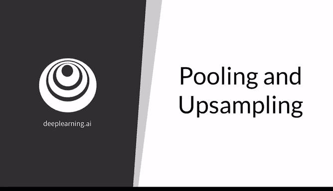
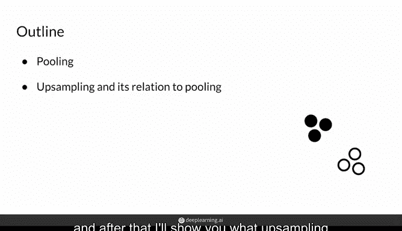
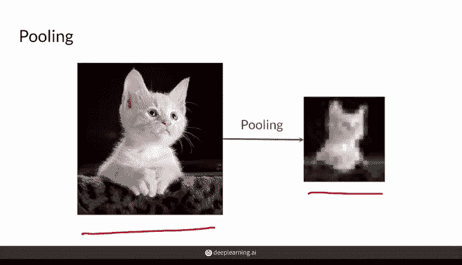
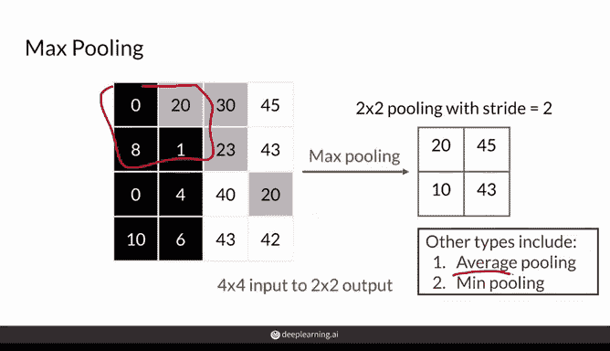
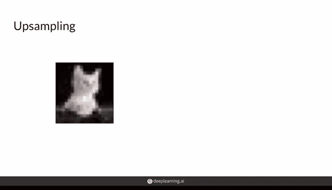
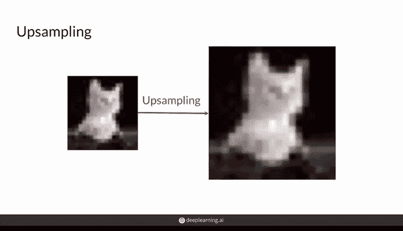
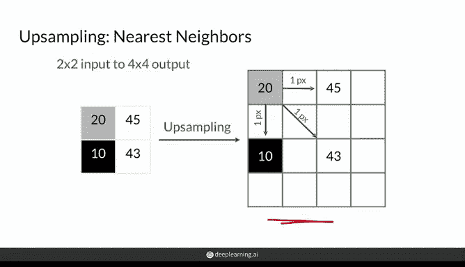
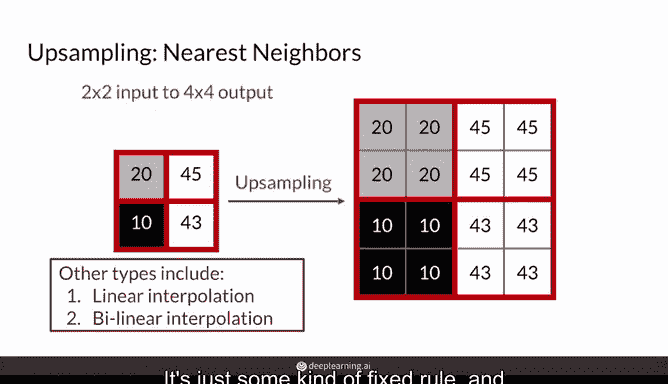
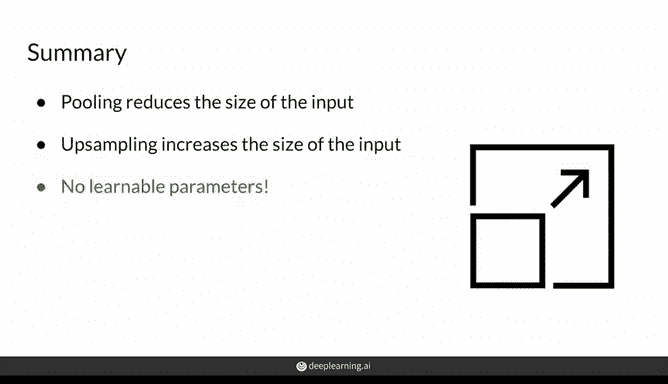

# 吴恩达《生成对抗网络（Generative Adversarial Networks，GAN）》中英字幕 - P18：18_02_08_池化与上采样.zh_en - GPT中英字幕课程资源 - BV1JC4y1T7vZ

Pouloling and ups are really common layers in convolutional neural networks。

 which are just neural networks that use convolutions。

Pouloling is used to reduce the size of the input while upseling is used to increase the size of that input。

So let's revisit what pooling is and how it works。 And after that。

 I'll show you what upsling is and how it relates to pooling。

 Poing is used to lower the dimension of the input images by taking the mean or finding the maximum of value of different areas。

 For instance， a picture of this cat after a pooling layer will result in this blurry image with a lower size or lower resolution。

 And in this example， you can see that the color palette into the color distribution over both images is still very similar。

 So the shapes on the blurry image still resemble the original。

 and it' will be much less expensive to do computations on this pooled layer than it is on this original image。

 And so pooling is really just trying to distill that information。

So let's take a look at one of the most popular types of pooling called max pooling and here's how it works with a really simple example so take this four by4 grayscale image and suppose that you use max pooling to reduce it to this two by two output image out here。

 So what you would do is you visit different sections or windows of the image in a really really similar way as convolutions so to achieve the desired outcome you have to use a two by two pooling filter in a sense and I'm saying filter here。

 but there are no learned weights so it's just a window that's being passed across and it'll have a stride equal to two so that it won't visit any pixel more than once so starting in the top left corner of the image you find the maximum value in that window which is 20。

And you just take that and you put it here in the output and next you do it to the same in the top right corner again。

 not overlapping any pixels， you look here， the largest value is 45。

 you put it out here and then you keep doing that。Until you've covered the entire image。

 so at the end you have this2 by2 output containing the maximum of each of these two by2 sections that you visited from the input。

So what Max pullinging is doing here is that it's getting the most salient information from this image。

 which are these really high values here。And this can be really important for distilling information where you really care about only the most salient information。

 and sometimes this is not an image and this is just an intermediate layer。

 so this is really just extracting the weights with the highest values on this intermediate section。

And so there are other kinds of pooling other than max pooling。

 so there's average pooling which is also fairly commonly used where you just take the average instead of the max in that window and min pooling where you take the minimum。

And again， it's really， really important to know here that pooling doesn't have any learnable parameters。

 so that's where it's really different from convolutions。

So these are not learned there's just a simple rule applied across the image。

Okay， so now upsling has the opposite effect of pooling， so given this lower resolution image。

 upsling has a goal of outputting one that has higher resolution。

You you see that it's not perfect， so to do this it actually requires inferring values for the additional pixels。

 and there are a few different methods to do this。

So one easy way to ups samplele is known as nearest neighbors upsling。 and using this method。

 you can copy the values of the pixels from your input multiple times to fill your output。

 So to illustrate， take this2 by2 grayscale image that you want to upsample to this 4 by4 output here。

So first， you assign the value in the top left corner from the input to the top left pixel in the output and the other values from the input to pixels that are added distance of two pixels from that top left corner。

 and for other cases， this distance might be different depending on the size。

 the enlargement that you would want。So there would be exactly one pixel in between each of these。

 including this diagonal and then assign the same value to every other pixel as it is to its nearest neighbor。

 so for every two by two corner in the output， the pixel values will look the same and you can also think of this as putting these values into the corners first and for every other pixel finding its nearest neighbor。

And again， like pooling for up sampling， there are many different ways to do upsling like linear and bi linear interpolation。

 and feel free to explore what those do and how those are implemented。

 but you really don't have to worry about implementing them because programming frameworks like Tensorflow and pytorch actually take care of this whole process for you。

 You just need to know that they infer the values for missing pixels in the output by looking at the known values from the input。

 And just like pooling ups layers， don't have any learnable parameters。

 it's just some kind of fixed rule。 and these are just different fixed rules。

So in summary， a pooling layer reduces the size of inputs while upsampling does the opposite。

 unlike convolutions， neither pooling nor upsampling layers have those learnable parameters。

 just fixed rules， so coming up I'll introduce you to an upsling method which is not quite an upsling layer known as transpo convolution that does have learnable parameters。

