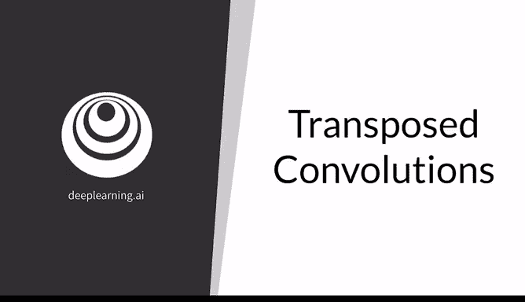
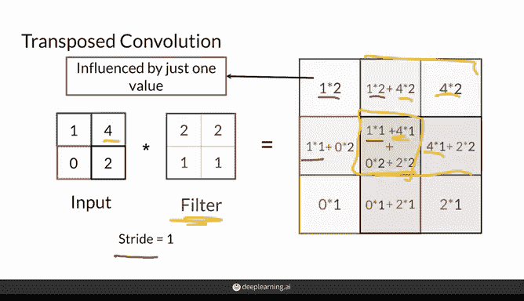
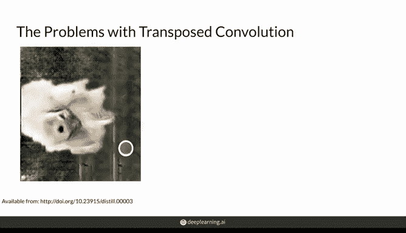
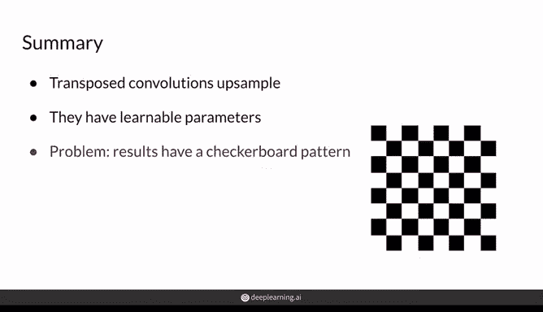

# 吴恩达《生成对抗网络（Generative Adversarial Networks，GAN）》中英字幕 - P19：19_02_09_转置卷积.zh_en - GPT中英字幕课程资源 - BV1JC4y1T7vZ

Now that you're familiar with convolutions， pulling， and upstampling layers。

 let's talk about transpose convolutions。

In this video， I'll talk about transpo convolutions an upsling technique that uses a learnable filter to enlarge the size of your input。

Then I'll show you how the outputs from this method have a really particular issue related to the way that pixel values are calculated。

So take this example with a two by2 input that you want to upsample to a3 by3 output using a transpo convolution。

 you can use a2 by2 learned filter with str equal to1 to accomplish this task by following a really similar procedure to the one for convolutions that I demonstrated earlier in this course。

 So you start by taking the top left value from your input and getting its product with every value in the2 by2 filter。

Then you save this value in the top two by two left corner of your output。

So here are the multiied values from that operation。Next。

 you shift the filter by your stride of one and you repeat the same process on this next pixel。

 and now it's at the top right corner of your input as well as these four pixels out here in your output。

And you keep the products there and where there is overlap you added to the previous product。

And after that， you move to the bottom left corner of your input and take the product with the filter。

 some the result， and so on and so forth until you've covered your entire input。😊。

So with this computation you can see that some of the values in the output are influenced much more heavily by the values from the input。

 for instance， the center pixel and the output is influenced by all the values in the input while the corners are influenced by just one value。

And so this is the transpose convolution operation。

 and that's all it's doing in upsampling that in the filter these values are learned。

But there is an issue that this center pixel is visited four times and is influenced by all pixels while the other ones are not。

 and this causes a common issue that arises when using transpo convolutions and this image shows a real output from a transpo convolution where the circle is not actually generated it's just a zoom in this checkerboard issue。

 so notice that the image has a pattern resembling a checkerboard。

 and this arises because when you upsample with the filter。

 some pixels are influenced most more heavily， while the ones around it are not。

Despite this issue， however， transpo convolutions are still fairly popular in the research community。

 though using up sampling followed by a convolution is becoming a more popular technique now to avoid this checkerboard problem。

So to recap， trans convolutions are used as an upsampling method and they have learnable parameters unlike upsampling layers。

A problem arising from the use of transpo convolutions， however。

 is that the output has a checkerboard problem。Nevertheless。

 these layers are still pretty popular and you'll use them for some of the models in this specialization。

