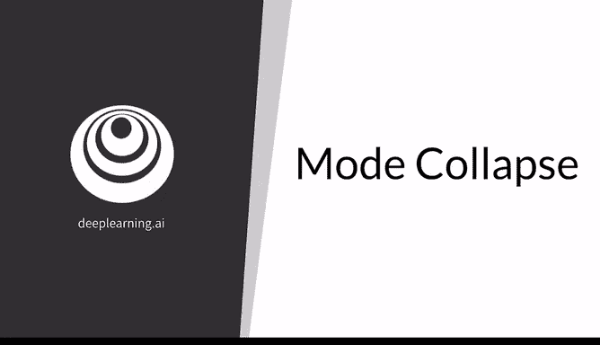
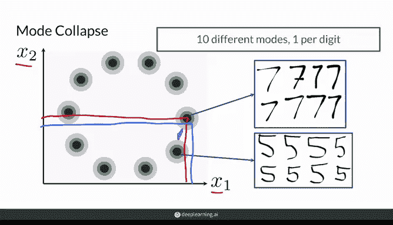
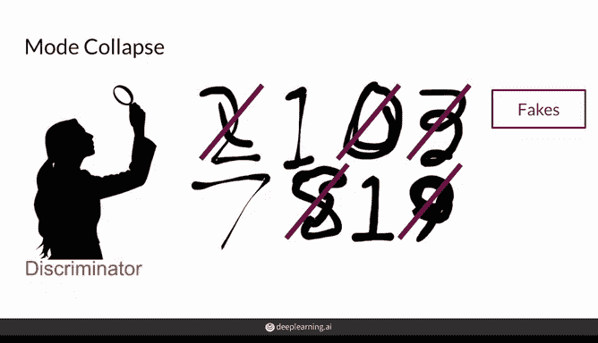
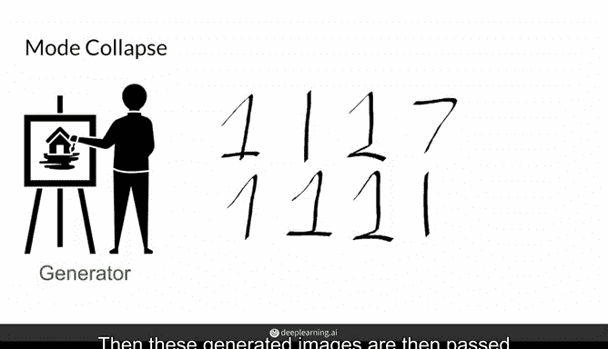
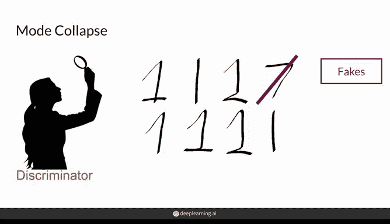
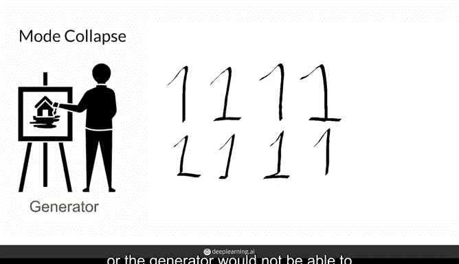
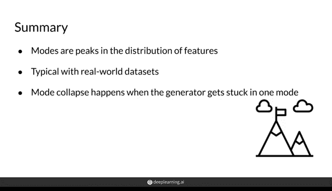

# 吴恩达《生成对抗网络（Generative Adversarial Networks，GAN）》中英字幕 - P21：21_03_02_模式坍塌.zh_en - GPT中英字幕课程资源 - BV1JC4y1T7vZ

During this week， you'll see some problems faced by traditionalganNs trained with binary cross entropy loss or VCE loss。

 like mode collapse and vanish ingredients。I'll show you a very simple modification to the GNS architecture and a new loss function that'll help you overcome these problems。

So in this video you'll see what a mode is in a probability density distribution。

 as well as what mode collapse is in the intuition behind it during GA training。

So a mode in a distribution of data is just an area with a high concentration of observations。

 For instance， the mean value in a normal distribution is the single mode of that distribution。

And there are certainly distributions with multiple modes where the mean doesn't have to be one of them。

 And so in this distribution， that' bimodal has two modes or multimodal。

 meaning it has multiple modes。 so more intuitively。

 any peak on the probability density distribution over features is a mode of that distribution。

For example， take handwritten digits represented by features X1 and x2。

 meaning that these are just dimensions along which you can represent these numbers。

 like values you can use to represent different handwritten digits。

 so the probability density distribution in this case will be a surface with many peaks corresponding to each digit。

 so this is definitely multimodal with 10 different modes and different observations of the numbers 7。

 for example， will be represented by similar x1 and x2 pairs。

So those two values there would both be sevens and the one marked in red there in the mean would be the average seven would be an average looking seven。

 and you can imagine each of these peaks kind of coming out at you in a 3D representation where the darker circle represents higher altitudes。

Different pairs of x1 and x2 features would create these handwritten5s here and a value in between the 7 and 5。

 where it's very， very low density， so very low probability of generating something that is an intermediate between 7 and 5 in the real dataset would be probably a mixture of 7 and 5。

 but there's a very low probability that you would see that x1 x2 pair in this in between space that would produce in intermediate 5。

7 looking number。So different observations of the same digit will be grouped together in this feature space with high concentration in the area with the most common way to write that digit or what that average seven is there。

 and of course an average five is in the center of the five mode peak。

So this probability density distribution over these features x1 and x2 will have 10 modes。

 one for each of these digits。

Many real life distributions used for training GAs are multimodto like this one。

 and I'll continue with a handwritten in digigit example to show you what mode collapse might mean。

 which intuitively as you just get started， sounds like things collapsing to one mode or fewer modes and some of the modes disappearing。

So take a discriminator that has learned to be good at identifying which handwritten digits are fake。

 except for cases where generated images look like ones and sevens and discriminate the discriminator is at a local minima of its cost function so the discriminator classifies most of the digits correctly。

 except for the ones that resemble those ones and sevens。

And then this information is passed on to the generator。

Now the generator sees this and looks at the feedback from the discriminator and gets a good idea of how to fool the discriminator in the next round。

It sees that all the images were misclassified by the discriminatory resemble either a one or a7。

 so it generates a lot of pictures that resemble either of those numbers。

Then these generated images are then passed onto to the discriminator in the next round who then misclassifies every picture except for maybe the one that looks more like a seven。

Generator gets that feedback and sees that the discriminator's weakness is with the pictures that resemble handwritten one。

 so this time all the pictures it produces resemble that digit。

 collapsing to a single mode of the whole distribution of possible handwritten digits。Eventually。

 the discriminator will probably catch on and learn to catch the generator's fake handwritten number ones by getting out of that local minima。

But the generator could also migrate to another mode of the distribution and the gam would collapse again to a different mode。

 or the generator would not be able to figure out where else to diversify。 So to sum up。

 modes are peaks and the probability distribution over features。

Real world datas have many modes related to each possible class within them。

 like the digits in this dataset of handwritten digits。

MoodeCls happens when the generator learns to fool the discriminator by producing examples from a single class from the whole training data set like handwritten number ones。

 and this is unfortunate because while the generator is optimizing to fool the discriminator。

 that's not what you ultimately want your generator to do。

