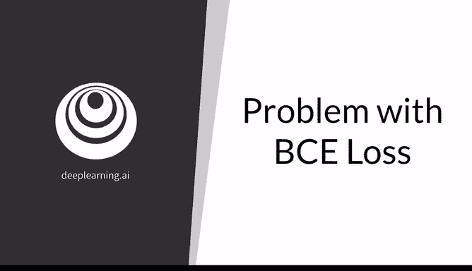
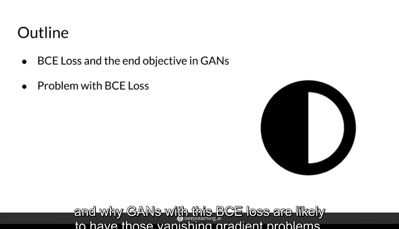
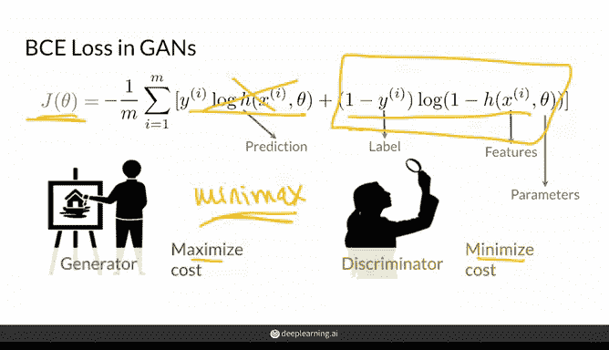
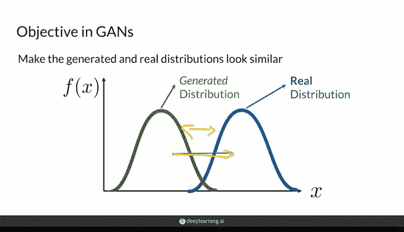
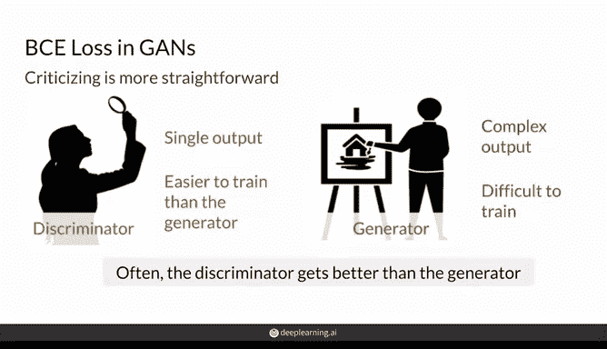
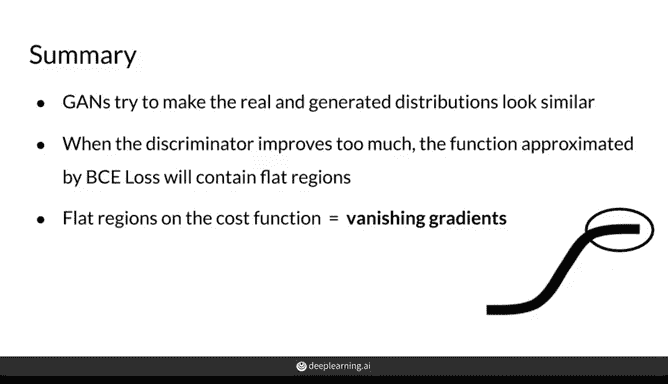

# 吴恩达《生成对抗网络（Generative Adversarial Networks，GAN）》中英字幕 - P22：22_03_03_BCE损失的问题.zh_en - GPT中英字幕课程资源 - BV1JC4y1T7vZ

Binary crenttropy loss or BC loss is traditionally used for training gownNs。

 but it isn't the best way to do it， with BC loss， GNs are prone to mode collapse and other problems。

In this video， you'll see why GNs trained with BC loss are susceptible to vanish ingredient problems。

 To that end， you'll review the B loss function and what that means for the generator and the discriminator's objectives。

 Then you'll see when and why GNs with this B loss are likely to have those vanish ingredient problems。

So remember the form of the BC loss function is' just an average of the cost for the discriminator for misclassifying real and fake observations。

 where the first term is for reals and the second term is for the fakes。

The higher cost value is the words the discriminator is doing at it。

 The generator wants to maximize this cost， because that means the discriminator is doing poorly and is classifying its fake values into reels。

 whereas the discriminator wants to minimize this cost function because that means its classifying things correctly。

 And， of course， the generator only sees the fake side of things So it actually doesn't see anything about the reels。

And this maximization and minimization is often called a minimax game。

 and that's how you might hear it being referred to as。

And at the end of this miniax game， the generator and discriminator interaction translates to a more general objective for the wholegan architecture。

 and that is to make the real and generated data distributions of features very， very similar。

 so trying to get the generated distribution to be as close as possible to the reels。

 and so this miniax of the binary crossenttropy loss function is somewhat approximating the minimization of another complex ho function that's trying to make this happen。

And of course， during this whole training process， the discriminator naturally is trying to delineate this real and fake distribution as much as possible。

 whereas the generator is trying to make the generated distribution look more like the reels。

However， let's take a step back again to the generator and discriminator's roles。

 so the discriminator in a again needs to output just a single value prediction within0 and 1。

 whereas the generator actually needs to produce a pretty complex output composed of multiple features to try and fool the discriminator。

 for example， an image。As a result， the discriminator's job tends to be a little bit easier。

To put it another way， it's more straightforward to look at images in a museum than it is to paint those masterpieces。

 right， So during training， it's possible for the discriminator to outperform the generator。 very。

 very possible， in fact， quite common。

But at the beginning of training， this isn't such a big problem because the discriminator isn't that good。

 so it has trouble distinguishing the generated in real distributions。 There's some overlap。

 and it's not quite sure。 and as a result， it's able to give useful feedback in the form of a nonzero gradient back to the generator。

However， as it gets better at training， it starts to delineate the generated and real distributions a little bit more。

 such that it can start distinguishing them much more。

 where the real distribution will be centered around one and the generated distribution will start to approach zero。

And as a result， when it's starting to get better as the discriminator is getting better。

 it'll start giving less informative feedback。 In fact， it might give gradients closer to 0。

 and that becomes unhelpful for the generator because then the generator doesn't know how to improve。

 And so this is how the vanish and gradient problem will arise。So in summary。

 GANs try to make the generated distribution look similar to the real one by minimizing that underlying cost function that measures how different the distributions are。

As a discriminator improves during training and sometimes improves more easily than the generator。

 that underlying cost function will have those flat regions when the distributions are very different from one another。

 where the discriminator is able to distinguish between the reels and the fakes much more easily。

 and be able to say you know， reels look really real。

 a label of1 and fakes look really fake a label of 0。

 And so all of this will cause vanishing gradient problems。

