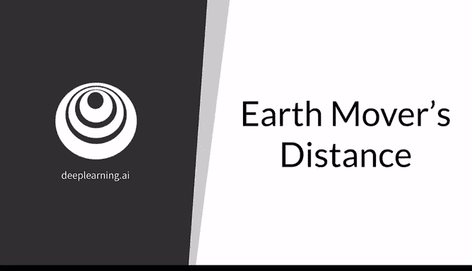
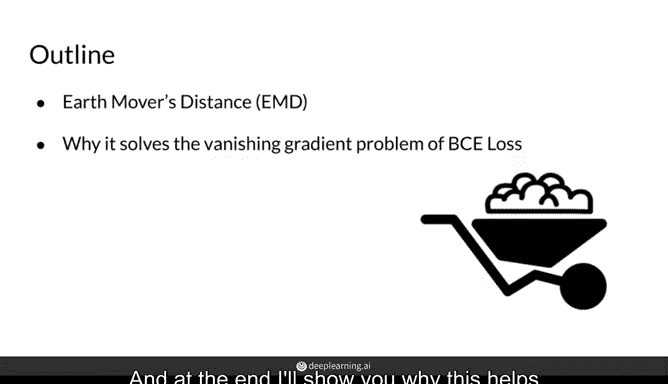
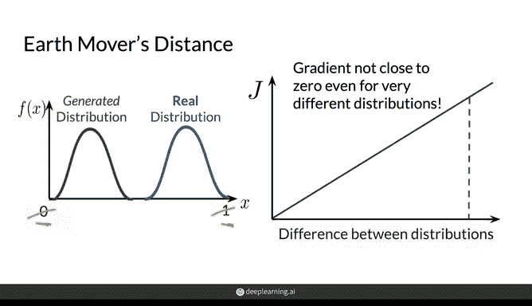
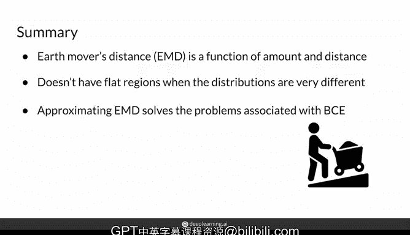

# 吴恩达《生成对抗网络（Generative Adversarial Networks，GAN）》中英字幕 - P23：23_03_04_推土机距离.zh_en - GPT中英字幕课程资源 - BV1JC4y1T7vZ

When using BCE loss to train a ga， you often encounter mode collapse and vanishing gradient problems due to the underlying cost function of the whole architecture。

And even though there is an infinite number of decimal values between0 and1。

 the discriminator as it improves， will be pushing towards those ends。

In this video you'll see a different underlying cost function called Earth Mors's distance that measures the distance between two distributions and generally outperforms the one associated with BC loss for training Gs。

 and at the end I'll show you why this helps with the vanish ingredient problem。

So take this generated and real distributions with the same variance。

 but different means and assume they might be normal distributions。

 What the Earth mover's distance does is it measures how different these two distributions are by estimating the amount of effort it takes to make the generated distribution equal to the real。

So intuitively， if the generated distribution was a pile of dirt。

 How difficult would it be to move that pile of dirt and mold it into the shape and location of the real distribution。

 So that's what this Earth move resistance means。 So the function depends on both the distance in the amount that the generated distribution needs to be moved and also you a function that calculates this in the next video。

So the problem with V loss is that as a discriminator improves。

 it would start giving more extreme values between 0 and 1。 So values closer to 1 and closer to 0。

 And as a result， this became less helpful feedback back to the generator So the generator would stop learning due to vanishing gradient problems。

 with Earth movers' distance， however， there's no such ceiling to the 0 and 1。

 So the cost function continues to grow， regardless of how far apart these distributions are。

 And the gradient of this measure won't approach 0。 And as a result。

 Gs are less prone to vanishing gradient problems。 And from vanishing gradient problems。

 mode collapse。So wrapping up Earthmo resistance is a function of the effort to make a distribution equal to another。

 so it depends on both distance and a amount， and unlike BCE。

 it doesn't have flat regions when the distributions start to get very different and the discriordinator starts to improve a lot。

 so approximating this measure eliminates the vanish ingredient problem and reduces the likelihood of mode collapse in Gs。

In the next few videos， I'll show you a loss function that uses Earth Mor's distance for training Gs。

