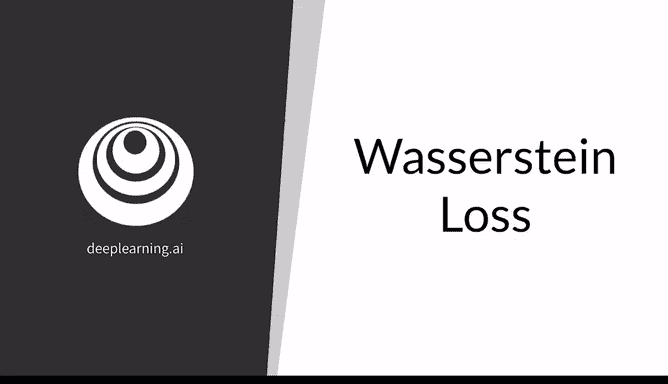
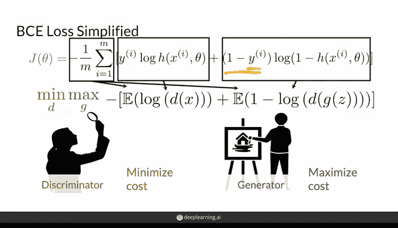
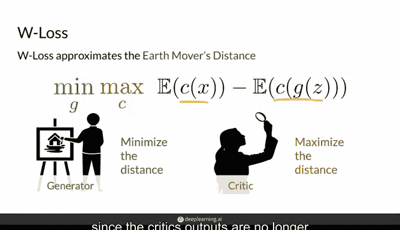
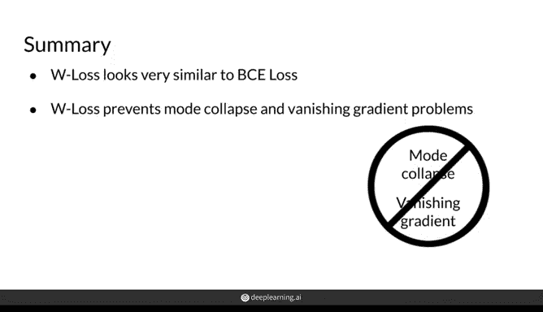

# 吴恩达《生成对抗网络（Generative Adversarial Networks，GAN）》中英字幕 - P24：24_03_05_Wasserstein损失.zh_en - GPT中英字幕课程资源 - BV1JC4y1T7vZ

As you've seen it previously， B C loss is used traditionally to traingans。 However。

 it has many problems due to the form of the function it's approximated by。 So in this video。

 I'll introduce you to an alternative loss function called Waserson Los or W Los for short。

 That approximates the Earth mover's dis that you saw in the previous video。

So to that end， first you'll see an alternative way to look at the BC loss function that's more simple and compact。

 and I'll show you how W loss is calculated， and I'll compare this loss with BC loss。

So BC loss is computed by a long equation that essentially measures how bad on average。

 some observations are being classified by the discriminator as fake and real。

So the generator in GANS wants to maximize this cost because that means the discriminator is saying that its fake values seem really real。

 while the discriminator wants to minimize that cost。

And so this is often referred to as a miniax game。this very long equation for B laws can be simplified as follows。

 The sum and division over examples M is nothing but a mean or expected value。

 And the first part inside the sum measures how bad the discriminator classifies real observations。

 where y equals 1 and 1 means real， and the second part measures how bad it classifies fake observations produced by the generator where y of1 means real。

 but one minus y y of0 means fake。

AW loss， on the other hand， approximates the Earth mover's distance between the real and generated distributions。

 but it has nicer properties than BCE。However， it does look very similar to the simplified form for the BCE loss。

 and in this case the function calculates the difference between the expected values of the predictions of the discriminator here it's called a critic and I'll go over that later so I'm going to represent it with a C here。

 and this is C of a real example X versus C of a fake example G of Z generator taking in a noise vector to produce a fake image G of Z。

 or perhaps you can call it X hat。So the discriminator looks at these two things。

 and it wants to maximize the distance between its thoughts on the reels versus its thoughts on the fakes。

 So it's trying to push away these two distributions to be as far apart as possible。 Meanwhile。

 the generator wants to minimize this difference because it wants the discriminator to think that its fake images are as close as possible to the reels。

I know that in contrast with BCE， there are no logs in this function。

 since the critics outputs are no longer bounded to be between zero and1。

So for the BC loss to make sense， the output of the discriminator needs to be a prediction between 0 and1。

 and so the discriminator's neural network for GANS trained with BC loss have a sigmoid activation function in the output layer to then squash the values between 0 and1。

W loss however， doesn't have that requirement at all。

 so you can actually have a linear layer at the end of the discriminator's neural network and that could produce any real value output。

And you can interpret that output as how real an image is considered by the critic， which。

 by the way， is now what we're calling the discriminator instead。

 because it's no longer bounded between0 and 1， where 0 means fake and one means real。

 It's no longer classifying into these two or discriminating between these two classes。

And so as a result， it wouldn't make that much sense to call that neural network a discriminator because it doesn't discriminate between the classes。

 and so for W loss， the equivalent to a discriminator is called a critic and what it tries to do is maximize the distance between its evaluation on a fake and its evaluation on real。

So some of the main differences between W loss and BCE loss is that the discriminator under BC loss outputs a value between 0 and1。

 while the critic and W loss will output any number Additionally the forms of their cost functions is very similar but W loss doesn't have any logarithms within it and that's because it's a measure of how far the prediction of the critic for the real is from its prediction on the fake。

Meanwhile， BC loss does measure that distance between figure a real。

 but two a ground truth of one or0。And so what's important to take away here is largely that the discriminator is bounded between 0 and1 whereas the critic is no longer bounded and just trying to separate the two distributions as much as possible。

 And as a result， because it's not bounded， the critic is allowed to improve without degrading its feedback back to the generator。

 And this is because it doesn't have a vanish and gradientd problem and this will mitigate against mode collapse because the generator will always get useful feedback back。

So in summary W loss looks very similar to BC loss。

 but it isn't as complex a mathematical expression under the hood。

 what it does is approximates the Earth movers's distance so it prevents mode collapse and manage ingredient problems；

 however， there is an additional condition on this cost function for it to work well and for it to be valid and you'll see that in the following videos。

