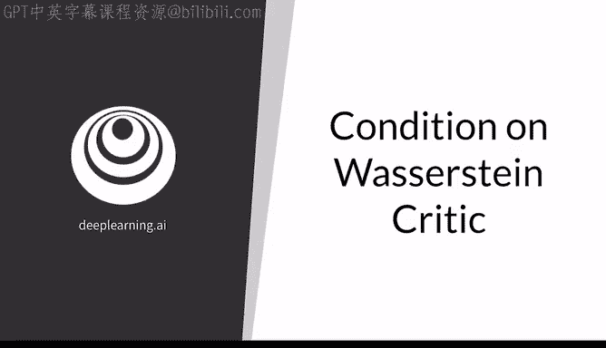
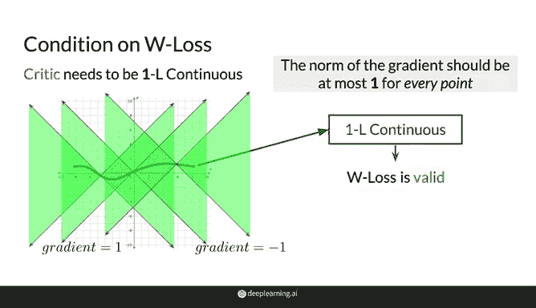
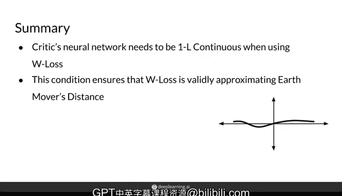

# 吴恩达《生成对抗网络（Generative Adversarial Networks，GAN）》中英字幕 - P25：25_03_06_Wasserstein判别器的条件.zh_en - GPT中英字幕课程资源 - BV1JC4y1T7vZ

Werson Los or W Los solves some problems faced byganNs like Mo claps and vanish ingredients。

 but for it to work well， there's a special condition that needs to be met by the critic。

So in this video you'll see what the continuity condition on the C neural network means and why that condition is important when using W laws for training GwnNs。

 and trust me it's worth it， so stay tuned。So W loss is a simple expression that computes the difference between the expected values of the critic's output for the real examples X and its predictions on the fake examples G of Z。

The generator tries to minimize this expression， trying to get the generated examples to be as close as possible to the real examples。

 while the critic wants to maximize this expression because it wants to differentiate between the reals and the fakes it wants the distance to be as large as possible。

However， for training GANs using W laws， the critic has a special condition。

 it needs to be something called one Lichs continuous or1L continuous for short。

So this condition sounds more sophisticated than it really is for a function like the critic's neural network to be one lips just continuous。

 the norm of its gradient needs to be at most one and what that means is that the slope can't be greater than one at any point。

 its gradient can't be greater than one。So to check if a function here is one lips justs continuous。

 you want to go along every point in this function and make sure its slope is less than or equal to1 or its gradientient is less than or equal to1。

 And what you can do is you can actually draw two lines。

 one where the slope is exactly one at this certain point that you're evaluating the function and one where the slope is negative one where you're evaluating that function and you want to make sure that the growth of this function never goes out of bounds from these lines because staying within these lines means that the function is growing linearly。

And so here this function is not lips's continuous because it's coming out in all these sections。

 it's not staying within this green area， which suggests that it's growing more than linear。

And so looking at another example here， so this is a smooth curve functions。

 you want to again check every single point on this function before you can determine whether or not that this is one lip just continuous so here it looks fine。

 the function looks good， here it also looks good here it looks good and so let's say you check every single value and the function never grows more than linearly。

So this function is one lips just continuous。And this condition on the critic's neural network is important for W Los because it assures that the W loss function is not only continuous and differentiable。

 but also that it doesn't grow too much and maintain some stability during training。

And this is what makes the underlying Earth mover's distance valid。

 which is what W loss is founded on。

And this is required for training both the critic and generator's neural networks。

 and it also increases stability because the variation as the G learns will be bounded。

So to recap the critic in a again that uses W Los for training needs to be one lips thats continuous in order for its underlying earth movers' distance comparison between the reels and the fakes to be a valid comparison。

In order to satisfy or try to satisfy this condition during training。

 there are multiple different methods， so next you'll learn about a couple of these methods。

