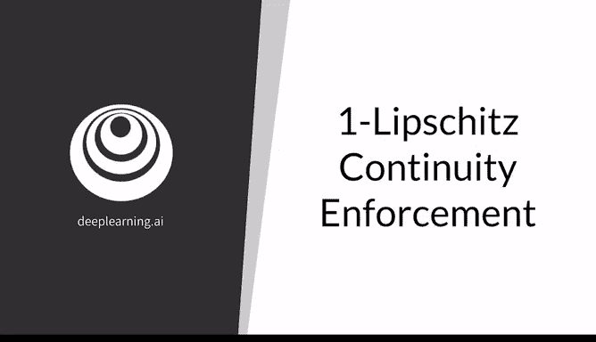
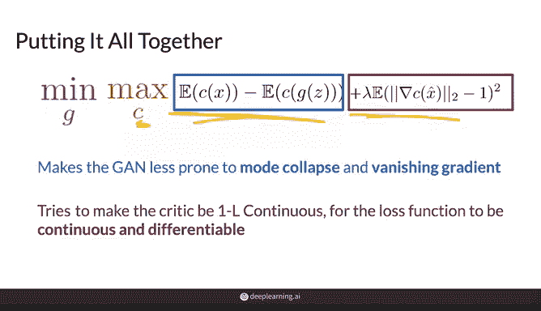
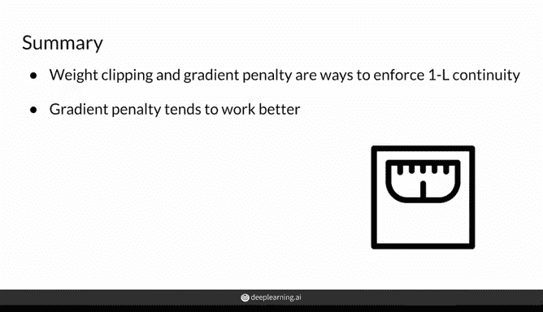

# 吴恩达《生成对抗网络（Generative Adversarial Networks，GAN）》中英字幕 - P26：26_03_07_1-Lipschitz连续性强制.zh_en - GPT中英字幕课程资源 - BV1JC4y1T7vZ

One lip shift continuity or1 L continuity of the critic neural network in your Wassterson loss G ensures that the Wasson loss is valid。

 so you already saw what this means and this video I'll show you how to enforce this condition when training your critic。

So first I will introduce you to two different methods to enforce 1L continuity on the critic。

 namely weight clipping and gradient penalty， and then I'll discuss the advantages of gradient penalty over weight clipping。

So first recall that the critic being1 L continuous means that the norm of its gradient is at most one at every single point of this function。

This upside on triangles assigned for gradient， this is the function。

 perhaps f is the critic here and x is the image， and this just represents the norm of that gradient being less than or equal to one。

And using the L2 norm is very， very common here， which just means it's Euclidean distance or often thought of as your triangle distance of your hypotenuseuse。

 This is the distance between these two points， not going this direction。 It's this hypotenuse。

So intuitively in two dimensions， it's that the slope is less than or equal to one。

 At every single point of this function， it'll remain within these green triangles。

So two common ways of ensuring this condition are weight clipping and gradient penalty with weight clipping。

 the weights of the Cri's neural network are forced to take values between a fixed interval。

 So after you update the weights during gradient descent。

 you actually will clip any weights outside of the desired interval。

 and basically what that means is that weights over that interval either too high or too low will be set to the maximum or the minimum amount allowed。

 and so that's clipping the weights there。This is one way of enforcing the1 L continuity。

 but it has a major downside。 Forcing the weights of the critic to a limited range of values could limit the critic's ability to learn and ultimately for the G to perform。

 because if the critic can't take on many different parameter values， its weights can't take on many。

 many different values， it might not be able to improve easily or find good local optimum for it to be in。

 So not only is this trying to do one L continuity enforcement。

 this might also limit the critic too much。 or on the other hand。

 it might actually limit the critic too little if you don't clip the weights enough。

 So there's a lot of hyperparameter tuning involved。The gradient penalty， which is another method。

 is a much softer way to enforce the critic to be one lip that's continuous。

 and so with a gradient penalty， all you need to do is add a regularization term to your loss function。

And what this regularization term does to your W loss loss function is that it penalizes the critic when its gradient norm is higher than one。

 and so I'll dive into what that means， so the regularization term is this rag here。

 which I'll unfold shortly and lambmbda is just a hyperparameter value of how much to weight this regularization term against the main loss function。

So in order to check the critic's gradient at every possible point of the feature space。

 that's virtually impossible or at least not practical。

 So instead with gradient penalty during implementation， of course。

 all you do is sample some points by interpolating between real and fake examples For instance。

 you could sample an image with a set of realels and an image the set of fakes and you grab one of each and you can get an inter image by interpolating those two images using a random number epsilon so epsilon here it could be a weight of 0。

3 and here it would evaluate 1 minus epsilon would be 0。

7 and that would get you this random interpolated image that's in between these two images。

And I'll call this random interpolated image X hat。

And it's on X hatt that you want to get the critic's gradient to be less than or equal to one。

And so this is exactly what's happening here， the critic looks at X hat。

 you get the gradient of the critic's prediction on X hat。

 and then you take the norm of that gradient and you want that norm to be one。

And so here it's simpler to say， hey， can I get the norm of the gradient to be one as opposed to at most one。

 because this in fact is penalizing any value outside of one？

And the two heroes you saying I want the square distance as opposed to perhaps the absolute value between them。

 penalizing values much more when they're further away from one。So specifically。

 that Xha is an intermediate image where it's weighted against the realel in a fake using epsilon。

So with this method you're not strictly enforcing 1 L continuity， but you're just encouraging it。

 and this is proven to work well and much better than weight clipping。And so the complete expression。

 the loss function that you use for training again with W loss ingredient penalty now has these two components。

 first you approximate Earthmor distance with this main W loss component。

 and this makes the galess prone to mode collapse and manage ingredients。

 and the second part of this loss function is a regularization term that meets the condition for with a critic desires in order to make this main term valid。

And of course， this is a soft constraint on making the critic one lipsts continuous。

 but it has been shown to be very effective by keeping the norm of the gradient of the critic close ish to one almost everywhere is actually the technical term is almost anywhere。

So wrapping up in this video I presented you with two ways of enforcing the critic to be one lipis continuous or one L continuous weight clipping as one and gradient penalty as the other weight clipping might be problematic because you're strongly limiting the way the critic learns during training or you're being too soft so there's a bit of hyperparmed tuning。

Greeting penalty on the other hand， is a softer way to enforce one lip shift's continuity。

 and while it doesn't strictly enforce the critic's gradient norm to be less than one at every point。

 it works better in practice than weight clipping。

