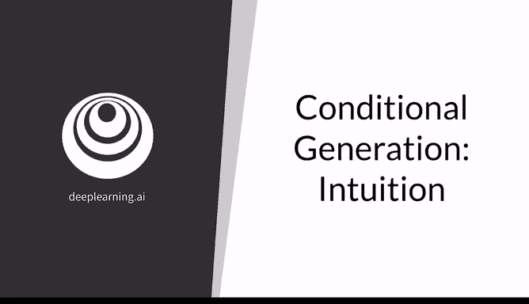
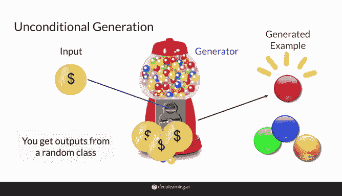
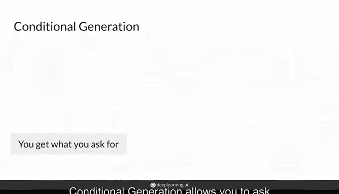
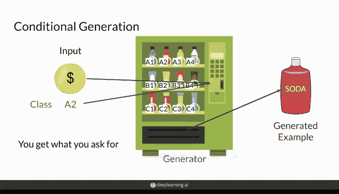
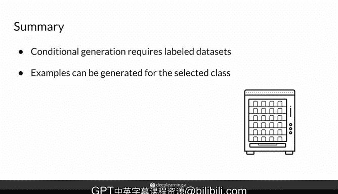

# 吴恩达《生成对抗网络（Generative Adversarial Networks，GAN）》中英字幕 - P28：28_04_02_条件生成的直觉.zh_en - GPT中英字幕课程资源 - BV1JC4y1T7vZ

In the last couple weeks， you've seen how GNs work and how to build them to produce examples that mimic your training data set。

During this week， I'm going to show you how to control the output and get examples from a particular class。

 or for those examples to take on certain features， so this is pretty fun。

In this video， I'll review what unconditional generation is。

 and it's actually the one that you've been using this whole time。

 and you'll also be introduced to conditional generation by comparison of them both。

So as a quick recap with unconditional generation， you get outputs from random classes and so you can think of this as a gumball machine where you input a coin and you get a random colored gumball So if you want a gumball of a specific color。

 say red， you have to keep spinning coins until you get it。And in this example。

 the coin is like the random noise vector that your G uses for generation。

 and the gumball machine is like the generator， and then the gumballs are the random outputs。

 those images you get。So you can see what color guballs you might get。

 just like how you know what your G is trained on， you can't control what exact color of output you'll get。

On the other hand， conditional generation allows you to ask for an example from a specific class and you get what you ask for it's like a vending machine。

So you input a coin similar to the combmball machine。

 but you input a coin along with a code for an item that you want， for example， A2 for a red soda。

But note that you still don't control certain features of the soda bottle。

 like you can't get the one with the latest expiration date or the bottle that's least damaged or the one that's filled up the most。

 you just get a random red soda， but it is a red soda， not a blue candy bar。

So here the coin and the code are like the inputs for the GAN and the vending machine is the generator and the soda is like the generated output so with a conditional GN you get a random example from the class you specify and that class is this A2 soda here。

So now you have an idea of how conditional versus unconditional generation are related。

 so let's compare them a bit， so with conditional generation you can get generated examples from the classes you decide while with unconditional generation。

 you get examples from a random class。So as a result of that， with conditional generation。

 you actually have to train your GA with label data sets and those labels are on the different classes you want。

 while unconditional generation doesn't need any labels and you've seen this in previous weeks from the course there you don't need any labels。

 you just need a pile of real examples。And you'll see how to modify your model for this conditional generation in the following lectures。

So what you should take away from this video is that conditional generation requires labeled data sets for training in order to learn how to produce examples from desired classes and coming up I'll show you how the labels from your dataset are fed to the generator and discriminator in order to train your G and produce examples from the desired class like selecting the Red Soda from the vending machine。

