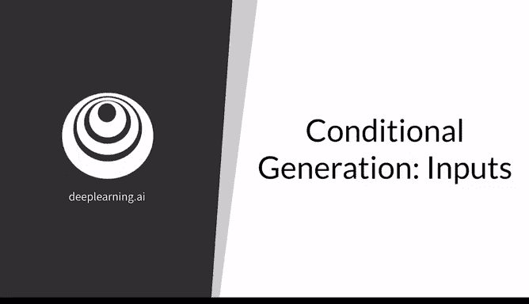
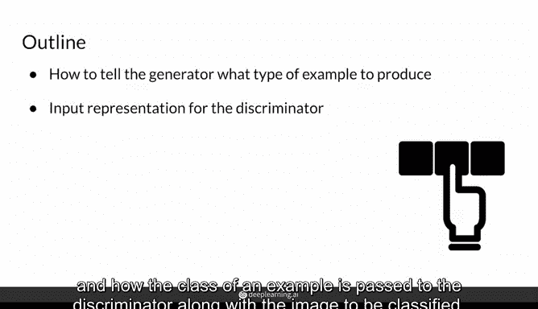
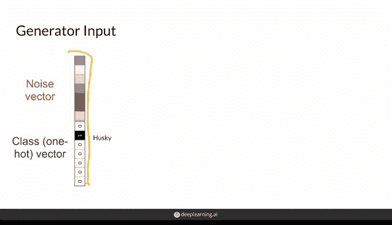
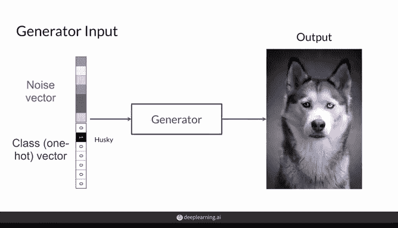
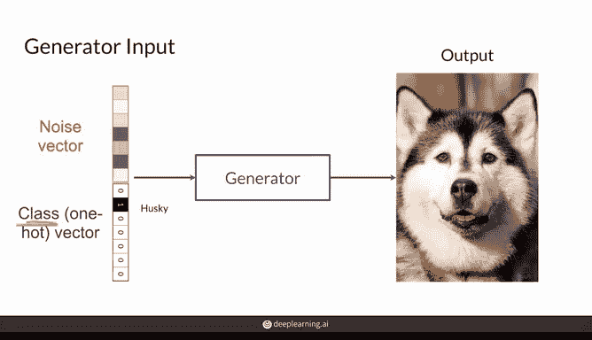
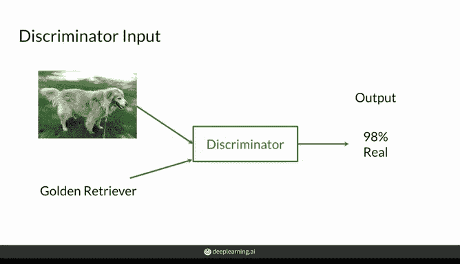
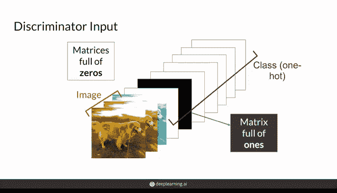
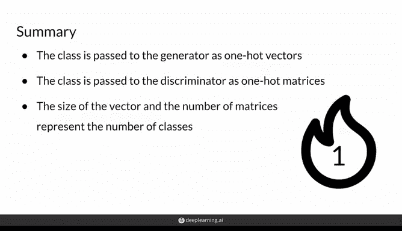

# 吴恩达《生成对抗网络（Generative Adversarial Networks，GAN）》中英字幕 - P29：29_04_03_条件生成的输入.zh_en - GPT中英字幕课程资源 - BV1JC4y1T7vZ

Conditional generation lets you produce examples from the classes you want and for doing that。

 you need to have a label data and somehow pass that class information to both the generator and the discriminator during training So here you'll learn how to tell the generator which class to produce and how the class of an example is passed to the discriminator along with the image to be classified。

So you've seen already with unconditional generation。

 the generator needs a noise vector to produce random examples。For conditional generation。

 you also need a vector to tell the generator from which class that generated example should come from。

And usually this is a one hot vector， which means that there are zeros in every position except for one position corresponding to the class you want。

And remember that the noise factor is random values as well， but it doesn't have to be 01。

So as an example， let's say all of these different values in the one hot class vector are different dog breeds。

 and this second cell here corresponds to a husky。And so specifying a position of one here means that you want the generator to produce a husky。

 if you had a one somewhere else and a zero on the husky cell。

 then you would want it to produce a different class， for example， a goldenner retriever。So here。

 the noise vector is the one that adds randomness to the generation similar to before to let you produce a diverse set of examples。

 but now it's a diverse set within the certain class。

 conditioned on the certain class and restricted by the certain class。

So this one hot vector is now what lets you control what class to generate。

The input to the generator in a conditional GN is actually a concatenated vector of both the noise and the one hot class information。

 so it's one huge vector。For example， with a class vector here representing a husky breed。

 the generator will ideally produce a husky dog from one noise vector。

 but if you change that noise vector， it should produce a different husky dog while the class information stays the same。

So both are still huskies， both are still the same class。

 but how do you ensure the generator actually produces a husky， that seems like magic。

 why doesn't it just produce any random dog？Well， that's actually because the discriminator will also be given this class information。

 so the generator needs to fool the discriminator and so you'll see how this happens。

 the discriminator in a similar way will take the examples。

 but now they're paired with the class information as inputs to determine if the examples are either real or fake representations of that particular class and that's what's key here。

So for example， with this class of golden retriever， but an image of a beele dog。

 so not a golden retriever being fed in， this discriminator should actually say this is fake because it is not a real looking golden retriever。

 even though it's a very real looking image of a beagle。

 this is just 5% real is what it's going to say。So as a result for the discriminator to predict that an example is real。

 it needs to look like the examples from that class in the training dataset。

 and the training dataset is key here because it'll get these real labels next to it so the generator in order to fool it with a golden retriever needs to produce a realistic golden retriever。

So following the last example with the Golden retriever class。

 the discriminator will learn to predict that the image is more real only if the example looks like a golden retriever。

And again， this is because the real images will have the correct class label。

 and this encourages the generated images to take on the right class as well。

Pretty cool， right， So digging a little bit deeper， the input to the discriminator is an image。

 So how do you go about adding that class information。😊，Well。

 the image is fed in as three different channels， RGB， red， green blue。

 or just one channel if it's a gray scale image， so that's this image component。

And then the one hott class information could also be fed in as additional channels。

 where all the channels take on values of all zeros。

 so all these white blocks of the same height and width as the image take on values of all zeros。

 whereas this black one here will take on values of ones。In contrast to that one hot vector。

 these are typically much larger matrices， where each channel is full of zeros at every position where it's not that class。

And so there are many other less space consuming ways of doing this。

 like compressing this information in another format。

 you could even create a separate neural network head to do that for you。

 which would be prudent if you had many， many different classes。

 but this approach definitely works for the seven or so classes you have here and the model will learn that information。

To sum up in conditional generation， you pass the class information to both models to the generator。

 it's typically a one hot vector concatenated with your noise vector to the discriminator when the desired output of the GNs or images。

 It's one hot matrices representing the channels。 The size of the class vector and the number of extra channels for the class information is just the same as the number of classes you'll be turning on。

