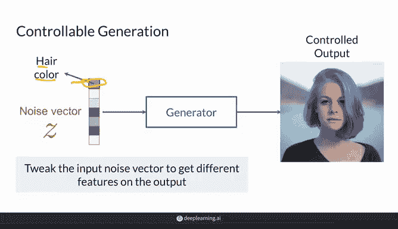
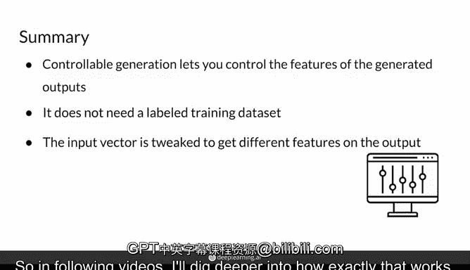

# 吴恩达《生成对抗网络（Generative Adversarial Networks，GAN）》中英字幕 - P30：30_04_05_可控生成.zh_en - GPT中英字幕课程资源 - BV1JC4y1T7vZ

Another way to control the outputs produced by GNs is after it's been trained or more generally controllable generation。

While conditional generation leverages labels during training。

 this video will focus on controlling what features you want in the output examples。

 even after the model's been trained。

So you learn about controlling specific features and how it compares with conditional generation you learned about in the previous video。

Crable generation allows you to control some of the features that you want in your output examples。

For instance， with a game that performs face generation。

 you could control the age the person looks in the image or if they have sunglasses or the direction they're looking at in the picture or their perceived gender。

And you can do this by actually tweaking the input noise vector Z that is fed to the generator after you train the model。

For example， with the input noise vector Z， maybe you get this picture of a woman with red hair。

And let's say you tweak one of the features from this input noise vector here。

And maybe now you get the same woman but with blue hair this time and maybe it's because this first element here represents changing hair color that would be super cool right and you'll learn exactly how to tweak the Z in the following lecture。

 but first to get a better sense of controllable generation。

 I'll make a quick comparison with conditional generation。

And I'll use these terms here because that's typically what researchers mean if you check out the papers。

 though it's not as clearly delineated， sometimes controllable generation can definitely include conditional generation because you're still controlling the G in some way。

So with controllable generation you're able to get examples with the features that you want like faces from people who look older with green hair and glasses。

 with conditional generation， you get examples from the class that you want like a human or a bird and of course it could also be I want a person with sunglasses on as well so so far they're a bit similar but controllable generation typically means you want to control how much or how little of a feature you want they're typically more continuous features like age conditional generation on the other hand allows you to specify what class you want so a very different type of thing and for this you need to have a label data and implement it during training typically and you probably don't want to label every hair length of value so controllable generation will do that for you and it's more about finding directions of the features you want and that can happen after training。

Of course， controllable generation， you will sometimes also see it happening during training as well to help nudge the model in a direction where it's easier to control。

And finally， as you just learned， controllable generation works by tweaking that input noise vector Z that's fed into the generator。

 while with conditional generation you have to pass additional information representing the class that you want appended to that noise vector。

So in summary， controllable generation lets you control the features in the output from your GAN。

 and in contrast with conditional generation， there's no need for a label training data set so to change the output in some way with controllable generation。

 the input noise vector is tweaked in some other way。

 so in following videos I'll dig deeper into how exactly that works。

