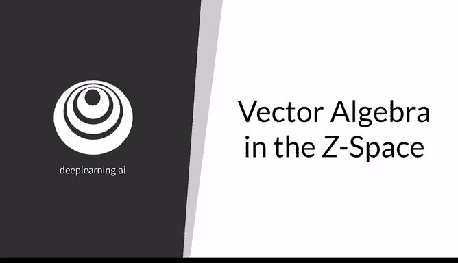
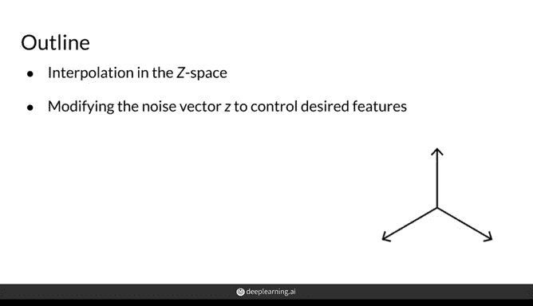
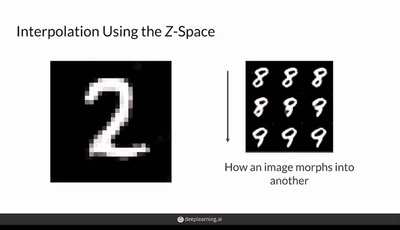
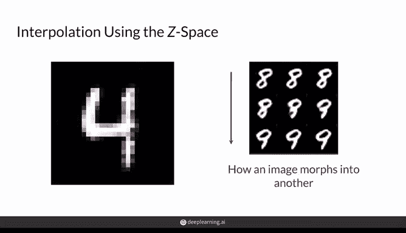
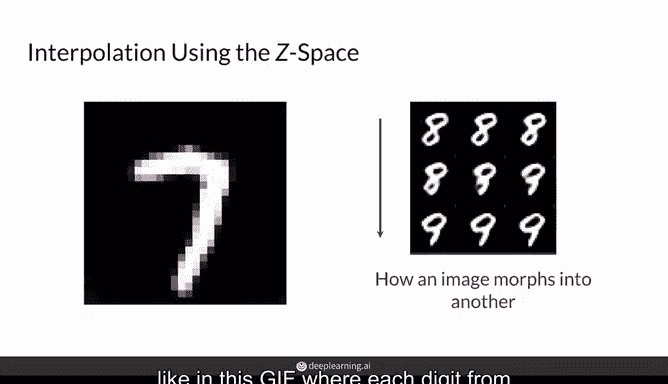
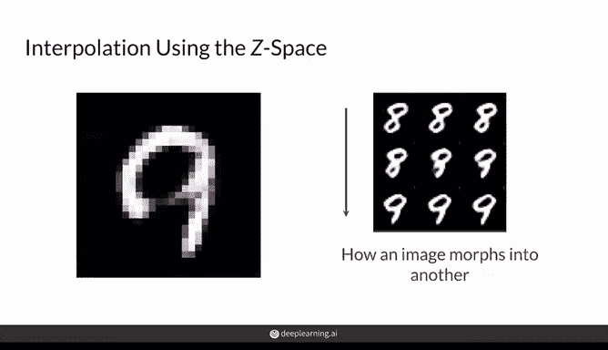
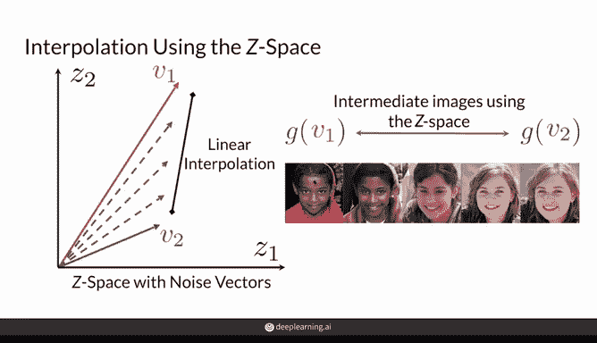
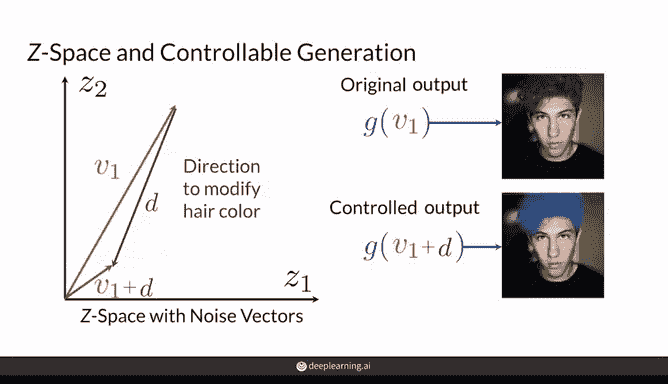
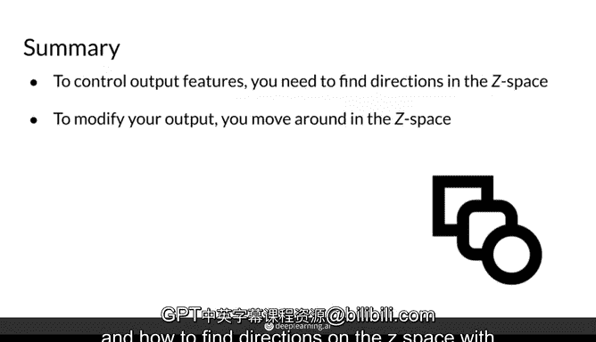

# 吴恩达《生成对抗网络（Generative Adversarial Networks，GAN）》中英字幕 - P31：31_04_06_Z空间中的向量代数.zh_en - GPT中英字幕课程资源 - BV1JC4y1T7vZ

As you've seen in the previous video， controllable generation is cheap by manipulating the noise vector Z that's fed into the generator。

In this video， I'll show you the intuition behind that process。

I'll review how to interpolate between two GN outputs first。

 and you'll learn how to manipulate noise vectors in order to control desired features in your outputs。

So controllable generation and interpolation are somewhat alike with interpolation you get these intermediate examples between two generated observations。

 so in practice with interpolation you can see how an image morphs into another like in this g where each digit from zero to9 morphs into the following one it's pretty cool。

And what happens is that you get intermediate examples between the targets by manipulating the inputs from Z space。

 which is just the name for the vector space of the noise vectors。

 And you'll see later that this is the same idea behind controllable generation。

 And so just to be clear here， Z1 and Z2 are the two dimensions in this z space that you're looking at right now。

 And so as an example， there's a noise vector v1 and a noise vector v2 where V1 could have a z1 value of let's say 5 and a z2 value of let's say。

So then this is the vector 5，10， and then V2 is a smaller value， so 4 and 2。So it's the vector42。

So that's what Z1 and Z2 are just dimensions in the Z space， and the actual vectors。

 V1 and V2 are going to represent concrete vector values in this Z space。 So V1。

 when you feed it into the generator， will produce this image here， and V2。

 when you feed it into the generator will produce this image there。

And so if you want to get intermediate values between these two images。

 you can make an interpolation between their two input vectors， V1 and V2 in the Z space， actually。

And this interpolation is often a linear interpolation。 of of course。

 there are other ways to interpolate between these two vectors。

And then you can take all these intermediate vectors and see what they produce from the generator。

 so the generator takes this vector and produces that image， this vector， that image and this vector。

 that image to get this gradient between these two images。

So controllable generation also uses changes in the Z space and takes advantage of how modifications to the noise vectors are reflected on the output from the generator。

 So， for example， with a noise vector， you could get a picture of a woman with red hair。

 and then with another noise vector， you could get a picture of the same woman， but with blue hair。

And the difference between these two noise vectors is just this direction in which you have to move in Z space to modify the hair color of your generated images。

 So in controllable generation， your goal is to find these directions for different features you care about。

 for example， modifying hair color。 But don't worry about finding that exact direction。 yet。

 I'm going to show you in the following lectures。So with this known direction D。

 let's call this direction D in your Z space， you can now control the features on the output of your G。

 which is really exciting。 So this means that if you then generate an image of a man with red hair produced by the same generator G with this input noise vector here。

 V1。 you can modify the hair color of this man in the image by adding that direction vector D you found earlier to the noise vector creating this new noise vector here。

 V1 plus D passing that into your generator and getting a resulting image where his hair is now blue。

😊。

So to sum up in controllable generation， you need to find the directions in the Z space related to changes of the desired features on the output of your G。

With known directions， controllable generation works by moving the noise vector in different directions in that Z space。

 and up next， you'll learn some challenges related to controllable generation and how to find directions on the Z space with known effects on the generated outputs。

