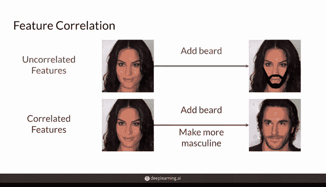
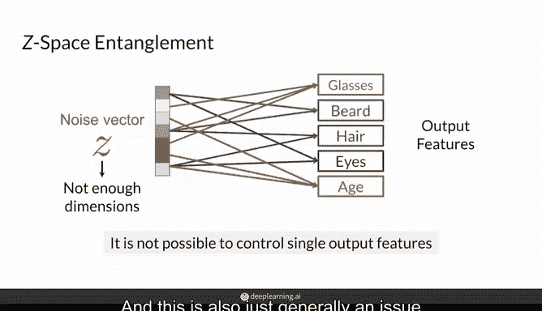
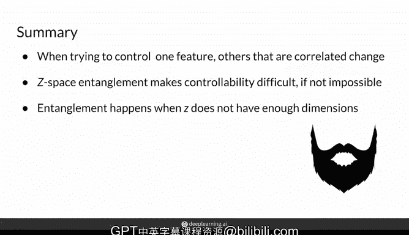

# 吴恩达《生成对抗网络（Generative Adversarial Networks，GAN）》中英字幕 - P32：32_04_07_可控生成的挑战.zh_en - GPT中英字幕课程资源 - BV1JC4y1T7vZ

Controllable generation makes it so that you can decide the features in the output of a G like hair color or hair length in a G that produces pictures of people。

 However， controllable generation has a couple of challenges that you'll see in this video。

Specifically， you'll learn about feature correlation in the output space and Z space entanglement。😊。

So when different features have a high correlation in the data， they use the train your again。

 it becomes difficult to control specific features without modifying the ones that are correlated to them。

So for example， ideally you want to be able to control single features like the amount of beard on a person's face。

 produced by your G and if features in the data set don't happen to have a high correlation。

 you'd be able to take this picture of a woman and add a beard to her by moving in some direction in Z space。

However， it's very likely that in the data set you use for training features like the presence of a beard and how masculine the face looks will be strongly correlated。

So if you want to add a beard to the picture of a woman。

 you'd end up modifying many more features on the output。

But that perhaps is not desirable because you want to be able to find these directions where you can just change one feature about someone that way you can reliably edit images。

Another challenge faced by controllable generation is known as entanglement in the Z space。

 So when the Z space is entangled， movement in the different directions has an effect on multiple features simultaneously in the output。

 Even if those features aren't necessarily correlated in your training dataset。

 This is just how the noise space was learned to be very entangled。 So in this entangled Z space。

 when you control if a person in the output has glasses。 for example。

 youll also end up modifying whether she has a beard in her hair。

 or when you try to modify her apparent age， you'll end up also changing her apparent eyes in hair color too。

 So that's not quite desirable， and the same happens with other uncorrelated features。

 And this means that changes in some of the components of the noise vectors change multiple features in the output at the same time。

 This makes it difficult， if not impossible to control the output。

This is a very common problem when the Z space doesn't have enough dimensions relative to the number of features you want to control in the output。

 because then it actually can't map things one to one。

And this is also just generally an issue in training generative models。

So to recap， controllable generation faces several challenges。

 if features in your data set have a high correlation with each other and you don't account for this in some way。

 then when you try to control the output of your G， you end up changing multiple features at a time。

And even if the features you want to control don't have a high correlation with each other in the training data。

 Patable generation is also difficult if your Z space is entangled。

 which will happen commonly if the number of dimensions in your Z space is not large enough。

 but there are a host of other reasons of why that happens as well。

