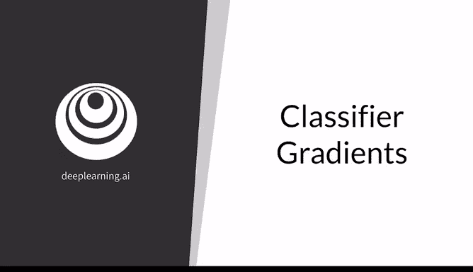
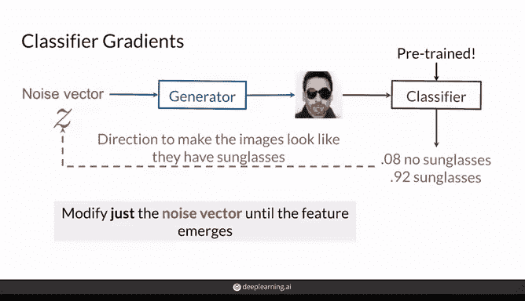
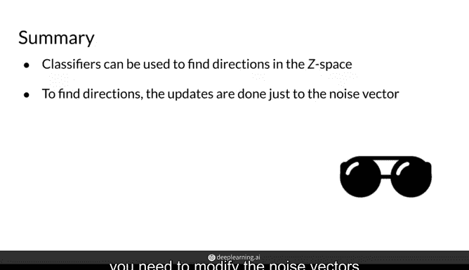

# 吴恩达《生成对抗网络（Generative Adversarial Networks，GAN）》中英字幕 - P33：33_04_08_分类器梯度.zh_en - GPT中英字幕课程资源 - BV1JC4y1T7vZ

Troable generation works by moving in the Z space according to directions that correspond to desired features such as lengthening hair or shortening hair。

In this video you'll learn a very simple method used to find that direction using the gradient of trained classifiers。

 you'll see what the requirements are for this method。

So to find the direction in the Z space that modifies certain features on the output。

 say the precede of sunglasses， you could use a train classifier that identifies if a person in a picture has that said feature。

So to do so， you could take a batch of noise vector Z that goes through the generator to get some images。

You then pass these images through a sunglasses classifier。

 which will tell you if the outputs correspond to people with or without sunglasses。

Then you use that information to modify your Z vectors。

 and this is without modifying the weights of the generator at all。

 so the generator weights are frozen， you're done training。

 and you modify your Z vectors by moving in the direction of the gradient with a cost that penalizes the model for every image classified as not having sunglasses。

So then you repeat this process until the images are classified as people with sunglasses。

So this method is very simple and efficient， and some might argue even lazy because you're using this classifier that's already there for you。

 but I think it's great that you're taking advantage of a pretrain classifier。 However， of course。

 there's also the downside that you need a pre-trained classifier that accurately detects the feature that you want to control beforehand。

 you can also train your own， of course。 So if you wanted a classifier that detected beards。

 for example， you might have to train that on your own if that isn't available off the shelf。

 but you should always check if something is available out there because this could be a really simple and cool way to allow you to start controlling your G。

😊。

So you should take away from this video that pretrained classifiers can be used to find directions in the Z space associated with features in the output of GNS and to find those directions using the gradients of the classifiers you need to modify the noise vectors without changing the generator so remember all of this happens after training。

