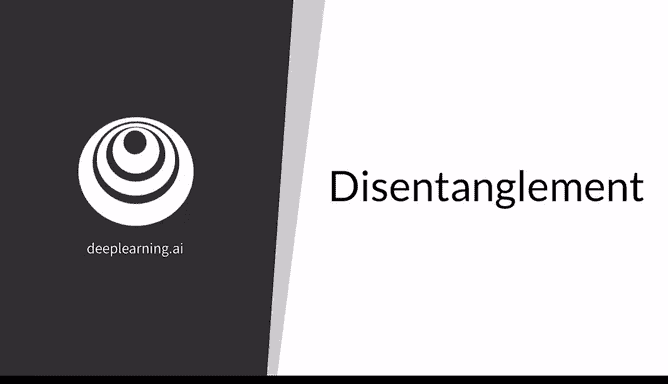
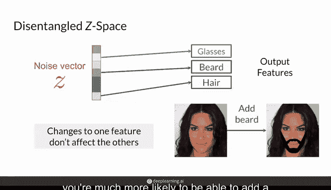
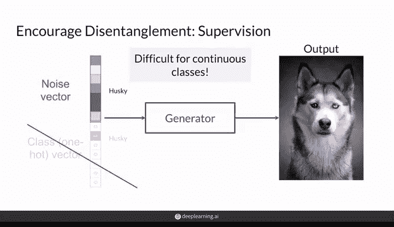
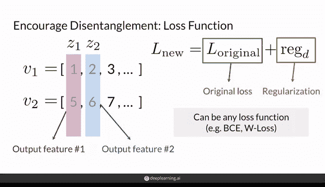
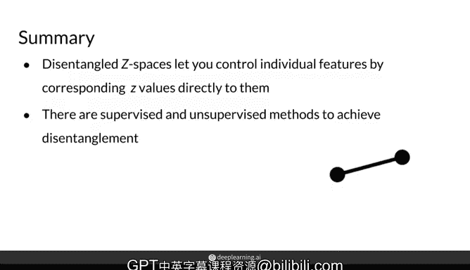

# 吴恩达《生成对抗网络（Generative Adversarial Networks，GAN）》中英字幕 - P34：34_04_09_解耦.zh_en - GPT中英字幕课程资源 - BV1JC4y1T7vZ

Previously， you saw what entanglement in the Z space means and why that's problematic and controllable generation in this video I'll talk about disentanglement and some ways to encourage your model to achieve it。

So first I'll revisit what entangled versus disentangled Z space mean。

 then I'll mention some of the most popular ways to encourage your model to have a disentangled Z space。

So take the following Z noise vectors， V1 and V2 and imagine that these are coming from a disentangled Z space。

 and now here on the right， I'm visualizing two dimensions of that Z space， but of course。

 as you can tell from these noise vectors， there's many more than just two dimensions。Now。

 if this is a disentangled Z space， then each of these positions would correspond to a single feature in the output。

 For example， his first element， this first dimension of the noise vector would correspond to hair color。

 and the second dimension would correspond to hair length and so on。

So if you wanted to change the hair color in a picture。

 you would literally just change the first element on its noise vector or move in the Z1 direction on that seed space。

 and that's all you have to do change the hair color。 and then for hair length。

 you just move in the Cd2 dimension。And that's just changing these values here in the second position。

And also it's quite possible that these noise vectors are disentangled with respect to just these two different features and the rest of the values don't mean anything。

 and this is because you typically want the size of your noise vector to be larger than the number of features you want to control and this makes it easier for your model to learn because it allows these values to take on different things over time during training。

So for example， if you only wanted to control these two features like hair color and hair length。

 then it's probably prudent to make your noise vector larger than just two dimensions。

 but here you see three or more， and these other values won't control a specific feature。

 they just help the model adapt during training。So because the components of the noise vectors in the disentangled Z space allow you to change those features that you desire in the output。

 they're often called latent factors of variation， where the wordlant comes from the fact that the information from the noise vectors is not seen directly on the output。

 but they do determine how that output looks， and sometimes you might hear noise vectors being referred more generally as latetnt。

And then factors of variation means that these are just different factors like hair color in hair length that you want to vary and only that one factor。

 that one feature that you are varying when you're varying it， not anything else。

So essentially a disentangled Z space means that there are specific indices on the noise vectors。

 these specific dimensions that change particular features on the output of yourgan。For instance。

 if a person on the image generated by again has glasses or not。

 or whether she has a beard or some features of her hair。

 So each of these cells will correspond to something that you desire to change。

 and you can just change the values of that dimension in order to adapt glasses， beard or hair。

And a crucial difference between a disentangled Z space and an Nangled Z space is that here。

 with a disentangled Z space， when you control one of the features on the output， for example。

 glasses， the other features remain the same。 So the beard in hair will remain the same。

 Or if I change whether someone has a beard， the glasses and hair will stay the same。

And so what this means is that with a disentangled sea space。

 you're much more likely to be able to add a beard to a person that looks very feminine without changing her hair or her facial features。

So one way to encourage your model to use disentangle these spaces is to label your data and follow a similar process to the one used for conditional generation。

 but in this case the information from the class is embedded in the noise vector so you don't need this extra one hot class information or class vector。

However， using this method could be problematic for continuous classes。

 Imagine having to label thousands of human faces with the length of their hair。 Of course。

 if you do do this， even having a few different classes。

 a few different buckets might actually nudge your generator in the right direction。

So another way to encourage your model is to use a disentangled these space without labeling any of your examples。

 and instead you add a regularization term to the loss function of your choice like BCE or W loss to encourage your model to associate each index from the noise vectors to different features on the output and this regularization could come from classifier gradients。

 and there are also much more advanced techniques to do this in an unsupervised way。

 meaning without any labels。

So in summary， disentangled Z spaces let you control individual output features by corresponding certain Z values directly to desired features you want to control。

And to encourage your model to use disentangled noise vectors。

 you can use both supervised and unsupervised learning methods。

