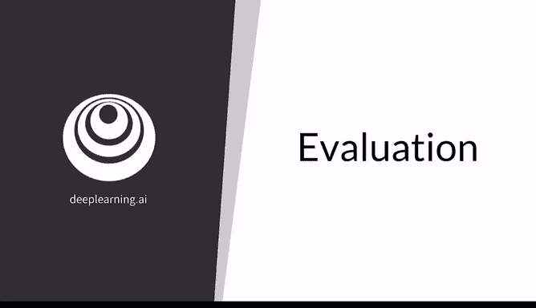
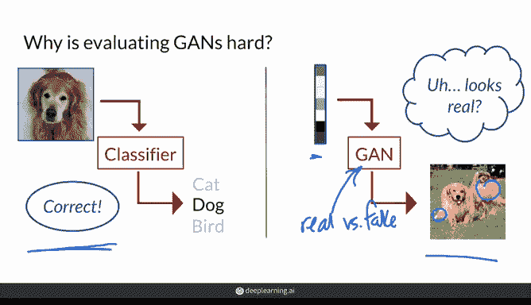
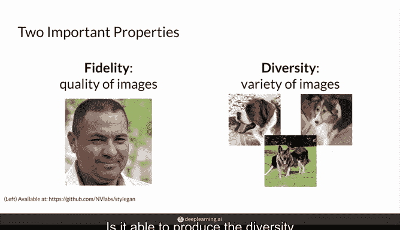
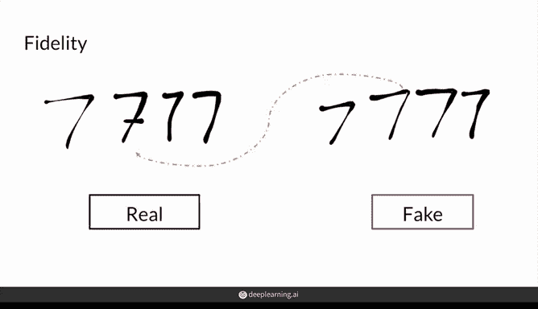
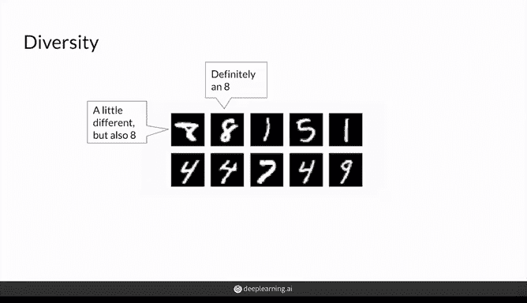
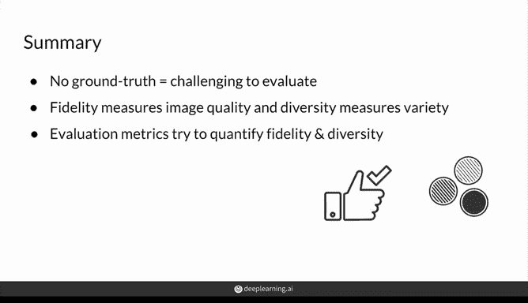

# 吴恩达《生成对抗网络（Generative Adversarial Networks，GAN）》中英字幕 - P37：03_01_05_评估.zh_en - GPT中英字幕课程资源 - BV1JC4y1T7vZ

In this lecture， you'll learn about evaluating GANs。

 starting with understanding a couple criteria or properties you want your GAN to have。

So first you'll see why it's challenging to evaluate again and then you'll learn about two of the most important properties。

 fidelity and diversity。So evaluating GANs is similar to evaluating other models in that you typically take a model checkpoint。

 weights frozen at a certain point， and compare its output against some metrics。

 and these metrics can be used across models not just your own for an independent evaluation。

But evaluating GANS is a particularly challenging task in an active area of research that's seen a lot of progress recently。

 so to illustrate first in supervised learning with a classifier。

 there are tests you can pass on which have labels on how your images should be classified。

And based on these labels， you can evaluate if your model is right or wrong， if it's correct or not。

 you have a sense of correctness here， and usually there's a heldout test set on which you can evaluate how right or wrong your model is。

 and this test set can be used to evaluate your model or other people's models。However， with agan。

 you pass in some random noise to it and you get this fake image。

 but there's no concrete way of telling how realistic these generated images are。

 You don't know the exact pixels it's supposed to generate。 You can't say， oh。

 this pixel right here is slightly off or right there is supposed to be green。

And so because theres that， there's no clear goal for what pixels you're supposed to generate given this noise vector going in。

So this model is more like an advanced artist learning how to paint masterpieces as opposed to learning exact brushstrs in a known painting。

 which is just this correctness from the classifier because there's a clear， right and wrong。

Additionally， the discriminator in this G， which classifies real versus fake。

 doesn't ever reach perfection and often overfits to discriminating real versus fake images for its particular generator。

 so you might think， oh wow， because it's classifying between real and fake images。

 maybe it could be useful for this， but no it's overfitting to your generator。

 so it'll likely think a lot of images from your particular generator。

 even though they look realistic are， in fact fake， because it can pick up on certain qualities。

And so those certain qualities could be small， sometimes even perceptible things that the generator is producing。

Because of this， there are no perfect or universal discriminators that can look at two generators and say for sure that this one is better than the other。

 So then how do you evaluate GNs。 Well， you can start by first defining the desired criteria you want from this properties you might want and one primary property。

 one primary objective is certainly fidelity or the quality of your generated images and how realistic they look。

 and you can think of quality overall and fidelity overall as its realism factor。

 but also the crispness of the image for example， a blurry face could still look realistic。

 but it wouldn't be high fidelity per se。 So the fidelity of this picture of a person is pretty good here。

 but just generating a single image is not what you want from your generator。

 a good generator also produces a good variety of images。

 It wouldn't be very useful to just produce this one image here。

So the second property you typically care about is diversity What's the range。

 what's the variety of images this generator is able to produce is it able to produce the diversity that's inherent in the training dataset or the desired class you're modeling that is of all dogs in this case can it model all types of dogs。

 all breeds of dogs， dogs in different places in different positions or is it just going to generate a single very realistic image like with this face over here and so that's why when you're evaluating again。

 it's important to consider not only fidelity that quality of images which obviously is very important。

 but also this diversity aspect as well of what's the range of images it can generate to get an idea of whether your G covers a good variety of what's expected and real。

And so all of this can be pretty tough because how do you really evaluate or quantify whether something has sufficient diversity when you don't want it to necessarily memorize the training data？

In summary， we have two properties， fidelity and diversity。

 and there are two axes and sometimes you can think of them as trading one off for the other。

So now diving a bit deeper into each of them。So for fidelity。

 you can consider how realistic your images are looking from yourgan so think of it this way。

 So for each fake sample， how different is it from its nearest real sample so you can also think about it more generally as how far are 100 fakes from 100 reels to get a better representation and you don't want to one hit onender G you don't want to miss good and bad high low fidelity samples because those could differentiate this G from another G you want agan that can consistently give you good results。

And so there are a few ways you can do this comparison and you'll learn about some of them later in this course。

On diversity， you want the generated images to cover the whole diversity the variety of the real distribution。

 meaning if a again is only generating the same single image， but it's very realistic。

 that's not a well performingforming model。 You might remember that this is similar to what happens when there is mode collapse。

 So you want a again that can generate a variety of different images such as these8s written in different styles。

 And you can also measure and get a sense of the spread of say。

1 hundred examples to the spread of 100 real ones。So when evaluating GANs fidelity and diversity are both criteria you care about。

By capturing fidelity and diversity， you can get a pretty good notion of how well your generator is generating fake images。

 and this could be just looking through how close your fake images are to your real images。

So in summary it's challenging to evaluate a GAN because there is no global discriminator giving a ground truth that would enable fair comparisons across GNs。

 and to evaluate again， you want to consider fidelity or the quality of images as well as the diversity or variety of those images coming out of your GAN。

And with these properties， these criteria in mind， you'll learn ways you can evaluate your GA in the following videos。

