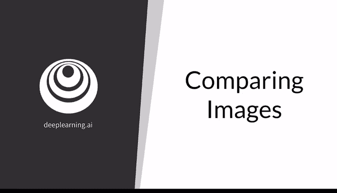
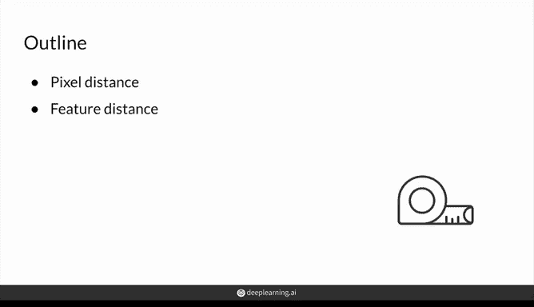
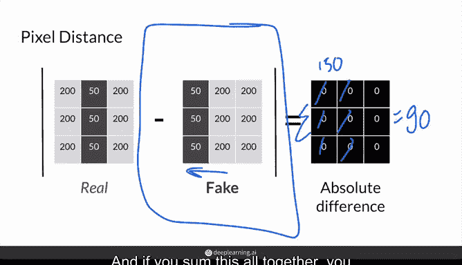
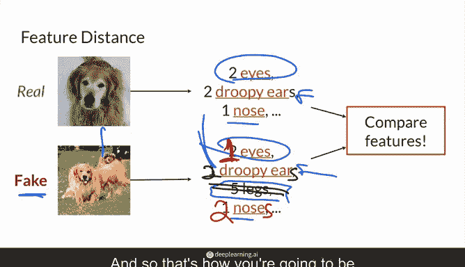
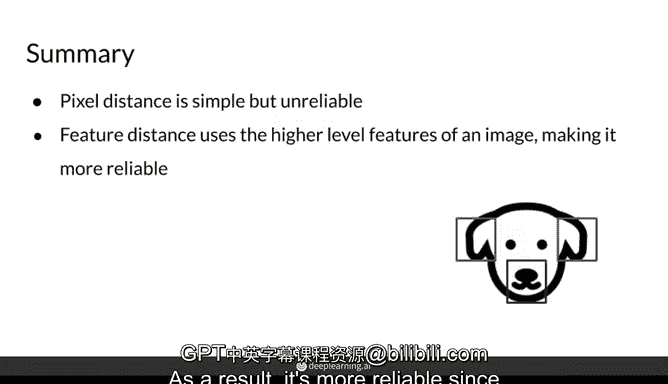

# 吴恩达《生成对抗网络（Generative Adversarial Networks，GAN）》中英字幕 - P38：04_01_06_图像比较.zh_en - GPT中英字幕课程资源 - BV1JC4y1T7vZ

In this video， you'll learn about a way to compare different images， for example。

 real versus fake images in order to evaluate your GN。

Comparing images on fidelity and diversity can be challenging because what exactly should you be comparing？

First you'll explore what pixel distance is， a simple approach but insufficient。

 then you'll get to compare images using feature distance。

 which will give you greater reliability in your comparisons。

So probably the simplest approach to comparing images is looking at the differences between their pixels and this is known as pixel distance。

So with a real image and a fake image here， you can subtract their pixel values。

 a value from 0 to 255 in one image from the other， and then get their absolute difference。

 so you're subtracting each pixel with the other and then you get each of their differences。

And perhaps then you can sum their differences。 And here the total difference is zeros。 So far。

 this looks great because these two images are identical and we get0 out here。

 So they look identical and the absolute difference is0。 so they have no distance from each other。

 perfect。 but pixel distance actually isn't that reliable。😊，For example。

 imagine an image shifted one pixel to the left here in the fake image。

 This would potentially have a huge pixel distance from the original image or from this real image here。

 Even though the images are really similar。 even imperceptibly different to your eye when looking at a。

 say high resolution image with millions of pixels。 So if this image were super large。

 and it only shifted one pixel， you probably wouldn't notice anything。 However。

 based on pixel distance， this absolute difference would then be huge。

 So then all of these values here。Would all evaluate to 150。And if you sum this all together。

 you would get a huge pixel distance of 900。

So one alternative is to look at the higher level features of your images instead of the pixels。

So does a dog have two eyes is the nose under the eyes is their fur。

 And this higher level semantic information would be less sensitive to small shifts。

 So instead of looking at pixels directly， you could condense or explain the image using its features like having two eyes droopy ears and nose。

 And then you can compare the images by using these extracted features。 Okay。

 now I'm going to compare these images at what I call the feature level。

 So looking at their features。 And this is a neat trick for comparing higher level semantic information between images and is pretty common outside ofgans as well。

 So by using these extracted features， your evaluation is less sensitive to small differences in the images。

 And in this example， although the background of the images are different。

 there are boths still identifiable as dogs with pixel distance。

 The fake image would be really far off from the real。

 And you'll see more details on how to get these features as well as calculate the feature distance in the following videos。

😊，And what's interesting here is that you can see that these two images are similar in some ways。

 you know， having both having two eyes， but here this guy has two droopy ears and this one only has one droopy ear and this one seems to have five legs so that seems kind of off。

 you know on the fake side and both of them have a nose。

So you can imagine a fake image that's further away from this reel that only has one eye。

Or two noses。Or one that's closer to your real image that doesn't have any legs and has two droopy ears。

And so that's how you're going to be getting distance between these images。

 It's at this feature level。 So in summary， when evaluating again。

 comparing images with pixel distance is simple， but too sensitive and unreliable。

 feature distance is an alternative to that and works by extracting higher level features instead of pixels to compare your images。

 As a result， it's more reliable since it looks at higher level information。

