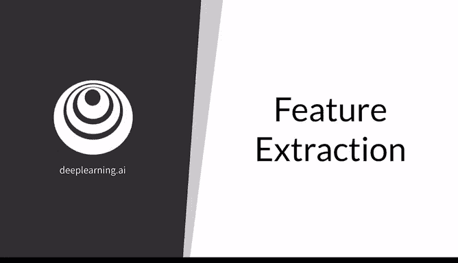
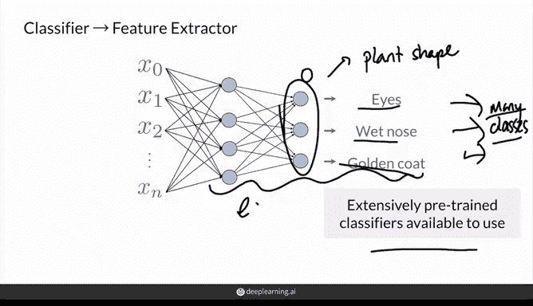
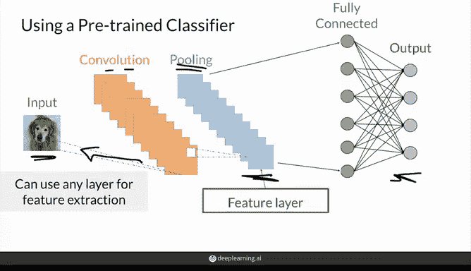
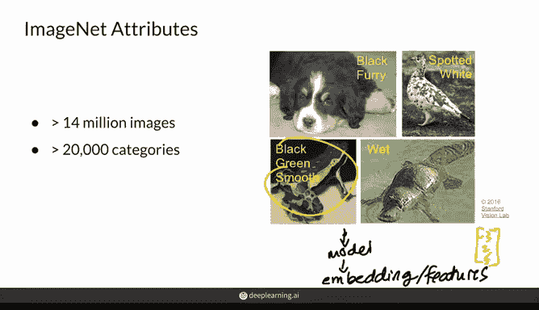
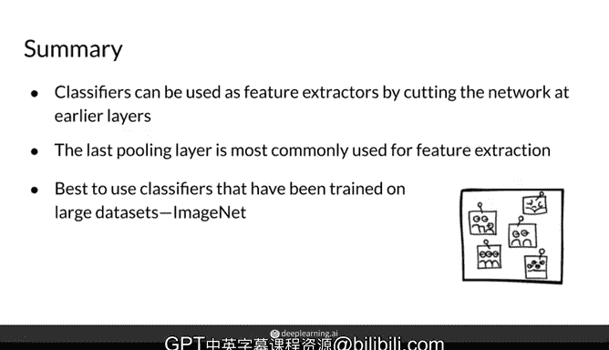

# 吴恩达《生成对抗网络（Generative Adversarial Networks，GAN）》中英字幕 - P39：05_01_07_特征提取.zh_en - GPT中英字幕课程资源 - BV1JC4y1T7vZ

In this video， you'll learn how to extract features from your images。

 and these features are what you'll use when computing feature distance between those images。

So specifically， you'll learn how to extract features using classifiers that have trained on so many images that these classifiers are generally regarded as being able to model natural images or photographs。

 and these many images are typically from the famous large data called ImageNet。

 which I'll also touch up on in this video。So in order to compute the feature distance between real and fake images。

 you first need a way to extract the features from those images。

 you can get a feature extractor by taking the weights of a pre-trained classifier。

 typically on many images and ideally on data and classes that are somewhat related to the features you want to extract。

 for example， if your classifier with classifying dogs and cats。

 then it would be a pretty good feature extractor for dogs and cats but maybe not for office objects。

And the weights of these pretrained models have essentially encoded features a lot of features。

 as they have to， for example， to classify dogs from plants， for example。

 it would have to have figured out what this wet nose golden Co eyes are as well as maybe also what a plant shape looks like。

 and this might not be at the very last layer here。

 this might be an intermediate layer where there are more nodes downstream。

 and they would have to have figured out some of these features along the way。

 although in reality note that these features extracted are a bit more abstract and don't necessarily correspond to our notion of a wet nose or golden Co or a plant shape。

You might be wondering if you need to build and train a new classifier each time you evaluate a GAN Thankly the answer is no as there are neural networks that have been pretrained on millions of images and hundreds or thousands of classes。

 you can plug in and used to extract features from an image input and these images are typically considered broad enough to be applicable to most natural images that is photos of the real world。

 and so these pre-trained classifiers are readily available for public use and offer a method that can be used across a variety of GNs so all different GNs that you train。

So these classifiers can classify many， many different classes， and as a result。

 they encode lots of relevant features in their network。

Alright， so to use this pre-trained classifier， you actually don't want the end task of class at this output。

 you don't care about the actual classifier part， but the rest of the network is valuable It weights have learned important features that help with this classification task at the end So as a result。

 you can lo off this final classification layer and just grab the outputs from an earlier layer that contains useful information about the image you're putting through So here you see the final layers of a generic convolutional neural network or cn a convolution pooling fully connected or linear layer with an activation right after that goes into your output predictions and you can usually lo off this last fully connected layer because the most common place to get output features is the pooling layer before that last fully connected layer that's used for classification because at this layer at this pooling layer you have the most finegra feature information that is this layer must have encoded quite a bit of information so it can then go on past that information on to this fully connected layer。

To classify that image with just one more fully connected layer so you can then truncate the network as you saw with lopping this last part off and use this last pulling layer。

 and this just means the values that come out of this layer。

 you take this essentially intermediate values out and these values。

 let's say there are 100 of them come out from your， let's say， 500 by 500 input。

And so those00 values out here represent the features extracted from this model for this particular input image。

 and you can think of this layer as the feature layer because it is extracting those feature values。

And you can also tell quite immediately that this feature layer will be outputting far fewer values than your input。

 so it condenses the pixel values in your input into these 00 features。

It's also okay to use an earlier layer for your feature layer。

 so using the last layer is just convention because it has most information。

 but it also could be overfit to your data set and task like the classes for your classification out here。

So that means earlier layers are better for getting more primitive information。

 so as you go back along the network to an earlier convolution or typically a pooling layer。

And for those earlier layers on one extreme， if you go to the earliest layer would probably just mean vertical edge detection and be able to extract features around the vertical edges in your input versus the last pool layer out here。

 which will have features that apply to specific image classes like whether there's a cat in the image or not。

 if the output is predicting a cat somewhere here。

So choosing what to call your feature layer is something you can experiment with。

 but I typically suggest starting with this last polling layer because it'll be trained on a huge data set with a broad task。

And that huge data is typically ImageNet。So a good way to start is typically with a classifier that was pretrained on IageNet。

 an ImageNet is a data set with more than 14 million images and 20，000 categories。

 and you can see some of the categories on these images here。

Imta includes various types of dog breeds as well as cat breeds and species and almost any other type of animal you can imagine along with several types of objects。

 and this data essentially provides a plethora of information that can be meaningfully encoded in a classifier that is trained on it。

And the features you extract from that classifier are sometimes known as ImageNet embeddings。

 because they embed and compress that information from an image into a smaller vector of information using the weights from a network trained on this imageNe dataset to then guide that embedding process。

In these features， these embedding are just vectors that exist in what's more broadly known as feature space or embedding space。

 so you can imagine an image like this going in and the output features are really just a vector coming out of negative 32 5 of various values that represent a vector in a certain space which then represent your features。

 and this again can also be known as an embedding。

So in summary， you saw how to get a feature extractor from a pretrained classifier by cutting the network and using weights from the layers before that output layer。

And it's most common to use that last pulling layer， but if you use an earlier layer。

 you can extract more primitive features such as vertical edges or natural looking patterns。

Using a classifier that was trained on large dataset sets such as ImageNe。

 which has millions of images， you can encode really meaningful information on your images as features and in the following lectures。

 you will learn about a popular classifier that uses IageNet data and how it can be used to evaluate your GN。

