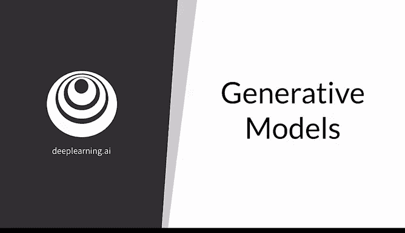
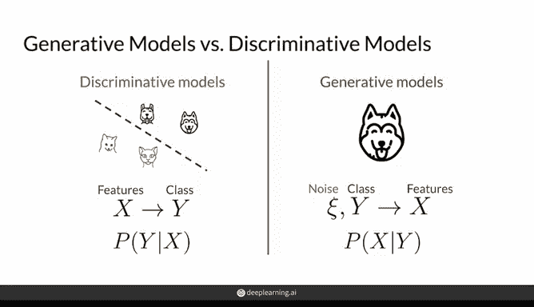
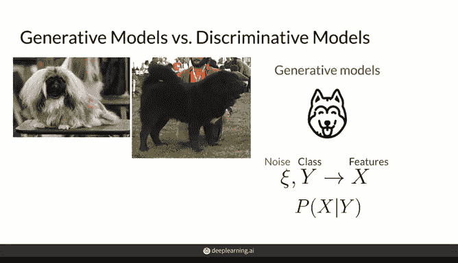
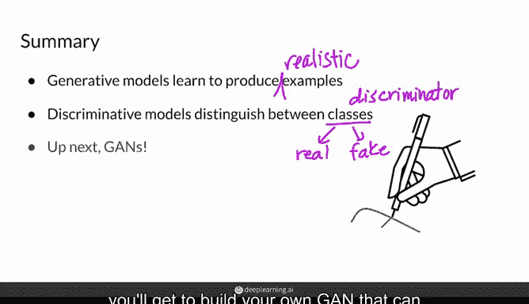

# 吴恩达《生成对抗网络（Generative Adversarial Networks，GAN）》中英字幕 - P3：03_01_05_生成模型.zh_en - GPT中英字幕课程资源 - BV1JC4y1T7vZ

Welcome to the specialization on generative adversarial networks or GANS for short。

You'll see how to build models that can generate realistic images， music， and other things。

In this video， you're going to gain some intuition about how GANs and their family of models work and by the end of the week。

 you get to build your own GAN that generates handwritten digits。

In this video， I'll introduce you to what generative models are， of which GNs are a type。

And how these models compare with other models that you might already know about。

And I'll also talk about two of the most popular geneerative model architectures。

You may be familiar with discriminative models， but you might not have known how they fit into the larger context of machine learning or ML。

A discriminative model is one typically used for classification in machine learning。

They learn how to distinguish between classes such as dogs and cats and are often called classifiers。

Discriminative models take a set of features X， such as having a wet nose or whether it purs。

 and from these features determine a category Y of whether the image is of a dog or a cat。

In other words， they try to model the probability of class Y。😡，Given a set of features。

 X as having a wet nose， but it doesn't par， so it's probably a dog。On the other hand。

 generative models try to learn how to make a realistic representation of some class， for instance。

 a realistic picture of a dog you see here， they take some random input represented by the noise here。

Which could take on the value， let's say three， a random number or negative5。Or 2。6。

 we're actually just a vector of all of those values。

The point is the noise represents a random set of values going into the generative model。

The geneerative model also sometimes takes in a class Y， such as a Do。And from these inputs。

 its goal is to generate a set of features， X that look like a realistic dog。

 So an image of a dog with features such as a wet nose or a tongue sticking out。

So you might wonder why we need this noise in the first place why can't we just tell it， hey。

 generate a dog for me and then it'll generate a dog。

The noise largely here is to ensure that what's generated isn't actually the same dog each time。

 and you'll see this theme play out shortly and this is because generating just one dog is no fun and also a little pointless。

So for now， think of this as some random noise that also goes in as an input。Al right。

 so more generally， geneerative models try to capture the probability distribution of X。

 the different features of having a wet nose， a tongue sticking out。

 maybe be pointy ears sometimes but not all the time， given that class Y of a dog。

And with the added noise， these models would generate realistic and diverse representations of this class Y。

And actually， if you're only generating one class， one y of a dog。

 then you probably don't need this conditioning on Y。

 and instead it's just a probability over all the features X。

And you can see from the side by side comparison that the discriminative models and the generative models actually mirror each other a bit here。

All right， so as an example for a generative model in a good run of a generative model。

 you could get a picture of this pecking geese and in another run a Tibetan mastiff。

And if you continue to run it multiple times without any restrictions。

 you'll end up getting more pictures representing the data set your generative model was trained on。

 and that might look like a lot of Q Labrador retrievers。

There are many types of generative models， and I'll briefly introduce you to the most popular ones。

 variational auto cutters or VAE for short and GNs。VAEs work with two models。

 an encoder and a decoder， and these are typically neural networks。

They learned first by feeding in realistic images into the encoder。

 such as this really realistic image of a dog that I drew。

Then the encoder's job is to find a good way of representing that image in this wonky latent space。

Let's say it finds a place right here。And let's say this point in the latent space can be represented by this vector of numbers。

 6。2 negative 321。And what the VAE does now is take this latent representation or a point close to it and put it through the decoder。

 and the goal of the decoder is to reconstruct the realistic image that the encoder saw before。

So that's assuming the decoder has already been trained to be pretty good。But in the beginning。

 the decoder won't be able to reconstruct the image and maybe the dog produced will have evil eyes。

Now， after training， we actually lop off the encoder and we can pick random points in the latent space。

 such as here， and the decoder will have learned to produce a realistic image of a dog。Now。

 what I just described is largely the auto encoder part， a variational autoender。

The variational part actually injects some noise into this whole model in training process。

 and instead of having the encoder encode the image into a single point in that lane space。

The encoder actually encodes the image onto a whole distribution and then samples a point on that distribution to feed into the decoder to then produce a realistic image this adds a little bit of noise since different points can be sampled on this distribution。

GANs work in a rather different way。 They're composed of two models again。

 but now there is a generator which generates images like the decoder and a discriminator that's actually a discriminative model hidden inside of this。

 so it's a little bit of inception going on。The generator takes in some kind of random noise input。

 as you saw before， for example， 1。23 negative 5 as a vector， and that is input into this generator。

 and of course， an optional class of dog， but if we're just generating dog。

 we don't need to input that。And as an output， it can generate that same dog over time， of course。

 and of course in the beginning it can also be evil。

So the generator's role in some sense is very similar to the decoder in the VAE。

So what's different is that there's no guiding encoder this time that determines what that noise vector should look like that's input into the generator。

Instead， there's a discriminator looking at fake and real images and simultaneously trying to figure out which ones are real and which ones are fake Over time。

 each model tries to one up each other。So these models compete against each other。

 which is why they're called adversarial， in the name generative adversarial networks。

So you can imagine those muscles growing over time as they compete against each other and learn from each other until they reach a point where we。

 again， don't need this second model any more， The discriminator。

 and the generator can take in any random noise and produce a realistic image。 For example。

 a vector of random numbers negative 5，6。2 and 8 can generate this Q Labrador retriever。Alright。

 so during this specialization， you are going to focus on GANs。

 but feel free to read more in VAEs if you find them interesting and don't worry if you don't quite understand how GANs work yet。

 I'm going to dig deeper on their architecture and the way they learn in the upcoming videos this week。

So in summary， generative models learn to produce realistic examples。

 kind of like an artist that can paint paintings that look like photos。Meanwhile。

 discriminative models distinguish between different classes。In summary。

 generative models learn to produce realistic examples。

 such as producing those pictures of cute dogs you just saw。

A generative model is kind of like an artist who's trying to learn how to create photoreistic art。

Meanwhile， discriminative models distinguish between different classes such as a dog or a cat。

But of course， you also saw that a discriminated model can be a subcomponent of a generative model。

 such as the discriminator whose classes are real and fake。There are many kinds of generative models。

 but in this specialization you're going to study GNS， and at the end of this week。

 you'll get to build your own GAN that can be able to produce handra in digits。

How cool is that。 Get ready。