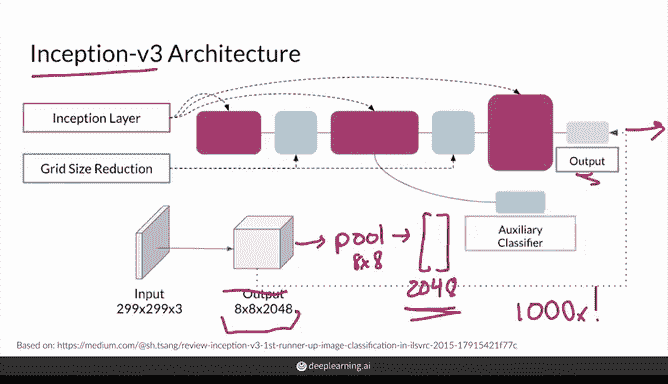
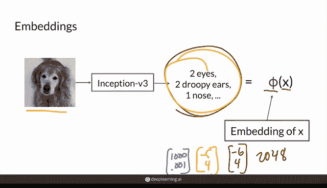
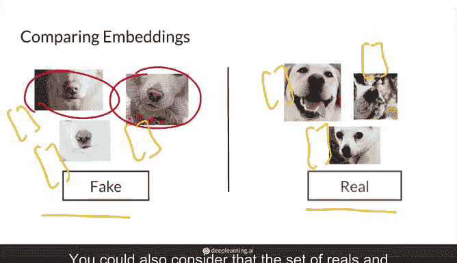
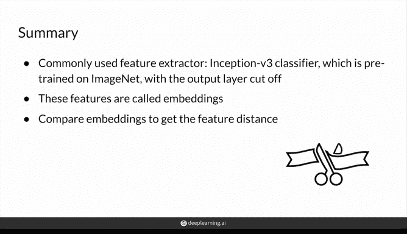

# 吴恩达《生成对抗网络（Generative Adversarial Networks，GAN）》中英字幕 - P40：06_01_08_Inception-v3与嵌入.zh_en - GPT中英字幕课程资源 - BV1JC4y1T7vZ

In this video， you'll learn about the Inception V3 network。

 an intricate convolutional neural network classifier that can be trained on ImageNet。

This section is about the Inception V3 network， how to extract future embeddings from it。

 and then compare those embeddings。 this comparison can then be used to evaluate GANs。

In the last video， you learned that you can use a classifier as a feature extractor。

 specifically one that's been trained on the extensive ImageNet dataset。

The exact network you use can vary， but one of the most common ones to use is inception V3 or inception for short。

 Inception is 42 layers deep， but amazingly caused and computationally efficient and has done well on classification tasks。

 as well as been particularly helpful as a feature extractor。

 And since you'll be using this as a feature extractor for comparing real versus generated images。

 I'll focus there。So this is a representation of the Inception V3 network and you can start by taking this classifier network with the final fully connected layer for classification cutoff and then using the last pooling layer。

 so classification is happening way out here off screen and that's already been cut off and here you see as output you get this8 by A by 2048。

 this is actually not exactly the output， this is what you get out of your last convolutional layer and then you put this into your last pooling layer with an8 byA filter and you get an embedding a vector of size 2048。

And what's amazing is that you only get these 2048 values as your output。

 and this means that given an image， it can condense the pixels of that image to just 2048 values to represent the salient features from that image。

And I keep saying 2048 because it's really not a lot of values compared to many images。

 Many images you see on the web are， let's say 1024 by 1024 pixels with three channels for RGB color。

 together， that's over 3 million pixel values。 So the embedding size of 2048 is over 1000 x smaller。

 That's 1000 x fewer values needed to describe your image。

So doing feature distance seems to be significantly better than pixel distance right now。

It's also useful that your feature extractor compresses information about your image because that allows you to operate on fewer dimensions per image and will also greatly reduce the time it takes to compare a large number of images。

 which you will definitely be doing later on。

So using the Inception V3 network trained to classify images on ImageNet。

 you can now extract features from your images to evaluate your GAN。And again。

 that could be getting features like two eyes， two droopy ears and one nose from this cute dog。

 and of course， the actual features are a bit more abstract than these descriptions and notally this feature extraction model applies a function or a mapping function called Phi on an image X to extract its features an X here can be a real or a fake image and phi here is actually that inception network with a fully connected layer lopped off to get these features of yours and to construct that embedding。

 which is just a vector of again， 2048 values。And again。

 you learn that these extracted features are frequently called an embedding of an image because they're condensed into this lower dimensional space and their placements in this lower dimensional space means something relative to each other。

Were actually embeddings with similar features will be closer together that is take on similar values。

 for example， if you had another dog coming in that is fairly similar to this one。

 perhaps another gold or a retrieve， but it's in a different position or something and you still extract these similar features then perhaps its feature vector will be much closer to that original one so it would have negative5 and4 and let's imagine the other one had negative6 and 4。

And so these two are fairly similar vectors。Now， if you had an image coming in of a chair that looked very different with none of these features。

 then you would have a third feature vector that would be very far from these two， for example。

 1000 here and 0。001。And I'm only showing two dimensions for these embeddings here。

 but remember they have 2048。

So for evaluating again， the next step is to compare those embeddings。

 these extracted features between reels and fakes， and that's typically several reels and several fakes so you get a sufficient representation of images。

 so let's say you have a few fake examples of dogs and when you extract their features into an embedding。

 you find that these embeddings and these are pictorial representations of vector values represent lightcoled dogs with pink noses。

Meanwhile， the feature embeddings of your real images have also light colored dogs。

 but more black noses， and so comparing these images as features will be much more meaningful than comparing them as pixels。

 and remember with simple pixel distance how a slight shift in pixels could actually make two images that are otherwise identical appear completely different。

So these two fairly similar images based on their feature distance would actually be very close because they're both light colored dogs。

 they both have pink noses， but in pixel distance they'd be really far apart because you know this one pixel is very different from that one pixel。

 so they would be a world apart in that pixel distance。

So to get the feature distance you could compare the features directly by subtracting them。

 so let's say you have vectors all around for all of these and you can perhaps take the average of all the fake vectors。

 the average of all the reels and subtract them that's one way and that's similar to how you did pixel distance or you could get the Euclidean or cosine distance between various vectors。

 you could also consider that the set of reels and the set of fakes are some kind of distribution and see how far apart those distributions are。

And in the next video， you'll learn how to calculate a future distance between reels and fakes that's a common method for evaluation。

 so stay tuned。So now you know a fair amount about inception as a classifier pre traineded on Imnet。

 it can also be used as a feature extractor by lopping off that final fully connected layer。

And how those intermediate outputs from that last pulling layer can construct a feature embedding for your input image that can then be used to compare amongst different images。

 namely between real images and fake images and getting a sense of how different they are in this feature space。

