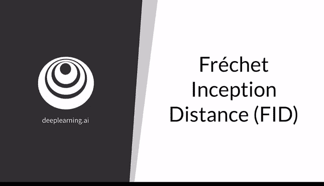
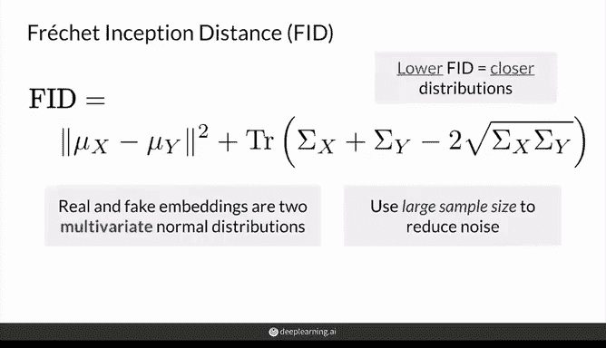
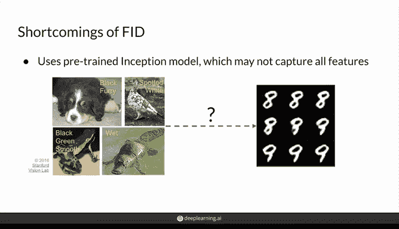
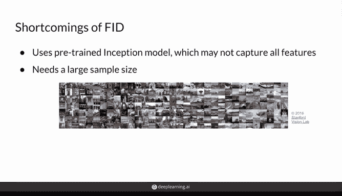
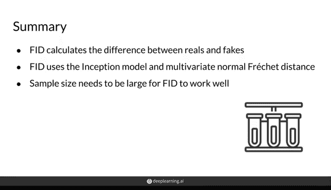

# 吴恩达《生成对抗网络（Generative Adversarial Networks，GAN）》中英字幕 - P41：07_01_09_Frechet起始距离(FID).zh_en - GPT中英字幕课程资源 - BV1JC4y1T7vZ

In this video， you'll learn about Fche Inception distance， or FID。

 the most popular metric for measuring the feature distance between real and generated images。

So first you'll learn about ft distance and then see how you can apply it to real and fakebeddings as Fche inception distance or FID to see how far apart they are Finally you'll learn about a few of FID's limitations evaluation is very much an open area in generative models research。

So Fche distance named after the mathematician Mohe Feche is a distance metric that is used to measure the distance between curves and can be extended to comparing distributions as well。

 The dog walker is a classic example used to illustrate fche distance where the dog is on one curve and the walker is on the other。

 So the dog here is on blue and the walker here is on this orange。 Each can go at their own speeds。

 but neither of them can go backwards。 so keep that in mind。

 So to calculate the fche distance between these curves。

 you need to figure out the minimum leash length needed to walk the curves from beginning to end。😊。

That is what is the least amount of leash you can give your dog without ever having to give them more slack during the walk。

 So that's the intuition behind fche distance between two of these curves here。

 and you can also calculate the fchet distance between distributions。

 There are many distributions for which the fche distance between two distributions is analytically solved and for example。

 there's a simple formula to calculate the ft distance between two single dimensional normal distributions。

 and that's the look at both of the distributions means， which is represented by mu here。

 as well as their standard deviations represented by sigma。

 And so one distribution is x and one is y so you can imagine x and y where x is the dog walker and y's for the dog and the mean gives you a sense of their center and the standard deviation gives you a sense of their spread。

And notationally， you can take the difference between the means and the difference between their standard deviations and then square each of these differences to penalize values further away from each other。

 and also as a notion of L2 distance in some way。So keeping this in mind。

 let's take a quick detour to talk about multivariate normal distributions multivariate normal distributions generalize the idea of a normal distribution to higher dimensions。

 and these extra dimensions allow you to model much more complex distributions than just one parameterized by a single mean in a single standard deviation。

And this is important because the features of your real data probably aren't distributed that nicely in just a single normal distribution。

 There are probably peaks in different areas， modes around certain features like a black nose for dogs or a tongue sticking out。

 a multivariate distribution is one to represent that and a multivariate normal distribution has particularly nice properties。

 so it's often used。 Allright， so thus far the distributions you've seen are univariate。

 meaning it's single dimensional， So the easiest way to visualize a multivariate normal distribution is to have a univariate normal distribution for each dimension here and here。

And these together construct this dark circle looking thing。

 which is actually pointing straight out at you in three dimensions， where darker the values。

 the higher its altitude is。And so this resulting distribution illustrates how much each side varies based on the other。

 how much they affect each other， and here both sides equally contribute to this center and they actually don't affect the other in doing so。

 and so you have this nice round center， normal distribution peak coming out at you。

But we can allow the dimensions to covari， meaning affect each other。

 and this means that certain values in one dimension will cause values in another dimension to become more or less likely。

 so the resulting distribution could look more lopsided like this。

Note that the normals here still look the same， even though they're affecting each other differently。

So in order to express that， you want to use a covariance matrix which generalizes the idea of variance。

 which you've seen as sigma squared， where Sigma on its own is a standard deviation and sigma squared is the variance。

And remember that the variance quantifies the spread of this normal distribution。

 and so covariance is aptly named because it measures the variance between two dimensions。

 So along the diagonals of this covariance matrix， you see variance within a dimension。

 So for example， dimension 1 with dimension 1 and here dimension 2 with dimension 2。

 dimension 1 is over here。 dimension 2 is over there。But on the off diagonal。

 you see these zero values here， this zero value measures dimension 1 to dimension 2。

 and this one is dimension 2 to dimension 1。 And so what this is saying is that the ones here are telling you what the variance is within a dimension and it's just one。

 and if these values were two， for example， then you would see a much wider circle with much more spread a much lower p because it would be spread out much more。

Now， a zero in any cell indicates no variance between those dimensions。

 so this covariance matrix which has zeros in all of the off diagonal elements。

 means that the two dimensions are independent， and again if these values were different。

 say2 or even if it's 0。5， then this peak would be even higher and the spread would be less。

 but these two dimensions would still be independent。So technically here。

 you don't need these covariance values assuming it's independent to fully describe the spread of this distribution。

However， a covariance matrix with non-zero off diagonal elements indicates covariance between the two dimensions。

 and a negative value indicates a negative correlation。

 and you can think of it as the direction here of how this correlation is going。

 so this is along the diagonal y equals negative x。

 and so a positive value in this covariance matrix would actually mean the opposite here like this trending outwards towards you along y equals x instead。

And a value of 0。5 would concentrate the spread more around the center with less magnitude in the covariance while negative 。

5 would do the same in the opposite direction。 Okay。

 so now that you have some intuition behind multivariate normal distributions。

 Let's recall the formula for fche distance on the univariate normal distribution。

 And that was in single dimension space。 So it's the difference between their means and the difference between the same deviations squared。

 And you can actually generalizes to the multivariate case。

 which just means comparing between two multivariant normal distributions that you were just looking at。

 And this is by using its covariance matrices， capital sigma here。

 So there are lots of parallels between the two formulas that can be generalized。 Now。

 this might look daunting at first。 So let's break that down。

So first both formulas include the square of the distance between the means and the multivariate one simply takes the magnitude of the vector since it's no longer a single value。

 that's that norm here。And so in the single dimension， you can actually still write it like this。

 but it does evaluate to exactly this up here。You can also expand the formula for the difference between those standard deviations in the Uniivariate case。

 So if you expand this square here， you will get this term and you can see that you end up with something that is very similar to the multivariate formula where Tr refers to the trace of a matrix。

 which is just the sum of its diagonal elements。 So for example。Two， negative one。

Two that you saw before， the trace would then only look at these elements and take the sum of them。

So the trace of this。be four。And know that the sum of the diagonal elements of say sigma x would actually just be the sum of the variances。

 I。e， the covariance that each dimension has with itself， not with the other dimensions。

The covariance between a dimension and another dimension isn't really considered here when the trace is being used on these guys。

Also everything seems squared in the Uniivevariate case。

 right you have this square here and this is squared relative to this square root。

 and that's because sigma is actually the standard deviation and sigma squared is the variance。

 but this big sigma down here is the covariance and its generalization of sigma squared the variance。

So they do match and finally to be extra clear， this matrix square root down here gets the square root of the matrix not each individual element。

So this multivariant normal fchet inception distance。

 what you need to take away here is just that it's very similar and it's very much just a generalization of the Uniivariate case by looking at differences between both the centers of those distributions and means。

 as well as the spreads of their distributions， the variances or covariances in this case。

So now how is this useful， the multivariate normal distribution can approximately model the many modes in your image features So from your real image feature embeddings。

 you can construct a multivariate normal distribution and this will be based on many。

 say 50000 real embedding vectors looking at how they're distributed in fitting a multinormal distribution to them which just means finding a mean and covariance matrix across all of these examples and so now you do the same for your fakes you get their feature embeddings。

 you fit a multivariate normal distribution on it， and then now you can compare the two multivariate normal distributions。

 the reels which I'll call x the fakes which I'll call y and that just corresponds to these up here where mu x is the mean of the real embeddings mu y is the mean of the fake embeddings Sigma X is the covariance matrix of the real embeddings and sigma Y is the covariance matrix of the fake embeddings which are then again used here So now between the real。

In the fakes you can first apply embeddings to those images。

 fit a multivariant normal distribution to each and then compute the FID score on them and so this is called Fche Inception distance or FID and it's currently the most widely used GAN evaluation metric you understood if Ft distance and inception just refers to using the inception V3 network to extract those features。

 those embeddings for reels and for fakes。So stepping back。

 FID looks at the statistics of the real multivariant normal distribution and the statistics of the fake multivariant normal distribution。

 where the statistics are just mean and covariance matrices and calculates how far apart those statistics are from each other。

 where the closer those statistics are to each other。

 the closer the fake embeddings model the real embedding。Now。

 FID does assume that the embeddings take on a multivariant normal distribution。

 not because it's always perfectly accurate， but mainly because it's approximate and easy to compute。

All right， so when all is computed here， you're left with a number that represents the difference between the real and the fake distributions。

If the fake is close to the real， meaning your model is generating fake outputlets close to the real。

 the lower this difference this number is so a smaller value actually means that features in the reels and fakeakes are more similar to each other。

 so that means lower the FiD， the better and this can sometimes trip people up because other evaluation metrics lean towards higher values being better But now for FiID lower is better because it's how far apart fakes are from reals。

Unfortunately， there isn't a super interpretable range for FiID values。

 wouldnn't it be great if the values were between 0 and1 and 。5 meant half or fake。

 that's not the case for FiID， but generally the closer you are to 0， the better because at zero。

 your fakes are indistinguishable from the reels based on those statistics computed from many of their embeddings。

Okay，To give a sense of the scale of this computation。

 recall that there are typically 2048 dimensions in a feature vector or embedding from the inception network。

 FID typically is calculated over a large number of samples， say at least 50，000 reels and 50。

000 fakes， and so using a large number of samples reduces the noise and selection bias you'd have if comparing between say just a couple of samples。

Additionally， the Imnet pretrained Inception V3 model doesn't always get the features you want。

 or they don't always make sense for your generator's task。 for example。

 if yourganda is trained on MNIS to generate handwritten digits。

 the inception V3 model might not be able to detect meaningful features since Imnet is composed of natural photos like dogs and humans and quite frankly a lot of dogs。

Also， as stated before， the sample size needs to be large for both sufficient coverage of samples and your FiD score is biased。

 which means that your FiD score will change based on the number of samples you use。

 which isn't great because yourgan isn't changing nor are the real samples。

 So the number of samples shouldn't impact the score。 but lo and behold。

 FiD is typically lower for larger sample sizes。 So the more sample you use。

 the better yourgan will seem to be， even if it actually isn't better because you're using the same model to compare。

 and this isn't a good property to have in a metric。

 but there's certainly research trying to overcome this creating an unbiased Fi， for example。

 but that method isn't widely used。 The large sample size also leads to FiD being slow to run。

Lastly， there are a limited number of statistics gathered on those distributions。

 only mean covariance， which are the first two moments of a distribution or properties of that distribution。

 and there are many other moments of a distribution like skeU and ktosis that you might be familiar with just to remember that mean and covariance don't cover all aspects of the distribution and the distribution also is likely not exactly multivariant normal and we're largely getting just mean and covariance because we're assuming that the distribution is multivariate normal。

 but the distribution of your samples also is likely not exactly multivariant normal。

 but that assumption is made to make the computation of statistics in comparison much easier。

So these shortcomings unfortunately mean that you still need to qualitatively look over your samples to find the model you want and to debug your model。

 and the problem is that existing evaluation metrics are not exactly the best indicator of progress now。

Nevertheless， FID is still one of the most popular ways to evaluate your GAN because it's easy to implement and use。

All right， that was a beefy video， in summary you learned how FID calculates the difference between the real and fake embeddings by using Fche dis。

There are a few shortcomings to FID that make it so you should still be babysitting your model and checking out its samples instead of just comparing FID scores between saved model checkpoints during training to decide which one is best。

